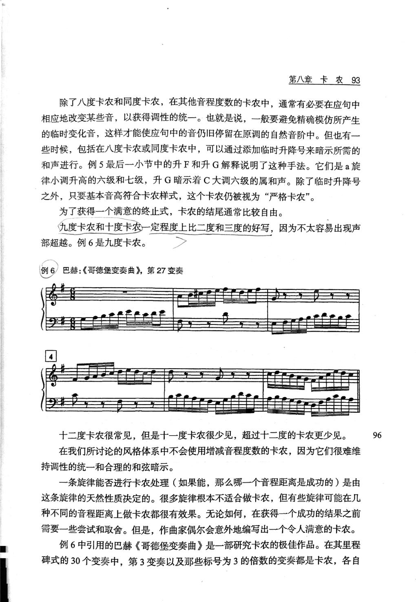
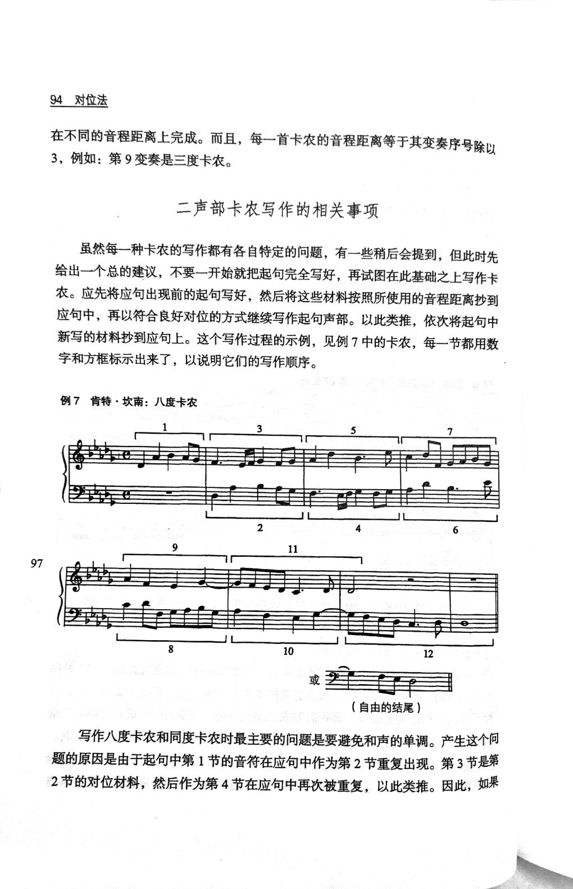
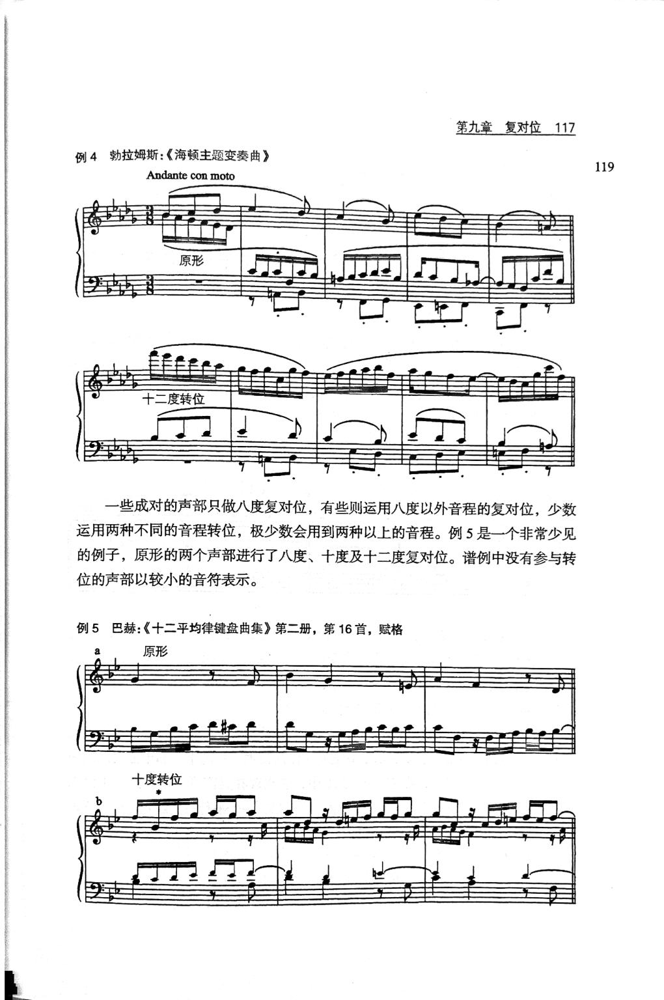

# 对位法 · 教材原页

肯特·坎南 · 3 个已引用页 · PDF 物理页码

> OCR 仅用于检索；谱例与临时记号以扫描图为准。

## PDF 第 107 页



### OCR

```text
第八章卡农93
除了八度卡农和同度卡农，在其他音程度数的卡农中，通常有必要在应句中
相应地改变某些音，以获得调性的统一。也就是说，一般要避免精确模仿所产生
的临时变化音，这样才能使应句中的音仍旧停留在原调的自然音阶中。但也有一
些时候，包括在八度卡农或同度卡农中，可以通过添加临时升降号来暗示所需的
和声进行。例5最后一小节中的升F和升G解释说明了这种手法。它们是a旋
律小调升高的六级和七级，升G暗示着C大调六级的属和声。除了临时升降号
之外，只要基本音高符合卡农样式，这个卡农仍被视为“严格卡农”。
为了获得一个满意的终止式，卡农的结尾通常比较自由。
九度卡农和十度卡农一定程度上比二度和三度的好写，因为不太容易出现声
部超越。例6是九度卡农。
巴赫：《哥德堡变奏曲》，第27变奏
例6
4
十二度卡农很常见，但是十一度卡农很少见，超过十二度的卡农更少见。
96
在我们所讨论的风格体系中不会使用增减音程度数的卡农，因为它们很难维
持调性的统一和合理的和弦暗示。
一条旋律能否进行卡农处理（如果能，那么哪一个音程距离是成功的）是由
这条旋律的天然性质决定的。很多旋律根本不适合做卡农，但有些旋律可能在几
种不同的音程距离上做卡农都很有效果。无论如何，在获得一个成功的结果之前
需要一些尝试和取舍。但是，作曲家偶尔会意外地编写出一个令人满意的卡农。
例6中引用的巴赫《哥德堡变奏曲》是一部研究卡农的极佳作品。在其里程
碑式的30个变奏中，第3变奏以及那些标号为3的倍数的变奏都是卡农，各自
```

<a id="claim-canon.interval-adjust"></a>
### 非八度卡农要作调性调整

精确移位可能把旋律带入临时升降号或远关系。为了留在原调，常须在应句中改动个别音；这种调整不破坏卡农关系。

> “在其他音程度数的卡农中，通常有必要在应句中相应地改变某些音，以获得调性的统一。”

[返回手册](../复调音乐手册.html#canon)

## PDF 第 108 页



### OCR

```text
94对位法
3，例如：第9变奏是三度卡农。
二声部卡农写作的相关事项
虽然每一种卡农的写作都有各自特定的问题，有一些稍后会提到，但此时先
给出一个总的建议，不要一开始就把起句完全写好，再试图在此基础之上写作卡
农。应先将应句出现前的起句写好，然后将这些材料按照所使用的音程距离抄到
应句中，再以符合良好对位的方式继续写作起句声部。以此类推，依次将起句中
新写的材料抄到应句上。这个写作过程的示例，见例7中的卡农，每一节都用数
字和方框标示出来了，以说明它们的写作顺序。
例7肯特·坎南：八度卡农
2
97
10
12
（自由的结尾）
写作八度卡农和同度卡农时最主要的问题是要避免和声的单调。产生这个问
题的原因是由于起句中第1节的音符在应句中作为第2节重复出现。第3节是第
```

<a id="claim-canon.process"></a>
### 卡农按“先写露出部分，再抄写，再续写”推进

不要先写完主句再硬配应句。先写应句进入前的主句片段，按音程抄入应句，再写主句与已出现的应句相对的部分，逐段推进。

> “不要一开始就把起句完全写好，再试图在此基础之上写作卡农。应先将应句出现前的起句写好，然后将这些材料按照所使用的音程距离抄到应句中，再以符合良好对位的方式继续写作起句声部。”

[返回手册](../复调音乐手册.html#canon)

## PDF 第 131 页



### OCR

```text
第九章复对位117
例4勃拉姆斯：《海顿主题变奏曲》
119
Andante con moto
原形
度转位
一些成对的声部只做八度复对位，有些则运用八度以外音程的复对位，少数
运用两种不同的音程转位，极少数会用到两种以上的音程。例5是一个非常少见
的例子，原形的两个声部进行了八度、十度及十二度复对位。谱例中没有参与转
位的声部以较小的音符表示。
例5巴赫：《十二平均律键盘曲集》第二册，第16首，赋格
原形
十度转位
```

<a id="claim-invert.multiple"></a>
### 同一对声部可以同时为多种转位写作

八度、十度、十二度转位可以叠加。能同时在多个位置成立，意味着同一素材可用于呈示、中间部与再现的声部交换。

> “一些成对的声部只做八度复对位，有些则运用八度以外音程的复对位，少数运用两种不同的音程转位。”

[返回手册](../复调音乐手册.html#invertible)
