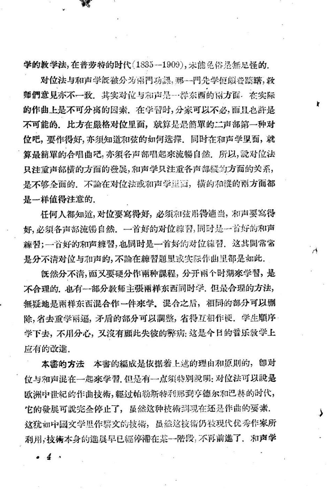
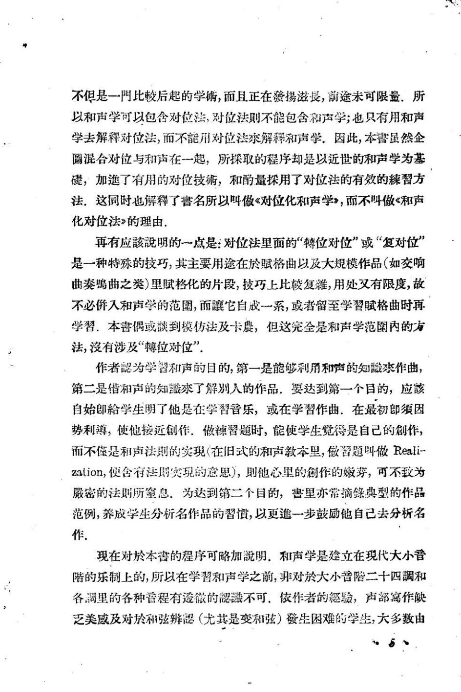

# 对位化和声学 · 教材原页

陈洪 · 2 个已引用页 · PDF 物理页码

> OCR 仅用于检索；谱例与临时记号以扫描图为准。

## PDF 第 13 页



### OCR

```text
学的教学法，在普劳特的时代（1835一1909），米能免俗是然足怪的
对位法与和声学既被分为雨門功课，那一門先学便顾蓉踪購，教
师們意見亦不一致.其实对位与和声是一样东西的雨方面，在实际
的作曲上是不可分离的因素.在学替时，分蒙可以不必，前且也許是
不可能的.比方在最格对位里面，就算是最簡單的二声部第一种对
位吧，要作得好，亦须知道和弦的如何选選，同时在和声学里面，就
算最簡單的合唱曲吧，亦须各声部唱起來流蜴自然.所以，对位法
只注重声部横的方面的發展，和声学只注重各声部的方面的关系，
是不够全面的.不论在对位法或和声学望面，横的和赞的两方面都
是一样值得注意的.
任何人都知道，对位要寫得好，必须和弦用得適当，和声要寫得
好，必须各声部流自然.一首好的对位留，同时是一首好的和声
習；一首好的和声棘習，也同时是一首好的对位颖留.这其間常常
是分不清对位与和声的，不在習题里或实际作曲里都是如此，
既然分不满，而又要硬分作雨种課程，分开雨个时期学習，是
不合理的.也有一部分教师主张雨样东西同时学，但最合理的方法，
無疑地是雨样东西混合作一件來学.混合之后，相同的部分可以删
除，省去重学雨逼，矛盾的部分可以整，省得互相作硬.学生顺序
学下去，不用分心，叉有此失彼的病：这是今日的普乐教学上
应有的改進。
本鑫的方法本害的成是依据着上越的理由和原则的，即对
位与和声混在一起來学習.但是有-一点特别明：对位法可以是
欧洲中世纪的作曲技，經过帕勒斯特利那到享德尔和巴赫的时代，
它的發展可完全停止了，虽然这种技到現在还是作曲的要素
这犹如中國文学里作骄文的技，虽然这技销仍被现代优秀作家所
利用，技術本身的進展早已經停滞在某一陪段，不再前進了，和声学
·4。
```

<a id="claim-hist.style-system"></a>
### 对位规则依附于当时的调式与和声语言

分类对位不是超历史的自然法。文艺复兴调式、巴洛克大小调与二十世纪音高组织，会改变什么算协和、什么算必须解决的 dissonance。

> “对位法可以是欧洲中世纪的作曲技，經过帕勒斯特利那到享德尔和巴赫的时代，它的發展可完全停止了”

[返回手册](../复调音乐手册.html#periods)

## PDF 第 14 页



### OCR

```text
不但是一門比较后起的学铺，而且正在發揚滋長，前途未可限量，所
学去解释对位法，而不能用对位法來解释和声学，因此，本营虽然企
圖混合对位与和声在一起，所探取的程序却是以近世的和声学为基
磅，加進了有用的对位技，和酌量探用了对位法的有效的辣習方
法.这同时也解释了書名所以叫做《对位化和声学》，而不叫做《和声
化对位法》的理由.
再有应該明的一点是：对位法里面的“轉位对位”或“复对位”
是一种特殊的技巧，其主要用途在於赋格曲以及大规模作品（如交响
曲奏曲之类）里赋格化的片段，技巧上比较复雜，用处叉有限度，故
不必佛入和声学的范圍，而它自成一系，或者留至学習赋格曲时再
学習.本書偶或谈到模仿法及卡農，但这完全是和声学范圍内的方
法，没有涉及“轉位对位”
第二是借和声的知誠來了解别人的作品，要达到第一个自的，应該
自始即学生明了他是在学習音乐，或在学習作曲，在最初即须因
势利遵，使他接近創作.做辣智题时，能使学生觉得是自己的創作，
而不是和声法则的实现（在旧式的和声教本里，做智题叫做Reali-
zation，使舍有法期实現的意患），则他心里的創作的嫩芽，可不致为
密的法则所室息，为达到第二个目的，害里亦常摘錄典型的作品
范例，养成学生分析名作品的習惯，以更進一步鼓励他自已去分析名
作。
现在对於本普的程序可略加明.和声学是建立在现代大小音
隋的乐制上的，所以在学習和声学之前，非对於大小音二十四和
各調里的各种香程有透微的誠不可，依作者的經驗，声部寫作缺
乏美感及对於和弦辨（尤其是变和弦）發生困难的学生，大多数由
```

<a id="claim-hist.tonal-basis"></a>
### 巴洛克赋格以大小调功能和声为底层

主题、答题、对题与间插段不只是旋律模仿；它们同时承担主属关系、离调、终止与低音持续。

> “以近世的和声学为基磅，加進了有用的对位技”

[返回手册](../复调音乐手册.html#periods)
