# 赋格学新论 · 教材原页

陈铭志 · 12 个已引用页 · PDF 物理页码

> OCR 仅用于检索；谱例与临时记号以扫描图为准。

## PDF 第 20 页

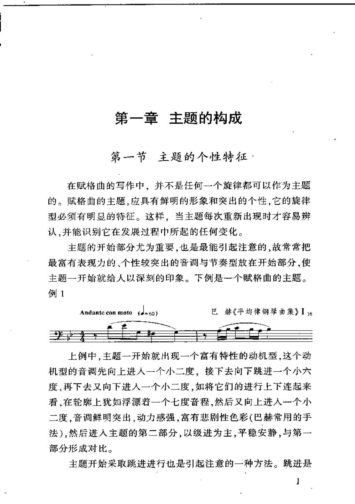

### OCR

```text
第一章主题的构成
第一节主题的个性特征·
在赋格曲的写作中，并不是任何一个旋律都可以作为主题
的。赋格曲的主题，应具有鲜明的形象和突出的个性，它的旋律
型必须有明显的特征。这样，当主题每次重新出现时才容易辨
认，并能识别它在发展过程中所起的任何变化。
主题的开始部分尤为重要，也是最能引起注意的，故常常把
最富有表现力的、个性较突出的音调与节奏型放在开始部分，使
主题一开始就给人以深刻的印象。下例是一个赋格曲的主题。
例1
巴赫《平均律钢琴曲集》I6
（=60)
Andantc con moto
上例中，主题一开始就出现一个富有特性的动机型，这个动
机型的音调先向上进人一个小二度，接下去向下跳进一个小六
度，再下去又向下进人一个小二度，如将它们的进行上下连起来
看，在轮廓上犹如浮漂若一个七度音程，然后又向上进人一个小
二度，音调鲜明突出，动力感强，富有悲剧性色彩（巴赫常用的手
法），然后进人主题的第二部分，以级进为主，平稳安静，与第一
部分形成对比。
主题开始采取跳进进行也是引起注意的一种方法。跳进是
```

<a id="claim-fugue.subject-identity"></a>
### 主题必须可辨认、可重复、可发展

主题不是随便一句旋律。首部要有清楚的动机与节奏标记，使它在转调、扩大、倒影或密接中仍能被听出；同时要能承载答题、对题和间插段。

> “赋格曲的主题，应具有鲜明的形象和突出的个性，它的旋律型必须有明显的特征。”

[返回手册](../复调音乐手册.html#fugue-subject)

## PDF 第 38 页

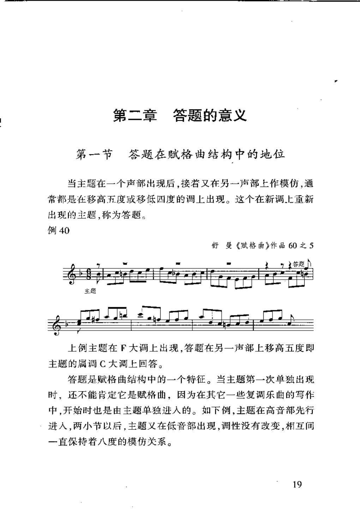

### OCR

```text
第二章答题的意义
第一节答题在赋格曲结构中的地位
当主题在一个声部出现后，接着又在另一声部上作模仿，通
常都是在移高五度或移低四度的调上出现。这个在新调上重新
出现的主题，称为答题。
例40
舒曼《赋格曲》作品60之5
答题
主题
上例主题在F大调上出现，答题在另一声部上移高五度即
主题的属调C大调上回答。
答题是赋格曲结构中的一个特征。当主题第一次单独出现
时，还不能肯定它是赋格曲，因为在其它一些复调乐曲的写作
中，开始时也是由主题单独进人的。如下例，主题在高音部先行
进人，两小节以后，主题义在低音部出现，调性没有改变，相互间
一直保持着八度的模仿关系。
19
```

<a id="claim-fugue.answer-dominant"></a>
### 答题是主题在属方向的回答

答题不是新主题。它通常把主题移高五度或移低四度，使呈示部的主、属两极建立起来；答题的尾部若回主调，就完成一次调性往返。

> “当主题在一个声部出现后，接着又在另一声部上作模仿，通常都是在移高五度或移低四度的调上出现。这个在新调上重新出现的主题，称为答题。”

[返回手册](../复调音乐手册.html#fugue-answer)

## PDF 第 53 页

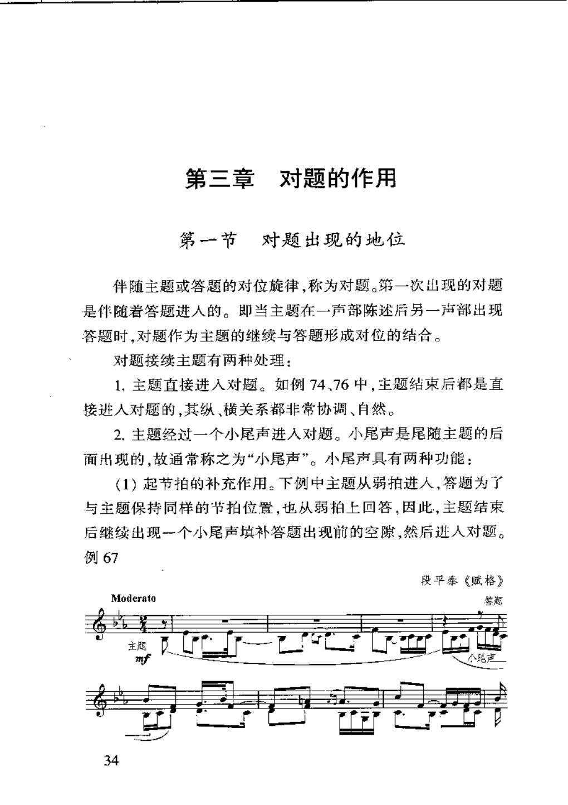

### OCR

```text
第三章对题的作用
第一节对题出现的地位
伴随主题或答题的对位旋律，称为对题。第一次出现的对题
是伴随着答题进人的。即当主题在一声部陈述后另一声部出现
答题时，对题作为主题的继续与答题形成对位的结合。
对题接续主题有两种处理：
1.主题直接进人对题。如例74、76中，主题结束后都是直
接进人对题的，其纵、横关系都非常协调、自然。
2.主题经过一个小尾声进人对题。小尾声是尾随主题的后
面出现的，故通常称之为“小尾声”。小尾声具有两种功能：
（1）起节拍的补充作用。下例中主题从弱拍进人，答题为了
与主题保持同样的节拍位置，也从弱拍上回答，因此，主题结束
后继续出现一个小尾声填补答题出现前的空隙，然后进人对题。
例67
段平泰《赋格》
Moderato
答蔻
主题
mf
34
```

<a id="claim-fugue.countersubject"></a>
### 对题在答题进入时形成，固定对题要与主题构成可转位关系

对题不是伴奏。它在答题出现时与主题的声部继续对位，常以节奏和音调的对比补足主题；若每次随主题出现，就须按二重对位写作，使上下交换仍成立。

> “伴随主题或答题的对位旋律，称为对题。第一次出现的对题是伴随着答题进入的。”

[返回手册](../复调音乐手册.html#fugue-countersubject)

## PDF 第 68 页

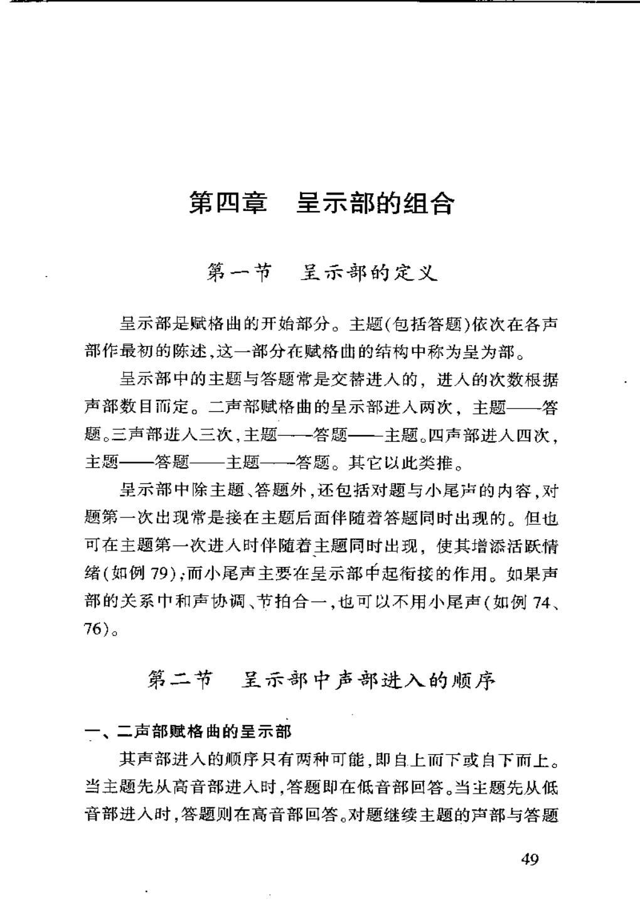

### OCR

```text
第四章呈示部的组合
第一节呈示部的定义
呈示部是赋格曲的开始部分。主题(包括答题)依次在各声
部作最初的陈述，这一部分在赋格曲的结构中称为呈为部。
呈示部中的主题与答题常是交替进人的，进人的次数根据
声部数目而定。二声部赋格曲的呈示部进人两次，主题—答
题。三声部进人三次，主题一一答题—主题。四声部进人四次，
主题—答题——主题——答题。其它以此类推。
呈示部中除主题、答题外，还包括对题与小尾声的内容，对
题第一次出现常是接在主题后面伴随若答题同时出现的。但也
可在主题第一次进人时伴随着主题同时出现，使其增添活跃情
绪（如例79)；而小尾声主要在呈示部中起衔接的作用。如果声
部的关系中和声协调、节拍合一，也可以不用小尾声（如例74、
76)。
第二节呈示部中声部进入的顺序
一、二声部赋格曲的呈示部
其声部进人的顺序只有两种可能，即自上而下或自下而上。
当主题先从高音部进人时，答题即在低音部回答。当主题先从低
音部进人时，答题则在高音部回答。对题继续主题的声部与答题
49
```

<a id="claim-fugue.exposition-order"></a>
### 呈示部按声部数完成主题与答题的交替

二声部是主题—答题；三声部是主题—答题—主题；四声部是主题—答题—主题—答题。每次进入都应有清楚的音区与声部定位。

> “二声部赋格曲的呈示部进入两次，主题—答题。三声部进入三次，主题—答题—主题。四声部进入四次，主题—答题—主题—答题。”

[返回手册](../复调音乐手册.html#fugue-exposition)

## PDF 第 96 页

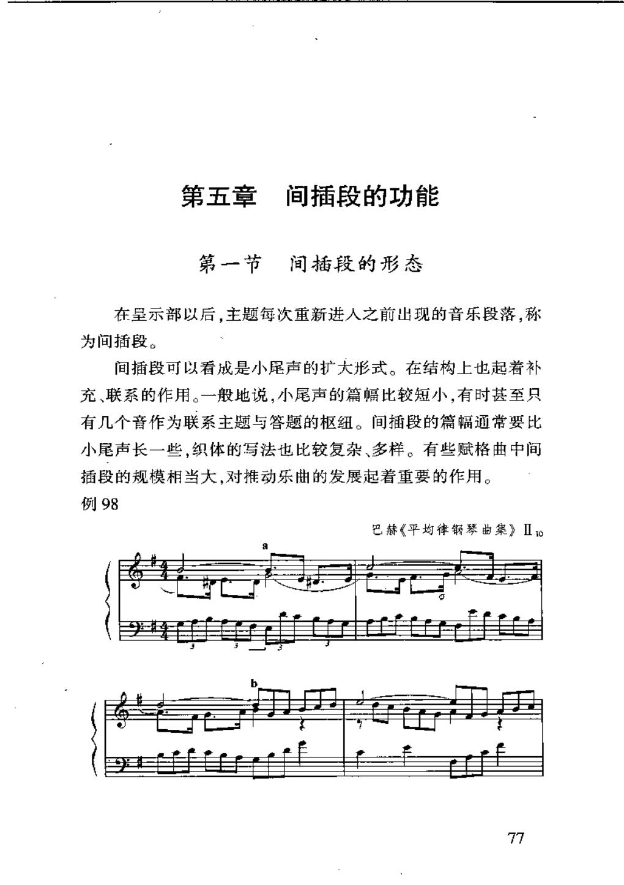

### OCR

```text
第五章
间插段的功能
第一节间插段的形态
在呈示部以后，主题每次重新进人之前出现的音乐段落，称
为间插段。
间插段可以看成是小尾声的扩大形式。在结构上也起着补
充、联系的作用。一般地说，小尾声的篇幅比较短小，有时甚至只
有几个音作为联系主题与答题的枢纽。间插段的篇幅通常要比
小尾声长一些，织体的写法也比较复杂、多样。有些赋格曲中间
插段的规模相当大，对推动乐曲的发展起着重要的作用。
例98
巴赫《平均律琴曲集》Ⅱto
77
```

<a id="claim-fugue.episode-definition"></a>
### 间插段位于主题再次进入之前

间插段不是主题陈述，而是连接。它通常从主题或对题抽取动机，以模进、模仿或转位推进和声，并把音乐送到下一调的入口。

> “在呈示部以后，主题每次重新进入之前出现的音乐段落，称为间插段。”

[返回手册](../复调音乐手册.html#fugue-episode)

## PDF 第 98 页

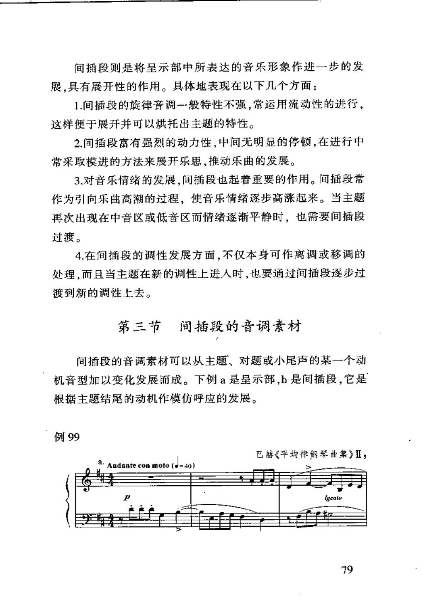

### OCR

```text
间插段则是将呈示部中所表达的音乐形象作进一步的发
展，具有展开性的作用。具体地表现在以下几个方面：
1.间插段的旋律音调一般特性不强，常运用流动性的进行，
这样便于展开并可以烘托出主题的特性。
2.间插段富有强烈的动力性，中间无明显的停顿，在进行中
常采取模进的方法来展开乐思，推动乐曲的发展。
3.对音乐情绪的发展，间插段也起着重要的作用。间插段常
作为引向乐出高潮的过程，使音乐情绪逐步高涨起来。当主题
再次出现在中音区或低音区而情绪逐渐平静时，也需要间插段
过渡。
4.在间插段的调性发展方面，不仅本身可作离调或移调的
处理，而且当主题在新的调性上进人时，也要通过间插段逐步过
渡到新的调性上去。
第三节间插段的音调素材
间插段的音调素材可以从主题、对题或小尾声的某一个动
机音型加以变化发展而成。下例a是呈示部，b是间插段，它是
根据主题结尾的动机作模仿呼应的发展。
例99
巴赫《平均律钢琴曲集》Is
Andanteconmoto（d=40)
igcato
79
```

<a id="claim-fugue.episode-function"></a>
### 间插段的核心功能是转调与动力

间插段可以短暂离调，也可以完成到新调的过渡；它的材料通常来自主题或对题，但处理更流动、更模进化。

> “在间插段的调性发展方面，不仅本身可作离调或移调的处理，而且当主题在新的调性上进入时，也要通过间插段逐步过渡到新的调性上去。”

[返回手册](../复调音乐手册.html#fugue-episode)

## PDF 第 136 页

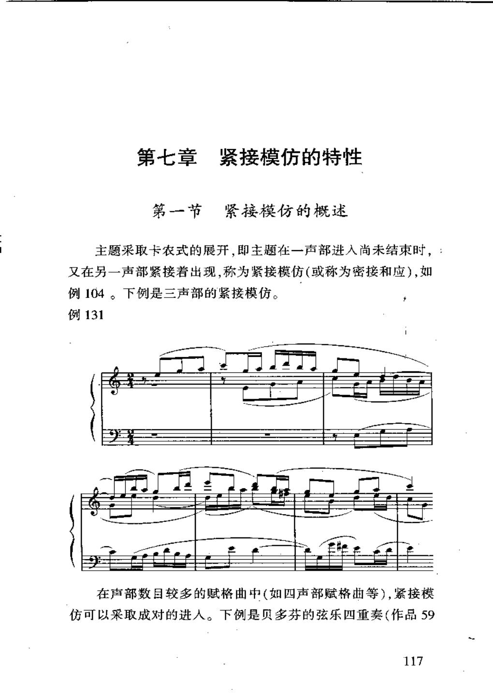

### OCR

```text
第七章紧接模仿的特性
第一节紧接模仿的概述
主题采取卡农式的展开，即主题在一声部进入尚未结束时，：
又在另一声部紧接着出现，称为紧接模仿(或称为密接和应)，如
例104。下例是三声部的紧接模仿。
例131
在声部数目较多的赋格曲中（如四声部赋格曲等），紧接模
仿可以采取成对的进人。下例是贝多芬的弦乐四重奏（作品59
117
```

<a id="claim-fugue.stretto-definition"></a>
### 密接和应：主题尚未结束就再次进入

紧接进入的条件是时间重叠。它增加和声密度与调性张力，并要求主题在音程、音区和可结合性上预先设计。

> “主题在一声部进入尚未结束时，又在另一声部紧接着出现，称为紧接模仿（或称为密接和应）。”

[返回手册](../复调音乐手册.html#fugue-stretto)

## PDF 第 138 页

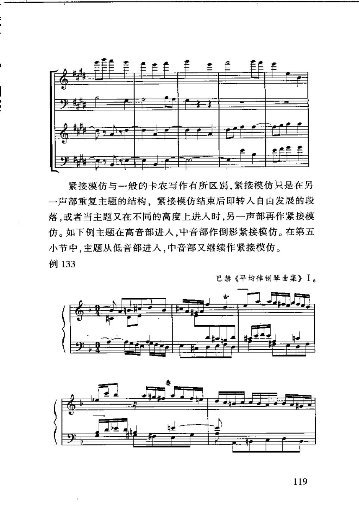

### OCR

```text
紧接模仿与一般的卡农写作有所区别，紧接模仿只是在另
一声部重复主题的结构，紧接模仿结束后即转人自由发展的段
落，或者当主题又在不同的高度上进人时，另一声部再作紧接模
仿。如下例主题在高音部进人，中音部作倒影紧接模仿。在第五
小节中，主题从低音部进人，中音部又继续作紧接模仿。
例133
巴赫《平均律钢琴曲集》I
119
```

<a id="claim-fugue.stretto-difference"></a>
### 密接和应不是整首卡农

它只在局部让主题重叠；重叠结束后仍回到自由对位、间插或下一次主题进入。

> “紧接模仿只是在另一声部重复主题的结构，紧接模仿结束后即转入自由发展的段落。”

[返回手册](../复调音乐手册.html#fugue-stretto)

## PDF 第 154 页

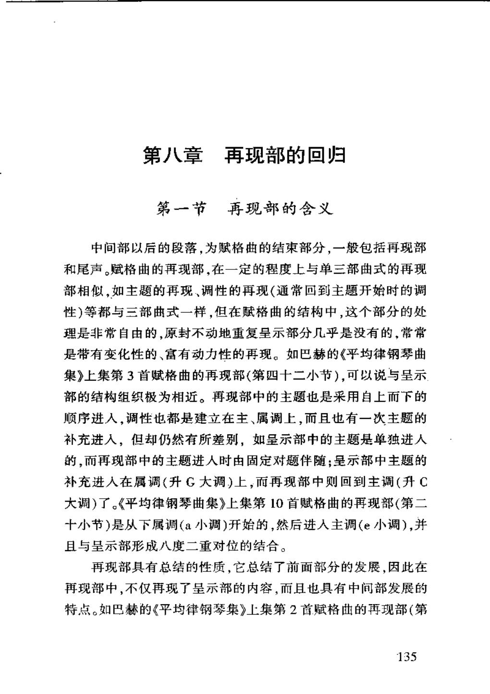

### OCR

```text
第八章再现部的回归
第一节再现部的含义
中间部以后的段落，为赋格曲的结束部分，一般包括再现部
和尾声。赋格曲的再现部，在一定的程度上与单三部曲式的再现
部相似，如主题的再现、调性的再现（通常回到主题开始时的调
性）等都与三部曲式一样，但在赋格曲的结构中，这个部分的处
理是非常自由的，原封不动地重复呈示部分几乎是没有的，常常
是带有变化性的、富有动力性的再现。如巴赫的《平均律钢琴曲
集》上集第3首赋格曲的再现部（第四十二小节），可以说与呈示
部的结构组织极为相近。再现部中的主题也是采用自上而下的
顺序进人，调性也都是建立在主、属调上，而且也有一次主题的
补充进入，但却仍然有所差别，如呈示部中的主题是单独进人
的，而再现部中的主题进人时由固定对题伴随；呈示部中主题的
补充进人在属调（升G大调）上，而再现部中则回到主调（升C
大调）了。《平均律钢琴曲集》上集第10首赋格曲的再现部（第二
十小节）是从下属调（a小调）开始的，然后进人主调（e小调），并
且与呈示部形成八度二重对位的结合。
再现部具有总结的性质，它总结了前面部分的发展，因此在
再现部中，不仅再现了呈示部的内容，而且也具有中间部发展的
特点。如巴赫的《平均律钢琴集》上集第2首赋格曲的再现部（第
135
```

<a id="claim-fugue.recap"></a>
### 再现以主调回归为骨架，常带变化

再现不是把呈示部抄一遍。它通常回到主调，并改变声部顺序、对题、紧接、织体或主题变形，使前面材料获得总结。

> “原封不动地重复呈示部分几乎是没有的，常常是带有变化性的、富有动力性的再现。”

[返回手册](../复调音乐手册.html#fugue-recap)

## PDF 第 165 页

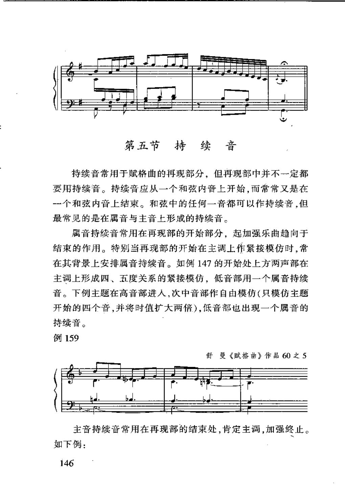

### OCR

```text
第五节持续 音
持续音常用于赋格曲的再现部分，但再现部中并不一定都
要用持续音。持续音应从一个和弦内音上开始，而常常又是在
-个和弦内音上结束。和弦中的任何一音都可以作持续音，但
最常见的是在属音与主音上形成的持续音。
属音持续音常用在再现部的开始部分，起加强乐曲趋向于
结束的作用。特别当再现部的开始在主调上作紧接模仿时，常
在其背景上安排属音持续音。如例147的开始处上方两声部在
主调上形成四、五度关系的紧接模仿，低音部用一个属音持续
音。下例主题在高音部进人，次中音部作自由模仿（只模仿主题
开始的四个音，并将时值扩大两倍），低音部也出现一个属音的
持续音。
例159
舒曼《赋格曲》作品60之5
主音持续音常用在再现部的结束处,肯定主调，加强终止。
如下例：
146
```

<a id="claim-fugue.pedal"></a>
### 持续音加强属到主的结构支点

属持续常放在再现开始前或紧接段下方，主持续常放在结尾确认主调。持续音必须从和弦音开始，并在和弦音上结束。

> “持续音应从一个和弦内音上开始，而常常又是在一个和弦内音上结束……最常见的是在属音与主音上形成的持续音。”

[返回手册](../复调音乐手册.html#fugue-recap)

## PDF 第 172 页

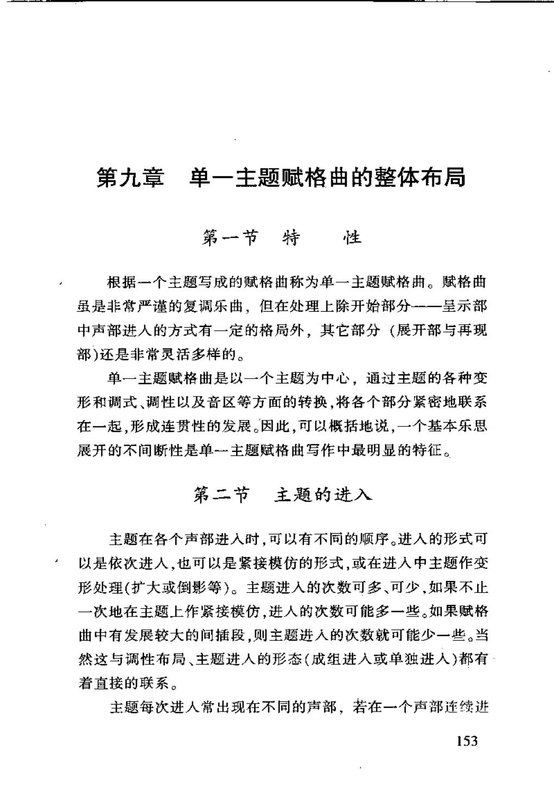

### OCR

```text
第九章单一主题赋格曲的整体布局
第一节特性
根据一个主题写成的赋格曲称为单一主题赋格曲。赋格曲
虽是非常严谨的复调乐曲，但在处理上除开始部分--一呈示部
中声部进人的方式有一定的格局外，其它部分（展开部与再现
部）还是非常灵活多样的。
单一主题赋格曲是以一个主题为中心，通过主题的各种变
形和调式、调性以及音区等方面的转换，将各个部分紧密地联系
在一起，形成连贯性的发展。因此，可以概括地说，一个基本乐思
展开的不间断性是单一主题赋格曲写作中最明显的特征。
第二节主题的进入
主题在各个声部进入时，可以有不同的顾序。进入的形式可
以是依次进人，也可以是紧接模仿的形式，或在进人中主题作变
形处理（扩大或倒影等）。主题进人的次数可多、可少，如果不止
一次地在主题上作紧接模仿，进人的次数可能多一些。如果赋格
曲中有发展较大的间插段，则主题进人的次数就可能少一些。当
然这与调性布局、主题进人的形态（成组进人或单独进人）都有
着直接的联系。
主题每次进人常出现在不同的声部，若在一个声部连续进
153
```

<a id="claim-fugue.overall"></a>
### 整体布局把主题进入与调性运动对齐

呈示部建立主属；中间部用关系调与下属方向扩展，并以间插段连接；再现回到主调，最后用紧接、持续音与尾声收束。

> “单一主题赋格曲是以一个主题为中心，通过主题的各种变形和调式、调性以及音区等方面的转换，将各个部分紧密地联系在一起，形成连贯性的发展。”

[返回手册](../复调音乐手册.html#fugue-overall)

## PDF 第 211 页

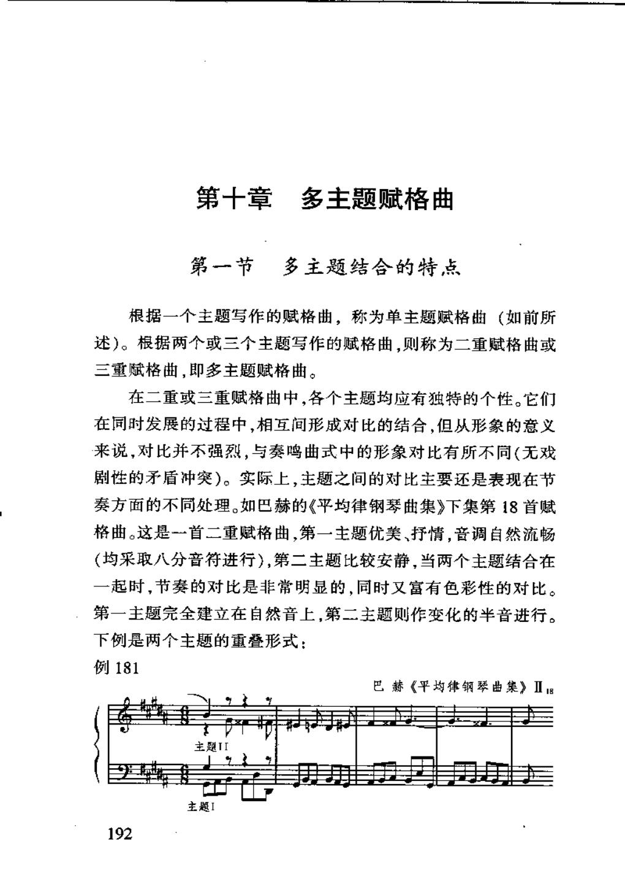

### OCR

```text
第十章多主题赋格曲
第一节多主题结合的特点
根据一个主题写作的赋格曲，称为单主题赋格曲（如前所
述）。根据两个或三个主题写作的赋格曲，则称为二重赋格曲或
三重赋格曲，即多主题赋格曲。
在二重或三重赋格曲中，各个主题均应有独特的个性。它们
在同时发展的过程中，相互间形成对比的结合，但从形象的意义
来说，对比并不强烈，与奏鸣曲式中的形象对比有所不同（无戏
剧性的矛盾冲突）。实际上，主题之间的对比主要还是表现在节
奏方面的不同处理。如巴赫的《平均律钢琴曲集》下集第18首赋
格曲。这是一首二重赋格曲，第一主题优美、抒情，音调自然流畅
（均采取八分音符进行），第二主题比较安静，当两个主题结合在
一起时，节奏的对比是非常明显的，同时又富有色彩性的对比。
第一主题完全建立在自然音上，第二主题则作变化的半音进行。
下例是两个主题的重叠形式：
例181
巴赫《平均律钢琴曲集》ⅡB
主题1
192
```

<a id="claim-fugue.multiple"></a>
### 二重/三重赋格：每个主题都有独立呈示与发展

多主题赋格不是把两个动机硬叠在一起。每个主题要能独立成为完整乐思，并预先写成可转位的组合，才能在再现中交换声部。

> “根据两个或三个主题写作的赋格曲，则称为二重赋格曲或三重赋格曲，即多主题赋格曲。”

[返回手册](../复调音乐手册.html#fugue-multiple)
