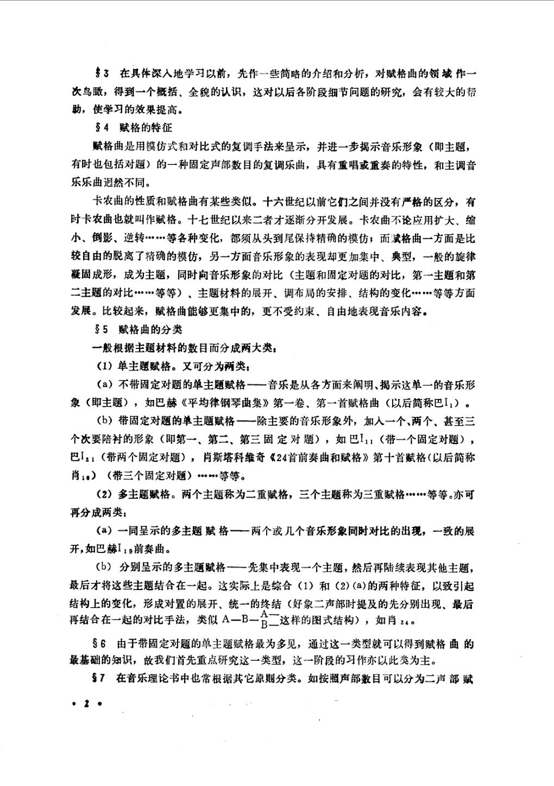
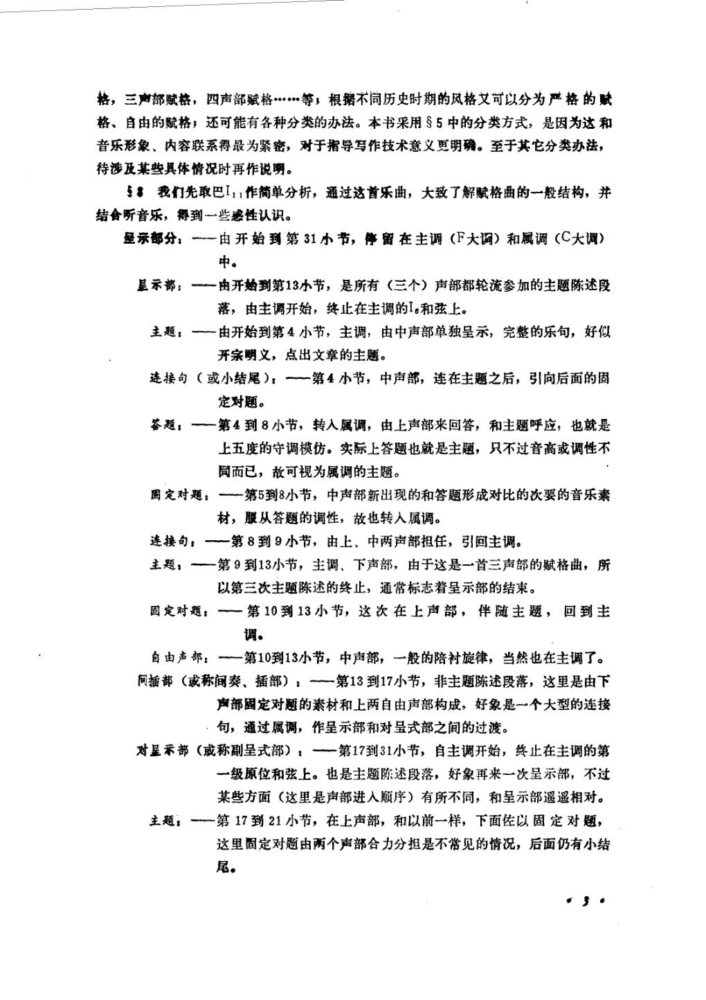
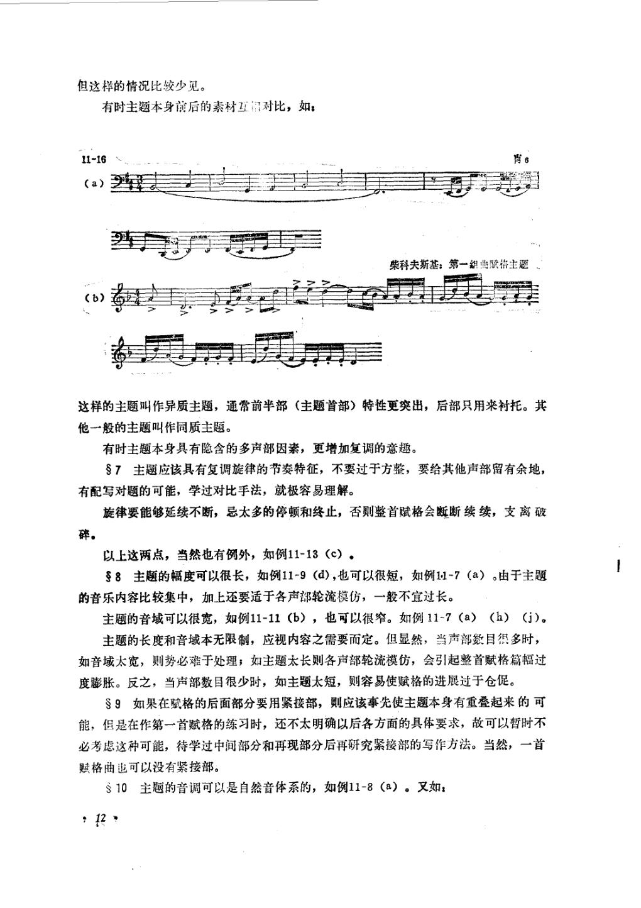
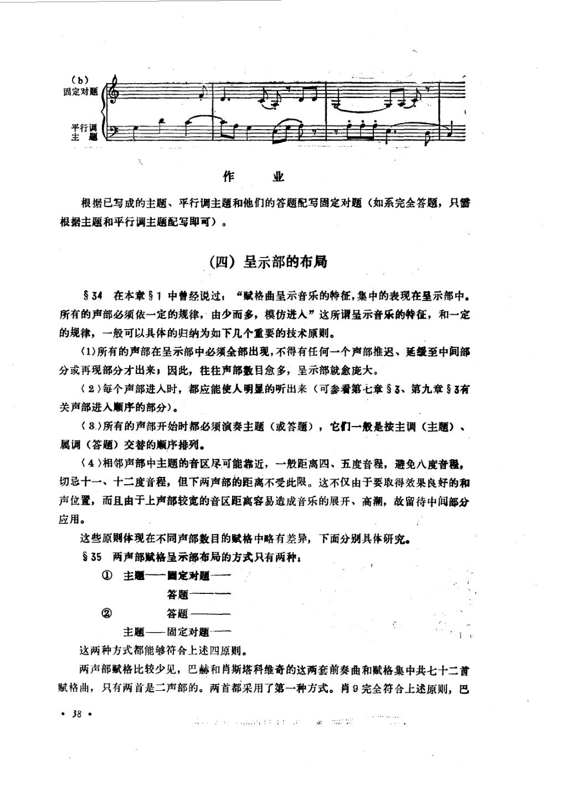

# 复调音乐（下册） · 教材原页

段平泰 · 4 个已引用页 · PDF 物理页码

> OCR 仅用于检索；谱例与临时记号以扫描图为准。

## PDF 第 4 页



### OCR

```text
3在具体深入地学习以前，先作一些简略的介绍和分析，对赋格曲的领域作一
次鸟瞰，得到一个概括、全貌的认识，这对以后各阶段细节问题的研究，会有较大的帮
助，使学习的效果提高。
4赋格的特征
赋格曲是用模仿式和对比式的复调手法来呈示，并进一步揭示音乐形象（即主题，
有时也包括对题）的一种固定声部数目的复调乐曲，具有重唱或重奏的特性，和主调音
乐乐曲迥然不同。
卡农曲的性质和赋格曲有某些类似。十六世纪以前它们之间并没有严格的区分，有
时卡农曲也就叫作赋格。十七世纪以来二者才逐渐分开发展。卡农曲不论应用扩大、缩
小、倒影、逆转等各种变化，都须从头到尾保持精确的模仿；而藏格曲一方面是比
较自由的脱离了精确的模仿，另一方面音乐形象的表现却更加集中、典型，一般的旋律
凝固成形，成为主题，同时向音乐形象的对比（主题和固定对题的对比，第一主题和第
二主题的对比…等等）、主题材料的展开、调布局的安排、结构的变化……等等方面
发展。比较起来，赋格曲能够更集中的，更不受约束、自由地表现音乐内容。
35赋格曲的分类
一般根据主题材料的数目而分成两大类：
（1）单主题赋格。又可分为两类：
（a）不带固定对题的单主题赋格-一音乐是从各方面来阐明、揭示这单一的音乐形
象（即主题），如巴赫《平均律钢琴曲集》第一卷、第一首赋格曲（以后简称巴I）。
（b）带固定对题的单主题赋格一一除主要的音乐形象外，加入一个、两个、甚至三
个次要陪衬的形象（即第一、第二、第三固定对题），如巴I：（带一个固定对题），
巴I1（带两个固定对题），肖斯塔科维奇《24首前奏曲和赋格》第十首赋格（以后简称
肖）（带三个固定对题）等等。
（2）多主题赋格。两个主题称为二重赋格，三个主题称为三重赋格等等。亦可
再分成两类：
开，如巴赫I19前奏曲。
（b）分别呈示的多主题赋格一一先集中表现一个主题，然后再陆续表现其他主题，
最后才将这些主题结合在一起。这实际上是综合（1）和（2）(a)的两种特征，以致引起
结构上的变化，形成对置的展开、统一的终结（好象二声部时提及的先分别出现、最后
S6由于带固定对题的单主题赋格最为多见，通过这一类型就可以得到赋格曲的
最基础的知识，故我们首先重点研究这一类型，这一阶段的习作亦以此类为主。
7在音乐理论书中也常根据其它原则分类。如按照声部数目可以分为二声部赋
··
```

<a id="claim-fugue.definition"></a>
### 赋格用模仿与对比展开一个固定主题，不等于通篇卡农

卡农要求从头到尾精确模仿；赋格只把模仿作为结构手段，并加入调性布局、对题、间插段、紧接和再现。

> “卡农曲……都须从头到尾保持精确的模仿；而赋格曲……比较自由的脱离了精确的模仿。”

[返回手册](../复调音乐手册.html#fugue-overall)

## PDF 第 5 页



### OCR

```text
格，三声部赋格，四声部赋格…等；根据不同历史时期的风格文可以分为严格的赋
格、自由的赋格；还可能有各种分类的办法。本书采用S5中的分类方式，是因为这和
音乐形象、内容联系得最为紧密，对于指导写作技术意义更明确。至于其它分类办法，
待涉及某些具体情况时再作说明。
5我们先取巴I，作简单分析，通过这首乐曲，大致了解赋格曲的一般结构，并
结合昕音乐，得到一些感性认识。
垦示部分：一由开始到第31小节，停留在主调（F大调）和属调（C大调）
中。
星示部：“一由开始到第13小节，是所有（三个）声部都轮流参加的主题陈述段
落，由主调开始，终止在主调的I。和弦上。
主题：一一由开始到第4小节，主调，由中声部单独呈示，完整的乐句，好似
开宗明义，点出文章的主题。
连接句（或小结尾）：一第4小节，中声部，连在主题之后，引向后面的固
定对题。
答题：一一第4到8小节，转入属调，由上声部来回答，和主题呼应，也就是
上五度的守调模仿。实际上答题也就是主题，只不过音高或调性不
同而已，故可视为属调的主题。
围定对题：一一第5到8小节，中声部新出现的和答题形成对比的次要的音乐素
材，服从答题的调性，故也转入属调。
连接句：一第8到9小节，由上、中两声部担任，引回主调。
主题：一第9到13小节，主调、下声部，由于这是一首三声部的赋格曲，所
以第三次主题陈述的终止，通常标志着呈示部的结束。
固定对题：一一第10到13小节，这次在上声部，伴随主题，回到主
调。
自由声部：一第10到13小节，中声部，一般的陪衬旋律，当然也在主调了。
同插部（或称间奏、插部）：一一第13到17小节，非主题陈述段落，这里是由下
声部固定对题的素材和上两自由声部构成，好象是一个大型的连接
．句，通过属调，作呈示部和对呈式部之间的过渡。
对呈示部（或称副呈式部）：“一第17到31小节，自主调开始，终止在主调的第
一级原位和弦上。也是主题陈述段落，好象再来一次呈示部，不过
某些方面（这里是声部进人顺序）有所不同，和呈示部遥遥相对。
主题：一第17到21小节，在上声部，和以前一样，下面佐以固定对题，
这里固定对题由两个声部合力分担是不常见的情况，后面仍有小结
尾。
```

<a id="claim-fugue.overall"></a>
### 整体布局把主题进入与调性运动对齐

呈示部建立主属；中间部用关系调与下属方向扩展，并以间插段连接；再现回到主调，最后用紧接、持续音与尾声收束。

> “呈示部……是所有（三个）声部都轮流参加的主题陈述段落……中间部分……开始脱离了以前的两个基本调（主和属），引进其它的调式或移入新的调性。”

[返回手册](../复调音乐手册.html#fugue-overall)

## PDF 第 14 页



### OCR

```text
但这样的情况比较少见。
有时主题本身前后的素材互得对比，如：
11-16
肖6
(a）
柴科夫斯基：第一组曲赋格主题
（6）
这样的主题叫作异质主题，通常前半部（主题首部）特性更突出，后部只用来衬托。其
他一般的主题叫作同质主题。
有时主题本身具有隐含的多声部因素，更增加复调的意趣。
S7主题应该具有复调旋律的节奏特征，不要过于方整，要给其他声部留有余地，
有配写对题的可能，学过对比手法，就极容易理解。
旋律要能够延续不断，忌太多的停顿和终止，否则整首赋格会断断续续，支离破
碎。
以上这两点，当然也有例外，如例11-13（c）。
8主题的幅度可以很长，如例11-9（d)，也可以很短，如例11-7（a）。由于主题
的音乐内容比较集中，加上还要适于各声部轮流模仿，一般不宜过长。
主题的音域可以很宽，如例11-11（b），也可以很窄。如例11-7（a）（h）（j）。
主题的长度和音域本无限制，应视内容之需要而定。但显然，当声部数目很多时，
如音域太宽，则势必难于处理；如主题太长则各声部轮流模仿，会引起整首赋格篇幅过
度膨胀。反之，当声部数目很少时，如主题太短，则容易使赋格的进展过于仓促。
S9如果在赋格的后面部分要用紧接部，则应该事先使主题本身有重叠起来的可
能，但是在作第一首赋格的练习时，还不太明确以后各方面的具体要求，故可以暂时不
必考虑这种可能，待学过中间部分和再现部分后再研究紧接部的写作方法。当然，一首
赋格曲也可以没有紧接部。
10主题的音调可以是自然音体系的，如例11-8（a）。又如：
```

<a id="claim-fugue.subject-properties"></a>
### 主题的调性、长度、音域与收束位置

多数主题留在主调或只触及属调；声乐赋格常不超过一个八度；主题通常结束在强拍，长度要足以成为完整乐思，又不能长到妨碍多声部进入。

> “由于主题的音乐内容比较集中，加上还要适于各声部轮流模仿，一般不宜过长。”

[返回手册](../复调音乐手册.html#fugue-subject)

## PDF 第 40 页



### OCR

```text
（b)
固定对题
平行调
主
作业
根据已写成的主题、平行调主题和他们的答题配写固定对题（如系完全答题，只
根据主题和平行调主题配写即可）。
（四）呈示部的布局
S34在本章51中曾经说过：“赋格曲呈示音乐的特征，集中的表现在呈示部中。
所有的声部必须依一定的规律，由少而多，模仿进人”这所谓呈示音乐的特征，和一定
的规律，一般可以具体的归纳为如下几个重要的技术原则。
(1>所有的声部在呈示部中必须全部出现，不得有任何一个声部推迟、延缓至中间部
分或再现部分才出来；因此，往往声部数目愈多，呈示部就愈庞大。
（2）每个声部进入时，都应能使人明显的听出来（可参看第七章S3、第九章3有
关声部进入顺序的部分）。
（8.>所有的声部开始时都必须演奏主题（或答题），它们一般是按主调（主题）、
属调（答题）交替的顺序排列。
（4>相邻声部中主题的音区尽可能靠近，一般距离四、五度音程，避免八度音，
切忌十一、十二度音程，但下两声部的距离不受此限。这不仅由于要取得效果良好的和
声位置，而且由于上声部较宽的音区距离容易造成音乐的展开、高潮，故留待中间部分
应用。
这些原则体现在不同声部数目的赋格中略有差异，下面分别具体研究。
35两声部赋格呈示部布局的方式只有两种：
①主题—国定对题
答题
②
答题
主题—固定对题
这两种方式都能够符合上述四原则。
两声部赋格比较少见，巴赫和肖斯塔科维奇的这两套前奏曲和赋格集中共七十二首
赋格曲，只有两首是二声部的。两首都采用了第一种方式。肖9完全符合上述原则，巴
·38·
```

<a id="claim-fugue.exposition-principles"></a>
### 呈示部要求所有声部出场，并建立主属调性

呈示部不是“主题第一次出现”的同义词，而是所有声部依次陈述主题或答题的段落。它通常停在主调，随后才进入中间部。

> “所有的声部在呈示部中必须全部出现……它们一般是按主调（主题）、属调（答题）交替的顺序排列。”

[返回手册](../复调音乐手册.html#fugue-exposition)
