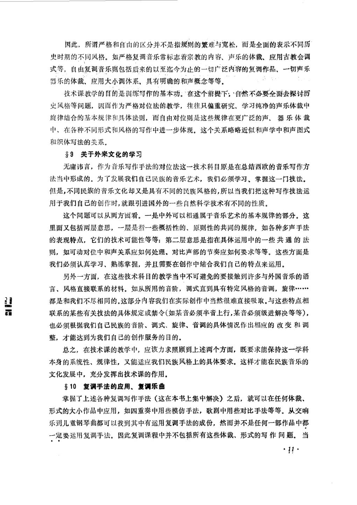
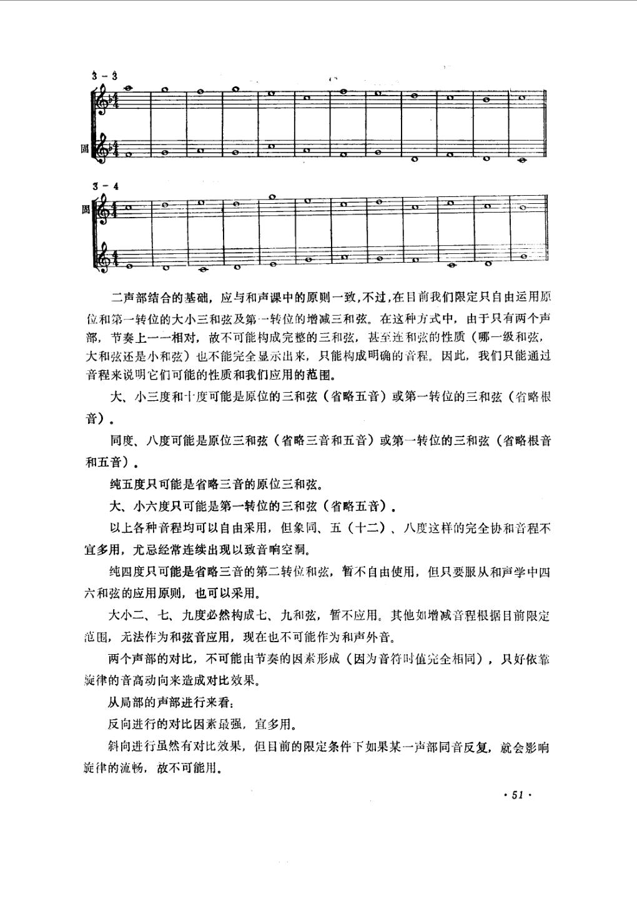
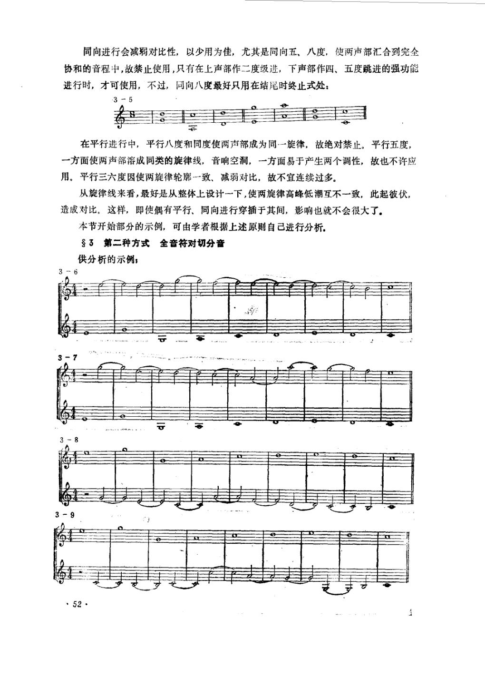
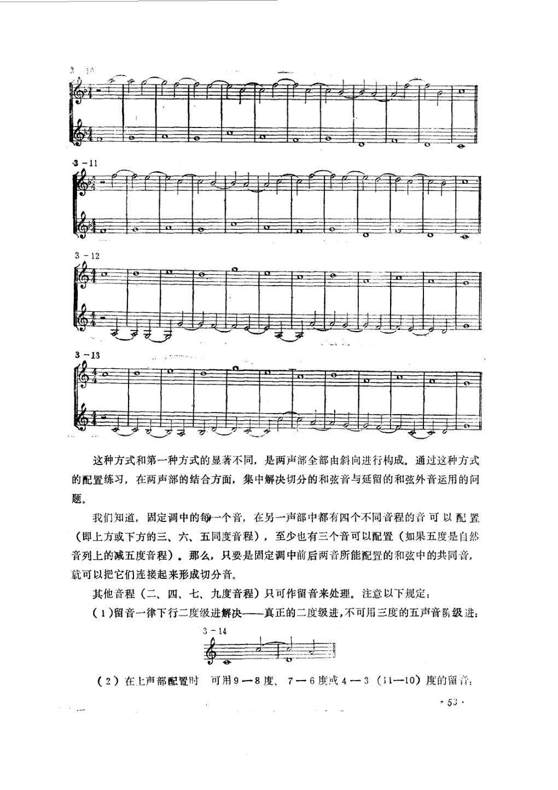
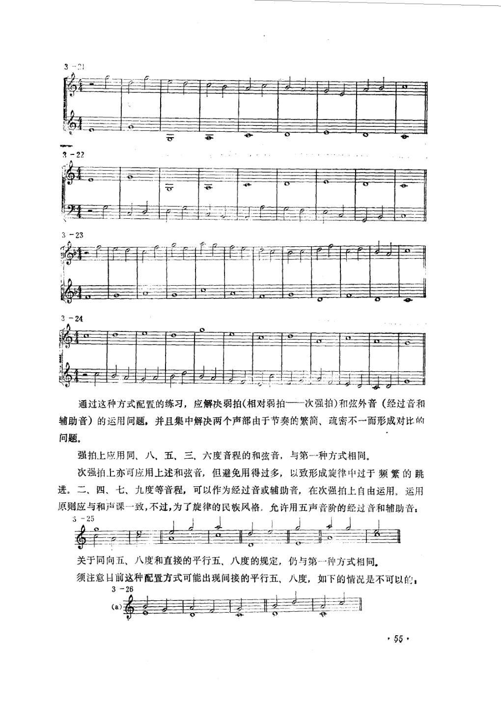

# 复调音乐（上册） · 教材原页

段平泰 · 5 个已引用页 · PDF 物理页码

> OCR 仅用于检索；谱例与临时记号以扫描图为准。

## PDF 第 13 页



### OCR

```text
因此，所谓严格和自由的区分并不是指规则的繁难与宽松，而是全面的表示不同历
史时期的不同风格。如严格复调音乐常标志着宗教的内容、声乐的体裁、应用古教会调
式等，自由复调音乐则包括后来的以至迄今为止的一切广泛内容的复调作品、一切声乐
器乐的体裁、应用大小调体系、具有明确的和声概念等等。
技术课教学的自的是训练写作的基本功：在这个前提下，自然不必要全面去探讨历
史风格等问题，因而作为严格对位法的教学，往往只偏重研究、学习纯净的声乐体裁中
旋律结合的基本规律和具体法则，而自由对位则是这些规律在更广泛的声、器乐体裁
中、在各种不同形式和风格的写作中进一步体现。这个关系略略近似和声学中和声图式
和织体写法的关系。
9关于外来文化的学习
无庸讳言，作为音乐写作手法的对位法这一技术科目原是在总结西欧的音乐写作方
法当中形成的。为了发展我们自已民族的音乐艺术，我们必须学习、掌握这一门技法。
但是，不同民族的音乐文化却又是具有不同的民族风格的，所以当我们把这种写作技法运
用于我们自己的创作时，就跟引进国外的一些自然科学技术有不同的性质。
这个问题可以从两方面看。一是中外可以相通属于音乐艺术的基本规律的部分。这
里面又包括两层意思，一层是指一些概括性的、原则性的共同的规律，如各种多声手法
的表现特点，它们的技术可能性等等；第二层意思是指在具体运用中的一些共通的法
则，如可动对位中和声关系应如何处理、对比声部的节奏应如何要求等等。这些方面是
我们必须认真学习、熟练掌握，并且需要在创作中结合我们自已的特点来运用。
另外一方面，在这些技术科目的教学当中不可避免的要接触到许多与外国音乐的语
言、风格直接联系的材料。如从所用的音阶，调式直到具有特定风格的音调，旋律
3
都是和我们不尽相同的。这部分内容我们在实际创作中当然很难直接吸取。与这些特点相
联系的某些有关技法的具体规定或禁令（如某音必须半音上行，某音必须级进解决等等），
也必须根据我们自已民族的音阶、调式、旋律、音调的具体情况作出相应的改变和调
整，才能达到为我们自已的创作服务的目的。
总之，在技术课的教学中，应该力求照顾到上述两个方面，既要求能保持这一学科
本身的系统性、规律性，又能适应我们民族风格上的具体要求。这样才能在民族音乐的
文化发展中，充分发挥出技术课的作用.
10复调手法的应用、复调乐曲
掌握了上述各种复调写作手法（这在本书上集中解决）之后，就可以在任何体裁、
形式的大小作品中应用，如四重奏中用些模仿手法，歌剧中用些对比手法等等。从交响
乐到儿童钢琴曲都可以找到其中有运用复调手法的成份，然而并不是任何一部作品中都
一定要运用复调手法。因此复调课程中并不包括所有这些体裁、形式的写作问题。当
.ii.
```

<a id="claim-hist.style-system"></a>
### 对位规则依附于当时的调式与和声语言

分类对位不是超历史的自然法。文艺复兴调式、巴洛克大小调与二十世纪音高组织，会改变什么算协和、什么算必须解决的 dissonance。

> “所谓严格和自由的区分并不是指规则的繁难与宽松，而是全面的表示不同历史时期的不同风格。”

[返回手册](../复调音乐手册.html#periods)

## PDF 第 53 页



### OCR

```text
二声部结合的基础，应与和声课中的原则一致，不过，在目前我们限定只自由运用原
位和第一转位的大小三和弦及第·一转位的增减三和弦。在这种方式中，由于只有两个声
部，节奏上一一相对，故不可能构成完整的三和弦，甚至连和弦的性质（哪一级和弦，
大和弦还是小和弦）也不能完全显示出来，只能构成明确的音程。因此，我们只能通过
音程来说明它们可能的性质和我们应用的范围。
大、小三度和十度可能是原位的三和弦（省略五音）或第一转位的三和弦（省略根
音）。
同度、八度可能是原位三和弦（省略三音和五音）或第一转位的三和弦（省略根音
和五音）。
纯五度只可能是省略三音的原位三和弦。
大、小六度只可能是第一转位的三和弦（省略五音），
以上各种音程均可以自由采用，但象同、五（十二）、八度这样的完全协和音程不
宜多用，尤忌经常连续出现以致音响空洞。
纯四度只可能是省略三音的第二转位和弦，暂不自由使用，但只要服从和声学中四
六和弦的应用原则，也可以采用。
大小二、七、九度必然构成七、九和弦，暂不应用。其他如增减音程根据目前限定
范围，无法作为和弦音应用，现在也不可能作为和声外音。
两个声部的对比，不可能由节奏的因素形成（因为音符时值完全相同），只好依靠
旋律的音高动向来造成对比效果。
从局部的声部进行来看：
反向进行的对比因素最强，宜多用。
斜向进行虽然有对比效果，但目前的限定条件下如果某一声部同音反复，就会影响
旋律的流畅，故不可能用。
·51
```

<a id="claim-species.first-boundaries"></a>
### 第一类：首尾用完全协和，内部避免连续完全协和

二声部一音对一音以协和音程为全部骨架；首尾用同度、五度或八度确认调性，中段连续三个以上完全协和会失去声部独立与音响支撑。

> “以上各种音程均可以自由采用，但象同、五（十二）、八度这样的完全协和音程不宜多用，尤忌经常连续出现以致音响空洞。”

[返回手册](../复调音乐手册.html#species-1)

## PDF 第 54 页



### OCR

```text
同向进行会减弱对比性，以少用为佳，尤其是同向五、八度，使两声部汇合到完全
协和的音程中，故禁止使用，只有在上声部作二度级进，下声部作四、五度跳进的强功能
进行时，才可使用，不过，同向八度最好只用在结尾时终止式处：
3-5
在平行进行中，平行八度和同度使两声部成为同一旋律，故绝对禁止。平行五度，
一方面使两声部溶成同类的旋律线，音响空洞，一方面易于产生两个调性，故也不许应
用。平行三六度因使两旋律轮廊一致、减弱对比，故不宜连续过多。
从旋律线来看，最好是从整体上设计一下，使两旋律高峰低潮互不一致，此起彼伏，
造成对比。这样，即使偶有平行、同向进行穿插于其间，影响也就不会很大了。
本节开始部分的示例，可由学者根据上述原则自已进行分析。
3第二种方式全音符对切分音
供分析的示例：
52
```

<a id="claim-species.third-parallels"></a>
### 第三类：平行五、八度按实际发声音程判断

四音对一音不因节奏变快而放宽平行完全音程。要检查相邻发声音符形成的五度/八度，而不只看每拍第一个音。

> “平行八度和同度使两声部成为同一旋律，故绝对禁止。平行五度，一方面使两声部溶成同类的旋律线，音响空洞，一方面易于产生两个调性，故也不许应用。”

[返回手册](../复调音乐手册.html#species-3)

## PDF 第 55 页



### OCR

```text
这种方式和第一种方式的显著不同，
由斜向进行构成。通过这种方式
的配置练习，在两声部的结合方面，集中解决切分的和弦音与延留的和弦外音运用的问
题。
我们知道，固定调中的每一个音，在另一声部中都有四个不同音程的音可以配置
（即上方或下方的三、六、五同度音程），至少也有三个音可以配置（如果五度是自然
音列上的减五度音程）。那么，只要是固定调中前后两音所能配置的和弦中的共同音，
就可以把它们连接起来形成切分音。
其他音程（二、四、七、九度音程）只可作留音来处理。注意以下规定：
（1）留音一律下行二度级进解决一真正的二度级进，不可用三度的五声音阶级进：
3-14
（2）在上声部配置时可用9一8度、7一6度或4一3（11-10）度的留音：
·53
```

<a id="claim-species.fourth-suspension"></a>
### 第四类：延留音要经过预备、强拍不协和、下行级进解决

切分音把前一弱拍的和弦音带入下一强拍。若该音在新和声上不协和，它就必须在强拍承担张力，并向下级进解决。严格对位中不接受上行或跳进解决。

> “留音一律下行二度级进解决一真正的二度级进”

[返回手册](../复调音乐手册.html#species-4)

## PDF 第 57 页



### OCR

```text
通过这种方式配置的练习，应解决弱拍
相对弱拍
次强拍）和弦外音（经过音和
辅助音）的运用问题，并且集中解决两个声部由于节奏的繁简、疏密不一而形成对比的
问题。
强拍上应用同、八、五、三、六度音程的和弦音，与第一种方式相同。
次强拍上亦可应用上述和弦音，但避免用得过多，以致形成旋律中过于频繁的跳
进。二、四、七、九度等音程，可以作为经过音或辅助音，在次强拍上自由运用，运用
原则应与和声课一致，不过，为了旋律的民族风格，
允许用五声音阶的经过音和辅助音：
3-25
关于同向五、八度和直接的平行五、八度的规定，仍与第-种方式相同。
须注意日前这种配置方式可能出现间接的平行五、八度，如下的情况是不可以的：
3-26
D
（a)
55
```

<a id="claim-species.second-passing"></a>
### 第二类：强拍协和，弱拍才容纳经过音与辅助音

二音对一音把每小节前半拍当作和声骨架。弱拍 dissonance 必须由级进产生并级进离开；跳到弱拍时，落点应仍是同一和弦的和弦音。

> “二、四、七、九度等音程，可以作为经过音或辅助音，在次强拍上自由运用”

[返回手册](../复调音乐手册.html#species-2)
