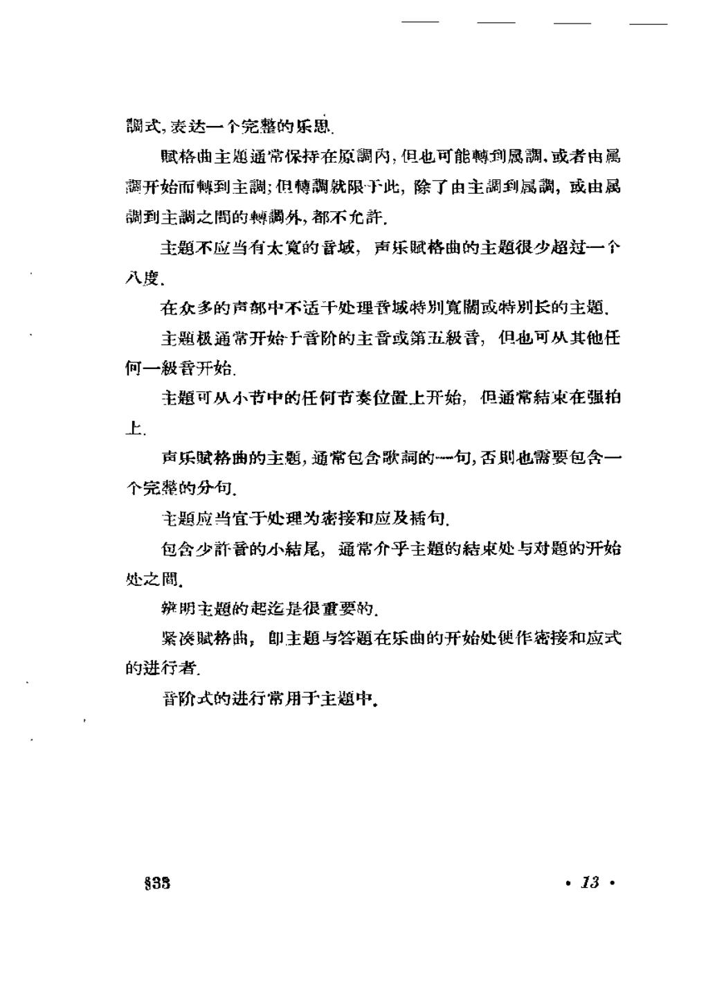
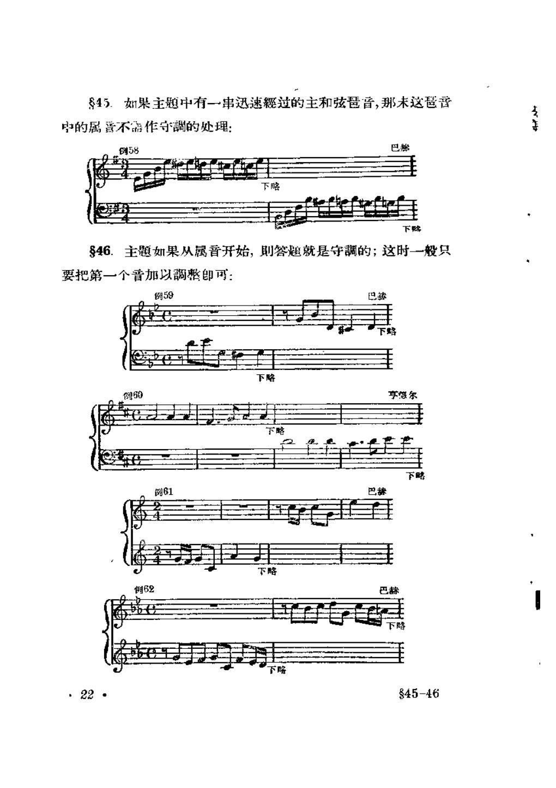
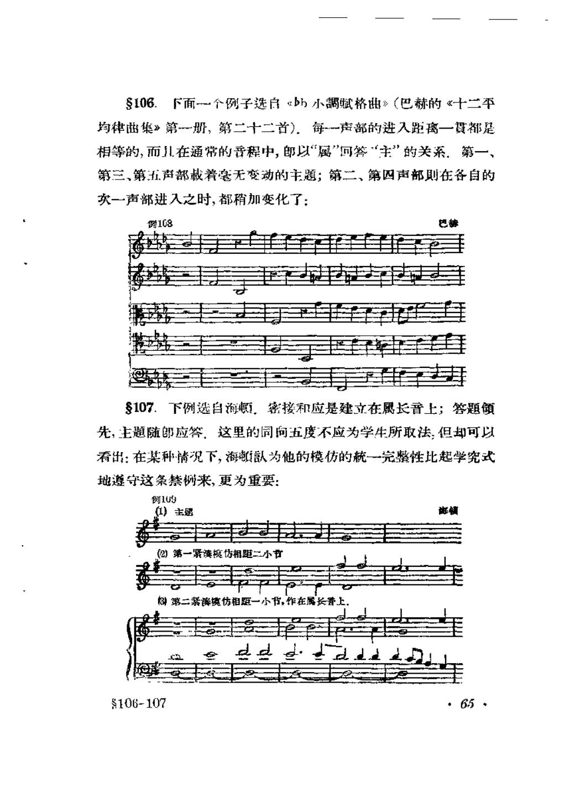

# 赋格曲 · 教材原页

希格斯 · 3 个已引用页 · PDF 物理页码

> OCR 仅用于检索；谱例与临时记号以扫描图为准。

## PDF 第 17 页



### OCR

```text
调式，表达一个完整的乐思
赋格曲主题通常保持在原調内，但也可能轉到属調，或者由属
开始而轉到主調；但博調就限下此，除了由主调到属調，或由属
调到主之間的轉调外，都不允許.
主题不应当有太寬的音域，声乐赋格曲的主题很少超过一个
入度.
在众多的声部中不适于处理普城特别寬或特别长的主题
主题极通常开始于音阶的主音或第五级晋，但也可从其他任
何一级音开始.
主题可从小节中的任何节奏位置上开始，但通常結束在强拍
上.
个完整的分句.
主题应当宜于处理为密接和应及插句.
包含少許音的小結尾，通常介乎主题的結束处与对题的开始
处之間.
辩明主题的起迄是很重要的.
紧赋格曲，即主题与答题在乐曲的开始处便作密接和应式
的进行者.
音阶式的进行常用于主题中，
38
·13·
```

<a id="claim-fugue.subject-identity"></a>
### 主题必须可辨认、可重复、可发展

主题不是随便一句旋律。首部要有清楚的动机与节奏标记，使它在转调、扩大、倒影或密接中仍能被听出；同时要能承载答题、对题和间插段。

> “主题应当宜于处理为密接和应及插句。”

[返回手册](../复调音乐手册.html#fugue-subject)

<a id="claim-fugue.subject-properties"></a>
### 主题的调性、长度、音域与收束位置

多数主题留在主调或只触及属调；声乐赋格常不超过一个八度；主题通常结束在强拍，长度要足以成为完整乐思，又不能长到妨碍多声部进入。

> “主题不应当有太宽的音域，声乐赋格曲的主题很少超过一个八度……主题可从小节中的任何节奏位置上开始，但通常结束在强拍上。”

[返回手册](../复调音乐手册.html#fugue-subject)

## PDF 第 24 页



### OCR

```text
45.如果主题中有一串迅速經过的主和弦琶音，那未这琶音
戈
中的属营不需作守调的处理：
巴
例58
下略
下骼
846.主题如果从属音开始，则答题就是守調的；这时一般只
要把第一个音加以整即可：
例59
巴苏
下陷
亨尔
下略
下略
例61
巴赫
巴赫
明62
下路
$45-46
```

<a id="claim-fugue.tonal-answer"></a>
### 守调答题只改动会破坏主属边界的位置

主题从属音开始，或主音后立即跳到属音时，完全移调会让答题一开始就离开主属范围。守调答题把首次出现的属音改为主音；没有这种主属冲突时，仍可用真实答题。

> “主题如果从属音开始，则答题就是守调的；这时一般只要把第一个音加以调整即可。”

[返回手册](../复调音乐手册.html#fugue-answer)

## PDF 第 61 页



### OCR

```text
S106.下面一个例子选白《bh小調赋格曲》（巴赫的《十二平
均律茁集》第一那，第二十二首）．每-一声部的进入距离一寶都足
相等的，而儿在通常的音程中，郎以“属”回答“主”的关系，第一、
第三、第五声部载着毫无变动的主题；第二、第四声部则在各自的
次一声部进入之时，都稍加变化了：
例108
8107.下例选自海顿，密接和应是建立在属长音上；答题
先，主题随郎应答，这里的同向五度不应为学生所取法，但却可以
看出：在某种情况下，海顿认为他的模仿的統一完整性比起学究式
地遵守这条禁例来，更为重要：
例109
(1）主题
紧藻模仿相距二小书
第二紧滨仿相距
106-107
```

<a id="claim-fugue.stretto-definition"></a>
### 密接和应：主题尚未结束就再次进入

紧接进入的条件是时间重叠。它增加和声密度与调性张力，并要求主题在音程、音区和可结合性上预先设计。

> “每一声部的进入距离一定都是相等的，而且在通常的音程中，以“属”回答“主”的关系。”

[返回手册](../复调音乐手册.html#fugue-stretto)
