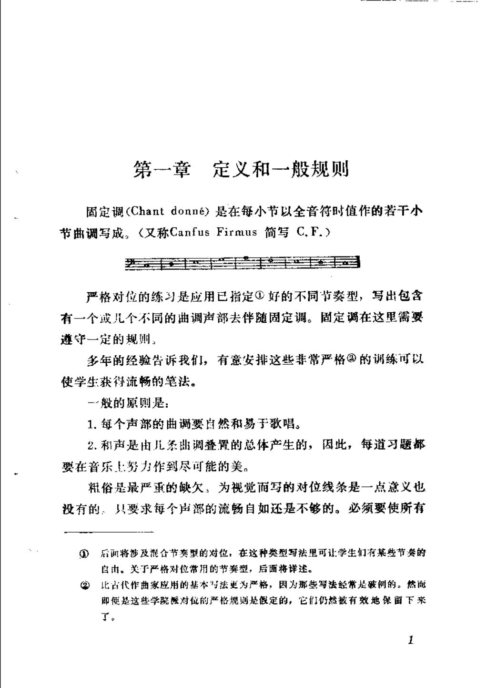
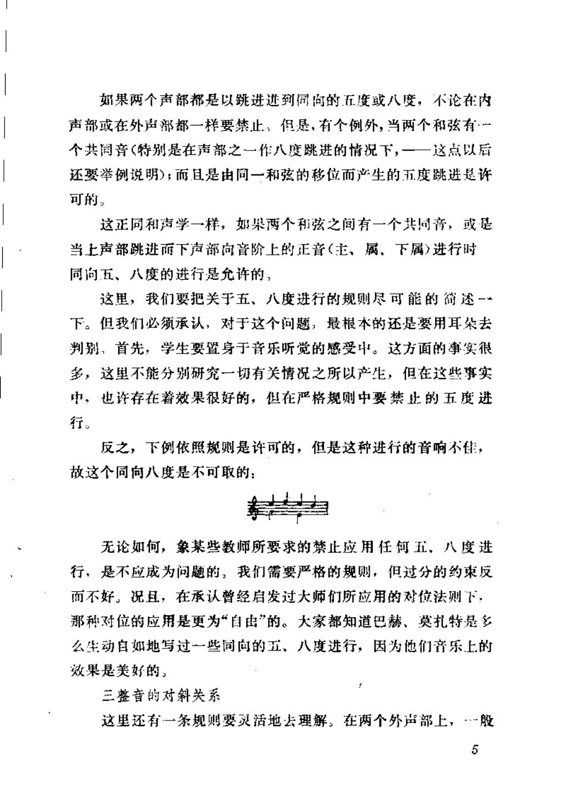

# 对位法概要 · 教材原页

柯克兰 · 2 个已引用页 · PDF 物理页码

> OCR 仅用于检索；谱例与临时记号以扫描图为准。

## PDF 第 5 页



### OCR

```text
第一章定义和一般规则
固定调（Chantdonné）是在每小节以全音符时值作的若干小
节曲调写成。（又称CanfusFirmus简写C.F.）
严格对位的练习是应用已指定好的不同节奏型，写出包含
有一个或儿个不同的曲调声部去伴随固定调。固定调在这里需要
遵守一定的规则，
多年的经验告诉我们，有意安排这些非常严格②的训练可以
使学生获得流畅的笔法。
-般的原则是：
1.每个声部的曲调要自然和易于歌唱。
2.和声是由儿条山调叠置的总体产生的，因此，每道习题都
要在音乐上努力作到尽可能的美。
粗俗是最严重的缺欠，为视觉而写的对位线条是一点意义也
没有的：只要求每个声部的流畅自如还是不够的。必须要使所有
后面将涉及混合节奏型的对位，在这种类型写法里可让学生们有某些节奏的
自由。关于严格对位常用的节奏型，后面将详述。
比占代作曲家应用的基本与法更为严格，因为那些写法经常是破例的。然面
2
即便是这些学院派对位的严格规则是假定的，它们仍然被有效地保留下来
T。
1
```

<a id="claim-hist.strict-training"></a>
### 严格复对位是进入自由写作的训练，不是创作禁令

复对位的严格练习把可转位性、协和框架与声部独立压缩成可控条件；实际作品仍按风格放松细节。

> “严格对位的练习是应用已指定好的不同节奏型，写出包含有一个或儿个不同的曲调声部去伴随固定调。”

[返回手册](../复调音乐手册.html#periods)

## PDF 第 9 页



### OCR

```text
奶果两个声部都是以跳进进到同向的五度或八度，不论在内
声部或在外声部都一样要禁止，但是，有个例外，当两个和弦有·一
个共同音（特别是在声部之一作八度跳进的情况下，一一这点以后
还要举例说明）；而且是由同一和弦的移位而产生的五度跳进是许
可的：
这正同和声学一样，如果两个利弦之间有一个共同音，或是
当上声部跳进而下声部向音阶上的正音（主、属、下属）进行时
同向五、八度的进行是允许的，
这里，我们要把关于五、八度进行的规则尽可能的简述一
下。但我们必须承认，对于这个问题，最根本的还是要用耳朵去
判别，首先，学生要置身于音乐听觉的感受中。这方面的事实很
多，这里不能分别研究一切有关情况之所以产生，但在这些事实
中：也许存在着效果很好的，但在严格规则中要禁比的五度进
行。
反之，下例依照规则是许可的，但是这种进行的音响不佳，
故这个同向八度是不可取的：
无论如何，象某些教师所要求的禁止应用任何五，八度进
行，是不应成为问题的，我们需要严格的规则，但过分的药束反
而不好，况且，在承认曾经启发过大师们所应用的对位法则下：
那种对位的应用是更为“自由”的。大家都知道巴赫、莫扎特是多
么生动自如地写过一些同向的五、八度进行，因为他们音乐上的
效果是美好的，
三整音的对斜关系
这里还有一条规则要灵活地去理解，在两个外声部上，“般
5
```

<a id="claim-species.third-parallels"></a>
### 第三类：平行五、八度按实际发声音程判断

四音对一音不因节奏变快而放宽平行完全音程。要检查相邻发声音符形成的五度/八度，而不只看每拍第一个音。

> “两个声部都是以跳进进到同向的五度或八度，不论在内声部或在外声部都一样要禁止”

[返回手册](../复调音乐手册.html#species-3)
