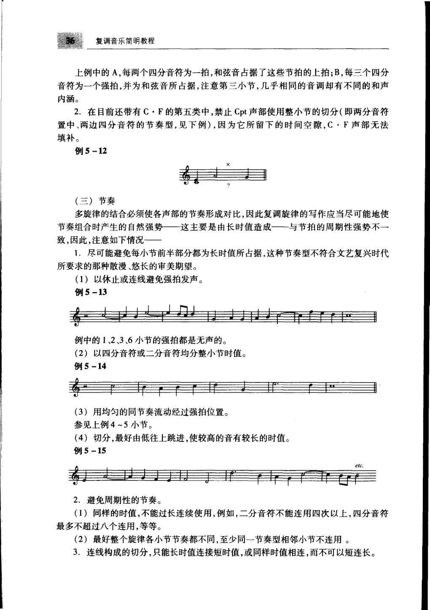
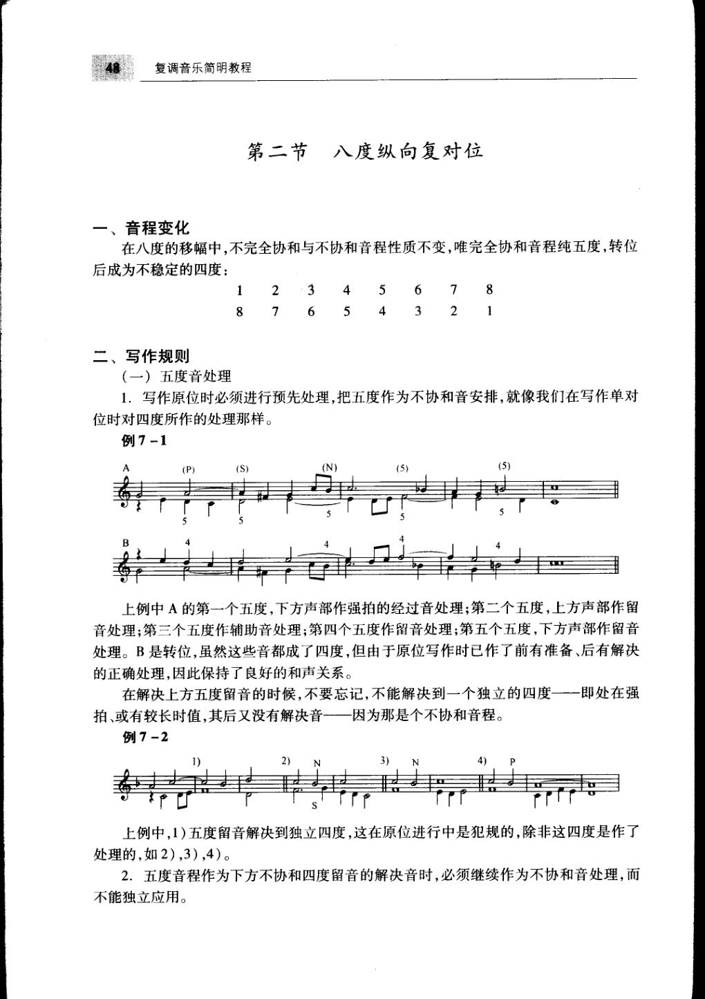
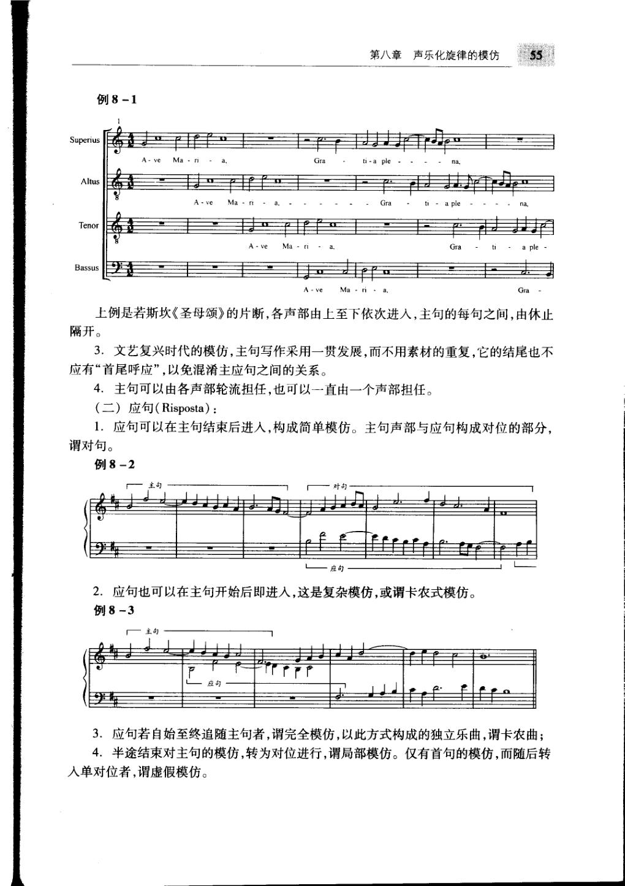
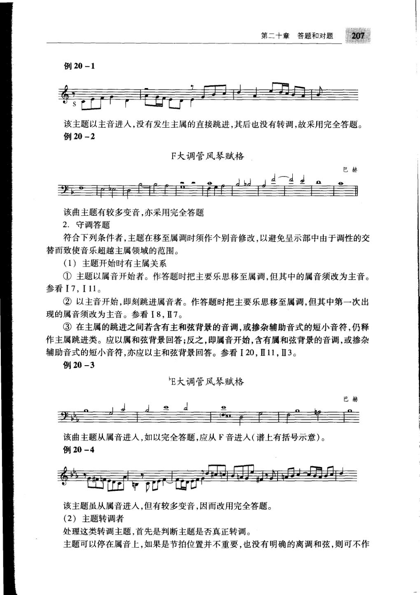
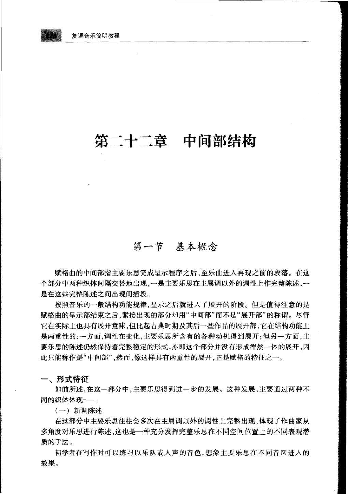

# 复调音乐简明教程 · 教材原页

林华 · 5 个已引用页 · PDF 物理页码

> OCR 仅用于检索；谱例与临时记号以扫描图为准。

## PDF 第 47 页



### OCR

```text
复调音乐简明教程
上例中的A，每两个四分音符为一拍，和弦音占据了这些节拍的上拍；B，每三个四分
音符为一个强拍，并为和弦音所占据，注意第三小节，几乎相同的音调却有不同的和声
内涵。
2.在目前还带有C·F的第五类中，禁止Cpt声部使用整小节的切分（即两分音符
置中、两边四分音符的节奏型，见下例），因为它所留下的时间空隙，C·F声部无法
填补。
例5-12
（三）节奏
多旋律的结合必须使各声部的节奏形成对比，因此复调旋律的写作应当尽可能地使
节奏组合时产生的自然强势—这主要是由长时值造成—与节拍的周期性强势不一
致，因此，注意如下情况一
1.尽可能避免每小节前半部分都为长时值所占据，这种节奏型不符合文艺复兴时代
所要求的那种散漫、悠长的审美期望。
（1）以休止或连线避免强拍发声。
例5-13
例中的12、36小节的强拍都是无声的。
（2）以四分音符或二分音符均分整小节时值。
例5-14
（3）用均匀的同节奏流动经过强拍位置。
参见上例4～5小节。
（4）切分，最好由低往上跳进，使较高的音有较长的时值。
例5-15
etc.
2.避免周期性的节奏。
（1）同样的时值，不能过长连续使用，例如，二分音符不能连用四次以上，四分音符
最多不超过八个连用，等等。
(2）最好整个旋律各小节节奏都不同，至少同一节奏型相邻小节不连用。
3.连线构成的切分，只能长时值连接短时值，或同样时值相连，而不可以短连长。
```

<a id="claim-species.fifth-rhythm"></a>
### 第五类：混合节奏仍服从强拍和声，但不能机械重复

第五类把前四类的音型合并。判断标准不是音符越多越自由，而是每个结构强拍仍能读出和声，同时各声部的节奏重音错开。

> “复调旋律的写作应当尽可能地使节奏组合时产生的自然强势……与节拍的周期性强势不一致。”

[返回手册](../复调音乐手册.html#species-5)

## PDF 第 59 页



### OCR

```text
复调音乐简明教程
第二节八度纵向复对位
一、音程变化
在八度的移幅中，不完全协和与不协和音程性质不变，唯完全协和音程纯五度，转位
后成为不稳定的四度：
2
3
4
6
7
5
1
6
5
3
2
8
7
二、写作规则
（一）五度音处理
1．写作原位时必须进行预先处理，把五度作为不协和音安排，就像我们在写作单对
位时对四度所作的处理那样。
例7-1
[5)
(P)
上例中A的第一个五度，下方声部作强拍的经过音处理；第二个五度，上方声部作留
音处理；第三个五度作辅助音处理；第四个五度作留音处理；第五个五度，下方声部作留音
处理。B是转位，虽然这些音都成了四度，但由于原位写作时已作了前有准备、后有解决
的正确处理，因此保持了良好的和声关系。
在解决上方五度留音的时候，不要忘记，不能解决到一个独立的四度一一即处在强
拍、或有较长时值，其后又没有解决音-一因为那是个不协和音程。
例7-2
上例中，1)五度留音解决到独立四度，这在原位进行中是犯规的，除非这四度是作了
处理的，如2），3），4）。
2.五度音程作为下方不协和四度留音的解决音时，必须继续作为不协和音处理，而
不能独立应用。
```

<a id="claim-invert.fifth"></a>
### 八度复对位中，纯五度转位后成为四度

因此在八度复对位原位写作时，五度不能像在单对位中那样无条件当作稳定协和；它要预先作为经过音、辅助音或延留音处理。

> “在八度的移幅中，不完全协和与不协和音程性质不变，唯完全协和音程纯五度，转位后成为不稳定的四度。”

[返回手册](../复调音乐手册.html#invertible)

## PDF 第 66 页



### OCR

```text
55
第八章声乐化旋律的模仿
例8-1
Altus
Gra
Gra
上例是若斯坎《圣母颂》的片断，各声部由上至下依次进人，主句的每句之间，由休止
隔开。
3.文艺复兴时代的模仿，主句写作采用一贯发展，而不用素材的重复，它的结尾也不
应有“首尾呼应”，以免混淆主应句之间的关系。
4.主句可以由各声部轮流担任，也可以一直由一个声部担任。
（二）应句（Risposta）：
1.应句可以在主句结束后进人，构成简单模仿。主句声部与应句构成对位的部分，
谓对句。
例8-2
2.应句也可以在主句开始后即进人，这是复杂模仿，或谓卡农式模仿。
例8-3
3.应句若自始至终追随主句者，谓完全模仿，以此方式构成的独立乐曲，谓卡农曲；
4.半途结束对主句的模仿，转为对位进行，谓局部模仿。仅有首句的模仿，而随后转
人单对位者，谓虚假模仿。
```

<a id="claim-canon.definition"></a>
### 卡农是完全模仿；应句持续追随主句

卡农不是“听起来像模仿”，而是应句按确定的时间差和音程关系复制主句。局部停止模仿后转入自由对位的，不再构成完整卡农。

> “应句若自始至终追随主句者，谓完全模仿，以此方式构成的独立乐曲，谓卡农曲。”

[返回手册](../复调音乐手册.html#canon)

## PDF 第 218 页



### OCR

```text
第二十章答题和对题
207
例20-1
该主题以主音进人，没有发生主属的直接跳进，其后也没有转调，故采用完全答题。
例20-2
F大调管风琴赋格
巴赫
该曲主题有较多变音，亦采用完全答题
2.守调答题
符合下列条件者，主题在移至属调时须作个别音修改，以避免呈示部中由于调性的交
替而致使音乐超越主属领域的范围。
（1）主题开始时有主属关系
①主题以属音开始者。作答题时把主要乐思移至属调，但其中的属音须改为主音。
参看17，I11。
②以主音开始，即刻跳进属音者。作答题时把主要乐思移至属调，但其中第一次出
现的属音须改为主音。参看I8，Ⅱ7。
③在主属的跳进之间若含有主和弦背景的音调，或掺杂辅助音式的短小音符，仍释
作主属跳进类。应以属和弦背景回答；反之，即属音开始，含有属和弦背景的音调，或掺杂
辅助音式的短小音符，亦应以主和弦背景回答。参看I20，Ⅱ11，Ⅱ3。
例20-3
E大调管风琴赋格
巴赫
该曲主题从属音进人，如以完全答题，应从F音进人（谱上有括号示意）。
例20-4
该主题虽从属音进人，但有较多变音，因而改用完全答题。
(2）主题转调者
处理这类转调主题，首先是判断主题是否真正转调。
主题可以停在属音上，如果是节拍位置并不重要，也没有明确的离调和弦，则可不作
```

<a id="claim-fugue.tonal-answer"></a>
### 守调答题只改动会破坏主属边界的位置

主题从属音开始，或主音后立即跳到属音时，完全移调会让答题一开始就离开主属范围。守调答题把首次出现的属音改为主音；没有这种主属冲突时，仍可用真实答题。

> “主题以属音开始者。作答题时把主要乐思移至属调，但其中的属音须改为主音。”

[返回手册](../复调音乐手册.html#fugue-answer)

## PDF 第 237 页



### OCR

```text
复调音乐简明教程
第二十二章中间部结构
第一节基本概念
赋格曲的中间部指主要乐思完成呈示程序之后，至乐曲进人再现之前的段落。在这
个部分中两种织体间隔交替地出现，一是主要乐思在主属调以外的调性上作完整陈述，一
是在这些完整陈述之间出现间插段。
按照音乐的一般结构功能规律，呈示之后就进人了展开的阶段。但是值得注意的是
赋格曲的呈示部结束之后，紧接出现的部分却用“中间部”而不是“展开部”的称谓。尽管
它在实际上也具有展开意味，但比起古典时期及其后一些作品的展开部，它在结构功能上
是两重性的：一方面，调性在变化，主要乐思所含有的各种动机得到展开；但另一方面，主
要乐思的陈述仍然保持着完整稳定的形式，亦即这个部分并没有形成浑然一体的展开，因
此只能称作是“中间部”，然而，像这样具有两重性的展开，正是赋格的特征之一。
一、形式特征
如前所述，在这一部分中，主要乐思得到进一步的发展。这种发展，主要通过两种不
同的织体体现—
（一）新调陈述
多角度对乐思进行陈述，这也是一种充分发挥完整乐思在不同空间位置上的不同表现潜
质的手法。
初学者在写作时可以练习以乐队或人声的音色，想象主要乐思在不同音区进人的
效果。
```

<a id="claim-fugue.middle"></a>
### 中间部是完整主题进入与间插段的交替

主题在中间部通常离开主属轴心，进入关系调、下属方向或更远调性；它保持主题的完整轮廓，同时以音区、配器、和声与对题变化展开。

> “赋格曲的中间部指主要乐思完成呈示程序之后，至乐曲进入再现之前的段落。在这个部分中两种织体间隔交替地出现，一是主要乐思在主属调以外的调性上作完整陈述，一是在这些完整陈述之间出现间插段。”

[返回手册](../复调音乐手册.html#fugue-middle)
