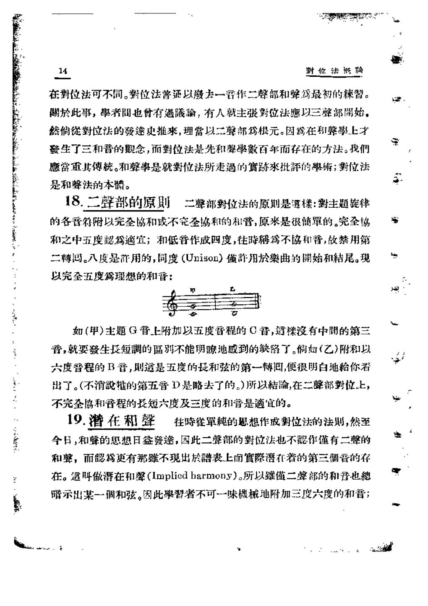

# 对位法概论 · 教材原页

缪天瑞 · 1 个已引用页 · PDF 物理页码

> OCR 仅用于检索；谱例与临时记号以扫描图为准。

## PDF 第 16 页



### OCR

```text
對位法概輪
14
在對位法可不同。对位法普通以去一寻作二聲部和聲為最初的辣習。
關於此事，學者問也會有過輸，有人就主张對位法應以三聲部開始，
然倘徙對位法的發達史推來，理赏以二聲部根元。因翁在和擎學上才
發生了三和音的觀念，而對位法是先和馨學数百年而存在的方法。我們
愿當重其傅统。和聲事是就對位法所走過的實卧來批评的學術；對位法
是和聲法的本。
18.二聲部的原则二聲部对位法的原则是通樣：對主题旋律
的各音符附以完全協和或不完全協和的和普，原來是很簡單的。完全協
和之中五度適宜；和低音作成四度，往時為不協和普，故禁用第
二轉码。八度是許用的，同度（Unison）优新用於樂曲的開始和秸尾。现
以完全五度為理想的和音：
晋，就要發生長短調的區别不能明嗦地感到的缺陷了。倘如（乙）附和以
六度晋程的B音，则這是五度的長和弦的第-一轉间，便很明白地你看
不完全和音程的長短六度及三度的和普是適宜的。
19.潜在和聲
往时單純的思想作成對位法的法则，然至
今日，和聲的思想日盒發達，因此二部的對位法也不作谨有二聲的
和聲，而為更有那虽不現出於譜表上前實際落在着的第三個晋的存
在。這呼做潜在和聲（Impliedharmony）。所以虽二擎部的和音也德
示出某一调和弦。因此擎習者不可一味機械地附加三度六度的和普；
```

<a id="claim-species.first-boundaries"></a>
### 第一类：首尾用完全协和，内部避免连续完全协和

二声部一音对一音以协和音程为全部骨架；首尾用同度、五度或八度确认调性，中段连续三个以上完全协和会失去声部独立与音响支撑。

> “二聲部对位法的原则是通樣：對主题旋律的各音符附以完全協和或不完全協和的和普，原來是很簡單的。”

[返回手册](../复调音乐手册.html#species-1)
