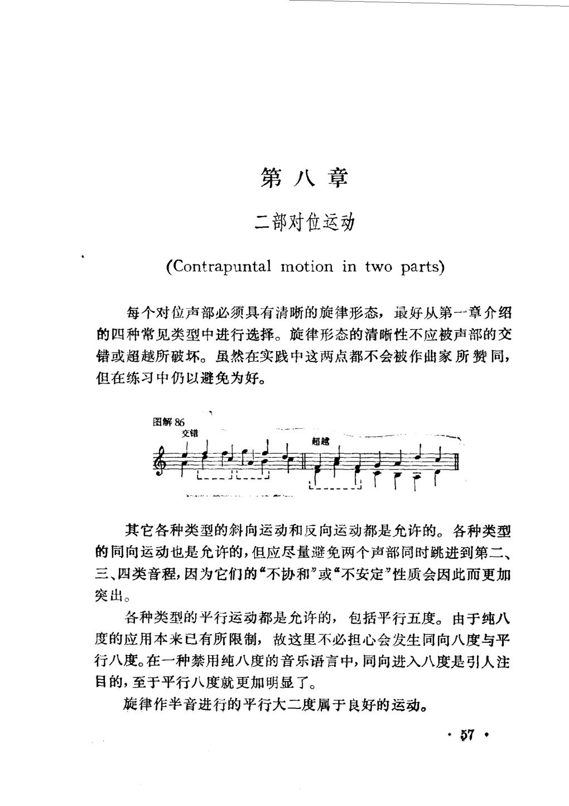
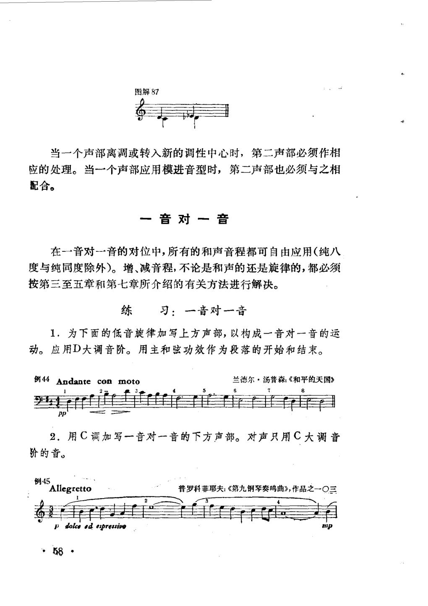
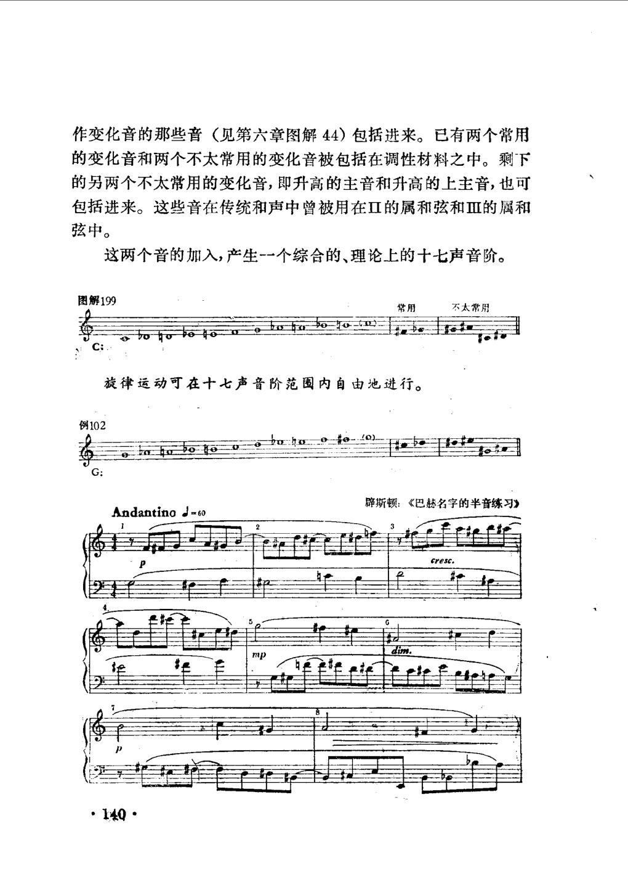

# 现代对位及其和声 · 教材原页

罗伯特·米德尔顿 · 3 个已引用页 · PDF 物理页码

> OCR 仅用于检索；谱例与临时记号以扫描图为准。

## PDF 第 59 页



### OCR

```text
第八章
二部对位运动
(Contrapuntal motion in two parts)
每个对位声部必须具有清晰的旋律形态，最好从第--章介绍
的四种常见类型中进行选择。旋律形态的清晰性不应被声部的交
错或超越所破坏。虽然在实践中这两点都不会被作曲家所赞同，
但在练习中仍以避免为好。
图解86
交错
超越
其它各种类型的斜向运动和反向运动都是允许的。各种类型
的同向运动也是允许的，但应尽量避免两个声部同时跳进到第二、
突出。
各种类型的平行运动都是允许的，包括平行五度。由于纯八
度的应用本来已有所限制，故这里不必担心会发生同向八度与平
行八度。在一种禁用纯八度的音乐语言中，同向进入八度是引人注
目的，至于平行八度就更加明显了。
旋律作半音进行的平行大二度属于良好的运动。
7
```

<a id="claim-modern.parallels"></a>
### 现代对位可以允许平行五度

当纵向音响不再由传统三和弦功能主导时，平行完全音程可以成为有控制的线条结果。米德尔顿的规则同时保留了纯八度的限制；这不是“所有现代作品都如此”。

> “各种类型的平行运动都是允许的，包括平行五度。由于纯八度的应用本来已有所限制，故这里不必担心会发生同向八度与平行八度。”

[返回手册](../复调音乐手册.html#modern)

<a id="claim-modern.linear"></a>
### 现代线条优先考虑旋律形态与声部独立

每个对位声部仍要有清楚的旋律形态；交错与超越会破坏辨识度。和声可以自由，但线条的方向、临界音与跳进补偿仍要控制。

> “每个对位声部必须具有清晰的旋律形态……旋律形态的清晰性不应被声部的交错或超越所破坏。”

[返回手册](../复调音乐手册.html#modern)

## PDF 第 60 页



### OCR

```text
图解87
当一个声部离调或转入新的调性中心时，第二声部必须作相
应的处理。当一个声部应用模进音型时，第二声部也必须与之相
配合。
一音对一音
在一一音对-一音的对位中，所有的和声音程都可自由应用（纯八
度与纯同度除外）。增、减音程，不论是和声的还是旋律的，都必须
按第三至五章和第七章所介绍的有关方法进行解决。
练习：一音对一音
1．为下面的低音旋律加写上方声部，以构成一音对一音的运
动。应用D大调音阶。用主和弦功效作为段落的开始和结束。
例44Andanteconmoto
兰德尔·汤普森：《和平的天国》
8
21
pp
2．用C调加写一音对一音的下方声部。对声只用C大调音
阶的音。
例45
普罗科菲耶夫：《第九钢琴奏鸣曲》，作品之一O三
Allegretto
1 dolce ed espressivo
58
```

<a id="claim-modern.intervals"></a>
### 现代对位中的音程选择服从音阶与语境

一音对一音可以使用除纯八度、同度外的多数和声音程；增减音程仍要按所选音阶模式处理。判断依据从“固定和弦功能”转为“音阶集合与旋律解决”。

> “在一音对一音的对位中，所有的和声音程都可自由应用（纯八度与纯同度除外）。增、减音程……必须按……方法进行解决。”

[返回手册](../复调音乐手册.html#modern)

## PDF 第 142 页



### OCR

```text
作变化音的那些音（见第六章图解44）包括进来。已有两个常用
的变化音和两个不太常用的变化音被包括在调性材料之中。剩下
的另两个不太常用的变化音，即升高的主音和升高的上主音，也可
包括进来。这些音在传统和声中曾被用在Ⅱ的属和弦和Ⅲ的属和
弦中。
这两个音的加入，产生-一个综合的、理论上的十七声音阶。
图解199
不太常用
常用
旋律运动可在十七声音阶范围内自由地进行。
例102
辟斯顿：《巴赫名字的半音练习》
AndantinoJ=60
cresc.
```

<a id="claim-modern.scale"></a>
### 调性材料可以扩张到十七声音阶

把更多变化音纳入同一调性中心后，旋律可在更大的音高集合内运动；这解释了为什么现代对位既能保持中心，又能使用高度半音化的线条。

> “这两个音的加入，产生一个综合的、理论上的十七声音阶。……旋律运动可在十七声音阶范围内自由地进行。”

[返回手册](../复调音乐手册.html#modern)
