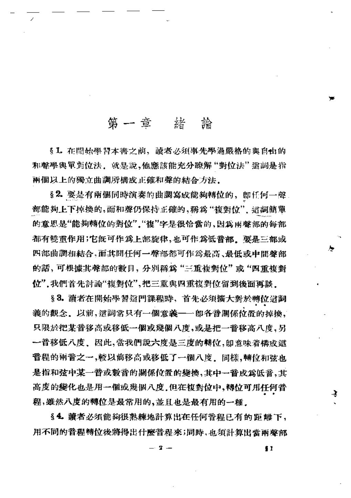
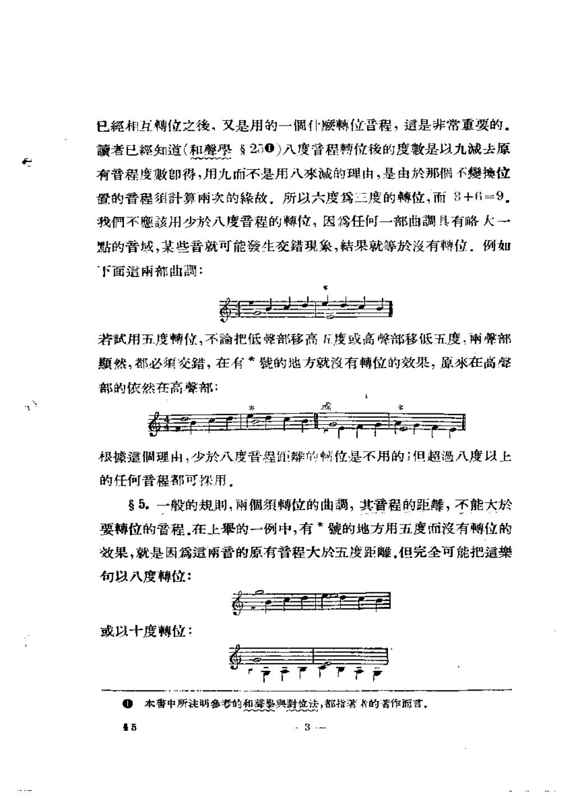
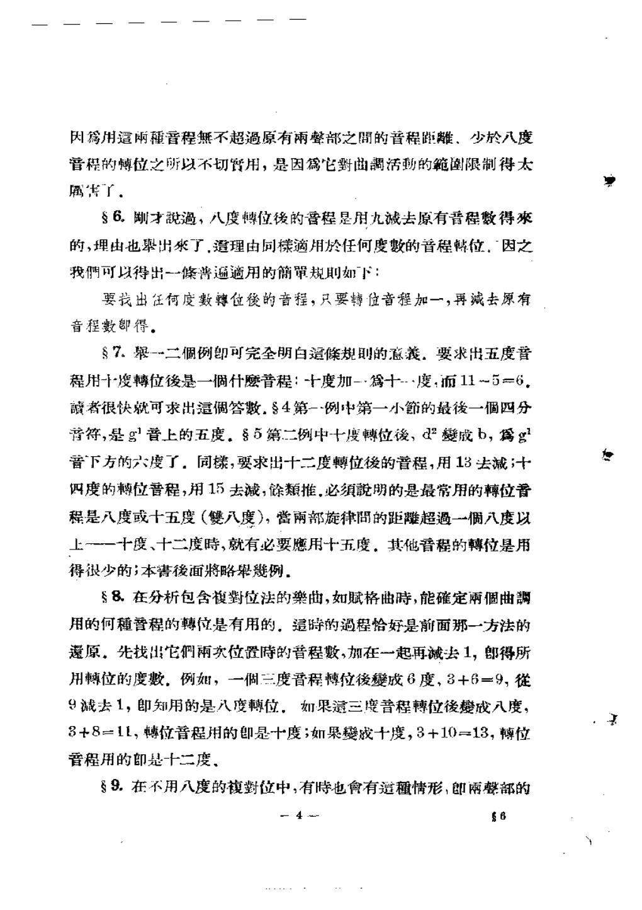
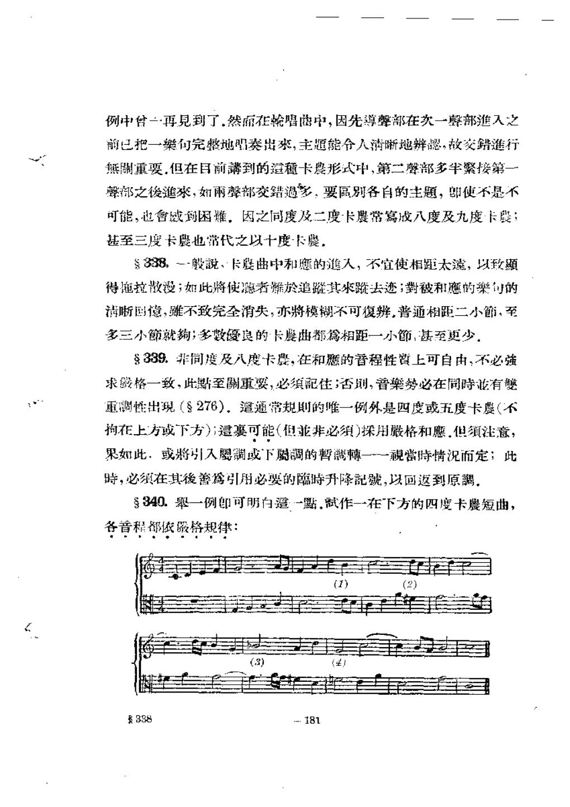

# 复对位法与卡农 · 教材原页

伊·普劳特 · 4 个已引用页 · PDF 物理页码

> OCR 仅用于检索；谱例与临时记号以扫描图为准。

## PDF 第 15 页



### OCR

```text
第一章
1.在開始學肾本書之前，讀者必须事先過格的奥自由的
和馨學舆單對位法，就是説，他愿該能充分晾解“對位法”遣嗣是指
雨個以上的獨立曲調所楼成正確和聲的结合方法，
82.要是有雨同時演奏的曲調寫成能轉位的，即任何一聲
部能上下掉换的，而和聲仍保持正確的，篇“馥對位”，遣簡單
的意思是“能轉位的背位”“複”字是很怡当的，因兩馨部的每部
都有雙重作用；它既可作上部旋律，也可作篇低音部，要是三部或
四部曲調相結合，而其開任何一馨部都可作為最高、最低或中間聲部
的話，可根其聲部的數目，分别“三重復对位”或“四重複對
位”.我們首先讨“對位”，把三重奥四重夜對位留到後面再。
3.讀者在開始學智這門課程時，首先必须大對於轉位遣調
義的觀念，以前，這常只有一個意羲一一郎各音關保位置的掉換，
只限於把某音移高或移低一個或個八度，或是把一音移高八度，另
-音移低八度、因此，當我們六度是三度的轉位，即意味着構成這
管程的兩普之一，较以前移高或移低了一個八度，同樣，轉位和弦也
是指和弦中某一音或數音的開係位置的换，其中一普成篇低音，其
高度的疑化也是用一個或個八度.但在馥對位中，轉位可用任何普
程，然八度的轉位是最常用的，且也是最有用的一種。
4.者必须能很熟辣地計算出在任何晋程已有的距離下，
用不同的普程轉位後將得出什魔普程來；同時，也须計算出當雨馨部
一&一
1
```

<a id="claim-invert.definition"></a>
### 复对位：交换声部后和声仍然成立

复对位的核心不是“写两条好旋律”，而是同一对音高关系在上下交换后仍满足纵向规则。写作时必须同时检查原位与转位。

> “要是有两个同时演奏的曲调写成能转位的，即任何一声部能上下掉换的，而和声仍保持正确的，为复对位。”

[返回手册](../复调音乐手册.html#invertible)

## PDF 第 16 页



### OCR

```text
已經相互轉位之後，又是用的一個仆轉位晋程，這是非常重要的，
者已經知道（和聲學20）八度音程轉位後的度數是以九减去原
有看程度敷即得，用九而不是用八來减的理由，是由於那偶不矮换位
置的音程须計算兩次的緣故。所以六度為三度的轉位，而8+6=9.
我們不該用少於八度晋程的轉位，因為任何一部曲調具有略人一
點的普域，某些音就可能發生交錯現象，結果就等於没有轉位。例如
下面遣兩部曲調：
若試用五度博位，不把低聲部移高丘度或高聲部移低五度，雨聲部
然，都必须交錯，在有*號的地方就没有轉位的效果，原求在高学
部的依然在高聲部：
或
根據遣调理由：少於八度普星距鳞的蚂位是不用的；但超過入度以上
的任何音程都可探用。
5.一般的规期，兩個须轉位的曲，其音程的距，不能大於
要轉位的普程.在上举的一例中，有*號的地方用五度而没有轉位的
效果，就是因為這雨音的原有音程大於五度距離.但完全可能把這樂
句以八度轉位：
或以十度博位：
本書中所注明参考的和墨與對位法，都指署具的著作丽言。
5
```

<a id="claim-hist.strict-training"></a>
### 严格复对位是进入自由写作的训练，不是创作禁令

复对位的严格练习把可转位性、协和框架与声部独立压缩成可控条件；实际作品仍按风格放松细节。

> “对于实际作曲中所应用的复对位而言，这只能算作一种基本的入门技术；然而，严格对位的基本原则，还是要遵的。”

[返回手册](../复调音乐手册.html#periods)

## PDF 第 17 页



### OCR

```text
属焦了，
6.剛才说過，八度博位後的晋程是用九减去原有晋程数得来
的，理由也率出來了.造理由同樣滴用於任何度数的音程韩位，因之
我們可以得出-條普遍適用的簡單规期如下：
要找出任何度數轉位後的音程，只要搏位音程加一，再减去原有
音程數即得，
7。一二个例即可完全明白遗條规别的意义，要求出五度音
程用--度轉位後是一個什音程：-十度加--為十--度，而11～5=6.
者很快就可求出这偶答數.84第-例中第一小的最後一個四分
音符，是g普上的五度。85第二例中-十度轉位後、d變成b，禽g
音下方的六度了，同樣，要求出十二度轉位後的普程，用13去减；十
四度的轉位音程，用15去减，馀類推.必须明的是最常用的轉位普
程是八度或十五度（雙八度），当南部旋律問的距超過一调八度以
上一一十度、十二度時，就有必要應用十五度。其他音程的轉位是用
得很少的；本後面將略毕例，
8.在分析包含復對位法的藥曲，如赋格曲时，能確定雨個曲調
用的何種管程的轉位是有用的，退时的過程恰好是前面那一方法的
远原，先找出它們雨次位置时的音程數，加在一起再诫去1，即得所
用轉位的度數，例如，一個三度音程博位後變成6度，3+6=9，
9藏去1，即知用的是八度轉位，如果遗三度普程轉位後變戏八度，
3+8=11，轉位普程用的即是十度；如果成十度，3+10=13，轉位
普程用的即是十二度、
9.在不用八度的復對位中，有时也會有這種情形，即雨馨部的
- 4
S6
```

<a id="claim-invert.formula"></a>
### 转位音程的公式：转位度数加一，再减原音程度数

八度转位用 9 减原音程；十度用 11 减；十二度用 13 减。这个公式直接决定哪些音程会在转位后变成不协和。

> “要找出任何度数转位后的音程，只要转位音程加一，再减去原有音程数即得。”

[返回手册](../复调音乐手册.html#invertible)

## PDF 第 194 页



### OCR

```text
例中一再见到了.然在轮唱茁中，因先導聲部在次一聲部進入之
前已把一樂句完整地唱奏出來，主题能合人清晰地辨懿·故交錯進行
無開重要.但在目前講到的道種卡段形式中，第二聲部多半繁接第一
聲部之後進來，如雨聲部交錯過多，要區别各自的主题，即使不是不
可能，也會感到困耀，因之同度及二度卡晨常寫成八度及九度卡股；
甚至三度卡也常代之以十度卡農，
338。一般，卡曲中和愿的進人，不宜使相距太遠，以致额
得施拉散漫；如此将使者於追其來去迹；對被和應的樂可的
清晰国憶，離不致完全消失，亦將模糊不可復辨，普通相距二小，至
多三小節就狗，多数優良的卡晨曲都為相距一小節，甚至更少，
8339.非同度及八度卡，在和的普程性算上可自由，不必强
求格一致、此點至刷重要，必须記住；否则，普樂势必在同时有雙
重调性出现（276），这通常规则的唯一例外是四度或五度卡晨（不
拘在上方或下方）这裹可能（但非必须）探用格和愿.但注意，
果如此，或將引入國调或下腐調的暂博一一當時情况而定；此
时，必须在其後蓄為引用必要的离时升降記號，以回返到原，
340.翠一例朗可明白这一點，试作一在下方的四度卡晨短曲，
各音程都依微格规律：
(1)
（2）
（3）
（）
338
181
```

<a id="claim-canon.delay"></a>
### 进入距离通常一到三小节

进入太晚，主题的对应关系难被记住；进入太早，声部容易交错。常见做法是一个小节左右，具体由主题长度和音程决定。

> “普通相距二小节，至多三小节就够，多数优良的卡农曲都为相距一小节，甚至更少。”

[返回手册](../复调音乐手册.html#canon)

<a id="claim-canon.overlap"></a>
### 紧接进入会压缩声部空间

同度或二度卡农常因声部交错难以辨认，于是改写为八度或十度卡农；这不是规避规则，而是在保持卡农关系的同时保留声部辨识度。

> “同度及二度卡农常写成八度及九度卡农；甚至三度卡农也常代之以十度卡农。”

[返回手册](../复调音乐手册.html#canon)
