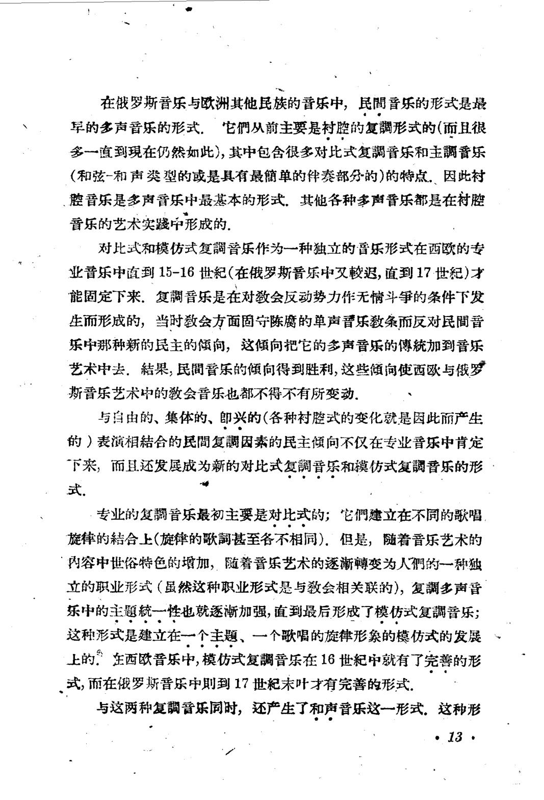

# 复调音乐 · 教材原页

斯克列勃科夫 · 1 个已引用页 · PDF 物理页码

> OCR 仅用于检索；谱例与临时记号以扫描图为准。

## PDF 第 16 页



### OCR

```text
在俄罗斯音乐与欧洲其他民族的普乐中，民間音乐的形式是最
早的多声音乐的形式，它們从前主要是衬腔的复調形式的（而且很
多一直到現在仍然如此），其中包含很多对比式复調音乐和主調音乐
（和弦-和声类型的或是具有最簡单的件奏部分的）的特点.因此衬
、腔音乐是多声音乐中最基本的形式.其他各种多声音乐都是在衬腔
音乐的艺术实践中形成的.
对比式和模仿式复調音乐作为一种独立的音乐形式在西欧的专
业音乐中直到15-16世紀（在俄罗斯音乐中叉较迟，直到17·世纪）才
能固定下来，复調音乐是在对数会反动势力作无情斗争的条件下发
生而形成的，当时教会方面固守陈腐的单声音乐教条而反对民間音
乐中那种新的民主的倾向，这倾向把它的多声音乐的傅統加到音乐
艺术中去．結果，民間音乐的倾向得到胜利，这些随向使西欧与俄罗
斯音乐艺术中的教会音乐也都不得不有所变动.
与自由的、集体的、郎兴的（各种衬腔式的变化就是因此丽产生
的）表演相結合的民間复調因素的民主倾向不仅在专业音乐中肯定
下来，而且还发展成为新的对比式复調音乐和模仿式复調音乐的形
式。
·专业的复音乐最初主要是对比式的；它們建立在不同的歌唱
旋律的結合上（旋律的歌甚至各不相同），但是，随着音乐艺术的
内容中世俗特色的增加，随着音乐艺术的逐渐轉变为人們的一种独
立的职业形式（虽然这种职业形式是与教会相关联的），复調多声音
乐中的主题統一性也就逐渐加强，直到最后形成了模仿式复调音乐；
这种形式是建立在一个主题、一个歌唱的旋律形象的模仿式的发展
上的：在西欧普乐中，模仿式复調音乐在16世紀中就有了完善的形
式，而在俄罗斯音乐中则到17世起末叶才有完善的形式。
与这两种复音乐同时，还产生了和声音乐这一形式，这种形
13
```

<a id="claim-hist.style-system"></a>
### 对位规则依附于当时的调式与和声语言

分类对位不是超历史的自然法。文艺复兴调式、巴洛克大小调与二十世纪音高组织，会改变什么算协和、什么算必须解决的 dissonance。

> “对比式和模仿式复調音乐作为一种独立的音乐形式在西欧的专业音乐中直到15-16世紀”

[返回手册](../复调音乐手册.html#periods)
