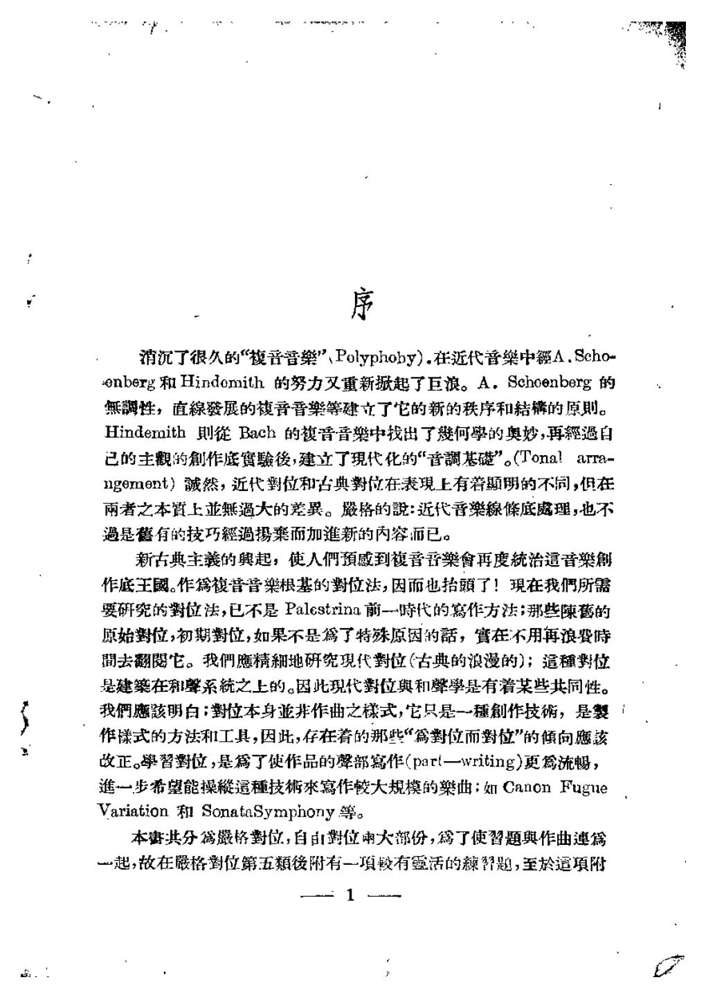
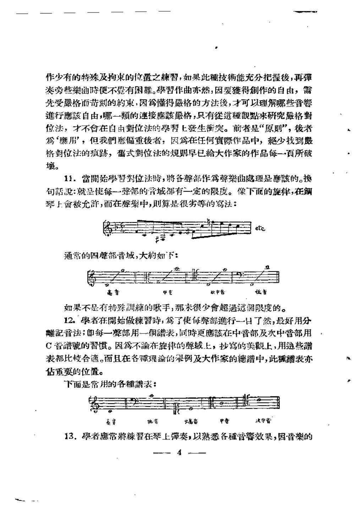

# 实用对位法 · 教材原页

苏夏 · 2 个已引用页 · PDF 物理页码

> OCR 仅用于检索；谱例与临时记号以扫描图为准。

## PDF 第 3 页



### OCR

```text
消沉了很久的“復音普樂”Polyphoby）.在近代音樂中额A.Scho
enberg和Hindomith的努力叉重新起了巨浪。A。Schoenberg的
無性，直線發展的音晋樂等建立了它的新的秩序和結的原则。
Hindemith则徙Bach的馥音音樂中找出了何學的奥妙，再經過自
己的主觀的創作庭寶驗後，建立了現代化的“音調基”。（Tona！ara-
ngement）誠然，近代對位和古典对位在表現上有着题明的不同，但在
雨者之本上业無過大的差巽。殿格的：近代音樂線條底處理，也不
過是舊有的技巧經過摄而加進新的内容而已。
新古典主義的與起，使人們预感到夜音言樂會再度統治這音樂
作底王國。作写復音音樂根基的對位法，因而也抬頭了！現在我們所
要研究的對位法，已不是Palestrina前一時代的寫作方法；那些陳蓄的
原始對位，初期對位，如果不是為了特殊原因的話，實在不用再浪費时
間去翻朗它。我們應精地研究現代對位（古典的浪漫的）；這種数位
是建在和聲系统之上的。因此现代對位與和聲学是有着某些共同性。
我們應該明白：對位本身非作曲之樣式，它只是一種創作技，是裂
作樣式的方法和工具，因此，存在着的那些“篇對位而對位”的倾向應該
改正。學習對位，是為了使作品的聲部寫作（part一writing）更為流畅，
進一步希望能操這種技來寫作大规模的樂曲；如CanonFugne
Variation和SonataSymphony等。
本妻共分為格對位，自由對位兩大部份，為了使習题與作曲連
一起，故在格對位第五類後附有一填较有靈活的暂题，至於运填附
```

<a id="claim-hist.style-system"></a>
### 对位规则依附于当时的调式与和声语言

分类对位不是超历史的自然法。文艺复兴调式、巴洛克大小调与二十世纪音高组织，会改变什么算协和、什么算必须解决的 dissonance。

> “近代對位和古典对位在表現上有着题明的不同，但在雨者之本上业無過大的差巽。”

[返回手册](../复调音乐手册.html#periods)

## PDF 第 8 页



### OCR

```text
作少有的特殊及拘束的位置之棘習：如果此種技能充分把握後，再强
旁些樂曲時便不覺有困難。學習作曲亦然，因要發得作的自由，需
先受格而苛刻的約束，因為懂得格的方法後，才可以理解哪些音響
進行應自由，哪一類的连接應該格，只有這種觀點冰研究格對
位法，才不會在自由對位法的學習上發生衡笑。前者是“原则”，後者
怎“赚用”，但我們愿偏重後者，因為在任何實际作品中，少找到
格對位法的痕跳，什式数位法的规则早已給大作家的作品每一百所破
壤。
11.當開始學習對位法时，将各聲部作為聲樂曲處理是應該的。換
句話：就是便每一整部的音域都有一定的限度。像下面的旋律，在鋼
琴上會被允許，而在葬楽中，则算是很劣等的寫法：
通常的四聲部音域，大約如下：
高音
低音
中书
如果不是有特殊訓辣的歌手，那未很少會超過這调限度的。
12.學者在開始做辣習时，為了使每聲部進行-一日了然，最好用分
離記音法；即每一聲部用一個譜表，同时更應該在中音部及次中音部用
C音譜號的習惯。因不在旋律的聲域上，抄寫的美觀上，用通些譜
表都比合適。而且在各理的谬例及大作家的譜中，此種譜表亦
估重要的位置。
下面是常用的各種譜表：
决中音
中音
高容
编音
女高音
13.者應常將習在琴上弹奏，以熟悉各種音霉效果，因音樂的
```

<a id="claim-hist.strict-training"></a>
### 严格复对位是进入自由写作的训练，不是创作禁令

复对位的严格练习把可转位性、协和框架与声部独立压缩成可控条件；实际作品仍按风格放松细节。

> “因要發得作的自由，需先受格而苛刻的約束”

[返回手册](../复调音乐手册.html#periods)
