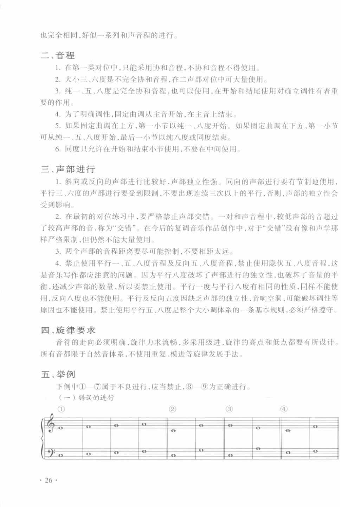
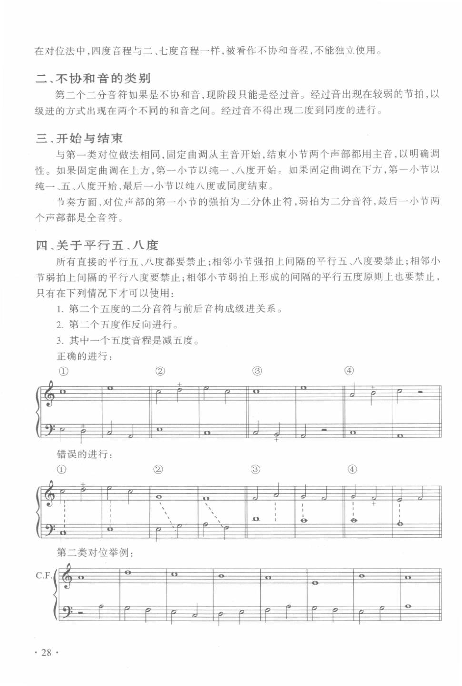
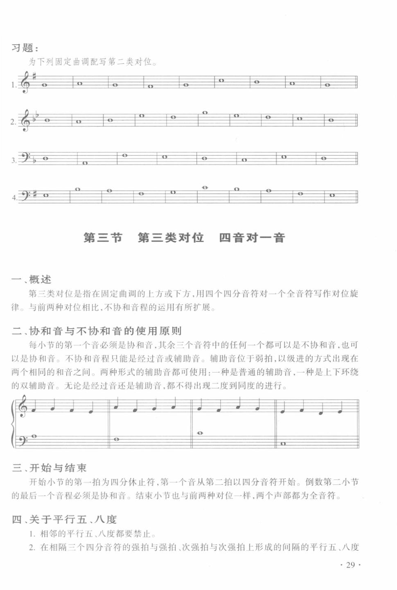
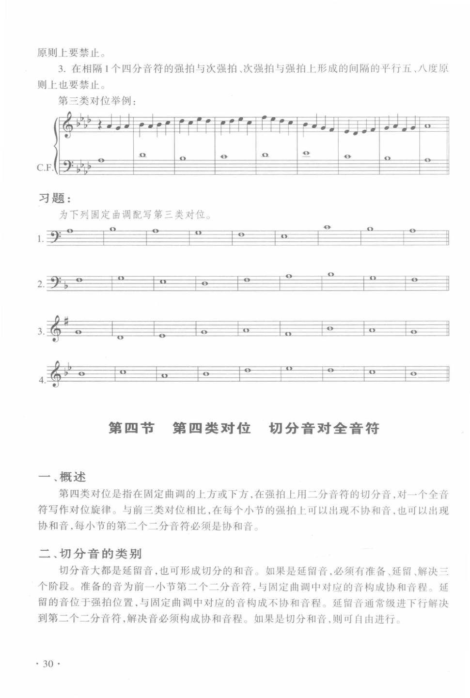
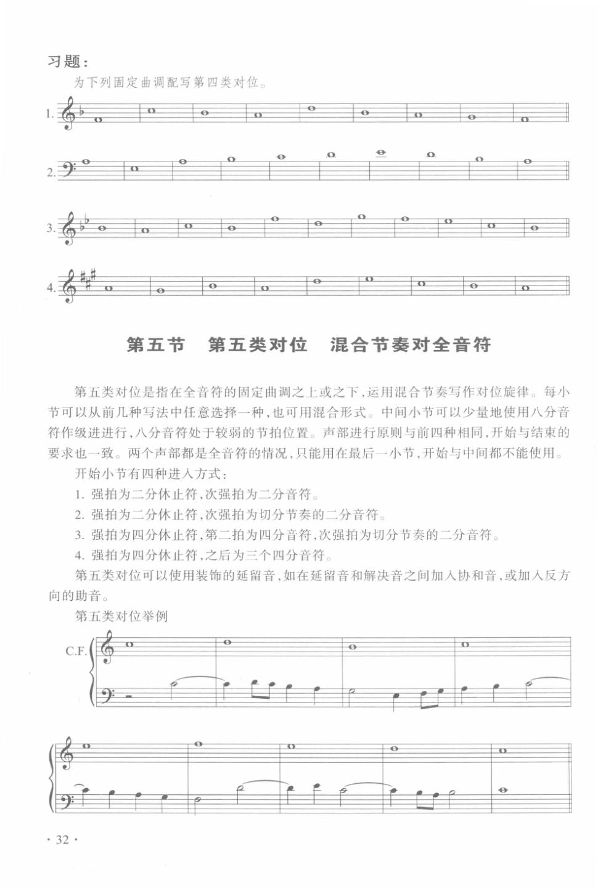

# 复调音乐分析与写作 · 教材原页

文锋 · 5 个已引用页 · PDF 物理页码

> OCR 仅用于检索；谱例与临时记号以扫描图为准。

## PDF 第 34 页



### OCR

```text
也完全相同，好似一系列和声音程的进行。
二、音程
1.在第一类对位中，只能采用协和音程，不协和音程不得使用
2.大小三、六度是不完全协和音程，在二声部对位中可大量使用。
3.纯一、五、八度是完全协和音程，也可以使用，在开始和结尾使用对确立调性有着重
要的作用。
4.为了明确调性，固定曲调从主音开始，在主音上结束。
5.如果固定曲调在上方，第一小节以纯一、八度开始。如果固定曲调在下方，第一小节
可从纯一、五、八度开始，最后一小节以纯八度或同度结束。
6.同度只允许在开始和结束小节使用，不要在中间使用，
三、声部进行
1.斜向或反向的声部进行比较好，声部独立性强。同向的声部进行要有节制地使用，
平行三、六度的声部进行要受到限制，不要出现连续三次以上的平行，否则，声部的独立性会
受到影响。
2.在最初的对位练习中，要严格禁止声部交错。一对和声音程中，较低声部的音超过
了较高声部的音，称为“交错”。在今后的复调音乐作品创作中，对于“交错”没有像和声学那
样严格限制，但仍然不能大量使用。
3.两个声部的音程距离要尽可能控制，不要相距太远
4.禁止使用平行一、五、八度音程及反向五、八度音程，禁止使用隐伏五、八度音程，这
是音乐写作都应注意的问题。因为平行八度破坏了声部进行的独立性，也破坏了音量的平
衡，还减少声部的数量，所以要禁止使用。平行一度与平行八度有相同的性质，同样不能使
用，反向八度也不能使用。平行及反向五度因缺乏声部的独立性，音响空洞，可能破坏调性等
原因也不能使用。禁止使用平行五、八度是整个大小调体系的一条基本规则，必须严格遵守。
四、旋律要求
音符的走向必须明确，旋律力求流畅，多采用级进，旋律的高点和低点都要有所设计。
所有音都限于自然音体系，不使用重复、模进等旋律发展手法。
五、举例
下例中①—属于不良进行，应当禁止，⑧一9为正确进行。
（一）错误的进行
①
②
③
④
·26·
```

<a id="claim-species.first-boundaries"></a>
### 第一类：首尾用完全协和，内部避免连续完全协和

二声部一音对一音以协和音程为全部骨架；首尾用同度、五度或八度确认调性，中段连续三个以上完全协和会失去声部独立与音响支撑。

> “在第一类对位中，只能采用协和音程，不协和音程不得使用”

[返回手册](../复调音乐手册.html#species-1)

## PDF 第 36 页



### OCR

```text
在对位法中，四度音程与二、七度音程一样，被看作不协和音程，不能独立使用。
二、不协和音的类别
第二个二分音符如果是不协和音，现阶段只能是经过音。经过音出现在较弱的节拍，以
级进的方式出现在两个不同的和音之间。经过音不得出现二度到同度的进行。
三、开始与结束
与第一类对位做法相同，固定曲调从主音开始，结束小节两个声部都用主音，以明确调
性。如果固定曲调在上方，第一小节以纯一、八度开始。如果固定曲调在下方，第一小节以
纯一、五、八度开始，最后一小节以纯八度或同度结束。
节奏方面，对位声部的第一小节的强拍为二分休止符，弱拍为二分音符，最后一小节两
个声部都是全音符。
四、关于平行五、八度
所有直接的平行五、八度都要禁止；相邻小节强拍上间隔的平行五、八度要禁止；相邻小
节弱拍上间隔的平行八度要禁止；相邻小节弱拍上形成的间隔的平行五度原则上也要禁止，
只有在下列情况下才可以使用：
1.第二个五度的二分音符与前后音构成级进关系。
2.第二个五度作反向进行。
3.其中一个五度音程是减五度。
正确的进行：
②
③
④
错误的进行：
①
?
③
4
第二类对位举例：
28·
```

<a id="claim-species.second-passing"></a>
### 第二类：强拍协和，弱拍才容纳经过音与辅助音

二音对一音把每小节前半拍当作和声骨架。弱拍 dissonance 必须由级进产生并级进离开；跳到弱拍时，落点应仍是同一和弦的和弦音。

> “第二个二分音符如果是不协和音，现阶段只能是经过音。”

[返回手册](../复调音乐手册.html#species-2)

## PDF 第 37 页



### OCR

```text
习题：
为下列固定曲调配写第二类对位。
第三节第三类对位四音对一音
一、概述
第三类对位是指在固定曲调的上方或下方，用四个四分音符对一个全音符写作对位旋
律。与前两种对位相比，不协和音程的运用有所扩展。
二、协和音与不协和音的使用原则
每小节的第一个音必须是协和音，其余三个音符中的任何一个都可以是不协和音，也可
以是协和音。不协和音程只能是经过音或辅助音。辅助音位于弱拍，以级进的方式出现在
两个相同的和音之间。两种形式的辅助音都可使用：一种是普通的辅助音，一种是上下环绕
的双辅助音。无论是经过音还是辅助音，都不得出现二度到同度的进行。
三、开始与结束
开始小节的第一拍为四分休止符，第一个音从第二拍以四分音符开始。倒数第二小节
的最后一个音程必须是协和音。结束小节也与前两种对位一样，两个声部都为全音符。
四、关于平行五、八度
1.相邻的平行五、八度都要禁止
2.在相隔三个四分音符的强拍与强拍、次强拍与次强拍上形成的间隔的平行五、八度
29
```

<a id="claim-species.third-parallels"></a>
### 第三类：平行五、八度按实际发声音程判断

四音对一音不因节奏变快而放宽平行完全音程。要检查相邻发声音符形成的五度/八度，而不只看每拍第一个音。

> “相邻的平行五、八度都要禁止”

[返回手册](../复调音乐手册.html#species-3)

## PDF 第 38 页



### OCR

```text
原则上要禁止。
3.在相隔1个四分音符的强拍与次强拍、次强拍与强拍上形成的间隔的平行五、八度原
则上也要禁止。
第三类对位举例：
习题：
为下列固定曲调配写第三类对位。
1.9
0
第四节第四类对位切分音对全音符
一、概述
第四类对位是指在固定曲调的上方或下方，在强拍上用二分音符的切分音，对一个全音
符写作对位旋律。与前三类对位相比，在每个小节的强拍上可以出现不协和音，也可以出现
协和音，每小节的第二个二分音符必须是协和音。
二、切分音的类别
切分音大都是延留音，也可形成切分的和音。如果是延留音，必须有准备、延留、解决三
个阶段。准备的音为前一小节第二个二分音符，与固定曲调中对应的音构成协和音程。延
留的音位于强拍位置，与固定曲调中对应的音构成不协和音程。延留音通常级进下行解决
到第二个二分音符，解决音必须构成协和音程。如果是切分和音，则可自由进行。
·30·
```

<a id="claim-species.fourth-suspension"></a>
### 第四类：延留音要经过预备、强拍不协和、下行级进解决

切分音把前一弱拍的和弦音带入下一强拍。若该音在新和声上不协和，它就必须在强拍承担张力，并向下级进解决。严格对位中不接受上行或跳进解决。

> “如果是延留音，必须有准备、延留、解决三个阶段。”

[返回手册](../复调音乐手册.html#species-4)

## PDF 第 40 页



### OCR

```text
习题：
为下列固定曲调配写第四类对位。
第五节第五类对位混合节奏对全音符
第五类对位是指在全音符的固定曲调之上或之下，运用混合节奏写作对位旋律。每小
节可以从前几种写法中任意选择一种，也可用混合形式。中间小节可以少量地使用八分音
符作级进进行，八分音符处于较弱的节拍位置。声部进行原则与前四种相同，开始与结束的
要求也一致。两个声部都是全音符的情况，只能用在最后一小节，开始与中间都不能使用。
开始小节有四种进人方式：
1.强拍为二分休止符，次强拍为二分音符。
2.强拍为二分休止符，次强拍为切分节奏的二分音符。
3.强拍为四分休止符，第二拍为四分音符，次强拍为切分节奏的二分音符。
4.强拍为四分休止符，之后为三个四分音符
第五类对位可以使用装饰的延留音，如在延留音和解决音之间加人协和音，或加入反方
向的助音。
第五类对位举例
```

<a id="claim-species.fifth-rhythm"></a>
### 第五类：混合节奏仍服从强拍和声，但不能机械重复

第五类把前四类的音型合并。判断标准不是音符越多越自由，而是每个结构强拍仍能读出和声，同时各声部的节奏重音错开。

> “第五类对位是指在全音符的固定曲调之上或之下，运用混合节奏写作对位旋律。”

[返回手册](../复调音乐手册.html#species-5)
