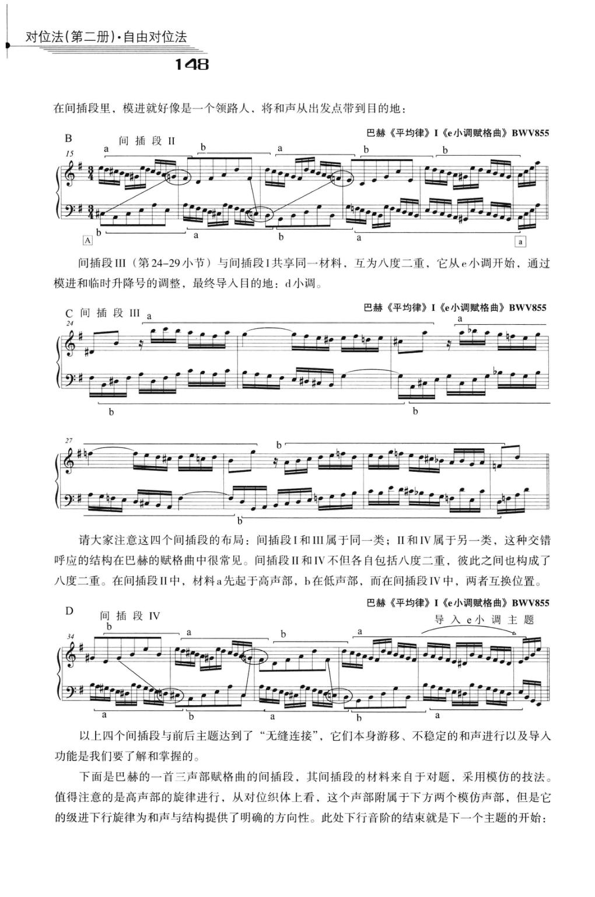
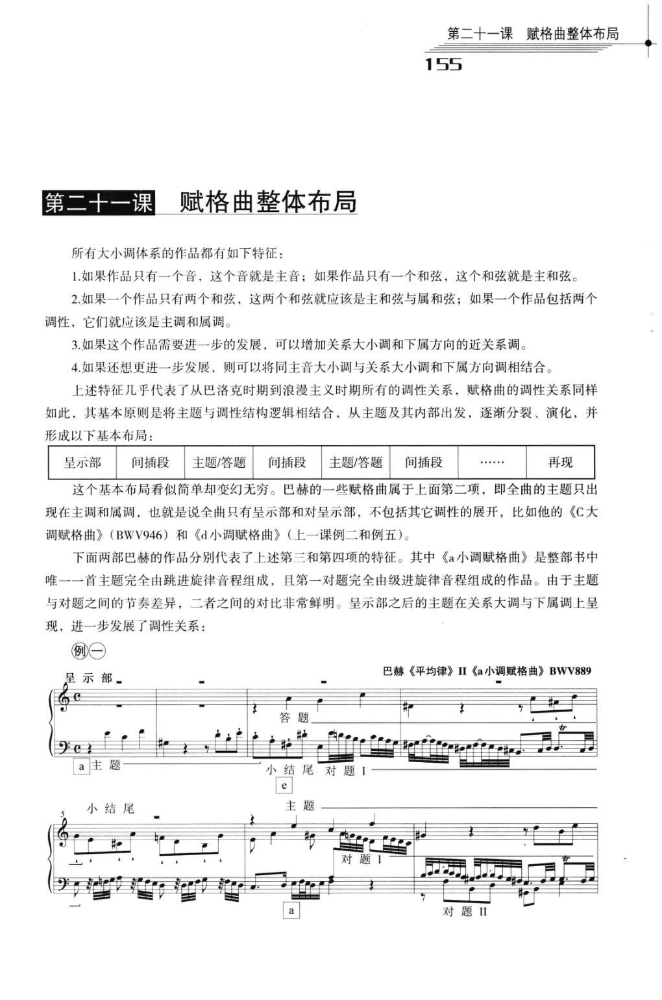

# 对位法（第二册）·自由对位法 · 教材原页

杨勇 · 2 个已引用页 · PDF 物理页码

> OCR 仅用于检索；谱例与临时记号以扫描图为准。

## PDF 第 158 页



### OCR

```text
对位法（第二册）·自由对位法
148
在间插段里，模进就好像是一个领路人，将和声从出发点带到目的地：
巴赫《平均律》I《e小调赋格曲》BWV855
B
间插段
间插段III（第24-29小节）与间插段I共享同一材料，互为八度二重，它从e小调开始，通过
模进和临时升降号的调整，最终导人目的地：d小调。
巴赫《平均律》I《e小调赋格曲》BWV855
间插段
请大家注意这四个间插段的布局：间插段I和IⅢI属于同一类；ⅡI和IV属于另一类，这种交错
呼应的结构在巴赫的赋格曲中很常见。间插段ⅡI和IV不但各自包括八度二重，彼此之间也构成了
八度二重。在间插段ⅡI中，材料a先起于高声部，b在低声部，而在间插段IV中，两者互换位置。
巴赫《平均律》I《e小调赋格曲》BWV855
D
间插段IV
导入e小调主题
以上四个间插段与前后主题达到了“无缝连接”，它们本身游移、不稳定的和声进行以及导人
功能是我们要了解和掌握的。
下面是巴赫的一首三声部赋格曲的间插段，其间插段的材料来自于对题，采用模仿的技法。
值得注意的是高声部的旋律进行，从对位织体上看，这个声部附属于下方两个模仿声部，但是它
的级进下行旋律为和声与结构提供了明确的方向性。此处下行音阶的结束就是下一个主题的开始：
```

<a id="claim-fugue.episode-function"></a>
### 间插段的核心功能是转调与动力

间插段可以短暂离调，也可以完成到新调的过渡；它的材料通常来自主题或对题，但处理更流动、更模进化。

> “间插段……本身游移、不稳定的和声进行以及导入功能是我们要了解和掌握的。”

[返回手册](../复调音乐手册.html#fugue-episode)

## PDF 第 165 页



### OCR

```text
第二十一课赋格曲整体布局
155
第二十一课赋格曲整体布局
所有大小调体系的作品都有如下特征：
1.如果作品只有一个音，这个音就是主音；如果作品只有一个和弦，这个和弦就是主和弦。
2.如果一个作品只有两个和弦，这两个和弦就应该是主和弦与属和弦；如果一个作品包括两个
调性，它们就应该是主调和属调。
3.如果这个作品需要进一步的发展，可以增加关系大小调和下属方向的近关系调。
4.如果还想更进一步发展，则可以将同主音大小调与关系大小调和下属方向调相结合。
上述特征几乎代表了从巴洛克时期到浪漫主义时期所有的调性关系，赋格曲的调性关系同样
如此，其基本原则是将主题与调性结构逻辑相结合，从主题及其内部出发，逐渐分裂、演化，并
形成以下基本布局：
呈示部
间插段
间插段
再现
主题/答题
主题/答题
间插段
......
这个基本布局看似简单却变幻无穷。巴赫的一些赋格曲属于上面第二项，即全曲的主题只出
现在主调和属调，也就是说全曲只有呈示部和对呈示部，不包括其它调性的展开，比如他的《C大
调赋格曲》（BWV946）和《d小调赋格曲》（上一课例二和例五）。
下面两部巴赫的作品分别代表了上述第三和第四项的特征。其中《a小调赋格曲》是整部书中
唯一一首主题完全由跳进旋律音程组成，且第一对题完全由级进旋律音程组成的作品。由于主题
与对题之间的节奏差异，二者之间的对比非常鲜明。呈示部之后的主题在关系大调与下属调上呈
现，进一步发展了调性关系：
例一
巴赫《平均律》ⅡI《a小调赋格曲》BWV889
呈示部
结
对题II
```

<a id="claim-hist.tonal-basis"></a>
### 巴洛克赋格以大小调功能和声为底层

主题、答题、对题与间插段不只是旋律模仿；它们同时承担主属关系、离调、终止与低音持续。

> “上述特征几乎代表了从巴洛克时期到浪漫主义时期所有的调性关系，赋格曲的调性关系同样如此。”

[返回手册](../复调音乐手册.html#periods)
