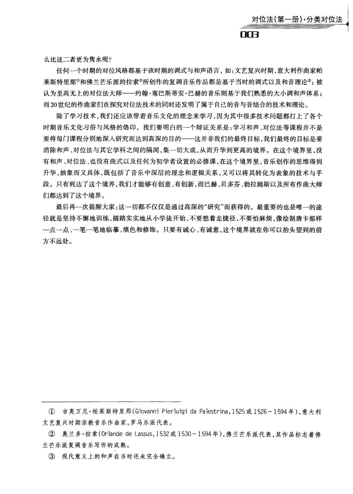
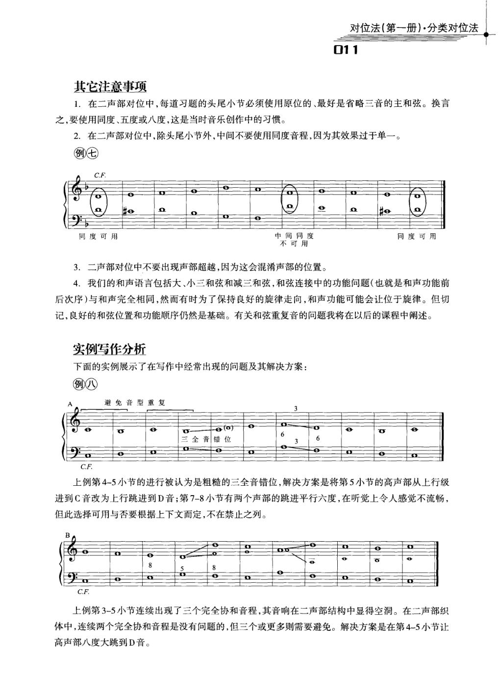
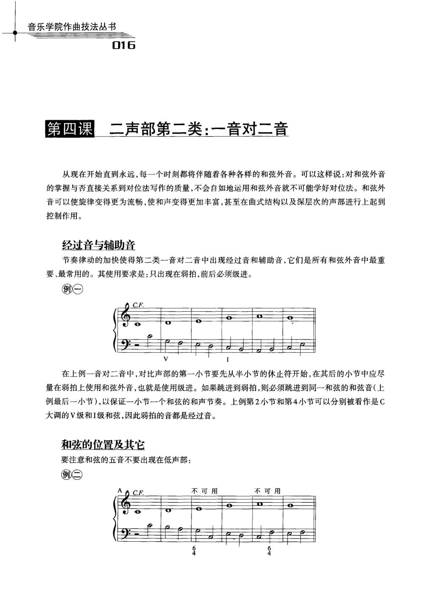
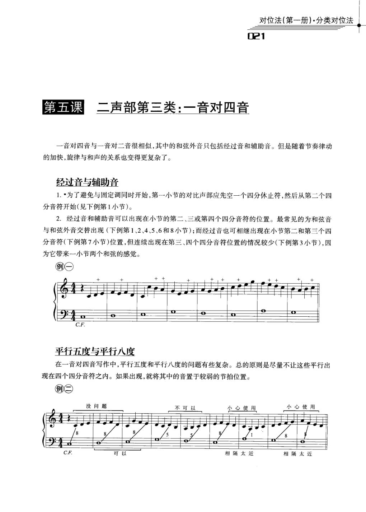
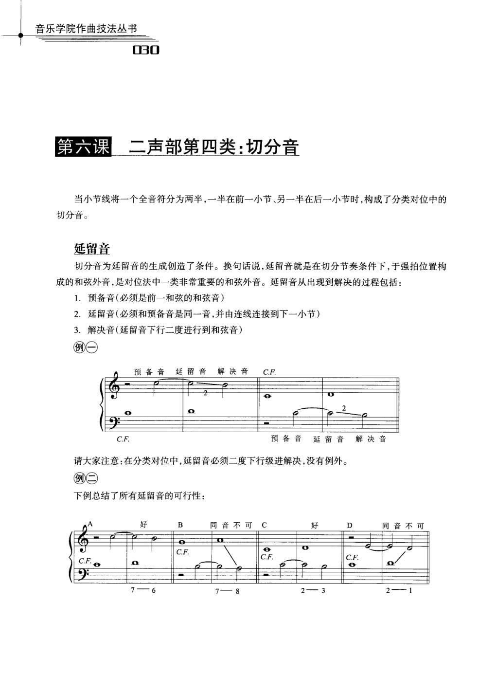

# 对位法（第一册）·分类对位法 · 教材原页

杨勇 · 5 个已引用页 · PDF 物理页码

> OCR 仅用于检索；谱例与临时记号以扫描图为准。

## PDF 第 12 页



### OCR

```text
对位法（第一册）·分类对位法
003
么比这二者更为隽永呢？
任何一个时期的对位风格都基于该时期的调式与和声语言，如：文艺复兴时期，意大利作曲家帕
莱斯特里那?和佛兰芒乐派的拉索?所创作的复调音乐作品都是基于当时的调式以及和音理论?；被
认为至高无上的对位法大师一一约翰·塞巴斯蒂安·巴赫的音乐则基于我们熟悉的大小调和声体系；
而20世纪的作曲家们在探究对位法技术的同时还发明了属于自已的音与音结合的技术和理论。
除了学习技术，我们还应该带着音乐文化的理念来学习，因为其中很多技术问题都打上了各个
时期音乐文化习俗与风格的烙印。我们要明白的一个辩证关系是：学习和声、对位法等课程并不是
要将每门课程分别地深入研究而达到高深的目的一这并非我们的最终目标，我们最终的目标是要
消除和声、对位法与其它学科之间的隔阅，集一切大成，从而升华到更高的境界。在这个境界里，没
有和声、对位法、也没有曲式以及任何为初学者设置的必修课，在这个境界里，音乐创作的思维得到
升华，抽象而又具体，既包括了音乐中深层的理念和逻辑关系，又可以将其转化为表象的技术与手
段。只有到达了这个境界，我们才能够有创意、有创新，而巴赫、贝多芬、勃拉姆斯以及所有作曲大师
们都达到了这个境界。
最后再一次提醒大家：这一切都不仅仅是通过高深的“研究”而获得的。最重要的也是唯一的途
径就是坚持不邂地训练，踏踏实实地从小学徒开始，不要想着走捷径，不要怕麻烦，像绘制唐卡那样
一点一点、一笔一笔地临摹、填色和修饰。只要有诚心、有诚意，这个境界就在你可以抬头望到的前
方不远处。
①吉奥万尼·帕莱斯特里那（GiovanniPierluigidaPalestrina，1525或1526～1594年），意大利
文艺复兴时期宗教音乐作曲家，罗马乐派代表。
②奥兰多·拉索（OrlandedeLassus,1532或1530～1594年），佛兰芒乐派代表，其作品标志着佛
兰芒乐派复调音乐写作的成熟。
③现代意义上的和声在当时还未完全确立。
```

<a id="claim-hist.style-system"></a>
### 对位规则依附于当时的调式与和声语言

分类对位不是超历史的自然法。文艺复兴调式、巴洛克大小调与二十世纪音高组织，会改变什么算协和、什么算必须解决的 dissonance。

> “任何一个时期的对位风格都基于该时期的调式与和声语言。”

[返回手册](../复调音乐手册.html#periods)

## PDF 第 20 页



### OCR

```text
对位法（第一册）·分类对位法
011
其它注意事项
1．在二声部对位中，每道习题的头尾小节必须使用原位的、最好是省略三音的主和弦。换言
之，要使用同度、五度或八度，这是当时音乐创作中的习惯。
2.在二声部对位中，除头尾小节外，中间不要使用同度音程，因为其效果过于单一。
例七
C.F.
中间同度
同度可用
同度可用
不可用
3.二声部对位中不要出现声部超越，因为这会混淆声部的位置。
4.我们的和声语言包括大、小三和弦和减三和弦，和弦连接中的功能问题（也就是和声功能前
后次序）与和声完全相同，然而有时为了保持良好的旋律走向，和声功能可能会让位于旋律。但切
记，良好的和弦位置和功能顺序仍然是基础。有关和弦重复音的问题我将在以后的课程中阐述。
实例写作分析
下面的实例展示了在写作中经常出现的问题及其解决方案：
例八
避免音型重复
每(o)
三全音错位
C.F.
上例第4-5小节的进行被认为是粗糙的三全音错位，解决方案是将第5小节的高声部从上行级
进到C音改为上行跳进到D音；第7-8小节有两个声部的跳进平行六度，在听觉上令人感觉不流畅，
但此选择可用与否要根据上下文而定，不在禁止之列。
0
C.F.
上例第3-5小节连续出现了三个完全协和音程，其音响在二声部结构中显得空洞。在二声部织
体中，连续两个完全协和音程是没有问题的，但三个或更多则需要避免。解决方案是在第4-5小节让
高声部八度大跳到D音。
```

<a id="claim-species.first-boundaries"></a>
### 第一类：首尾用完全协和，内部避免连续完全协和

二声部一音对一音以协和音程为全部骨架；首尾用同度、五度或八度确认调性，中段连续三个以上完全协和会失去声部独立与音响支撑。

> “每道习题的头尾小节必须使用原位的、最好是省略三音的主和弦……在二声部织体中，连续两个完全协和音程是没有问题的，但三个或更多则需要避免。”

[返回手册](../复调音乐手册.html#species-1)

## PDF 第 25 页



### OCR

```text
音乐学院作曲技法丛书
016
二声部第二类：一音对二音
第四课
从现在开始直到永远，每一个时刻都将伴随着各种各样的和弦外音。可以这样说：对和弦外音
的掌握与否直接关系到对位法写作的质量，不会自如地运用和弦外音就不可能学好对位法。和弦外
音可以使旋律变得更为流畅，使和声变得更加丰富，甚至在曲式结构以及深层次的声部进行上起到
控制作用。
经过音与辅助音
节奏律动的加快使得第二类一音对二音中出现经过音和辅助音，它们是所有和弦外音中最重
要、最常用的。其使用要求是：只出现在弱拍，前后必须级进。
例一
C.F.
在上例一音对二音中，对比声部的第一小节要先从半小节的休止符开始，在其后的小节中应尽
量在弱拍上使用和弦外音，也就是使用级进。如果跳进到弱拍，则必须跳进到同一和弦的和弦音（上
例最后一小节），以保证一小节一个和弦的和声节奏。上例第2小节和第4小节可以分别被看作是C
大调的V级和I级和弦，因此弱拍的音都是经过音。
和弦的位置及其它
要注意和弦的五音不要出现在低声部：
例=
不可用
不可用
C.F.
```

<a id="claim-species.second-passing"></a>
### 第二类：强拍协和，弱拍才容纳经过音与辅助音

二音对一音把每小节前半拍当作和声骨架。弱拍 dissonance 必须由级进产生并级进离开；跳到弱拍时，落点应仍是同一和弦的和弦音。

> “经过音和辅助音……只出现在弱拍，前后必须级进。……如果跳进到弱拍，则必须跳进到同一和弦的和弦音。”

[返回手册](../复调音乐手册.html#species-2)

## PDF 第 30 页



### OCR

```text
对位法(第一册)·分类对位法
021
第五课
二声部第三类：一音对四音
一音对四音与一音对二音很相似，其中的和弦外音只包括经过音和辅助音。但是随着节奏律动
的加快，旋律与和声的关系也变得更复杂了。
经过音与辅助音
1.·为了避免与固定调同时开始，第一小节的对比声部应先空一个四分休止符，然后从第二个四
分音符开始(见下例第1小节)。
2.经过音和辅助音可以出现在小节的第二、三或第四个四分音符的位置。最常见的为和弦音
分音符（下例第7小节)位置，但连续出现在第三、四个四分音符位置的情况较少（下例第3小节），因
为它带来一小节两个和弦的感觉。
例一
C.F.
平行五度与平行八度
在一音对四音写作中，平行五度和平行八度的问题有些复杂。总的原则是尽量不让这些平行出
现在四个四分音符之内。如果出现，就将其中的音置于较弱的节拍位置。
例=
没问题
小心使用
小心使用
不可以
C.F
相隔太近
相隔太近
```

<a id="claim-species.third-parallels"></a>
### 第三类：平行五、八度按实际发声音程判断

四音对一音不因节奏变快而放宽平行完全音程。要检查相邻发声音符形成的五度/八度，而不只看每拍第一个音。

> “总的原则是尽量不让这些平行出现在四个四分音符之内。如果出现，就将其中的音置于较弱的节拍位置。”

[返回手册](../复调音乐手册.html#species-3)

## PDF 第 39 页



### OCR

```text
音乐学院作曲技法丛书
030
第六课
二声部第四类：切分音
当小节线将一个全音符分为两半，一半在前一小节、另一半在后一小节时，构成了分类对位中的
切分音。
延留音
切分音为延留音的生成创造了条件。换句话说，延留音就是在切分节奏条件下，于强拍位置构
成的和弦外音，是对位法中一类非常重要的和弦外音。延留音从出现到解决的过程包括：
1．预备音(必须是前一和弦的和弦音)
2.延留音（必须和预备音是同一音，并由连线连接到下一小节）
3.解决音(延留音下行二度进行到和弦音）
例
预备音延留音
解决音
C.F.
预备音延留音解决音
C.F.
请大家注意：在分类对位中，延留音必须二度下行级进解决，没有例外。
例
下例总结了所有延留音的可行性：
好
同音不可C
B
好
D
同音不可
C.F.
C.F.
C.F.
```

<a id="claim-species.fourth-suspension"></a>
### 第四类：延留音要经过预备、强拍不协和、下行级进解决

切分音把前一弱拍的和弦音带入下一强拍。若该音在新和声上不协和，它就必须在强拍承担张力，并向下级进解决。严格对位中不接受上行或跳进解决。

> “延留音从出现到解决的过程包括：预备音……延留音……解决音……在分类对位中，延留音必须二度下行级进解决，没有例外。”

[返回手册](../复调音乐手册.html#species-4)
