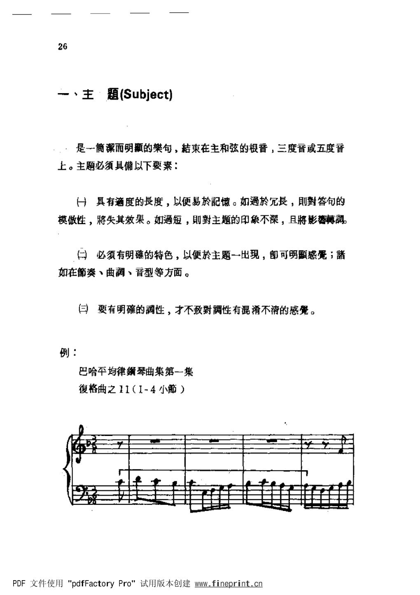
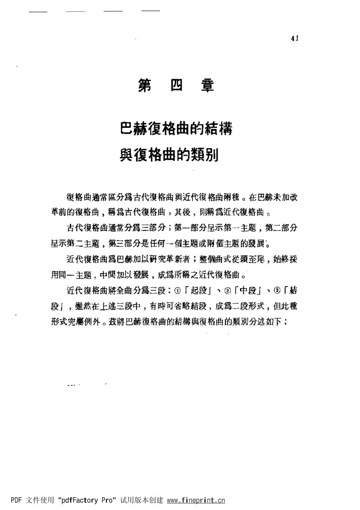

# 巴赫赋格曲的研究 · 教材原页

姚世泽 · 2 个已引用页 · PDF 物理页码

> OCR 仅用于检索；谱例与临时记号以扫描图为准。

## PDF 第 34 页



### OCR

```text
26
、主·题(Subject)
，是一潔而明的句，結束在主和弦的根音，三度音或五度音
上。主题必须具備以下要素：
一）具有適度的长度，以便易於記憶。如過於長，则對答句的
模做性，将失其效果。如過短，则對主题的印象不深，且將影蒋調。
（）必须有明確的特色，以便於主题一出現，郎可明显感冕；
如在奏、曲調、音型等方面。
三）要有明確的调性，才不致對調性有混淆不清的感覺。
例：
巴哈平均律琴曲集第一集
復格曲之11（I-4小）
PDF文件使用“pdfFactoryPro”试用版本创建www.fineprint.cn
```

<a id="claim-fugue.subject-memory"></a>
### 主题的长度由“可记忆”与“可处理”共同决定

过短难以形成印象，过长会削弱答题的模仿效果；判断标准是主题能否在若干声部与变形中保持统一。

> “具有适度的长度，以便易于记忆。如过于长，则对答句的模仿性将失其效果；如过短，则对主题的印象不深。”

[返回手册](../复调音乐手册.html#fugue-subject)

## PDF 第 49 页



### OCR

```text
41
第四章
巴赫復格曲的結構
與復格曲的類别
復格曲通常區分古代复格曲舆近代復格曲雨穗。在巴赫未加改
革前的復格曲，古代復格曲，其後，则近代復格曲。
古代復格曲通常分三部分；第一部分呈示第--主题，第二部分
星示第二主题，第三部分是任何一個主题或兩個主题的發展。
近代復格曲為巴赫加以研宪革新者；整個曲式頭至尾，始終探
用同一主题，中間加以發展，成所之近代復格曲。
近代復格曲将全曲分三段：①「起段」丶②「中段」、③「結
段」，然在上逃三段中，有時可省略秸段，成二段形式，但此種
形式究属例外。兹将巴赫復格曲的結構舆復格曲的類别分迹如下：
PDF文件使用“pdfFactoryPro”试用版本创建www.fineprint.cn
```

<a id="claim-fugue.bach-structure"></a>
### 巴赫式近代赋格：起段、中段、结段

起段完整呈示；中段以间插与主题再陈述交替并作调性扩展；结段回到主调并完成收束。三段功能比“固定小节数”更重要。

> “近代赋格曲将全曲分三段：①「起段」、②「中段」、③「结段」。”

[返回手册](../复调音乐手册.html#fugue-overall)
