# 华萃康《色彩和声》

> **PDF 文件**：`华萃康《色彩和声》.pdf`  
> **物理页数**：565（从 PDF 第 1 页起计）  
> **OCR 平均置信度**：0.953  
> **字符数**：269464

本文件收录**理论手册实际引用的 15 个 PDF 页**，每页采用整版影印 + OCR 文本。整页图保留谱例、图表、表格、边注和版面关系；OCR 只供检索与复制，具体音符、临时记号、连线和罗马数字以图像为准。被理论手册引用的条目列在图后，可直接回跳。

页码一律使用 **PDF 物理页码**，可能与书内印刷页码不同。

**快速跳页**：[p.5](#p0005) · [p.6](#p0006) · [p.18](#p0018) · [p.27](#p0027) · [p.31](#p0031) · [p.39](#p0039) · [p.42](#p0042) · [p.46](#p0046) · [p.80](#p0080) · [p.95](#p0095) · [p.175](#p0175) · [p.198](#p0198) · [p.327](#p0327) · [p.341](#p0341) · [p.390](#p0390)

---

<!-- PAGE:5 -->

## PDF p.5

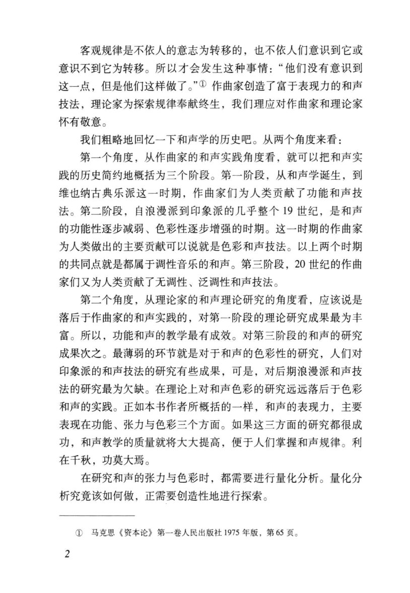

<!-- MANUAL-REFS:p0005 -->

<strong>手册使用本页</strong><ul><li id="ref-claim-color-harmony-function-color-history-p0005" class="manual-ref-item" data-kind="claim">论点<a href="../和声学手册.html#claim-color-harmony-function-color-history">色彩和声与调式色彩 · color-harmony.function-color-history</a> 手册提炼：功能和色彩是同一和弦的两种作用；历史上色彩作用增强，会相对削弱功能联系，两类作用仍可并存。</li><li id="ref-period-commonpractice-1-p0005" class="manual-ref-item" data-kind="period">阶段依据<a href="../和声学手册.html#period-basis">历史阶段依据 · 古典与共同实践</a> 阶段结论：调性中心、功能语法与声部规范 原文依据：第一阶段，从和声学诞生，到维也纳古典乐派这一时期，作曲家们为人类贡献了功能和声技法。</li><li id="ref-period-expandedtonality-1-p0005" class="manual-ref-item" data-kind="period">阶段依据<a href="../和声学手册.html#period-basis">历史阶段依据 · 浪漫主义与调性扩张</a> 阶段结论：交替、变和弦、远关系与色彩功能 原文依据：第二阶段，自浪漫派到印象派的几乎整个19世纪，是和声的功能性逐步减弱、色彩性逐步增强的时期。</li><li id="ref-period-modernposttonal-1-p0005" class="manual-ref-item" data-kind="period">阶段依据<a href="../和声学手册.html#period-basis">历史阶段依据 · 现代与后调性</a> 阶段结论：对称音阶、集合、无调性与十二音 原文依据：第三阶段，20世纪的作曲家们又为人类贡献了无调性、泛调性和声技法。</li><li id="ref-profile-profile-huacui_color-p0005" class="manual-ref-item" data-kind="profile">代表页<a href="../和声学手册.html#book-profiles">教材代表页 · 色彩和声</a> 手册将本页列为《色彩和声》代表页；该书定位：以功能、张力、色彩三元框架量化和弦色彩，讨论调式色彩、和弦组与色彩性和声进行。</li></ul>

客观规律是不依人的意志为转移的，也不依人们意识到它或 
意识不到它为转移。所以才会发生这种事情：“他们没有意识到 
这一点，但是他们这样做了。”①作曲家创造了富于表现力的和声 
技法，理论家为探索规律奉献终生，我们理应对作曲家和理论家 
怀有敬意。 
我们粗略地回忆一下和声学的历史吧。从两个角度来看： 
第一个角度，从作曲家的和声实践角度看，就可以把和声实 
践的历史简约地概括为三个阶段。第一阶段，从和声学诞生，到 
维也纳古典乐派这一时期，作曲家们为人类贡献了功能和声技 
法。第二阶段，自浪漫派到印象派的几乎整个19世纪，是和声 
的功能性逐步减弱、色彩性逐步增强的时期。这一时期的作曲家 
为人类做出的主要贡献可以说就是色彩和声技法。以上两个时期 
的共同点就是都属于调性音乐的和声。第三阶段，20世纪的作曲 
家们又为人类贡献了无调性、泛调性和声技法。 
第二个角度，从理论家的和声理论研究的角度看，应该说是 
落后于作曲家的和声实践的，对第一阶段的理论研究成果最为丰 
富。所以，功能和声的教学最有成效。对第三阶段的和声的研究 
成果次之。最薄弱的环节就是对于和声的色彩性的研究，人们对 
印象派的和声技法的研究有些成果，可是，对后期浪漫派和声技 
法的研究最为欠缺。在理论上对和声色彩的研究远远落后于色彩 
和声的实践。正如本书作者所概括的一样，和声的表现力，主要 
表现在功能、张力与色彩三个方面。如果这三方面的研究都很成 
功，和声教学的质量就将大大提高，便于人们掌握和声规律。利 
在千秋，功莫大焉。 
在研究和声的张力与色彩时，都需要进行量化分析。量化分 
析究竞该如何做，正需要创造性地进行探索。 
①马克思《资本论》第一卷人民出版社1975年版，第65页。 
2

---

<!-- PAGE:6 -->

## PDF p.6

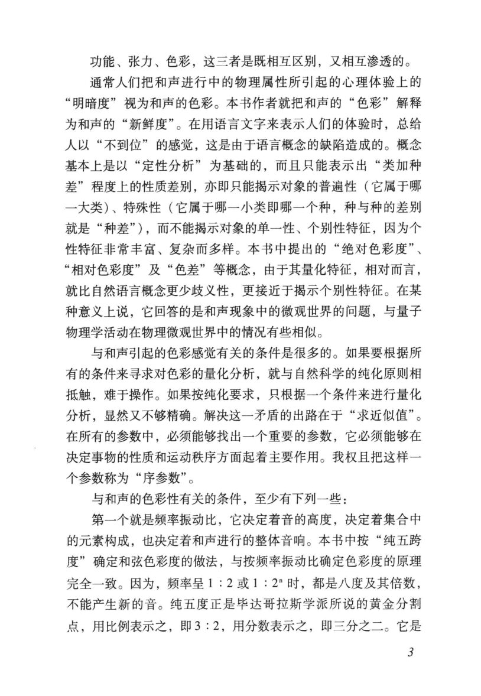

<!-- MANUAL-REFS:p0006 -->

<strong>手册使用本页</strong><ul><li id="ref-claim-color-harmony-function-tension-color-p0006" class="manual-ref-item" data-kind="claim">论点<a href="../和声学手册.html#claim-color-harmony-function-tension-color">色彩和声与调式色彩 · color-harmony.function-tension-color</a> 手册提炼：和声表现力可拆为功能、张力与色彩三个相互区别又相互渗透的维度，不能把色彩简单等同于“非功能”。</li><li id="ref-profile-profile-huacui_color-p0006" class="manual-ref-item" data-kind="profile">代表页<a href="../和声学手册.html#book-profiles">教材代表页 · 色彩和声</a> 手册将本页列为《色彩和声》代表页；该书定位：以功能、张力、色彩三元框架量化和弦色彩，讨论调式色彩、和弦组与色彩性和声进行。</li></ul>

功能、张力、色彩，这三者是既相互区别，又相互渗透的。 
通常人们把和声进行中的物理属性所引起的心理体验上的 
“明暗度”视为和声的色彩。本书作者就把和声的“色彩”解释 
为和声的“新鲜度”。在用语言文字来表示人们的体验时，总给 
人以“不到位”的感觉，这是由于语言概念的缺陷造成的。概念 
基本上是以“定性分析”为基础的，而且只能表示出“类加种 
差”程度上的性质差别，亦即只能揭示对象的普遍性（它属于哪 
一大类）、特殊性（它属于哪一小类即哪一个种，种与种的差别 
就是“种差”），而不能揭示对象的单一性、个别性特征，因为个 
性特征非常丰富、复杂而多样。本书中提出的“绝对色彩度”、 
“相对色彩度”及“色差”等概念，由于其量化特征，相对而言， 
就比自然语言概念更少歧义性，更接近于揭示个别性特征。在某 
种意义上说，它回答的是和声现象中的微观世界的问题，与量子 
物理学活动在物理微观世界中的情况有些相似。 
与和声引起的色彩感觉有关的条件是很多的。如果要根据所 
有的条件来寻求对色彩的量化分析，就与自然科学的纯化原则相 
抵触，难于操作。如果按纯化要求，只根据一个条件来进行量化 
分析，显然又不够精确。解决这一矛盾的出路在于“求近似值”。 
在所有的参数中，必须能够找出一个重要的参数，它必须能够在 
决定事物的性质和运动秩序方面起着主要作用。我权且把这样一 
个参数称为“序参数”。 
与和声的色彩性有关的条件，至少有下列一些： 
第一个就是频率振动比，它决定着音的高度，决定着集合中 
的元素构成，也决定着和声进行的整体音响。本书中按“纯五跨 
度”确定和弦色彩度的做法，与按频率振动比确定色彩度的原理 
完全一致。因为，频率呈1：2或1：2"时，都是八度及其倍数， 
不能产生新的音。纯五度正是毕达哥拉斯学派所说的黄金分割 
点，用比例表示之，即3：2，用分数表示之，即三分之二。它是 
3

---

<!-- PAGE:18 -->

## PDF p.18

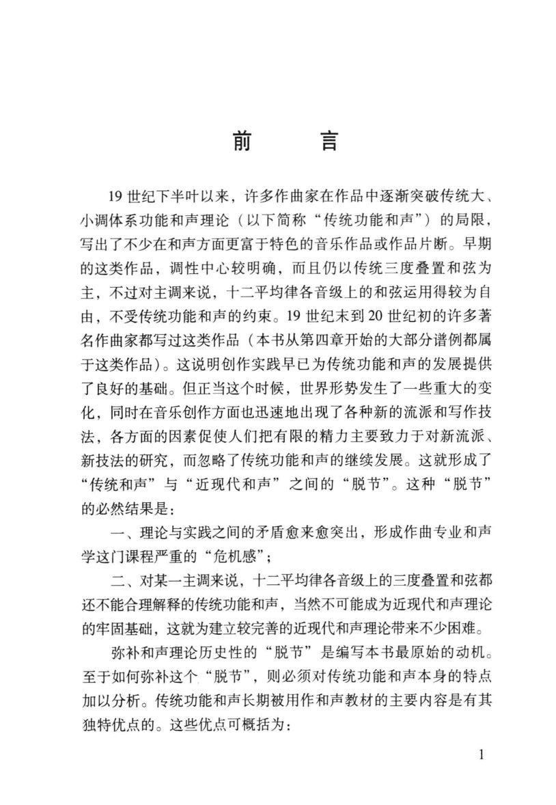

<!-- MANUAL-REFS:p0018 -->

<strong>手册使用本页</strong><ul><li id="ref-claim-triad-construction-p0018" class="manual-ref-item" data-kind="claim">论点<a href="../和声学手册.html#claim-triad-construction">三和弦与七和弦（前置速查） · triad.construction</a> 手册提炼：三和弦由根音、三音、五音按三度叠置；三度与五度的性质决定大、小、减、增四类结构。</li></ul>

前言 
19世纪下半叶以来，许多作曲家在作品中逐渐突破传统大、 
小调体系功能和声理论（以下简称“传统功能和声”）的局限， 
写出了不少在和声方面更富于特色的音乐作品或作品片断。早期 
的这类作品，调性中心较明确，而且仍以传统三度叠置和弦为 
主，不过对主调来说，十二平均律各音级上的和弦运用得较为自 
由，不受传统功能和声的约束。19世纪末到20世纪初的许多著 
名作曲家都写过这类作品（本书从第四章开始的大部分谱例都属 
于这类作品）。这说明创作实践早已为传统功能和声的发展提供 
了良好的基础。但正当这个时候，世界形势发生了一些重大的变 
化，同时在音乐创作方面也迅速地出现了各种新的流派和写作技 
法，各方面的因素促使人们把有限的精力主要致力于对新流派、 
新技法的研究，而忽略了传统功能和声的继续发展。这就形成了 
“传统和声”与“近现代和声”之间的“脱节”。这种“脱节” 
的必然结果是： 
一、理论与实践之间的矛盾愈来愈突出，形成作曲专业和声 
学这门课程严重的“危机感”； 
二、对某一主调来说，十二平均律各音级上的三度叠置和弦都 
还不能合理解释的传统功能和声，当然不可能成为近现代和声理论 
的牢固基础，这就为建立较完善的近现代和声理论带来不少困难。 
弥补和声理论历史性的“脱节”是编写本书最原始的动机。 
至于如何弥补这个“脱节”，则必须对传统功能和声本身的特点 
加以分析。传统功能和声长期被用作和声教材的主要内容是有其 
独特优点的。这些优点可概括为： 
1

---

<!-- PAGE:27 -->

## PDF p.27

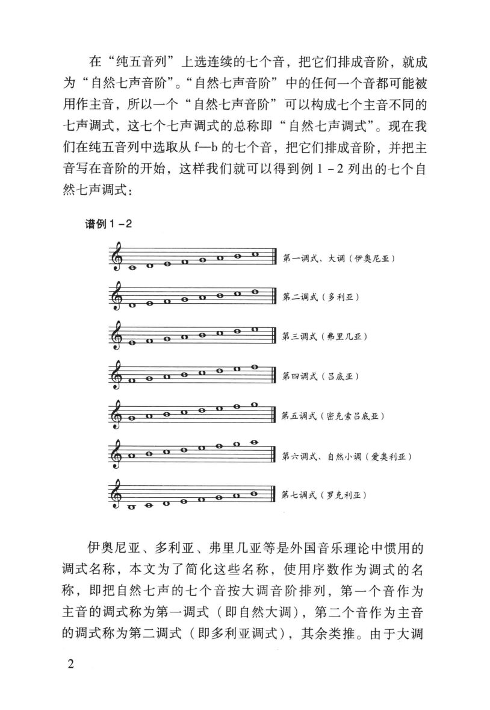

<!-- MANUAL-REFS:p0027 -->

<strong>手册使用本页</strong><ul><li id="ref-claim-scale-natural-modes-p0027" class="manual-ref-item" data-kind="claim">论点<a href="../和声学手册.html#claim-scale-natural-modes">调式、音阶与音级 · scale.natural-modes</a> 手册提炼：自然七调式可由同一音列移位并更换中心音得到；中心音与调式名称共同决定音阶身份。</li></ul>

在“纯五音列”上选连续的七个音，把它们排成音阶，就成 
为“自然七声音阶”。“自然七声音阶”中的任何一个音都可能被 
用作主音，所以一个“自然七声音阶”可以构成七个主音不同的 
七声调式，这七个七声调式的总称即“自然七声调式”。现在我 
们在纯五音列中选取从f一b的七个音，把它们排成音阶，并把主 
音写在音阶的开始，这样我们就可以得到例1－2列出的七个自 
然七声调式： 
谱例1-2 
第一调式、大调（伊奥尼亚） 
第二调式（多利亚） 
第三调式（弗里几亚） 
第四调式（吕底亚） 
第五调式（密克索吕底亚） 
第六调式、自然小调（爱奥利亚） 
第七调式（罗克利亚） 
伊奥尼亚、多利亚、弗里几亚等是外国音乐理论中惯用的 
调式名称，本文为了简化这些名称，使用序数作为调式的名 
称，即把自然七声的七个音按大调音阶排列，第一个音作为 
主音的调式称为第一调式（即自然大调），第二个音作为主音 
的调式称为第二调式（即多利亚调式），其余类推。由于大调 
2

---

<!-- PAGE:31 -->

## PDF p.31

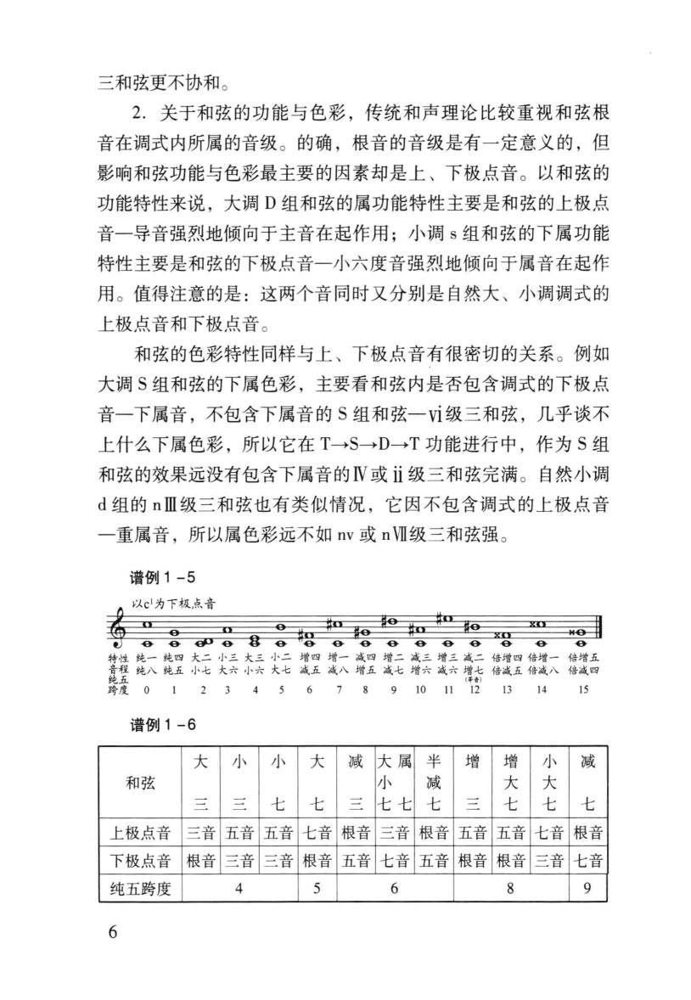

<!-- MANUAL-REFS:p0031 -->

<strong>手册使用本页</strong><ul><li id="ref-claim-voice-leading-leading-tone-p0031" class="manual-ref-item" data-kind="claim">论点<a href="../和声学手册.html#claim-voice-leading-leading-tone">声部进行与不协和解决 · voice-leading.leading-tone</a> 手册提炼：导音具有上行到主音的强烈倾向；当它位于外声部时，这一解决要求尤其严格。</li></ul>

三和弦更不协和。 
2.关于和弦的功能与色彩，传统和声理论比较重视和弦根 
音在调式内所属的音级。的确，根音的音级是有一定意义的，但 
影响和弦功能与色彩最主要的因素却是上、下极点音。以和弦的 
功能特性来说，大调D组和弦的属功能特性主要是和弦的上极点 
音一导音强烈地倾向于主音在起作用；小调s组和弦的下属功能 
特性主要是和弦的下极点音一小六度音强烈地倾向于属音在起作 
用。值得注意的是：这两个音同时又分别是自然大、小调调式的 
上极点音和下极点音。 
和弦的色彩特性同样与上、下极点音有很密切的关系。例如 
大调S组和弦的下属色彩，主要看和弦内是否包含调式的下极点 
音一下属音，不包含下属音的S组和弦一vi级三和弦，几乎谈不 
上什么下属色彩，所以它在T→S→D→T功能进行中，作为S组 
和弦的效果远没有包含下属音的IⅣV或ii级三和弦完满。自然小调 
d组的nⅢ级三和弦也有类似情况，它因不包含调式的上极点音 
一重属音，所以属色彩远不如nv或nV级三和弦强。 
谱例1-5 
以cl为下极点音 
0 
e0989 
9 
θ 
θ 
特性纯—纯四大二小三大三小二增四增一减四增二减三增三减二倍增四倍增一倍增五 
跨度 
0123456789101112 
13 
14 
15 
谱例1-6 
大 
小 
小 
大 
减 
大属 
半 
增 
增 
小 
减 
和弦 
小 
减 
大 
大 
三 
三 
七 
七 
三 
七七 
七 
三 
七 
七 
七 
上极点音 
三音 
五音 
五音 
七音 
根音 
三音 
根音 
五音 
五音 
七音 
根音 
下极点音 
根音 
三音 
三音 
根音 
五音 
七音 
五音 
根音 
根音 
三音 
七音 
纯五跨度 
4 
5 
6 
8 
9 
6

---

<!-- PAGE:39 -->

## PDF p.39

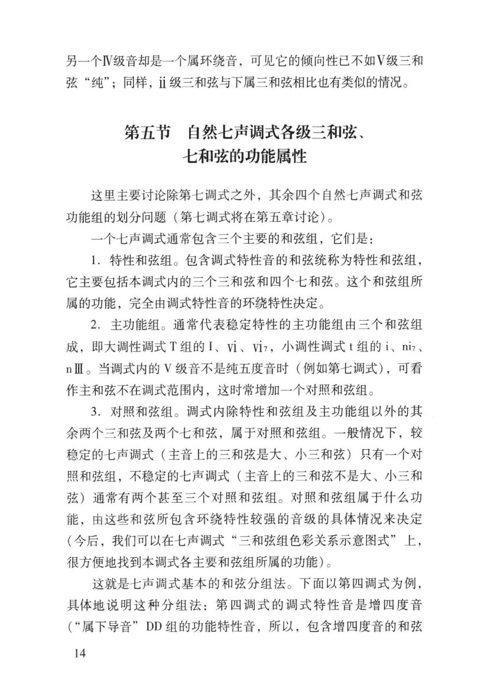

<!-- MANUAL-REFS:p0039 -->

<strong>手册使用本页</strong><ul><li id="ref-claim-color-harmony-characteristic-chords-p0039" class="manual-ref-item" data-kind="claim">论点<a href="../和声学手册.html#claim-color-harmony-characteristic-chords">色彩和声与调式色彩 · color-harmony.characteristic-chords</a> 手册提炼：含调式特性音的和弦构成特性和弦组，可用于识别调式色彩并把一般功能和弦与调式标志分开。</li><li id="ref-prose-cite-huacui_color-p0039-1-p0039" class="manual-ref-item" data-kind="prose">正文引用<a href="../和声学手册.html#cite-huacui_color-p0039-1">手册正文引用</a> 再圈特性和弦：华萃康把“包含调式特性音的和弦”统称为特性和弦组（《色彩和声》PDF p.39）。它们最能标记调式身份，也最适合做同主音调式交替与色彩中介。</li></ul>

另一个IV级音却是一个属环绕音，可见它的倾向性已不如V级三和 
弦“纯”；同样，ii级三和弦与下属三和弦相比也有类似的情况。 
第五节自然七声调式各级三和弦、 
七和弦的功能属性 
这里主要讨论除第七调式之外，其余四个自然七声调式和弦 
功能组的划分问题（第七调式将在第五章讨论）。 
一个七声调式通常包含三个主要的和弦组，它们是： 
1.特性和弦组。包含调式特性音的和弦统称为特性和弦组， 
它主要包括本调式内的三个三和弦和四个七和弦。这个和弦组所 
属的功能，完全由调式特性音的环绕特性决定。 
2.主功能组。通常代表稳定特性的主功能组由三个和弦组 
成，即大调性调式T组的I、Vi、Vi7，小调性调式t组的i、niz、 
nⅢ。当调式内的V级音不是纯五度音时（例如第七调式），可看 
作主和弦不在调式范围内，这时常增加一个对照和弦组。 
3.对照和弦组。调式内除特性和弦组及主功能组以外的其 
余两个三和弦及两个七和弦，属于对照和弦组。一般情况下，较 
稳定的七声调式（主音上的三和弦是大、小三和弦）只有一个对 
照和弦组，不稳定的七声调式（主音上的三和弦不是大、小三和 
弦）通常有两个甚至三个对照和弦组。对照和弦组属于什么功 
能，由这些和弦所包含环绕特性较强的音级的具体情况来决定 
（今后，我们可以在七声调式“三和弦组色彩关系示意图式”上， 
很方便地找到本调式各主要和弦组所属的功能）。 
这就是七声调式基本的和弦分组法。下面以第四调式为例， 
具体地说明这种分组法：第四调式的调式特性音是增四度音 
（“属下导音”DD组的功能特性音，所以，包含增四度音的和弦 
14

---

<!-- PAGE:42 -->

## PDF p.42

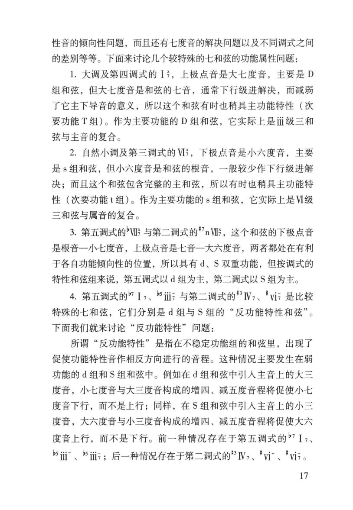

<!-- MANUAL-REFS:p0042 -->

<strong>手册使用本页</strong><ul><li id="ref-claim-seventh-general-resolution-p0042" class="manual-ref-item" data-kind="claim">论点<a href="../和声学手册.html#claim-seventh-general-resolution">七和弦、九和弦与不协和等级 · seventh.general-resolution</a> 手册提炼：七和弦是不协和和弦，需准备并按倾向解决；其七音通常下行级进，属七是最强的功能和声形态。</li></ul>

性音的倾向性问题，而且还有七度音的解决问题以及不同调式之间 
的差别等等。下面来讨论几个较特殊的七和弦的功能属性问题： 
1.大调及第四调式的I，上极点音是大七度音，主要是D 
组和弦，但大七度音是和弦的七音，通常下行级进解决，而减弱 
了它主下导音的意义，所以这个和弦有时也稍具主功能特性（次 
要功能T组）。作为主要功能的D组和弦，它实际上是Ⅲ级三和 
弦与主音的复合。 
2.自然小调及第三调式的V，下极点音是小六度音，主要 
是s组和弦，但小六度音是和弦的根音，一般较少作下行级进解 
决；而且这个和弦包含完整的主和弦，所以有时也稍具主功能特 
性（次要功能t组）。作为主要功能的s组和弦，它实际上是V级 
三和弦与属音的复合。 
3.第五调式的"VI与第二调式的"nVI，这个和弦的下极点音 
是根音一小七度音，上极点音是七音一大六度音，两者都处在有利 
于各自功能倾向性的位置，所以其有d、S双重功能，但按调式的 
特性和弦组来说，第五调式以d组为主，第二调式以S组为主。 
4.第五调式的I、i与第二调式的IV、vi是比较 
特殊的七和弦，它们分别是d组与S组的“反功能特性和弦”。 
下面我们就来讨论“反功能特性”问题： 
所谓“反功能特性”是指在不稳定功能组的和弦里，出现了 
促使功能特性音作相反方向进行的音程。这种情况主要发生在弱 
功能的d组和S组和弦中。例如在d组和弦中引人主音上的大三 
度音，小七度音与大三度音构成的增四、减五度音程将促使小七 
度音下行，而不是上行；同样，在S组和弦中引人主音上的小三 
度音，大六度音与小三度音构成的增四、减五度音程将促使大六 
度音上行，而不是下行。前一种情况存在于第五调式的”I7、 
b"ii-、b"i；后一种情况存在于第二调式的IV,、"vi、"vi7。 
17

---

<!-- PAGE:46 -->

## PDF p.46

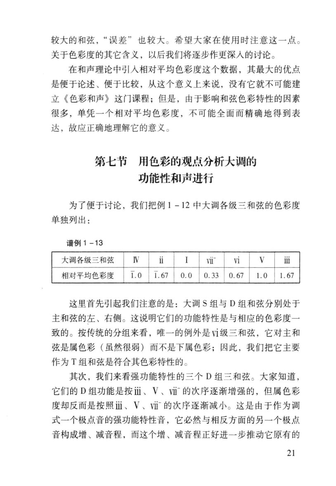

<!-- MANUAL-REFS:p0046 -->

<strong>手册使用本页</strong><ul><li id="ref-claim-color-harmony-relative-degree-p0046" class="manual-ref-item" data-kind="claim">论点<a href="../和声学手册.html#claim-color-harmony-relative-degree">色彩和声与调式色彩 · color-harmony.relative-degree</a> 手册提炼：和弦的相对色彩度可与功能组位置对应：大调 S 组与 D 组分居主和弦两侧，功能特性与色彩度大体一致。</li><li id="ref-profile-profile-huacui_color-p0046" class="manual-ref-item" data-kind="profile">代表页<a href="../和声学手册.html#book-profiles">教材代表页 · 色彩和声</a> 手册将本页列为《色彩和声》代表页；该书定位：以功能、张力、色彩三元框架量化和弦色彩，讨论调式色彩、和弦组与色彩性和声进行。</li></ul>

较大的和弦，“误差”也较大。希望大家在使用时注意这一点。 
关于色彩度的其它含义，以后我们将逐步作更深人的讨论。 
在和声理论中引人相对平均色彩度这个数据，其最大的优点 
是便于论述、便于比较，从这个意义上来说，没有它就不可能建 
立《色彩和声》这门课程；但是，由于影响和弦色彩特性的因素 
很多，单凭一个相对平均色彩度，不可能全面而精确地得到表 
达，故应正确地理解它的意义。 
第七节用色彩的观点分析大调的 
功能性和声进行 
为了便于讨论，我们把例1-12中大调各级三和弦的色彩度 
单独列出： 
谱例1-13 
IV 
i 
vi 
V 
大调各级三和弦 
I 
vi 
ii 
1.0 
1.67 
相对平均色彩度 
0.0 
0.33 
0.67 
1.0 
1.67 
这里首先引起我们注意的是：大调S组与D组和弦分别处于 
主和弦的左、右侧。这说明它们的功能特性是与相应的色彩度一 
致的。按传统的分组来看，唯一的例外是vi级三和弦，它对主和 
弦是属色彩（虽然很弱）而不是下属色彩；因此，我们把它主要 
作为T组和弦是符合其色彩特性的。 
其次，我们来看强功能特性的三个D组三和弦。大家知道， 
它们的D组功能是按ii、V、vi的次序逐渐增强的，但属色彩 
度却反而是按照i、V、vi的次序逐渐减小。这是由于作为调 
式一个极点音的强功能特性音，它必然与相反方面的另一个极点 
音构成增、减音程，而这个增、减音程正好进一步推动它原有的 
21

---

<!-- PAGE:80 -->

## PDF p.80

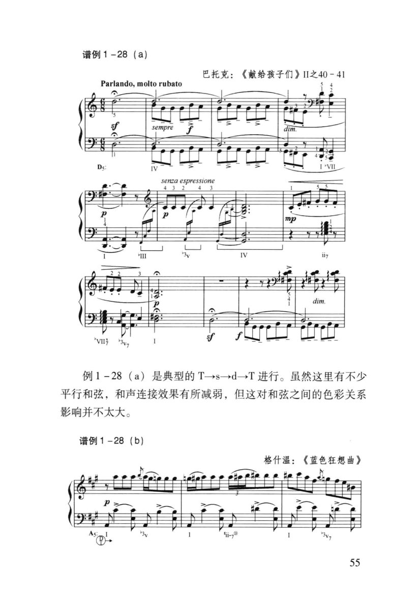

<!-- MANUAL-REFS:p0080 -->

<strong>手册使用本页</strong><ul><li id="ref-example-e07-p0080" class="manual-ref-item" data-kind="example">案例<a href="../和声学手册.html#example-e07">手册案例 E07 · 平行和弦：保持音程结构</a> 谱例1-28｜巴托克《献给孩子们》II 之40–41 原书要点：这是典型的 T→s→d→T 进行；大量平行和弦削弱连接感，但不改变和弦之间的色彩关系。 机制：平行进行保持各和弦的音程结构，以相同方向移动；连接感减弱，但 T–s–d–T 的根音与功能关系仍可由低音和句法辨认。 读谱：先标 T→s→d→T 的功能进行，再看各和弦是否保持同一音程结构平行移动；比较低音落点与声部间距。 用法：需要平行和声色彩时，保留 T–s–d–T 的功能进行，将中间和弦做成相同结构的平行进行；用低音和句法维持中心。</li></ul>

谱例1-28（a) 
巴托克：《献给孩子们》ⅡI之40-41 
Parlando,moltorubato 
? 
sempre 
senzaespressione 
III 
V 
dim. 
例1-28（a）是典型的T→s→d→T进行。虽然这里有不少 
平行和弦，和声连接效果有所减弱，但这对和弦之间的色彩关系 
影响并不太大。 
谱例1-28(b) 
格什温：《蓝色狂想曲》 
55

---

<!-- PAGE:95 -->

## PDF p.95

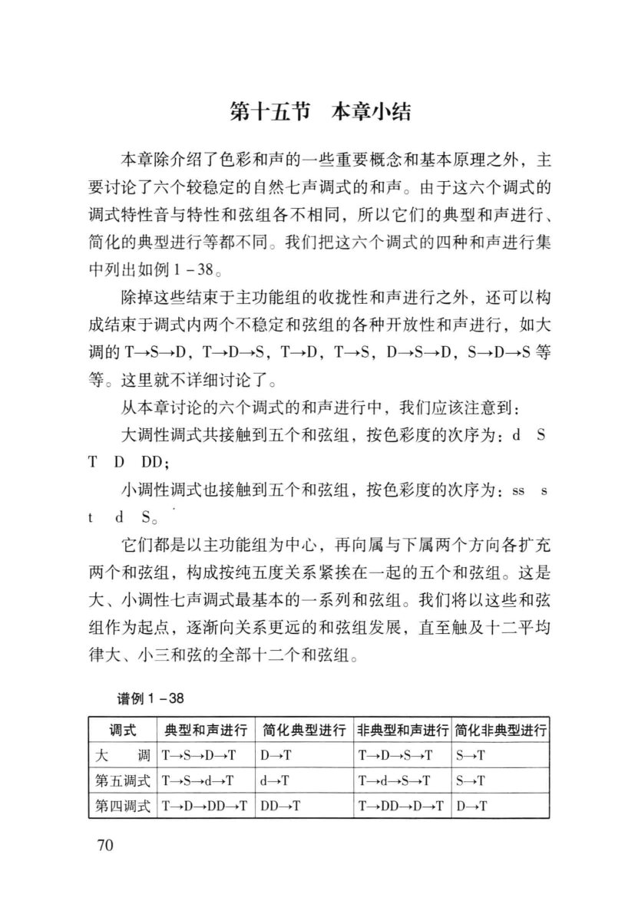

<!-- MANUAL-REFS:p0095 -->

<strong>手册使用本页</strong><ul><li id="ref-profile-profile-huacui_color-p0095" class="manual-ref-item" data-kind="profile">代表页<a href="../和声学手册.html#book-profiles">教材代表页 · 色彩和声</a> 手册将本页列为《色彩和声》代表页；该书定位：以功能、张力、色彩三元框架量化和弦色彩，讨论调式色彩、和弦组与色彩性和声进行。</li></ul>

第十五节本章小结 
本章除介绍了色彩和声的一些重要概念和基本原理之外，主 
要讨论了六个较稳定的自然七声调式的和声。由于这六个调式的 
调式特性音与特性和弦组各不相同，所以它们的典型和声进行、 
简化的典型进行等都不同。我们把这六个调式的四种和声进行集 
中列出如例1-38。 
除掉这些结束于主功能组的收拢性和声进行之外，还可以构 
成结束于调式内两个不稳定和弦组的各种开放性和声进行，如大 
调的T→S→D，T→D→S，T→D，T→S，D→S→D，S→D→S等 
等。这里就不详细讨论了。 
从本章讨论的六个调式的和声进行中，我们应该注意到： 
大调性调式共接触到五个和弦组，按色彩度的次序为：dS 
TDDD; 
小调性调式也接触到五个和弦组，按色彩度的次序为：SS 
dS。 
它们都是以主功能组为中心，再向属与下属两个方向各扩充 
两个和弦组，构成按纯五度关系紧挨在一起的五个和弦组。这是 
大、小调性七声调式最基本的一系列和弦组。我们将以这些和弦 
组作为起点，逐渐向关系更远的和弦组发展，直至触及十二平均 
律大、小三和弦的全部十二个和弦组。 
谱例1-38 
调式 
典型和声进行 
简化典型进行 
行非典型和声进行简化非典型进行 
大 
调 
T→S→D→T 
D→T 
T→D→S→T 
S→T 
第五调式 
T→S→d→T 
d→T 
T→d→S→T 
S→T 
第四调式 
T→D→DD→T 
DD→T 
T→DD→D→T 
D→T 
70

---

<!-- PAGE:175 -->

## PDF p.175

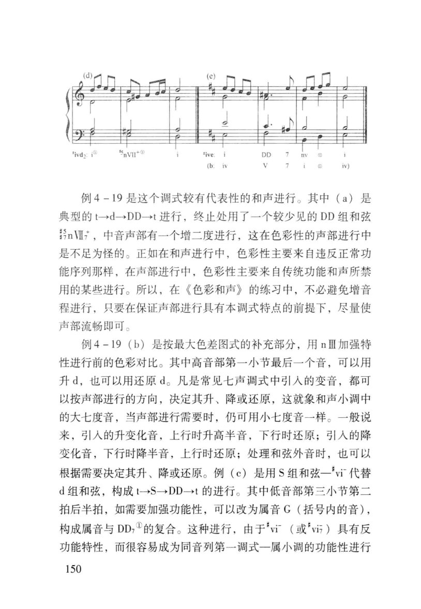

<!-- MANUAL-REFS:p0175 -->

<strong>手册使用本页</strong><ul><li id="ref-profile-profile-huacui_color-p0175" class="manual-ref-item" data-kind="profile">代表页<a href="../和声学手册.html#book-profiles">教材代表页 · 色彩和声</a> 手册将本页列为《色彩和声》代表页；该书定位：以功能、张力、色彩三元框架量化和弦色彩，讨论调式色彩、和弦组与色彩性和声进行。</li></ul>

ivd: 
nVll 
例4－19是这个调式较有代表性的和声进行。其中（a）是 
典型的t一d→DD→t进行，终止处用了一个较少见的DD组和弦 
nVI，中音声部有一个增二度进行，这在色彩性的声部进行中 
是不足为怪的。正如在和声进行中，色彩性主要来自违反正常功 
能序列那样，在声部进行中，色彩性主要来自传统功能和声所禁 
用的某些进行。所以，在《色彩和声》的练习中，不必避免增音 
程进行，只要在保证声部进行具有本调式特点的前提下，尽量使 
声部流畅即可。 
例4-19（b）是按最大色差图式的补充部分，用nⅢ加强特 
性进行前的色彩对比。其中高音部第一小节最后一个音，可以用 
升d，也可以用还原d。凡是常见七声调式中引人的变音，都可 
以按声部进行的方向，决定其升、降或还原，这就象和声小调中 
的大七度音，当声部进行需要时，仍可用小七度音一样。一般说 
来，引入的升变化音，上行时升高半音，下行时还原；引入的降 
变化音，下行时降半音，上行时还原；处理和弦外音时，也可以 
根据需要决定其升、降或还原。例（c）是用S组和弦一"vi代替 
d组和弦，构成t→S→DD→t的进行。其中低音部第三小节第二 
拍后半拍，如需要加强功能性，可以改为属音C（括号内的音）， 
构成属音与DD的复合。这种进行，由于"vi（或"vi）具有反 
功能特性，而很容易成为同音列第一调式一属小调的功能性进行 
150

---

<!-- PAGE:198 -->

## PDF p.198

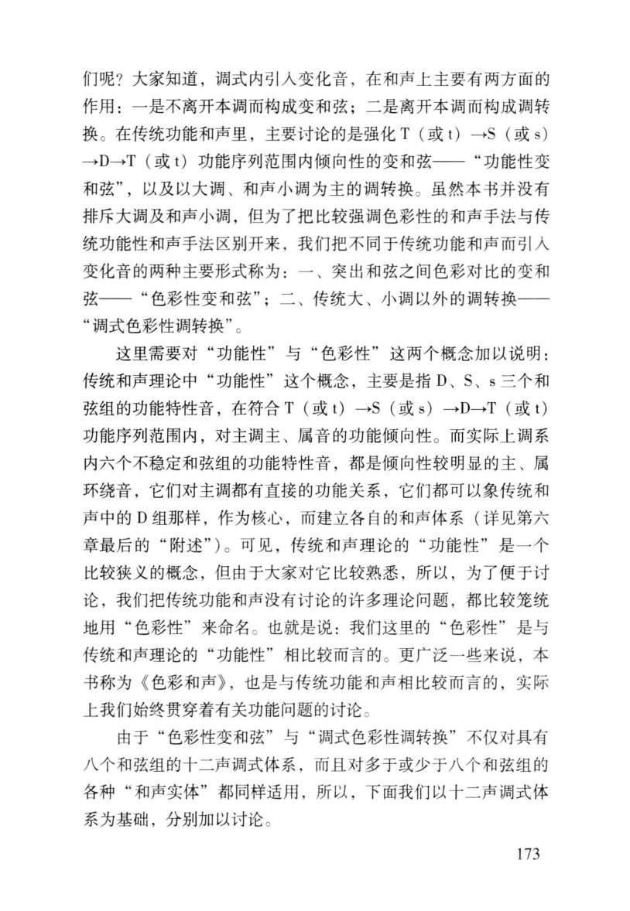

<!-- MANUAL-REFS:p0198 -->

<strong>手册使用本页</strong><ul><li id="ref-profile-profile-huacui_color-p0198" class="manual-ref-item" data-kind="profile">代表页<a href="../和声学手册.html#book-profiles">教材代表页 · 色彩和声</a> 手册将本页列为《色彩和声》代表页；该书定位：以功能、张力、色彩三元框架量化和弦色彩，讨论调式色彩、和弦组与色彩性和声进行。</li></ul>

们呢？大家知道，调式内引人变化音，在和声上主要有两方面的 
作用：一是不离开本调而构成变和弦；二是离开本调而构成调转 
换。在传统功能和声里，主要讨论的是强化T（或t）一S（或s） 
→D一T（或t）功能序列范围内倾向性的变和弦一“功能性变 
和弦”，以及以大调、和声小调为主的调转换。虽然本书并没有 
排斥大调及和声小调，但为了把比较强调色彩性的和声手法与传 
统功能性和声手法区别开来，我们把不同于传统功能和声而引入 
变化音的两种主要形式称为：一、突出和弦之间色彩对比的变和 
弦一“色彩性变和弦”；二、传统大、小调以外的调转换一 
“调式色彩性调转换”。 
传统和声理论中“功能性”这个概念，主要是指D、S、s三个和 
弦组的功能特性音，在符合T（或t）→S（或s）→D→T（或t） 
功能序列范围内，对主调主、属音的功能倾向性。而实际上调系 
内六个不稳定和弦组的功能特性音，都是倾向性较明显的主、属 
环绕音，它们对主调都有直接的功能关系，它们都可以象传统和 
声中的D组那样，作为核心，而建立各自的和声体系（详见第六 
章最后的“附述”）。可见，传统和声理论的“功能性”是一个 
比较狭义的概念，但由于大家对它比较熟悉，所以，为了便于讨 
论，我们把传统功能和声没有讨论的许多理论问题，都比较笼统 
地用“色彩性”来命名。也就是说：我们这里的“色彩性”是与 
传统和声理论的“功能性”相比较而言的。更广泛一些来说，本 
书称为《色彩和声》，也是与传统功能和声相比较而言的，实际 
上我们始终贯穿着有关功能问题的讨论。 
，与， 
八个和弦组的十二声调式体系，而且对多于或少于八个和弦组的 
各种“和声实体”都同样适用，所以，下面我们以十二声调式体 
系为基础，分别加以讨论。 
173

---

<!-- PAGE:327 -->

## PDF p.327

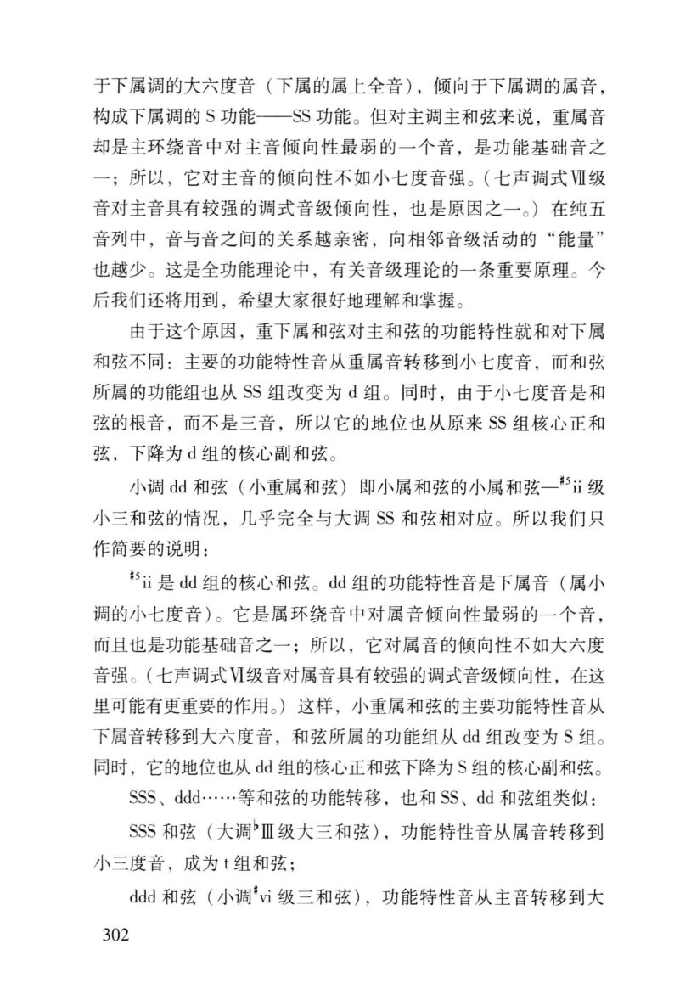

<!-- MANUAL-REFS:p0327 -->

<strong>手册使用本页</strong><ul><li id="ref-claim-color-harmony-function-transfer-p0327" class="manual-ref-item" data-kind="claim">论点<a href="../和声学手册.html#claim-color-harmony-function-transfer">色彩和声与调式色彩 · color-harmony.function-transfer</a> 手册提炼：色彩和弦可改变主要功能特性音；判断功能时应追踪特性音的归属与解决方向，不能只看根音级数。</li><li id="ref-prose-cite-huacui_color-p0327-1-p0327" class="manual-ref-item" data-kind="prose">正文引用<a href="../和声学手册.html#cite-huacui_color-p0327-1">手册正文引用</a> 检查功能转移：若根音级数提示某个功能，但特性音把重心移向另一功能，就要按特性音的倾向与解决重判。华萃康以小重属和弦说明，主要功能特性音可以从下属音转移到大六度音（PDF p.327）。</li></ul>

于下属调的大六度音（下属的属上全音），倾向于下属调的属音， 
构成下属调的S功能一SS功能。但对主调主和弦来说，重属音 
却是主环绕音中对主音倾向性最弱的一个音，是功能基础音之 
一；所以，它对主音的倾向性不如小七度音强。（七声调式业级 
音对主音具有较强的调式音级倾向性，也是原因之一。）在纯五 
音列中，音与音之间的关系越亲密，向相邻音级活动的“能量” 
也越少。这是全功能理论中，有关音级理论的一条重要原理。今 
后我们还将用到，希望大家很好地理解和掌握。 
由于这个原因，重下属和弦对主和弦的功能特性就和对下属 
和弦不同：主要的功能特性音从重属音转移到小七度音，而和弦 
所属的功能组也从SS组改变为d组。同时，由于小七度音是和 
弦的根音，而不是三音，所以它的地位也从原来SS组核心正和 
弦，下降为d组的核心副和弦。 
小调dd和弦（小重属和弦）即小属和弦的小属和弦一i级 
小三和弦的情况，几乎完全与大调SS和弦相对应。所以我们只 
作简要的说明： 
ii是dd组的核心和弦。dd组的功能特性音是下属音（属小 
调的小七度音）。它是属环绕音中对属音倾向性最弱的一个音， 
而且也是功能基础音之一；所以，它对属音的倾向性不如大六度 
音强。（七声调式VI级音对属音具有较强的调式音级倾向性，在这 
里可能有更重要的作用。）这样，小重属和弦的主要功能特性音从 
下属音转移到大六度音，和弦所属的功能组从dd组改变为S组。 
同时，它的地位也从dd组的核心正和弦下降为S组的核心副和弦。 
SSS、ddd....等和弦的功能转移，也和SS、dd和弦组类似： 
SSS和弦（大调Ⅲ级大三和弦），功能特性音从属音转移到 
小三度音，成为t组和弦； 
ddd和弦（小调"vi级三和弦），功能特性音从主音转移到大 
302

---

<!-- PAGE:341 -->

## PDF p.341

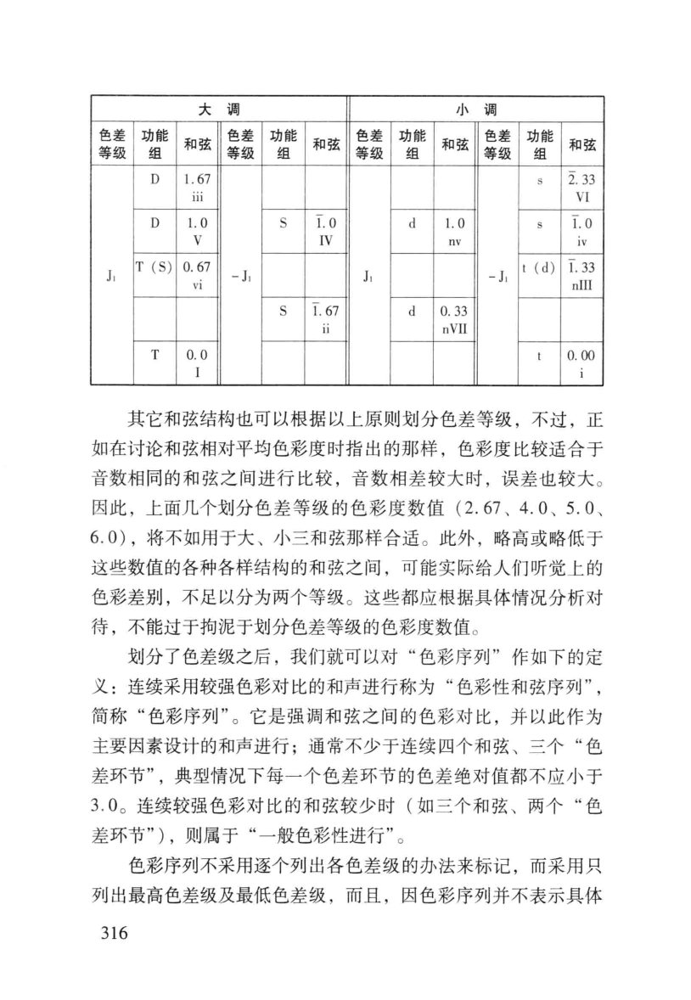

<!-- MANUAL-REFS:p0341 -->

<strong>手册使用本页</strong><ul><li id="ref-claim-color-harmony-color-progression-p0341" class="manual-ref-item" data-kind="claim">论点<a href="../和声学手册.html#claim-color-harmony-color-progression">色彩和声与调式色彩 · color-harmony.color-progression</a> 手册提炼：连续采用较强色彩对比的和声进行可组织为色彩性和弦序列，其逻辑是色彩张力与解决，而非传统 T–S–D 的简单替代。</li><li id="ref-prose-cite-huacui_color-p0341-1-p0341" class="manual-ref-item" data-kind="prose">正文引用<a href="../和声学手册.html#cite-huacui_color-p0341-1">手册正文引用</a> 最后组织色彩序列：连续采用较强色彩对比的和声进行可称为色彩性和弦序列（PDF p.341）。写作时同时记录共同音、半音移动、低音方向、张力峰值与解决点；若没有新调主和弦与终止确认，仍应标为色彩进行，而不是转调。</li></ul>

大调 
小调 
色差 
功能 
色差 
功能 
色差 
功能 
色差 
功能 
和弦 
和弦 
和弦 
和弦 
等级 
组 
等级 
组 
等级 
组 
等级 
组 
2.33 
D 
1.67 
S 
ii 
VI 
D 
1.0 
S 
1.0 
d 
1. 0 
1.0 
V 
IV 
nv 
iv 
T(S) 
0.67 
t (d) 
1.33 
J 
-J 
J 
-J 
vi 
nlI 
S 
1.67 
P 
0.33 
i 
nVII 
T 
0.0 
0.00 
I 
其它和弦结构也可以根据以上原则划分色差等级，不过，正 
如在讨论和弦相对平均色彩度时指出的那样，色彩度比较适合于 
音数相同的和弦之间进行比较，音数相差较大时，误差也较大。 
因此，上面几个划分色差等级的色彩度数值（2.67、4.0、5.0、 
6.0），将不如用于大、小三和弦那样合适。此外，略高或略低于 
这些数值的各种各样结构的和弦之间，可能实际给人们听觉上的 
色彩差别，不足以分为两个等级。这些都应根据具体情况分析对 
待，不能过于拘泥于划分色差等级的色彩度数值。 
划分了色差级之后，我们就可以对“色彩序列”作如下的定 
义：连续采用较强色彩对比的和声进行称为“色彩性和弦序列”， 
简称“色彩序列”。它是强调和弦之间的色彩对比，并以此作为 
主要因素设计的和声进行；通常不少于连续四个和弦、三个“色 
差环节”，典型情况下每一个色差环节的色差绝对值都不应小于 
3.0。连续较强色彩对比的和弦较少时（如三个和弦、两个“色 
差环节”），则属于“一般色彩性进行”。 
色彩序列不采用逐个列出各色差级的办法来标记，而采用只 
列出最高色差级及最低色差级，而且，因色彩序列并不表示具体 
316

---

<!-- PAGE:390 -->

## PDF p.390

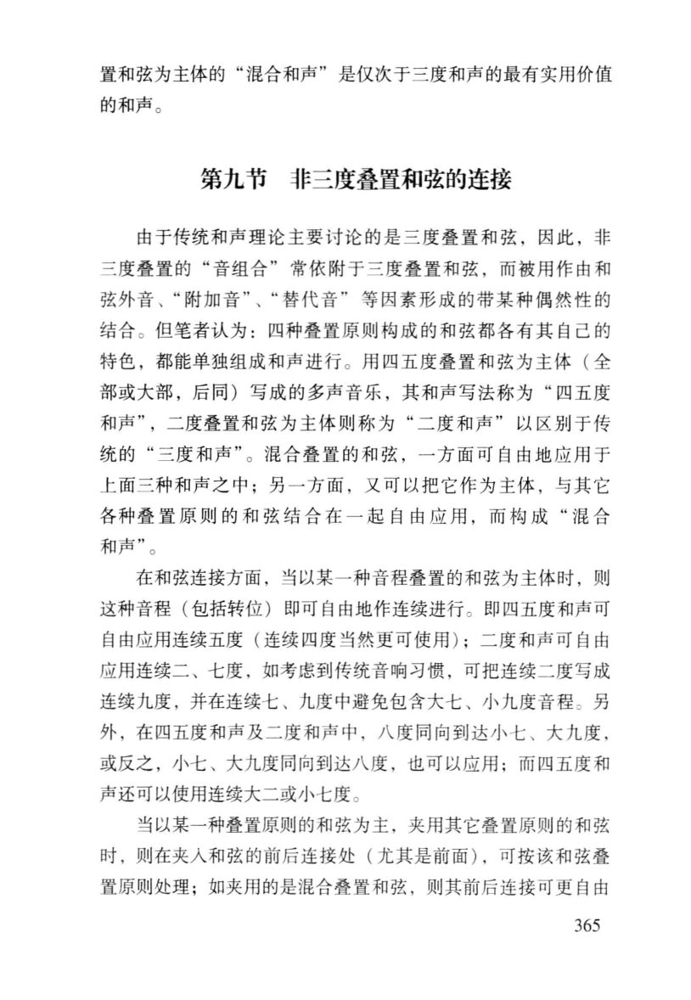

<!-- MANUAL-REFS:p0390 -->

<strong>手册使用本页</strong><ul><li id="ref-claim-atonal-chord-material-p0390" class="manual-ref-item" data-kind="claim">论点<a href="../和声学手册.html#claim-atonal-chord-material">无调性与自由音高组织 · atonal.chord-material</a> 手册提炼：后调性和弦不再只按三度叠置；三度/六度、四度/五度、二度/七度都可作为构建和弦的音程材料。</li></ul>

置和弦为主体的“混合和声”是仅次于三度和声的最有实用价值 
的和声。 
第九节非三度叠置和弦的连接 
由于传统和声理论主要讨论的是三度叠置和弦，因此，非 
三度叠置的“音组合”常依附于三度叠置和弦，而被用作由和 
结合。但笔者认为：四种叠置原则构成的和弦都各有其自己的 
特色，都能单独组成和声进行。用四五度叠置和弦为主体（全 
部或大部，后同）写成的多声音乐，其和声写法称为“四五度 
和声”，二度叠置和弦为主体则称为“二度和声”以区别于传 
统的“三度和声”。混合叠置的和弦，一方面可自由地应用于 
上面三种和声之中；另一方面，又可以把它作为主体，与其它 
各种叠置原则的和弦结合在一起自由应用，而构成“混合 
和声”。 
在和弦连接方面，当以某一种音程叠置的和弦为主体时，则 
这种音程（包括转位）即可自由地作连续进行。即四五度和声可 
自由应用连续五度（连续四度当然更可使用）；二度和声可自由 
应用连续二、七度，如考虑到传统音响习惯，可把连续二度写成 
连续九度，并在连续七、九度中避免包含大七、小九度音程。另 
外，在四五度和声及二度和声中，八度同向到达小七、大九度， 
或反之，小七、大九度同向到达八度，也可以应用；而四五度和 
声还可以使用连续大二或小七度。 
当以某一种叠置原则的和弦为主，夹用其它叠置原则的和弦 
时，则在夹入和弦的前后连接处（尤其是前面），可按该和弦叠 
置原则处理；如夹用的是混合叠置和弦，则其前后连接可更自由 
365

---
