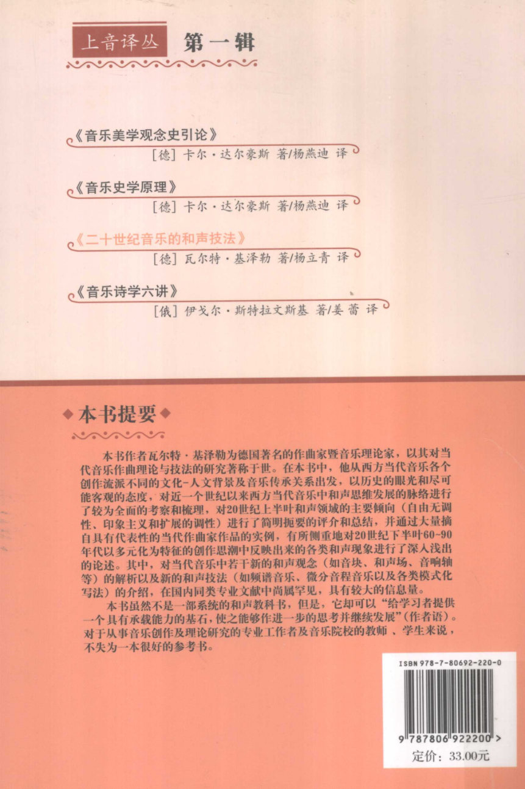
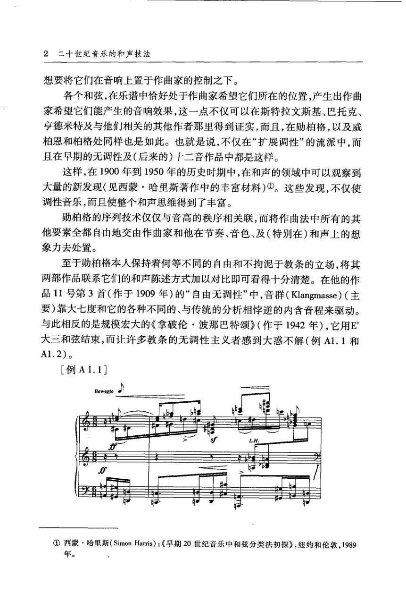
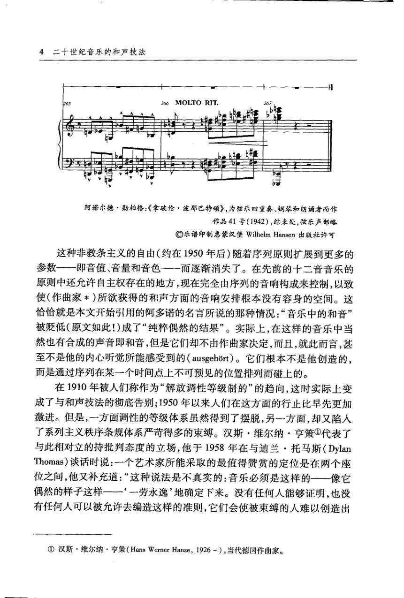
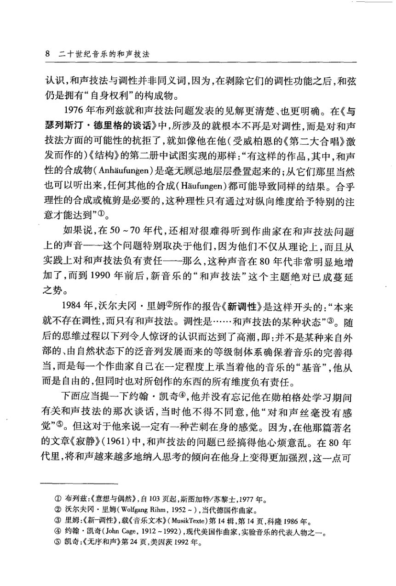
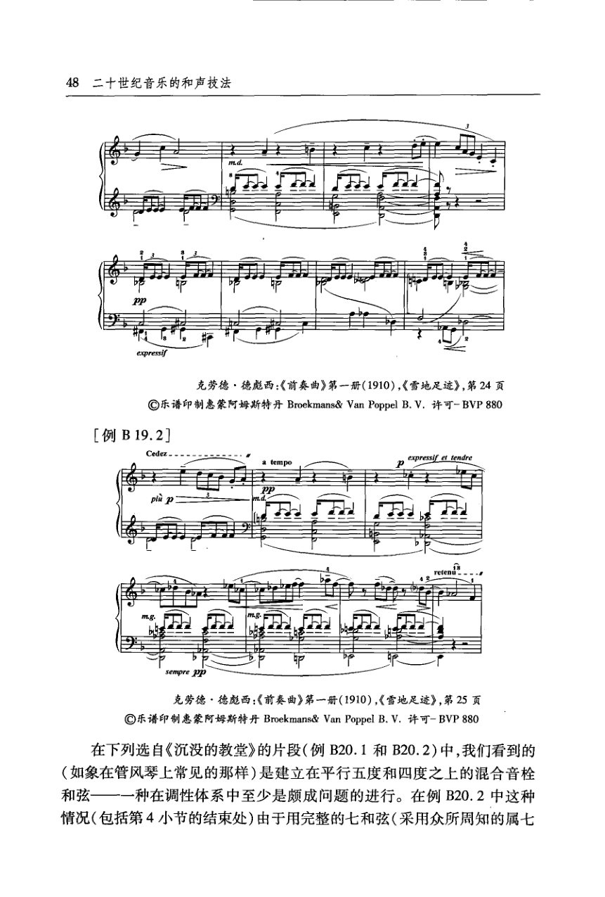
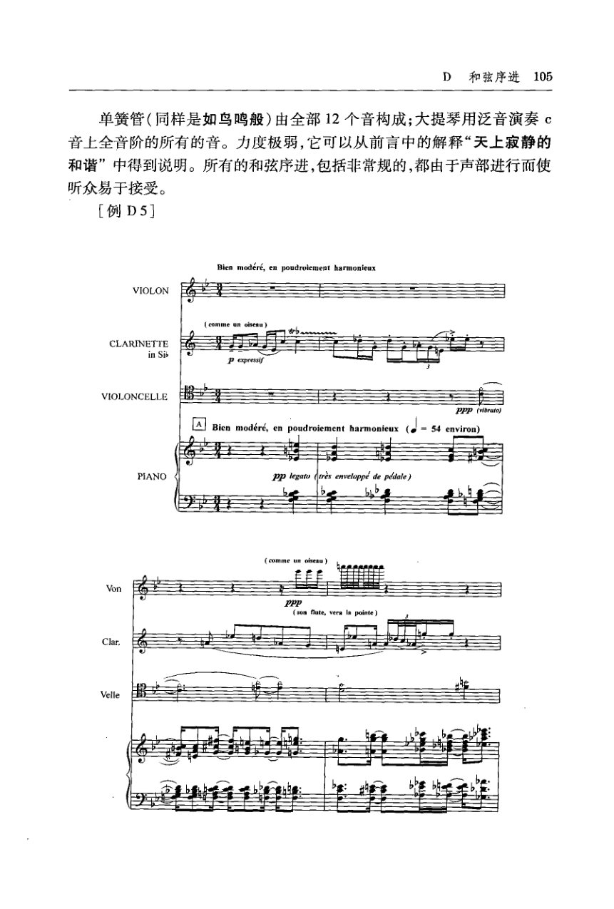
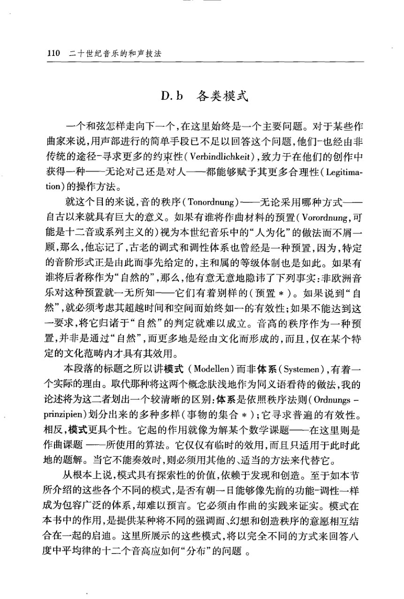
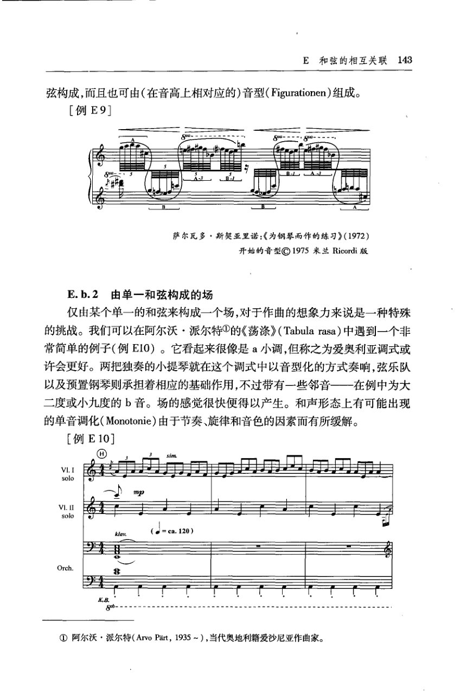
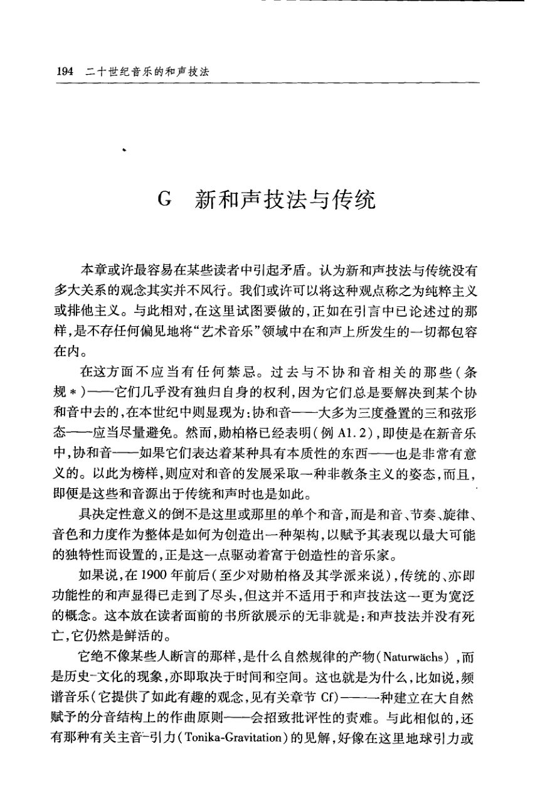

# 基泽勒《二十世纪音乐的和声技法》

> **PDF 文件**：`基泽勒《二十世纪音乐的和声技法》.pdf`  
> **物理页数**：280（从 PDF 第 1 页起计）  
> **OCR 平均置信度**：0.966  
> **字符数**：164344

本文件收录**理论手册实际引用的 9 个 PDF 页**，每页采用整版影印 + OCR 文本。整页图保留谱例、图表、表格、边注和版面关系；OCR 只供检索与复制，具体音符、临时记号、连线和罗马数字以图像为准。被理论手册引用的条目列在图后，可直接回跳。

页码一律使用 **PDF 物理页码**，可能与书内印刷页码不同。

**快速跳页**：[p.2](#p0002) · [p.10](#p0010) · [p.12](#p0012) · [p.16](#p0016) · [p.56](#p0056) · [p.113](#p0113) · [p.118](#p0118) · [p.151](#p0151) · [p.202](#p0202)

---

<!-- PAGE:2 -->

## PDF p.2

<!-- MANUAL-REFS:p0002 -->

<strong>手册使用本页</strong><ul><li id="ref-profile-profile-kizler_20c-p0002" class="manual-ref-item" data-kind="profile">代表页<a href="../和声学手册.html#book-profiles">教材代表页 · 基泽勒</a> 手册将本页列为《基泽勒》代表页；该书定位：从功能/非功能、和弦构造、和弦序进、音响场、中心音与微分音等角度梳理二十世纪和声技法。</li></ul>

上音译丛 
第一辑 
《音乐美学观念史引论》 
[德]卡尔·达尔豪斯著/杨燕迪译 
《音乐史学原理》 
[德]卡尔·达尔豪斯著/杨燕迪译 
《二十世纪音乐的和声技法》 
[德］瓦尔特·基泽勒著/杨立青译 
《音乐诗学六讲》 
[俄］伊戈尔·斯特拉文斯基著/姜蕾译 
本书提要 
本书作者瓦尔特·基泽勒为德国著名的作曲家暨音乐理论家，以其对当 
代音乐作曲理论与技法的研究著称于世。在本书中，他从西方当代音乐各个 
创作流派不同的文化-人文背景及音乐传承关系出发，以历史的眼光和尽可 
能客观的态度，对近一个世纪以来西方当代音乐中和声思维发展的脉络进行 
了较为全面的考察和梳理，对20世纪上半叶和声领域的主要倾向（自由无调 
性、印象主义和扩展的调性）进行了简明扼要的评介和总结，并通过大量摘 
自具有代表性的当代作曲家作品的实例，有所侧重地对20世纪下半叶60~90 
年代以多元化为特征的创作思潮中反映出来的各类和声现象进行了深人浅出 
的论述。其中，对当代音乐中若干新的和声观念（如音块、和声场、音响轴 
等）的解析以及新的和声技法（如频谱音乐、微分音程音乐以及各类模式化 
写法）的介绍，在国内同类专业文献中尚属罕见，具有较大的信息量。 
本书虽然不是一部系统的和声教科书，但是，它却可以“给学习者提供 
一个具有承载能力的基石，使之能够作进一步的思考并继续发展”（作者语）。 
对于从事音乐创作及理论研究的专业工作者及音乐院校的教师、学生来说， 
不失为一本很好的参考书。 
ISBN978-7-80692-220-0 
9787806922200&gt; 
定价：33.00元

---

<!-- PAGE:10 -->

## PDF p.10

<!-- MANUAL-REFS:p0010 -->

<strong>手册使用本页</strong><ul><li id="ref-claim-atonal-features-p0010" class="manual-ref-item" data-kind="claim">论点<a href="../和声学手册.html#claim-atonal-features">无调性与自由音高组织 · atonal.features</a> 手册提炼：自由无调性常避免主和弦与大三、小三和弦，自由运用半音阶与不协和音，并让每首作品自定进行规则。</li><li id="ref-claim-serialism-row-p0010" class="manual-ref-item" data-kind="claim">论点<a href="../和声学手册.html#claim-serialism-row">十二音序列与序列和声 · serialism.row</a> 手册提炼：十二音技法以预先设计的十二音级排序为全曲音高材料，并通过移位、逆行、倒影、逆行倒影组织 48 种形式。</li><li id="ref-claim-atonal-expanded-tonality-overlap-p0010" class="manual-ref-item" data-kind="claim">论点<a href="../和声学手册.html#claim-atonal-expanded-tonality-overlap">无调性与自由音高组织 · atonal.expanded-tonality-overlap</a> 手册提炼：扩展调性、自由无调性与十二音在同一时期并存；各流派都以不同方式控制纵向和声事件，年代上并无截然断裂。</li><li id="ref-claim-serialism-pitch-order-first-p0010" class="manual-ref-item" data-kind="claim">论点<a href="../和声学手册.html#claim-serialism-pitch-order-first">十二音序列与序列和声 · serialism.pitch-order-first</a> 手册提炼：早期十二音序列主要组织音高次序，节奏、音色与和声仍保留作曲家的自由；整体序列则把序列原则扩展到更多参数。</li><li id="ref-profile-profile-kizler_20c-p0010" class="manual-ref-item" data-kind="profile">代表页<a href="../和声学手册.html#book-profiles">教材代表页 · 基泽勒</a> 手册将本页列为《基泽勒》代表页；该书定位：从功能/非功能、和弦构造、和弦序进、音响场、中心音与微分音等角度梳理二十世纪和声技法。</li></ul>

2二十世纪音乐的和声技法 
想要将它们在音响上置于作曲家的控制之下。 
各个和弦，在乐谱中恰好处于作曲家希望它们所在的位置，产生出作曲 
家希望它们能产生的音响效果，这一点不仅可以在斯特拉文斯基、巴托克、 
亨德米特及与他们相关的其他作者那里得到证实，而且，在勋柏格，以及威 
柏恩和柏格处同样也是如此。也就是说，不仅在“扩展调性”的流派中，而 
且在早期的无调性及（后来的)十二音作品中都是这样。 
这样，在1900年到1950年的历史时期中，在和声的领域中可以观察到 
大量的新发现（见西蒙·哈里斯著作中的丰富材料）①。这些发现，不仅使 
调性音乐，而且使整个和声思维得到了丰富。 
勋柏格的序列技术仅仅与音高的秩序相关联，而将作曲法中所有的其 
他要素全都自由地交由作曲家和他在节奏、音色、及（特别在）和声上的想 
象力去处置。 
至于勋柏格本人保持着何等不同的自由和不拘泥于教条的立场，将其 
两部作品联系它们的和声陈述方式加以对比即可看得十分清楚。在他的作 
品11号第3首（作于1909年）的“自由无调性”中,音群（Klangmasse）（主 
要)靠大七度和它的各种不同的、与传统的分析相学逆的内含音程来驱动。 
与此相反的是规模宏大的《拿破伦·波那巴特颂》（作于1942年），它用E 
大三和弦结束，而让许多教条的无调性主义者感到大惑不解（例A1.1和 
A1.2)。 
[例A1.1] 
Bewegte 
年。

---

<!-- PAGE:12 -->

## PDF p.12

<!-- MANUAL-REFS:p0012 -->

<strong>手册使用本页</strong><ul><li id="ref-profile-profile-kizler_20c-p0012" class="manual-ref-item" data-kind="profile">代表页<a href="../和声学手册.html#book-profiles">教材代表页 · 基泽勒</a> 手册将本页列为《基泽勒》代表页；该书定位：从功能/非功能、和弦构造、和弦序进、音响场、中心音与微分音等角度梳理二十世纪和声技法。</li></ul>

4二十世纪音乐的和声技法 
265 
266MOLTORIT 
阿诺尔德·勋柏格：《拿破伦·波郡巴特颂》，为弦乐四重奏、钢琴和朗诵者而作 
作品41号（1942），结束处，弦乐声部略 
乐谱印制惠蒙汉堡WilhelmHansen出版社许可 
这种非教条主义的自由（约在1950年后）随着序列原则扩展到更多的 
参数一—即音值、音量和音色一而逐渐消失了。在先前的十二音音乐的 
原则中还允许自主权存在的地方，现在完全由序列的音响构成来控制，以致 
使（作曲家*）所欲获得的和声方面的音响安排根本没有容身的空间。这 
恰恰就是本文开始引用的阿多诺的名言所说的那种情况：“音乐中的和音” 
被贬低（原文如此！)成了“纯粹偶然的结果”。实际上，在这样的音乐中当 
然也有合成的声音即和音，但是它们却不由作曲家决定，而且，就此而言，甚 
至不是他的内心听觉所能感受到的（ausgehort）。它们根本不是他创造的， 
而是通过序列在某一个时间点上不可预见的位置排列而碰上的。 
在1910年被人们称作为“解放调性等级制的”的趋向，这时实际上变 
成了与和声技法的彻底告别；1950年以来人们在这方面的行止比早先更加 
激进。但是，一方面调性的等级体系虽然得到了摆脱，另一方面，却又陷人 
了系列主义秩序条规体系严苛得多的束缚。汉斯·维尔纳·亨策①代表了 
与此相对立的持批判态度的立场，他于1958年在与迪兰·托马斯（Dylan 
Thomas）谈话时说：一个艺术家所能采取的最值得赞赏的定位是在两个座 
位之间，他又补充道：“这种说法是不真实的：音乐必须是这样的一一像它 
偶然的样子这样一一‘一劳永逸”地确定下来。没有任何人能够证明，也没 
有任何人可以被允许去编造这样的准则，它们会使被束缚的人难以创造出 
①汉斯·维尔纳·亨策（HansWemerHanze，1926～），当代德国作曲家。

---

<!-- PAGE:16 -->

## PDF p.16

<!-- MANUAL-REFS:p0016 -->

<strong>手册使用本页</strong><ul><li id="ref-claim-atonal-harmony-not-tonality-p0016" class="manual-ref-item" data-kind="claim">论点<a href="../和声学手册.html#claim-atonal-harmony-not-tonality">无调性与自由音高组织 · atonal.harmony-not-tonality</a> 手册提炼：和声技法不等于调性功能；剥除调性功能后，和弦仍可作为具有自身结构的音响单位被组织。</li><li id="ref-profile-profile-kizler_20c-p0016" class="manual-ref-item" data-kind="profile">代表页<a href="../和声学手册.html#book-profiles">教材代表页 · 基泽勒</a> 手册将本页列为《基泽勒》代表页；该书定位：从功能/非功能、和弦构造、和弦序进、音响场、中心音与微分音等角度梳理二十世纪和声技法。</li></ul>

8二十世纪音乐的和声技法 
认识，和声技法与调性并非同义词，因为，在剥除它们的调性功能之后，和弦 
仍是拥有“自身权利”的构成物。 
1976年布列兹就和声技法问题发表的见解更清楚、也更明确。在《与 
瑟列斯汀·德里格的谈话》中，所涉及的就根本不再是对调性，而是对和声 
技法方面的可能性的抗拒了，就如像他在他（受威柏恩的《第二大合唱》激 
发而作的）《结构》的第二册中试图实现的那样：“有这样的作品，其中，和声 
性的合成物（Anhaufungen）是毫无顾忌地层层叠置起来的；从它们那里当然 
也可以听出来，任何其他的合成（Haufungen)都可能导致同样的结果。合乎 
理性的合成或梳剪是必要的，这种理性只有通过对纵向维度给予特别的注 
意才能达到”①。 
如果说，在50～70年代，还相对很难得听到作曲家在和声技法问题 
上的声音-一这个问题特别取决于他们，因为他们不仅从理论上，而且从 
加了，而到1990年前后，新音乐的“和声技法”这个主题绝对已成蔓延 
之势。 
1984年，沃尔夫冈·里姆②所作的报告《新调性》是这样开头的：“本来 
就不存在调性，而只有和声技法。调性是·..·和声技法的某种状态”③。随 
后的思维过程以下列令人惊讶的认识而达到了高潮，即：并不是某种来自外 
部的、由自然状态下的泛音列发展而来的等级制体系确保着音乐的完善得 
当，而是每一个作曲家自己在一定程度上承当着他的音乐的“基音”，他从 
而是自由的，但同时也对所创作的东西的所有维度负有责任。 
下面应当提一下约翰·凯奇，他并没有忘记他在勋柏格处学习期间 
有关和声技法的那次谈话，当时他不得不同意，他“对和声丝毫没有感 
觉”。但这对于他来说一定有一种芒刺在身的感觉。因为，在他那篇著名 
的文章《寂静》（1961)中，和声技法的问题已经搞得他心烦意乱。在80年 
代里，将和声越来越多地纳人思考的倾向在他身上变得更加强烈，这一点可 
①布列兹：《意想与偶然》，自103页起，斯图加特/苏黎士，1977年。 
②沃尔夫冈·里姆（WolfgangRihm，1952～），当代德国作曲家。 
③里姆：《新-调性》，载《音乐文本》（MusikTexte)第14辑，第14页，科隆1986年。 
④约翰·凯奇（JohnCage，1912～1992），现代美国作曲家，实验音乐的代表人物之一。 
③凯奇：《无序和声》第24页，美因茨1992年。

---

<!-- PAGE:56 -->

## PDF p.56

<!-- MANUAL-REFS:p0056 -->

<strong>手册使用本页</strong><ul><li id="ref-claim-voice-leading-parallels-p0056" class="manual-ref-item" data-kind="claim">论点<a href="../和声学手册.html#claim-voice-leading-parallels">声部进行与不协和解决 · voice-leading.parallels</a> 手册提炼：平行纯五度、纯八度削弱声部独立性，因此传统调性写作把它们视为需要避免的进行。</li></ul>

48二十世纪音乐的和声技法 
克劳德·德彪西：《前奏曲》第一册（1910)，《雪地足迹》，第24页 
乐谱印制惠蒙阿姆斯特丹Broekmans&amp;VanPoppelB.V.许可-BVP880 
[例B19.2] 
Cedez. 
expressifettendre 
克劳德·德彪西：《前奏曲》第一册（1910)，《雪地足迹》，第25页 
乐谱印制惠蒙阿姆斯特丹Broekmans&amp;VanPoppelB.V.许可-BVP880 
在下列选自《沉没的教堂》的片段（例B20.1和B20.2)中，我们看到的 
（如象在管风琴上常见的那样）是建立在平行五度和四度之上的混合音栓 
和弦 
一一种在调性体系中至少是颇成问题的进行。在例B20.2中这种 
情况（包括第4小节的结束处）由于用完整的七和弦（采用众所周知的属七

---

<!-- PAGE:113 -->

## PDF p.113

<!-- MANUAL-REFS:p0113 -->

<strong>手册使用本页</strong><ul><li id="ref-example-m04-p0113" class="manual-ref-item" data-kind="example">案例<a href="../和声学手册.html#example-m04">手册案例 M04 · 多层材料：独立音集与声部连接</a> 例D5｜梅西安《时间终结四重奏》第一乐章 原书要点：钢琴仪式性和弦具12音倾向，单簧管12音鸟鸣，大提琴奏C全音阶泛音，小提琴混合半音与全音；声部进行使非常规序进可接受。 机制：多层并置时，每层可拥有独立音集、节奏与音色；层间共同音或级进负责连接，统一性来自声部进行而非共同调性。 读谱：按乐器分层：钢琴看和弦对置、单簧管数12音、大提琴认全音阶、小提琴看半音加全音；再找层间共同音或级进。 用法：写多层音乐时，先给每层独立音集与节奏，再用共同音或级进连接；不必强迫各层共用一个调。</li></ul>

D和弦序进105 
单簧管（同样是如鸟鸣般）由全部12个音构成；大提琴用泛音演奏c 
音上全音阶的所有的音。力度极弱，它可以从前言中的解释“天上寂静的 
和谐”中得到说明。所有的和弦序进，包括非常规的，都由于声部进行而使 
听众易于接受。 
[例D5] 
Bien modere,en poudroiement harmonieux 
VIOLON 
comme 
CLARINETTE 
in Sib 
VIOLONCELLE 
ppp (vibrato) 
54environ) 
pp legato resemveloppede pedale) 
ppp 
Clar 
Velle

---

<!-- PAGE:118 -->

## PDF p.118

<!-- MANUAL-REFS:p0118 -->

<strong>手册使用本页</strong><ul><li id="ref-profile-profile-kizler_20c-p0118" class="manual-ref-item" data-kind="profile">代表页<a href="../和声学手册.html#book-profiles">教材代表页 · 基泽勒</a> 手册将本页列为《基泽勒》代表页；该书定位：从功能/非功能、和弦构造、和弦序进、音响场、中心音与微分音等角度梳理二十世纪和声技法。</li></ul>

110二十世纪音乐的和声技法 
D.b各类模式 
一个和弦怎样走向下一个，在这里始终是一个主要问题。对于某些作 
曲家来说，用声部进行的简单手段已不足以回答这个问题，他们一也经由非 
传统的途径-寻求更多的约束性（Verbindlichkeit），致力于在他们的创作中 
获得一种—-无论对已还是对人一一都能够赋予其更多合理性（Legitima 
tion）的操作方法。 
就这个目的来说，音的秩序（Tonordnung）——无论采用哪种方式— 
自古以来就具有巨大的意义。如果有谁将作曲材料的预置（Vorordnung，可 
能是十二音或系列主义的)视为本世纪音乐中的“人为化”的做法而不屑一 
顾，那么，他忘记了，古老的调式和调性体系也曾经是一种预置，因为，特定 
的音阶形式正是由此而事先给定的，主和属的等级体制也是如此。如果有 
谁将后者称作为“自然的”，那么，他有意无意地隐讳了下列事实：非欧洲音 
乐对这种预置就一无所知一—它们有着别样的（预置*）。如果说到“自 
然”，就必须考虑其超越时间和空间而始终如一的有效性；如果不能达到这 
一要求，将它归诸于“自然”的判定就难以成立。音高的秩序作为一种预 
置，并非是通过“自然”，而更多地是经由文化而形成的，而且，仅在某个特 
定的文化范畴内才具有其效用。 
本段落的标题之所以讲模式（Modellen）而非体系（Systemen），有着一 
个实际的理由。取代那种将这两个概念肤浅地作为同义语看待的做法，我的 
论述将为这二者划出一个较清晰的区别：体系是依照秩序法则（Ordnungs一 
prinzipien)划分出来的多种多样（事物的集合*）；它寻求普遍的有效性。 
相反，模式更具个性。它起的作用就像为解某个数学课题一在这里则是 
作曲课题一一所使用的算法。它仅仅有临时的效用，而且只适用于此时此 
地的题解。当它不能奏效时，则必须用其他的、适当的方法来代替它。 
从根本上说，模式具有探索性的价值，依赖于发现和创造。至于如本节 
所介绍的这些各个不同的模式，是否有朝一日能够像先前的功能-调性一样 
成为包容广泛的体系，却难以预言。它必须由作曲的实践来证实。模式在 
本书中的作用，是提供某种将不同的强调面、幻想和创造秩序的意愿相互结 
合在一起的启迪。这里所展示的这些模式，将以完全不同的方式来回答八 
度中平均律的十二个音高应如何“分布”的问题。

---

<!-- PAGE:151 -->

## PDF p.151

<!-- MANUAL-REFS:p0151 -->

<strong>手册使用本页</strong><ul><li id="ref-profile-profile-kizler_20c-p0151" class="manual-ref-item" data-kind="profile">代表页<a href="../和声学手册.html#book-profiles">教材代表页 · 基泽勒</a> 手册将本页列为《基泽勒》代表页；该书定位：从功能/非功能、和弦构造、和弦序进、音响场、中心音与微分音等角度梳理二十世纪和声技法。</li></ul>

E和弦的相互关联143 
弦构成，而且也可由（在音高上相对应的)音型(Figurationen)组成。 
[例E9] 
萨尔瓦多·斯契亚里诺：《为钢琴而作的练习》（1972） 
开始的音型1975米兰Ricordi版 
E.b.2由单一和弦构成的场 
仅由某个单一的和弦来构成一个场，对于作曲的想象力来说是一种特殊 
的挑战。我们可以在阿尔沃·派尔特的《荡涤》（Tabularasa）中遇到一个非 
常简单的例子（例E10）。它看起来很像是a小调，但称之为爱奥利亚调式或 
许会更好。两把独奏的小提琴就在这个调式中以音型化的方式奏响，弦乐队 
以及预置钢琴则承担着相应的基础作用，不过带有一些邻音——在例中为大 
二度或小九度的b音。场的感觉很快便得以产生。和声形态上有可能出现 
的单音调化（Monotonie）由于节奏、旋律和音色的因素而有所缓解。 
[例E10] 
V1. I 
solo 
V1.II 
solo 
(= ca. 120) 
klav. 
Orch. 
8 
K.B. 
①阿尔沃·派尔特（ArvoPart，1935～），当代奥地利籍爱沙尼亚作曲家。

---

<!-- PAGE:202 -->

## PDF p.202

<!-- MANUAL-REFS:p0202 -->

<strong>手册使用本页</strong><ul><li id="ref-claim-atonal-harmony-technique-survives-p0202" class="manual-ref-item" data-kind="claim">论点<a href="../和声学手册.html#claim-atonal-harmony-technique-survives">无调性与自由音高组织 · atonal.harmony-technique-survives</a> 手册提炼：功能性和声的退场不等于和声技法死亡；二十世纪音乐继续以音高、音色、密度、音区与织体组织纵向关系。</li><li id="ref-profile-profile-kizler_20c-p0202" class="manual-ref-item" data-kind="profile">代表页<a href="../和声学手册.html#book-profiles">教材代表页 · 基泽勒</a> 手册将本页列为《基泽勒》代表页；该书定位：从功能/非功能、和弦构造、和弦序进、音响场、中心音与微分音等角度梳理二十世纪和声技法。</li></ul>

194二十世纪音乐的和声技法 
G新和声技法与传统 
本章或许最容易在某些读者中引起矛盾。认为新和声技法与传统没有 
多大关系的观念其实并不风行。我们或许可以将这种观点称之为纯粹主义 
或排他主义。与此相对，在这里试图要做的，正如在引言中已论述过的那 
样，是不存任何偏见地将“艺术音乐”领域中在和声上所发生的一切都包容 
在内。 
在这方面不应当有任何禁忌。过去与不协和音相关的那些（条 
规*）一一它们几乎没有独归自身的权利，因为它们总是要解决到某个协 
和音中去的，在本世纪中则显现为：协和音一一大多为三度叠置的三和弦形 
态一一应当尽量避免。然而，勋柏格已经表明（例A1.2），即使是在新音乐 
中，协和音-一如果它们表达着某种具有本质性的东西一—也是非常有意 
义的。以此为榜样，则应对和音的发展采取一种非教条主义的姿态，而且， 
即便是这些和音源出于传统和声时也是如此。 
具决定性意义的倒不是这里或那里的单个和音，而是和音、节奏、旋律、 
音色和力度作为整体是如何为创造出一种架构，以赋予其表现以最大可能 
的独特性而设置的，正是这一点驱动着富于创造性的音乐家。 
如果说，在1900年前后（至少对勋柏格及其学派来说），传统的、亦即 
功能性的和声显得已走到了尽头，但这并不适用于和声技法这一更为宽泛 
的概念。这本放在读者面前的书所欲展示的无非就是：和声技法并没有死 
亡，它仍然是鲜活的。 
它绝不像某些人断言的那样，是什么自然规律的产物（Naturwachs），而 
是历史-文化的现象，亦即取决于时间和空间。这也就是为什么，比如说，频 
谱音乐（它提供了如此有趣的观念，见有关章节Cf)一一一种建立在大自然 
赋予的分音结构上的作曲原则一一一会招致批评性的责难。与此相似的，还 
有那种有关主音-引力（Tonika-Gravitation）的见解，好像在这里地球引l力或

---
