# 佩尔西采蒂《二十世纪和声学》

> **PDF 文件**：`佩尔西采蒂《二十世纪和声学》.pdf`  
> **物理页数**：287（从 PDF 第 1 页起计）  
> **OCR 平均置信度**：0.977  
> **字符数**：128459

本文件收录**理论手册实际引用的 15 个 PDF 页**，每页采用整版影印 + OCR 文本。整页图保留谱例、图表、表格、边注和版面关系；OCR 只供检索与复制，具体音符、临时记号、连线和罗马数字以图像为准。被理论手册引用的条目列在图后，可直接回跳。

页码一律使用 **PDF 物理页码**，可能与书内印刷页码不同。

**快速跳页**：[p.15](#p0015) · [p.30](#p0030) · [p.37](#p0037) · [p.41](#p0041) · [p.42](#p0042) · [p.68](#p0068) · [p.81](#p0081) · [p.83](#p0083) · [p.89](#p0089) · [p.112](#p0112) · [p.126](#p0126) · [p.226](#p0226) · [p.227](#p0227) · [p.235](#p0235) · [p.236](#p0236)

---

<!-- PAGE:15 -->

## PDF p.15

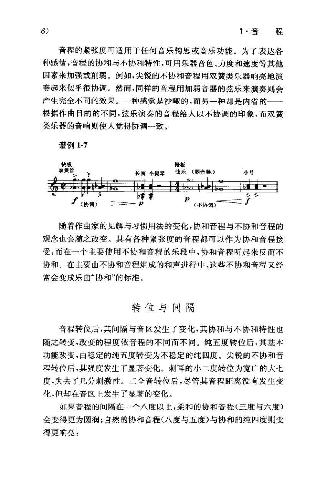

<!-- MANUAL-REFS:p0015 -->

<strong>手册使用本页</strong><ul><li id="ref-claim-interval-inversion-p0015" class="manual-ref-item" data-kind="claim">论点<a href="../和声学手册.html#claim-interval-inversion">音程、音高集合与音名拼写 · interval.inversion</a> 手册提炼：音程转位会改变度数，但保持两音的等音音高关系，是拼写、和弦转位与集合运算的共同前提。</li></ul>

6) 
1·音程 
音程的紧张度可适用于任何音乐构思或音乐功能。为了表达各 
种感情，音程的协和与不协和特性，可用乐器音色、力度和速度等其他 
因素来加强或削弱。例如，尖锐的不协和音程用双簧类乐器响亮地演 
奏起来似乎很协调。然而，同样的音程用加弱音器的弦乐来演奏则会 
产生完全不同的效果。一种感觉是沙哑的，而另一种却是内省的一一 
根据作曲目的的不同，弦乐演奏的音程给人以不协调的印象，而双簧 
类乐器的音响则使人觉得协调-一致。 
谱例1-7 
快板 
慢板 
双簧管 
弦乐.（弱音器.） 
长笛小提琴 
小号 
p 
（协调） 
（不协调） 
随着作曲家的见解与习惯用法的变化，协和音程与不协和音程的 
观念也会随之改变。具有各种紧张度的音程都可以作为协和音程接 
受，而在一个主要使用不协和音程的乐段中，协和音程听起来反而不 
协和。在主要由不协和音程组成的和声进行中，这些不协和音程又经 
常会变成乐曲“协和”的标准。 
转位与间隔 
音程转位后，其间隔与音区发生了变化，其协和与不协和特性也 
随之转变，改变的程度依音程的不同而不同。纯五度转位后，其基本 
功能改变，由稳定的纯五度转变为不稳定的纯四度。尖锐的不协和音 
程转位后，其强度发生了显著变化。刺耳的小二度转位为宽广的大七 
度，失去了几分刺激性。三全音转位后，尽管其音程距离没有发生变 
化，但却在音区上发生了显著的变化。 
如果音程的间隔在一个八度以上，柔和的协和音程（三度与六度） 
会变得更为圆润；自然的协和音程（八度与五度）与协和的纯四度则变 
得更响亮：

---

<!-- PAGE:30 -->

## PDF p.30

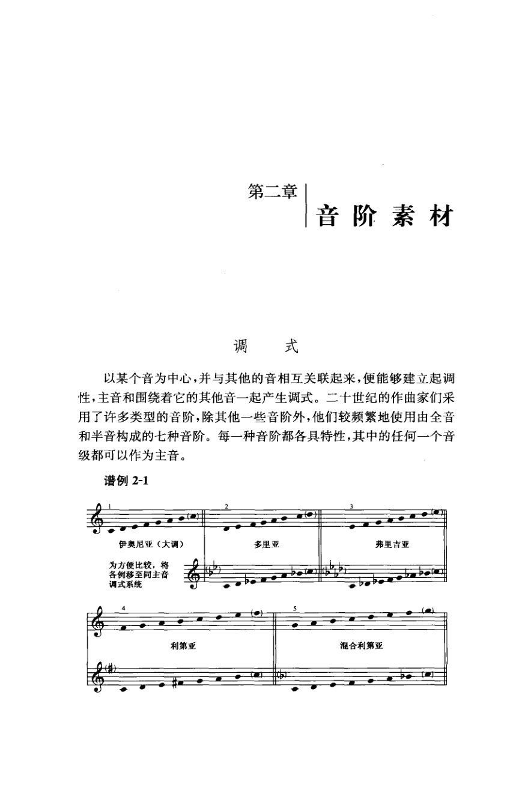

<!-- MANUAL-REFS:p0030 -->

<strong>手册使用本页</strong><ul><li id="ref-claim-scale-twentieth-century-materials-p0030" class="manual-ref-item" data-kind="claim">论点<a href="../和声学手册.html#claim-scale-twentieth-century-materials">调式、音阶与音级 · scale.twentieth-century-materials</a> 手册提炼：二十世纪音阶材料扩展到多种人工音阶、五声/六声、全音与半音音阶；七种自然调式仍可使用，但中心与用法不再受共同实践语法约束。</li><li id="ref-profile-profile-persichetti_20c-p0030" class="manual-ref-item" data-kind="profile">代表页<a href="../和声学手册.html#book-profiles">教材代表页 · 佩尔西采蒂</a> 手册将本页列为《佩尔西采蒂》代表页；该书定位：按材料组织二十世纪和声：音阶素材、三度/四度/二度叠置、复和弦、平行和声、调中心与无调性。</li></ul>

第二章 
音阶素材 
调式 
以某个音为中心，并与其他的音相互关联起来，便能够建立起调 
性，主音和围绕着它的其他音一起产生调式。二十世纪的作曲家们采 
用了许多类型的音阶，除其他一些音阶外，他们较频繁地使用由全音 
和半音构成的七种音阶。每一种音阶都各具特性，其中的任何一个音 
级都可以作为主音。 
谱例2-1 
伊奥尼亚（大调） 
多里亚 
弗里吉亚 
为方便比较，将 
各例移至同主音 
调式系统 
利第亚 
混合利第亚

---

<!-- PAGE:37 -->

## PDF p.37

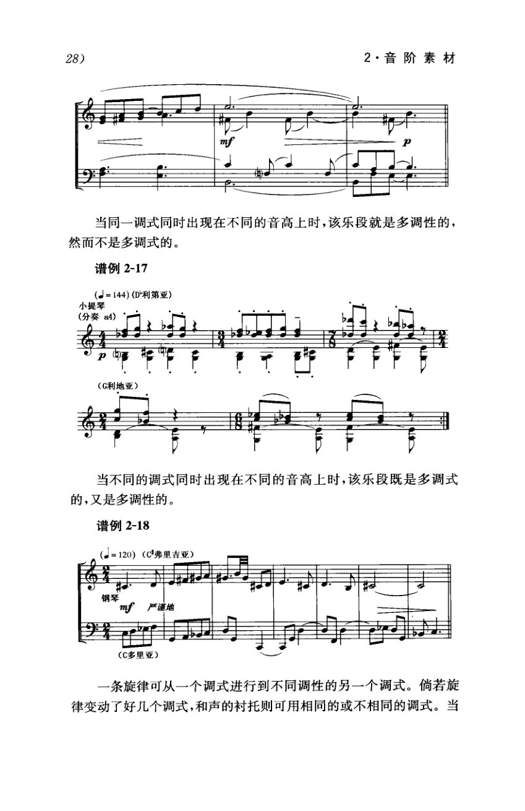

<!-- MANUAL-REFS:p0037 -->

<strong>手册使用本页</strong><ul><li id="ref-profile-profile-persichetti_20c-p0037" class="manual-ref-item" data-kind="profile">代表页<a href="../和声学手册.html#book-profiles">教材代表页 · 佩尔西采蒂</a> 手册将本页列为《佩尔西采蒂》代表页；该书定位：按材料组织二十世纪和声：音阶素材、三度/四度/二度叠置、复和弦、平行和声、调中心与无调性。</li></ul>

28) 
2·音阶素材 
当同一调式同时出现在不同的音高上时，该乐段就是多调性的， 
然而不是多调式的。 
谱例2-17 
（=144)（D利第亚） 
小提琴 
（分奏 
84） 
（G利地亚） 
当不同的调式同时出现在不同的音高上时，该乐段既是多调式 
的，又是多调性的。 
谱例2-18 
（=120）（C弗里吉亚） 
严谨地 
(C多里亚） 
一条旋律可从一个调式进行到不同调性的另一个调式。倘若旋 
律变动了好几个调式，和声的衬托则可用相同的或不相同的调式。当

---

<!-- PAGE:41 -->

## PDF p.41

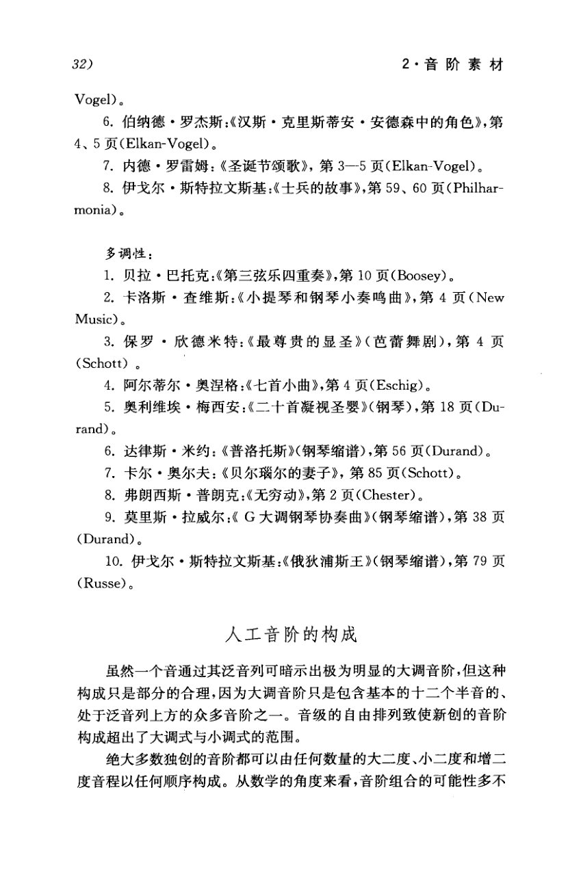

<!-- MANUAL-REFS:p0041 -->

<strong>手册使用本页</strong><ul><li id="ref-claim-scale-twentieth-century-materials-p0041" class="manual-ref-item" data-kind="claim">论点<a href="../和声学手册.html#claim-scale-twentieth-century-materials">调式、音阶与音级 · scale.twentieth-century-materials</a> 手册提炼：二十世纪音阶材料扩展到多种人工音阶、五声/六声、全音与半音音阶；七种自然调式仍可使用，但中心与用法不再受共同实践语法约束。</li></ul>

32) 
2·音阶素材 
Vogel)。 
6.伯纳德·罗杰斯：《汉斯·克里斯蒂安·安德森中的角色》，第 
4、5 页(Elkan-Vogel)。 
7.内德·罗雷姆：《圣诞节颂歌》，第3一-5页(Elkan-Vogel)。 
8.伊戈尔·斯特拉文斯基：《士兵的故事》，第59、60页（Philhar- 
monia)。 
多调性： 
1．贝拉·巴托克：《第三弦乐四重奏》，第10页（Boosey)。 
2.卡洛斯·查维斯：《小提琴和钢琴小奏鸣曲》，第4页（New 
Music)。 
3.保罗·欣德米特：《最尊贵的显圣》（芭蕾舞剧)，第4页 
(Schott）。 
4.阿尔蒂尔·奥涅格：《七首小曲》，第4页（Eschig)。 
5.奥利维埃·梅西安：《二十首凝视圣婴》钢琴），第18页（Du- 
rand)。 
6.达律斯·米约：《普洛托斯》（钢琴缩谱），第56页（Durand)。 
7.卡尔·奥尔夫：《贝尔瑙尔的妻子》，第85页(Schott)。 
8.弗朗西斯·普朗克：《无穷动》，第2页（Chester)。 
9.莫里斯·拉威尔：《G大调钢琴协奏曲》（钢琴缩谱），第38页 
(Durand)。 
10.伊戈尔·斯特拉文斯基：《俄狄浦斯王》钢琴缩谱），第79页 
(Russe)。 
人工音阶的构成 
虽然一个音通过其泛音列可暗示出极为明显的大调音阶，但这种 
构成只是部分的合理，因为大调音阶只是包含基本的十二个半音的、 
处于泛音列上方的众多音阶之一。音级的自由排列致使新创的音阶 
构成超出了大调式与小调式的范围。 
绝大多数独创的音阶都可以由任何数量的大二度、小二度和增二 
度音程以任何顺序构成。从数学的角度来看，音阶组合的可能性多不

---

<!-- PAGE:42 -->

## PDF p.42

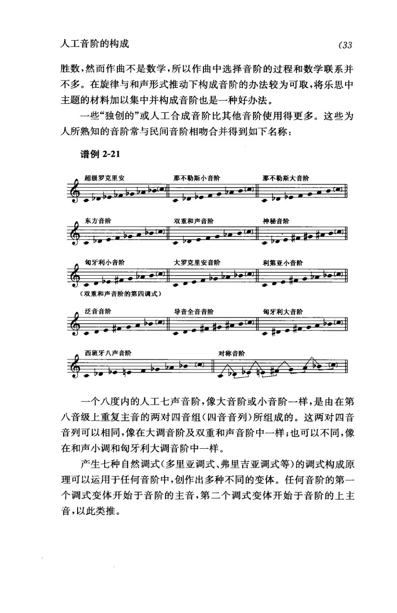

<!-- MANUAL-REFS:p0042 -->

<strong>手册使用本页</strong><ul><li id="ref-claim-scale-natural-modes-p0042" class="manual-ref-item" data-kind="claim">论点<a href="../和声学手册.html#claim-scale-natural-modes">调式、音阶与音级 · scale.natural-modes</a> 手册提炼：自然七调式可由同一音列移位并更换中心音得到；中心音与调式名称共同决定音阶身份。</li></ul>

人工音阶的构成 
(33 
胜数，然而作曲不是数学，所以作曲中选择音阶的过程和数学联系并 
不多。在旋律与和声形式推动下构成音阶的办法较为可取，将乐思中 
主题的材料加以集中并构成音阶也是一种好办法。 
一些“独创的”或人工合成音阶比其他音阶使用得更多。这些为 
人所熟知的音阶常与民间音阶相吻合并得到如下名称： 
谱例2-21 
超级罗克里安 
那不勒斯小音阶 
那不勒斯大音阶 
神秘音阶 
东方音阶 
双重和声音阶 
匈牙利小音阶 
大罗克里安音阶 
利第亚小音阶 
（双重和声音阶的第四调式） 
泛音音阶 
导音全音音阶 
旬牙利大音阶 
西班牙八声音阶 
对称音阶 
一个八度内的人工七声音阶，像大音阶或小音阶一样，是由在第 
八音级上重复主音的两对四音组（四音音列)所组成的。这两对四音 
音列可以相同，像在大调音阶及双重和声音阶中一样；也可以不同，像 
在和声小调和匈牙利大调音阶中一样。 
产生七种自然调式(多里亚调式、弗里吉亚调式等)的调式构成原 
理可以运用于任何音阶中，创作出多种不同的变体。任何音阶的第一 
个调式变体开始于音阶的主音，第二个调式变体开始于音阶的上主 
音，以此类推。

---

<!-- PAGE:68 -->

## PDF p.68

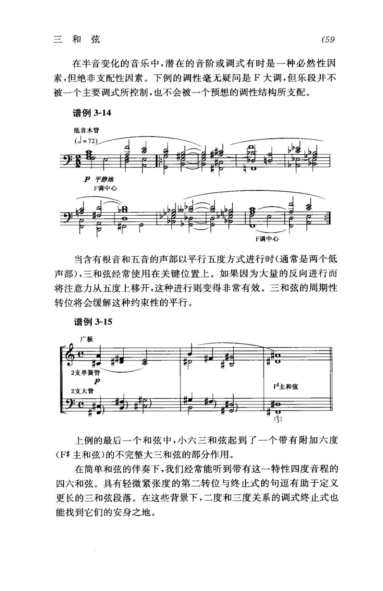

<!-- MANUAL-REFS:p0068 -->

<strong>手册使用本页</strong><ul><li id="ref-claim-voice-leading-parallels-p0068" class="manual-ref-item" data-kind="claim">论点<a href="../和声学手册.html#claim-voice-leading-parallels">声部进行与不协和解决 · voice-leading.parallels</a> 手册提炼：平行纯五度、纯八度削弱声部独立性，因此传统调性写作把它们视为需要避免的进行。</li><li id="ref-claim-inversion-cadential-six-four-p0068" class="manual-ref-item" data-kind="claim">论点<a href="../和声学手册.html#claim-inversion-cadential-six-four">转位、低音与和声节奏 · inversion.cadential-six-four</a> 手册提炼：终止四六和弦延迟 V 的到来，应处于比其后 V 更强的节奏位置，并以平稳声部进出。</li><li id="ref-prose-cite-persichetti_20c-p0068-1-p0068" class="manual-ref-item" data-kind="prose">正文引用<a href="../和声学手册.html#cite-persichetti_20c-p0068-1">手册正文引用</a> 平行纯五度、纯八度：两个声部以相同纯音程同向移动到新的纯音程，会削弱独立性，传统写作中避免。桑桐教程 PDF p.24、柴可夫斯基 PDF p.21、《概述》PDF p.103、斯波索宾上册答案 PDF p.20、徐平力 PDF p.379、桑桐《半音化的历史演进》PDF p.114、佩尔西采蒂 PDF p.68、基泽勒 PDF p.56。</li></ul>

三和弦 
(59 
在半音变化的音乐中，潜在的音阶或调式有时是一种必然性因 
素，但绝非支配性因素。下例的调性毫无疑问是F大调，但乐段并不 
被一个主要调式所控制，也不会被一个预想的调性结构所支配。 
谱例3-14 
低音木管 
(=72) 
P平静地 
F调中心 
8 
F调中心 
当含有根音和五音的声部以平行五度方式进行时（通常是两个低 
声部），三和弦经常使用在关键位置上。如果因为大量的反向进行而 
将注意力从五度上移开，这种进行则变得非常有效。三和弦的周期性 
转位将会缓解这种约束性的平行。 
谱例3-15 
广板 
F主和弦 
(学) 
上例的最后一个和弦中，小六三和弦起到了一个带有附加六度 
（F#主和弦）的不完整大三和弦的部分作用。 
在简单和弦的伴奏下，我们经常能听到带有这一特性四度音程的 
四六和弦。具有轻微紧张度的第二转位与终止式的句逗有助于定义 
更长的三和弦段落。在这些背景下，二度和三度关系的调式终止式也 
能找到它们的安身之地。

---

<!-- PAGE:81 -->

## PDF p.81

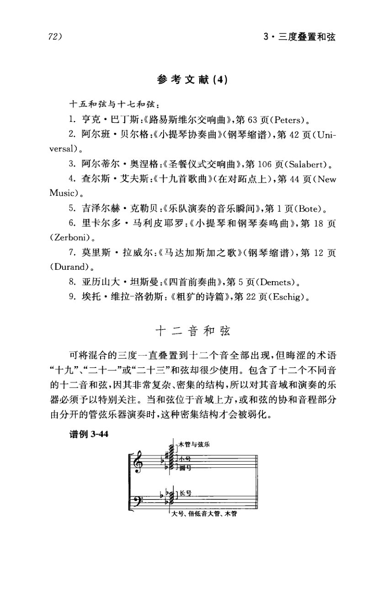

<!-- MANUAL-REFS:p0081 -->

<strong>手册使用本页</strong><ul><li id="ref-example-m07-p0081" class="manual-ref-item" data-kind="example">案例<a href="../和声学手册.html#example-m07">手册案例 M07 · 十二音和弦：音区与音色分层</a> 谱例3-44｜十二音和弦配器模型 原书要点：十二音和弦极密，必须特别关注音域与乐器；位于高音区或协和音程由分开的管弦乐器演奏时，密集结构才被弱化。 机制：十二个音同时发声时，听觉分辨受音区密度限制；把音高分配到不同音区与音色，能让协和音程和内部层次重新可辨。 读谱：按乐器或音区把和弦拆成三到四组，找每组内部的协和音程；再看密集音簇是否被移到高音区或被音色隔开。 用法：写十二音和弦时先做音区与音色分层：低音保留根音或五度，中部承担冲突，高音分开音色；避免全部挤在同一八度。</li></ul>

72) 
3·三度叠置和弦 
参考文献(4) 
十五和弦与十七和弦： 
1.亨克·巴丁斯：《路易斯维尔交响曲》,第63页（Peters)。 
2.阿尔班·贝尔格：《小提琴协奏曲》（钢琴缩谱），第42页（Uni- 
versal)。 
3.阿尔蒂尔·奥涅格：《圣餐仪式交响曲》,第106页(Salabert)。 
4.查尔斯·艾夫斯：《十九首歌曲》（在对跖点上），第44页（New 
Music)。 
5.吉泽尔赫·克勒贝：《乐队演奏的音乐瞬间》，第1页(Bote)。 
6.里卡尔多·马利皮耶罗：《小提琴和钢琴奏鸣曲》，第18页 
(Zerboni)。 
7.莫里斯·拉威尔：《马达加斯加之歌》（钢琴缩谱)，第12页 
(Durand)。 
8.亚历山大·坦斯曼：《四首前奏曲》，第5页(Demets)。 
9.埃托·维拉-洛勃斯：《粗犷的诗篇》，第22页（Eschig)。 
十二音和弦 
可将混合的三度一直叠置到十二个音全部出现，但晦涩的术语 
“十九”、“二十一"或“二十三"和弦却很少使用。包含了十二个不同音 
的十二音和弦，因其非常复杂、密集的结构，所以对其音域和演奏的乐 
器必须予以特别关注。当和弦位于音域上方，或和弦的协和音程部分 
由分开的管弦乐器演奏时，这种密集结构才会被弱化。 
谱例3-44 
木管与弦乐 
小号 
大号、倍低音大管、木管

---

<!-- PAGE:83 -->

## PDF p.83

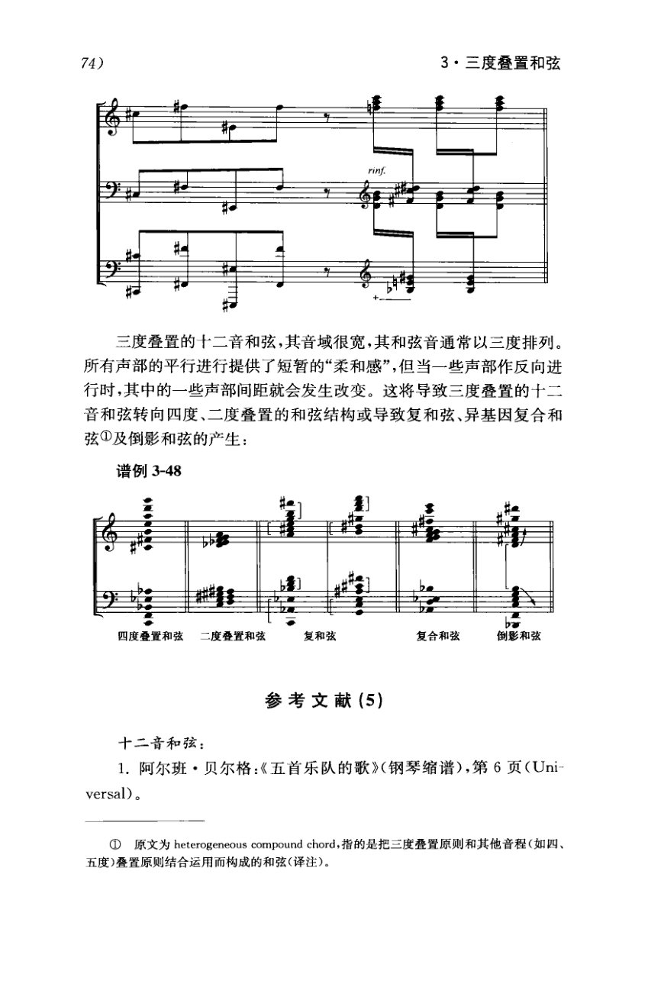

<!-- MANUAL-REFS:p0083 -->

<strong>手册使用本页</strong><ul><li id="ref-profile-profile-persichetti_20c-p0083" class="manual-ref-item" data-kind="profile">代表页<a href="../和声学手册.html#book-profiles">教材代表页 · 佩尔西采蒂</a> 手册将本页列为《佩尔西采蒂》代表页；该书定位：按材料组织二十世纪和声：音阶素材、三度/四度/二度叠置、复和弦、平行和声、调中心与无调性。</li></ul>

74) 
3·三度叠置和弦 
三度叠置的十二音和弦，其音域很宽，其和弦音通常以三度排列。 
所有声部的平行进行提供了短暂的“柔和感”，但当一些声部作反向进 
行时，其中的一些声部间距就会发生改变。这将导致三度叠置的十二 
音和弦转向四度、二度叠置的和弦结构或导致复和弦、异基因复合和 
弦①及倒影和弦的产生： 
谱例3-48 
b影 
四度叠置和弦 
二度叠置和弦 
复和弦 
复合和弦 
倒影和弦 
参考文献 (5) 
十二音和弦： 
1.阿尔班·贝尔格：《五首乐队的歌》（钢琴缩谱），第6页（Uni- 
versal)。 
①原文为heterogeneous compoundchord,指的是把三度叠置原则和其他音程（如四、 
五度）叠置原则结合运用而构成的和弦（译注）。

---

<!-- PAGE:89 -->

## PDF p.89

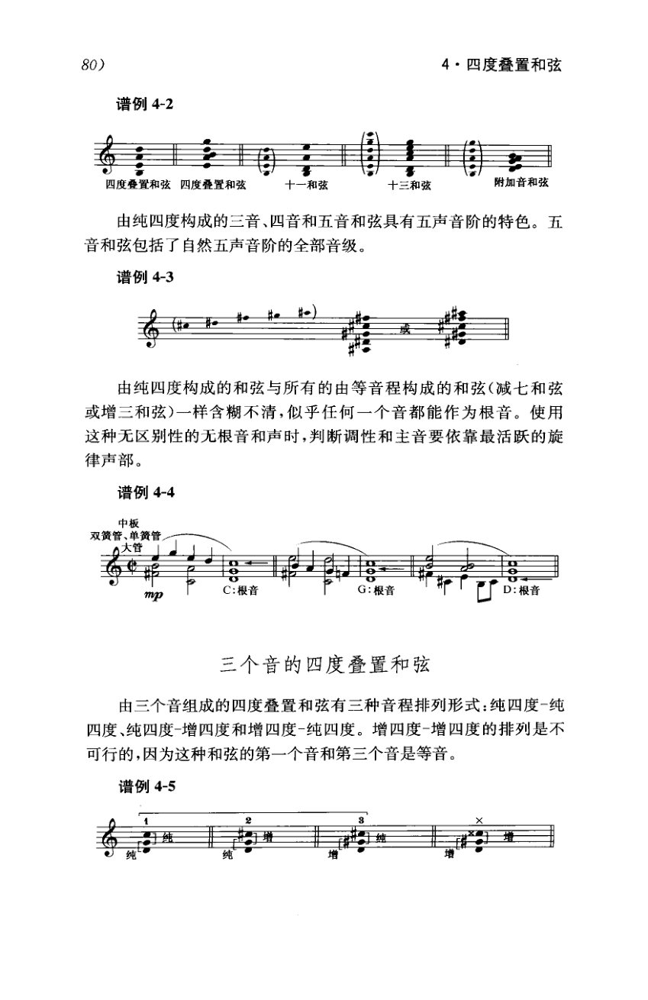

<!-- MANUAL-REFS:p0089 -->

<strong>手册使用本页</strong><ul><li id="ref-claim-diminished-seventh-enharmonic-p0089" class="manual-ref-item" data-kind="claim">论点<a href="../和声学手册.html#claim-diminished-seventh-enharmonic">减七和弦与等音网络 · diminished-seventh.enharmonic</a> 手册提炼：减七和弦由等分小三度构成，只有三种不同音响；每个音响可等音重写为四个不同根音的减七。</li></ul>

80) 
4·四度叠置和弦 
谱例4-2 
四度叠置和弦四度叠置和弦 
附加音和弦 
十一和弦 
十三和弦 
由纯四度构成的三音、四音和五音和弦具有五声音阶的特色。五 
音和弦包括了自然五声音阶的全部音级。 
谱例4-3 
由纯四度构成的和弦与所有的由等音程构成的和弦（减七和弦 
或增三和弦)一样含糊不清，似乎任何一个音都能作为根音。使用 
这种无区别性的无根音和声时，判断调性和主音要依靠最活跃的旋 
律声部。 
谱例4-4 
中板 
双簧管、单簧管 
Q大管 
du 
C:根音 
根音 
D:根音 
三个音的四度叠置和弦 
由三个音组成的四度叠置和弦有三种音程排列形式：纯四度-纯 
四度、纯四度-增四度和增四度-纯四度。增四度-增四度的排列是不 
可行的，因为这种和弦的第一个音和第三个音是等音。 
谱例4-5 
年 
门增 
纯 
增 
增

---

<!-- PAGE:112 -->

## PDF p.112

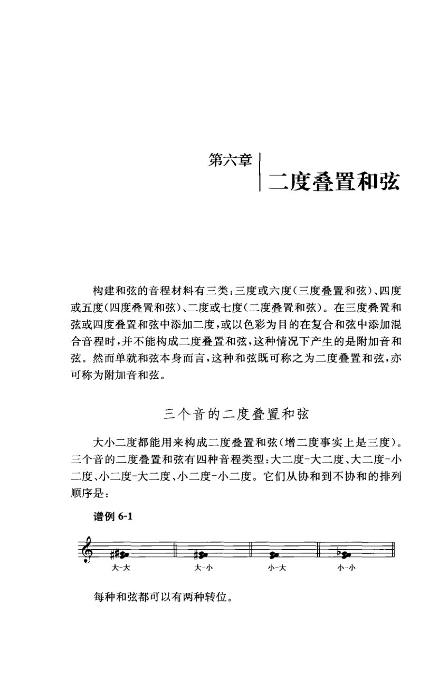

<!-- MANUAL-REFS:p0112 -->

<strong>手册使用本页</strong><ul><li id="ref-claim-atonal-chord-material-p0112" class="manual-ref-item" data-kind="claim">论点<a href="../和声学手册.html#claim-atonal-chord-material">无调性与自由音高组织 · atonal.chord-material</a> 手册提炼：后调性和弦不再只按三度叠置；三度/六度、四度/五度、二度/七度都可作为构建和弦的音程材料。</li><li id="ref-profile-profile-persichetti_20c-p0112" class="manual-ref-item" data-kind="profile">代表页<a href="../和声学手册.html#book-profiles">教材代表页 · 佩尔西采蒂</a> 手册将本页列为《佩尔西采蒂》代表页；该书定位：按材料组织二十世纪和声：音阶素材、三度/四度/二度叠置、复和弦、平行和声、调中心与无调性。</li></ul>

第六章 
二度叠置和弦 
构建和弦的音程材料有三类：三度或六度（三度叠置和弦）、四度 
或五度（四度叠置和弦）、二度或七度（二度叠置和弦）。在三度叠置和 
弦或四度叠置和弦中添加二度，或以色彩为目的在复合和弦中添加混 
合音程时，并不能构成二度叠置和弦，这种情况下产生的是附加音和 
弦。然而单就和弦本身而言，这种和弦既可称之为二度叠置和弦，亦 
可称为附加音和弦。 
三个音的二度叠置和弦 
大小二度都能用来构成二度叠置和弦(增二度事实上是三度）。 
三个音的二度叠置和弦有四种音程类型：大二度-大二度、大二度-小 
二度、小二度-大二度、小二度-小二度。它们从协和到不协和的排列 
顺序是： 
谱例6-1 
大-大 
大-小 
小-大 
小-小 
每种和弦都可以有两种转位。

---

<!-- PAGE:126 -->

## PDF p.126

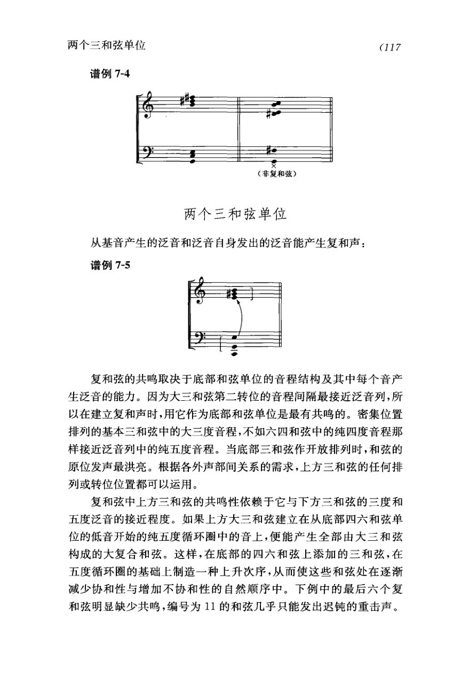

<!-- MANUAL-REFS:p0126 -->

<strong>手册使用本页</strong><ul><li id="ref-profile-profile-persichetti_20c-p0126" class="manual-ref-item" data-kind="profile">代表页<a href="../和声学手册.html#book-profiles">教材代表页 · 佩尔西采蒂</a> 手册将本页列为《佩尔西采蒂》代表页；该书定位：按材料组织二十世纪和声：音阶素材、三度/四度/二度叠置、复和弦、平行和声、调中心与无调性。</li></ul>

两个三和弦单位 
(117 
谱例7-4 
（非复和弦） 
两个三和弦单位 
从基音产生的泛音和泛音自身发出的泛音能产生复和声： 
谱例7-5 
复和弦的共鸣取决于底部和弦单位的音程结构及其中每个音产 
生泛音的能力。因为大三和弦第二转位的音程间隔最接近泛音列，所 
以在建立复和声时，用它作为底部和弦单位是最有共鸣的。密集位置 
排列的基本三和弦中的大三度音程，不如六四和弦中的纯四度音程那 
样接近泛音列中的纯五度音程。当底部三和弦作开放排列时，和弦的 
原位发声最洪亮。根据各外声部间关系的需求，上方三和弦的任何排 
列或转位位置都可以运用。 
复和弦中上方三和弦的共鸣性依赖于它与下方三和弦的三度和 
五度泛音的接近程度。如果上方大三和弦建立在从底部四六和弦单 
位的低音开始的纯五度循环圈中的音上，便能产生全部由大三和弦 
构成的大复合和弦。这样，在底部的四六和弦上添加的三和弦，在 
五度循环圈的基础上制造一种上升次序，从而使这些和弦处在逐渐 
减少协和性与增加不协和性的自然顺序中。下例中的最后六个复 
和弦明显缺少共鸣，编号为11的和弦几乎只能发出迟钝的重击声。

---

<!-- PAGE:226 -->

## PDF p.226

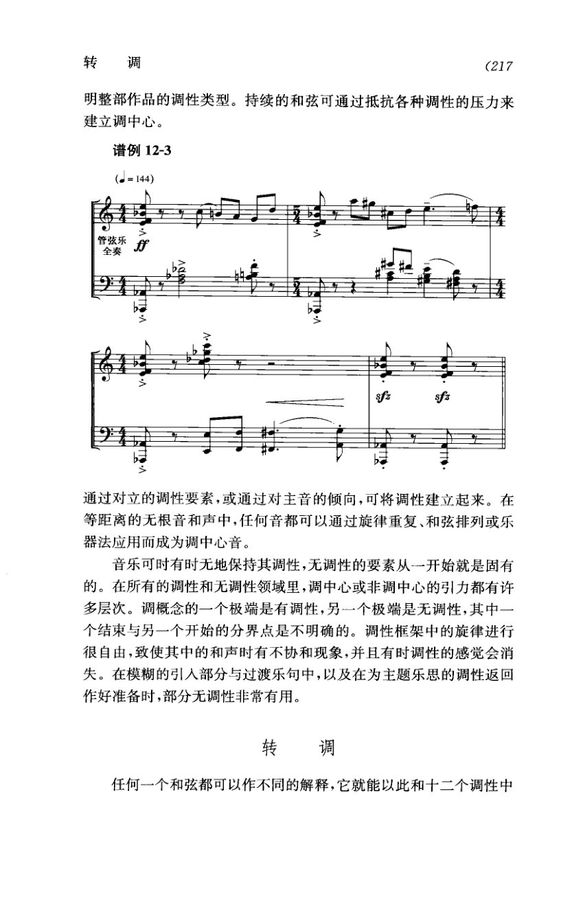

<!-- MANUAL-REFS:p0226 -->

<strong>手册使用本页</strong><ul><li id="ref-claim-atonal-tonal-continuum-p0226" class="manual-ref-item" data-kind="claim">论点<a href="../和声学手册.html#claim-atonal-tonal-continuum">无调性与自由音高组织 · atonal.tonal-continuum</a> 手册提炼：调性与无调性可按调中心引力的强弱排成连续范围；局部无调性可在模糊、过渡或属准备中发挥作用。</li><li id="ref-profile-profile-persichetti_20c-p0226" class="manual-ref-item" data-kind="profile">代表页<a href="../和声学手册.html#book-profiles">教材代表页 · 佩尔西采蒂</a> 手册将本页列为《佩尔西采蒂》代表页；该书定位：按材料组织二十世纪和声：音阶素材、三度/四度/二度叠置、复和弦、平行和声、调中心与无调性。</li></ul>

转调 
(217 
明整部作品的调性类型。持续的和弦可通过抵抗各种调性的压力来 
建立调中心。 
谱例12-3 
(=144) 
管弦乐 
计 
全奏 
sfz 
sfz 
通过对立的调性要素，或通过对主音的倾向，可将调性建立起来。在 
等距离的无根音和声中，任何音都可以通过旋律重复、和弦排列或乐 
器法应用而成为调中心音。 
音乐可时有时无地保持其调性，无调性的要素从一开始就是固有 
的。在所有的调性和无调性领域里，调中心或非调中心的引力都有许 
多层次。调概念的一个极端是有调性，另一个极端是无调性，其中一 
个结束与另一个开始的分界点是不明确的。调性框架中的旋律进行 
很自由，致使其中的和声时有不协和现象，并且有时调性的感觉会消 
失。在模糊的引人部分与过渡乐句中，以及在为主题乐思的调性返回 
作好准备时，部分无调性非常有用。 
转调 
任何-一个和弦都可以作不同的解释，它就能以此和十二个调性中

---

<!-- PAGE:227 -->

## PDF p.227

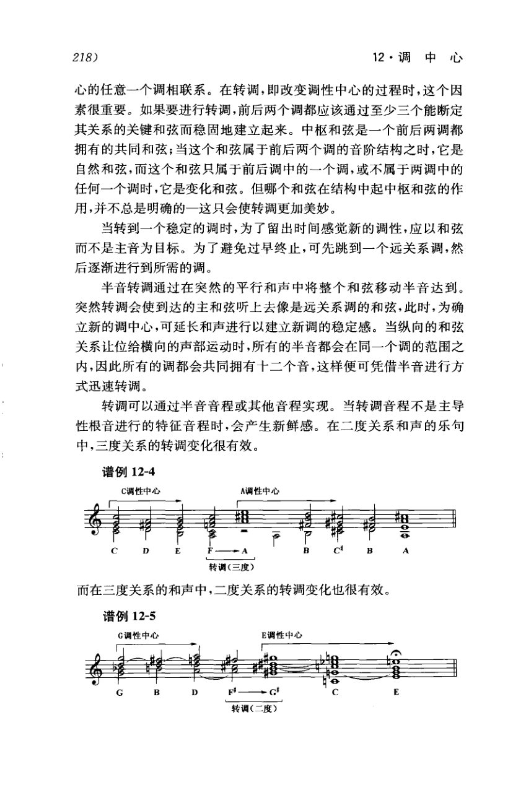

<!-- MANUAL-REFS:p0227 -->

<strong>手册使用本页</strong><ul><li id="ref-claim-pivot-common-chord-p0227" class="manual-ref-item" data-kind="claim">论点<a href="../和声学手册.html#claim-pivot-common-chord">中介和弦与转调 · pivot.common-chord</a> 手册提炼：中介和弦转调以两调共有的和弦为连接点；同一音集从旧调功能重释为新调功能，再由新调的属—主或终止式确认。</li></ul>

218) 
12·调中心 
心的任意一个调相联系。在转调，即改变调性中心的过程时，这个因 
素很重要。如果要进行转调，前后两个调都应该通过至少三个能断定 
其关系的关键和弦而稳固地建立起来。中枢和弦是一个前后两调都 
拥有的共同和弦；当这个和弦属于前后两个调的音阶结构之时，它是 
自然和弦，而这个和弦只属于前后调中的一个调，或不属于两调中的 
任何一个调时，它是变化和弦。但哪个和弦在结构中起中枢和弦的作 
用，并不总是明确的一这只会使转调更加美妙。 
当转到一个稳定的调时，为了留出时间感觉新的调性，应以和弦 
而不是主音为目标。为了避免过早终止，可先跳到一个远关系调，然 
后逐渐进行到所需的调。 
半音转调通过在突然的平行和声中将整个和弦移动半音达到。 
突然转调会使到达的主和弦听上去像是远关系调的和弦，此时，为确 
立新的调中心，可延长和声进行以建立新调的稳定感。当纵向的和弦 
关系让位给横向的声部运动时，所有的半音都会在同一个调的范围之 
内，因此所有的调都会共同拥有十二个音，这样便可凭借半音进行方 
式迅速转调。 
转调可以通过半音音程或其他音程实现。当转调音程不是主导 
性根音进行的特征音程时，会产生新鲜感。在二度关系和声的乐句 
中，三度关系的转调变化很有效。 
谱例12-4 
C调性中心 
A调性中心 
转调（三度） 
而在三度关系的和声中，二度关系的转调变化也很有效。 
谱例12-5 
G调性中心 
E调性中心 
转调（二度）

---

<!-- PAGE:235 -->

## PDF p.235

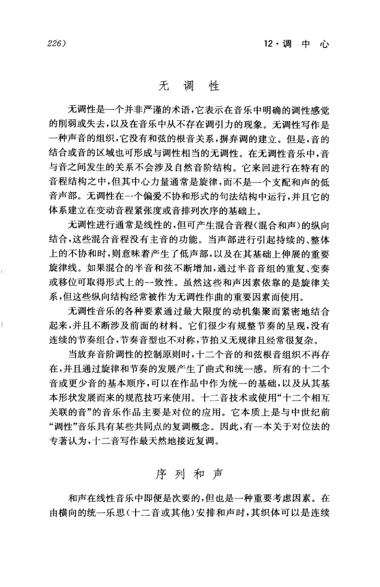

<!-- MANUAL-REFS:p0235 -->

<strong>手册使用本页</strong><ul><li id="ref-claim-atonal-definition-persichetti-p0235" class="manual-ref-item" data-kind="claim">论点<a href="../和声学手册.html#claim-atonal-definition-persichetti">无调性与自由音高组织 · atonal.definition-persichetti</a> 手册提炼：无调性指明确调性感觉的削弱或消失，以及音乐中不存在调引力；无调性写作仍通过音程、音区、旋律与排列组织音响。</li><li id="ref-profile-profile-persichetti_20c-p0235" class="manual-ref-item" data-kind="profile">代表页<a href="../和声学手册.html#book-profiles">教材代表页 · 佩尔西采蒂</a> 手册将本页列为《佩尔西采蒂》代表页；该书定位：按材料组织二十世纪和声：音阶素材、三度/四度/二度叠置、复和弦、平行和声、调中心与无调性。</li></ul>

226) 
12·调中心 
无调性 
无调性是一个并非严谨的术语，它表示在音乐中明确的调性感觉 
的削弱或失去，以及在音乐中从不存在调引力的现象。无调性写作是 
一种声音的组织，它没有和弦的根音关系，摒弃调的建立。但是，音的 
结合或音的区域也可形成与调性相当的无调性。在无调性音乐中，音 
与音之间发生的关系不会涉及自然音阶结构。它来回进行在特有的 
音程结构之中，但其中心力量通常是旋律，而不是一个支配和声的低 
音声部。无调性在一个偏爱不协和形式的句法结构中运行，并且它的 
体系建立在变动音程紧张度或音排列次序的基础上。 
无调性进行通常是线性的，但可产生混合音程（混合和声)的纵向 
结合，这些混合音程没有主音的功能。当声部进行引起持续的、整体 
上的不协和时，则意味着产生了低声部，以及在其基础上伸展的重要 
旋律线。如果混合的半音和弦不断增加，通过半音音组的重复、变奏 
或移位可取得形式上的--致性。虽然这些和声因素依靠的是旋律关 
系，但这些纵向结构经常被作为无调性作曲的重要因素而使用。 
无调性音乐的各种要素通过最大限度的动机集聚而紧密地结合 
起来，并且不断涉及前面的材料。它们很少有规整节奏的呈现，没有 
连续的节奏组合，节奏音型也不对称，节拍又无规律且经常很复杂。 
当放弃音阶调性的控制原则时，十二个音的和弦根音组织不再存 
在，并且通过旋律和节奏的发展产生了曲式和统一感。所有的十二个 
音或更少音的基本顺序，可以在作品中作为统一的基础，以及从其基 
本形状发展而来的规范技巧来使用。十二音技术或使用“十二个相互 
关联的音”的音乐作品主要是对位的应用。它本质上是与中世纪前 
“调性”音乐具有某些共同点的复调概念。因此，有一本关于对位法的 
专著认为，十二音写作最天然地接近复调。 
序列和声 
和声在线性音乐中即便是次要的，但也是一种重要考虑因素。在 
由横向的统一乐思（十二音或其他）安排和声时，其织体可以是连续

---

<!-- PAGE:236 -->

## PDF p.236

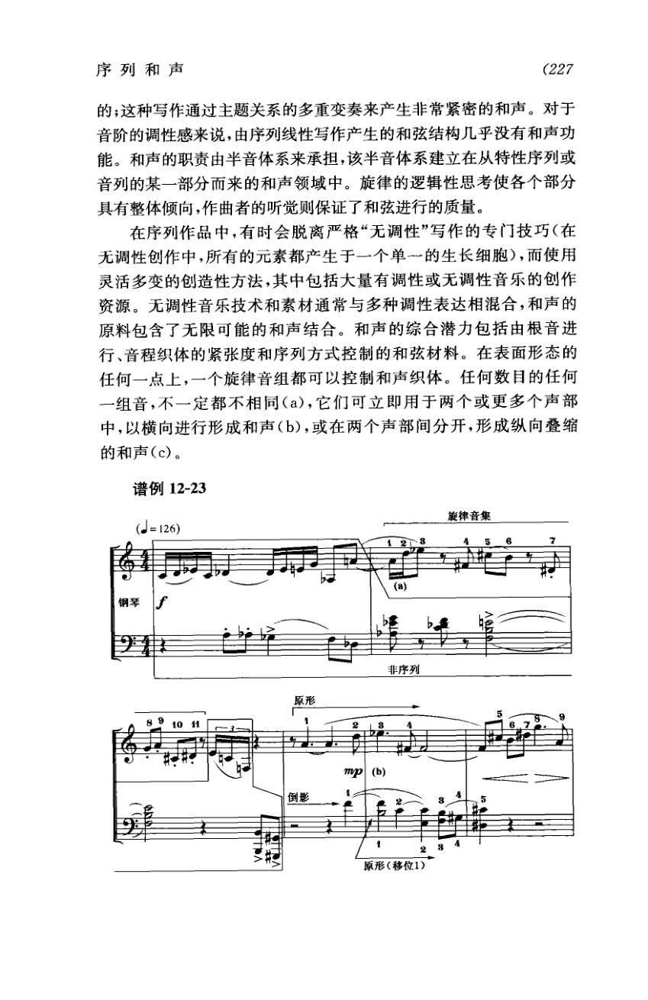

<!-- MANUAL-REFS:p0236 -->

<strong>手册使用本页</strong><ul><li id="ref-example-m08-p0236" class="manual-ref-item" data-kind="example">案例<a href="../和声学手册.html#example-m08">手册案例 M08 · 序列和声：连续截段的纵向叠置</a> 谱例12-23｜序列和声模型 原书要点：序列可横向进行，也可在两个或多个声部间分开形成纵向叠缩的和声；旋律音集可以控制和声织体。 机制：把序列的连续音级截段同时奏响，就得到纵向和声；横向顺序决定截段内容，移位、倒影与音区决定它们之间的关系。 读谱：把原形、倒影、移位1按序号对齐；看哪些相邻序号被同时奏响，哪些被分到不同声部。 用法：需要序列和声时，从音列取连续截段纵向叠置；用移位、倒影保持关系，用音区与节奏区分不同截段。</li></ul>

序列和声 
(227 
的；这种写作通过主题关系的多重 
生非常紧密的和声。对于 
音阶的调性感来说，由序列线 
结构几乎没有和声功 
本系建立在从特性序列或 
能。和声的职责由半音体系来 
音列的某一部分而来的和声领域 
律的逻辑性思考使各个部分 
具有整体倾向，作曲者的听觉则保证 
正了和弦进行的质量。 
无调性”写作的专门技巧（在 
在序列作品中，有时会脱离严 
无调性创作中，所有的元素都产 
单一的生长细胞），而使用 
灵活多变的创造性方法，其中包括 
有调性或无调性音乐的创作 
资源。无调性音乐技术和素材通常 
调性表达相混合，和声的 
原料包含了无限可能的和声结合。 
合潜力包括由根音进 
行、音程织体的紧张度和序列方式控制的和弦材料。在表面形态的 
任何一点上，一个旋律音组都可以控制和声织体。任 
任何数目的任何 
一组音，不一定都不相同（a)，它们可立即用于两个或更多个声部 
中,以横向进行形成和声(b)，或在两个声部间分开，形成纵向叠缩 
的和声(c)。 
谱例12-23 
(= 126) 
律音集 
钢琴 
非序列 
原形 
mp 
（b） 
倒影 
原形（移位1）

---
