# 桑桐《半音化的历史演进》

> **PDF 文件**：`桑桐《半音化的历史演进》.pdf`  
> **物理页数**：469（从 PDF 第 1 页起计）  
> **OCR 平均置信度**：0.971  
> **字符数**：203869

本文件收录**理论手册实际引用的 19 个 PDF 页**，每页采用整版影印 + OCR 文本。整页图保留谱例、图表、表格、边注和版面关系；OCR 只供检索与复制，具体音符、临时记号、连线和罗马数字以图像为准。被理论手册引用的条目列在图后，可直接回跳。

页码一律使用 **PDF 物理页码**，可能与书内印刷页码不同。

**快速跳页**：[p.7](#p0007) · [p.9](#p0009) · [p.15](#p0015) · [p.28](#p0028) · [p.31](#p0031) · [p.32](#p0032) · [p.33](#p0033) · [p.34](#p0034) · [p.41](#p0041) · [p.47](#p0047) · [p.100](#p0100) · [p.114](#p0114) · [p.128](#p0128) · [p.194](#p0194) · [p.219](#p0219) · [p.388](#p0388) · [p.389](#p0389) · [p.434](#p0434) · [p.436](#p0436)

---

<!-- PAGE:7 -->

## PDF p.7

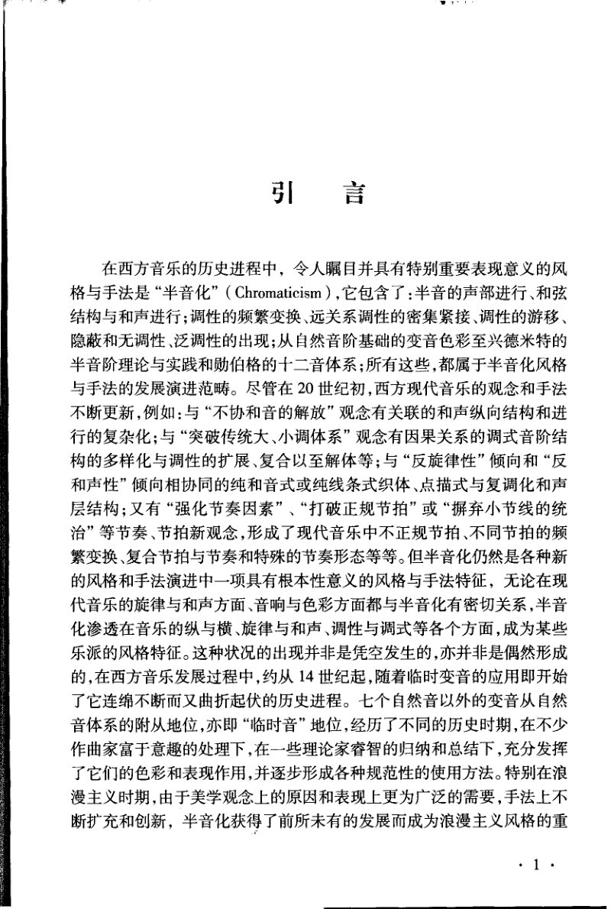

<!-- MANUAL-REFS:p0007 -->

<strong>手册使用本页</strong><ul><li id="ref-claim-serialism-row-p0007" class="manual-ref-item" data-kind="claim">论点<a href="../和声学手册.html#claim-serialism-row">十二音序列与序列和声 · serialism.row</a> 手册提炼：十二音技法以预先设计的十二音级排序为全曲音高材料，并通过移位、逆行、倒影、逆行倒影组织 48 种形式。</li></ul>

引言 
在西方音乐的历史进程中，令人瞩目并具有特别重要表现意义的风 
格与手法是“半音化”（Chromaticism），它包含了：半音的声部进行、和弦 
结构与和声进行；调性的频繁变换、远关系调性的密集紧接、调性的游移、 
隐蔽和无调性、泛调性的出现；从自然音阶基础的变音色彩至兴德米特的 
半音阶理论与实践和勋伯格的十二音体系；所有这些，都属于半音化风格 
与手法的发展演进范畴。尽管在20世纪初，西方现代音乐的观念和手法 
不断更新，例如：与“不协和音的解放”观念有关联的和声纵向结构和进 
行的复杂化；与“突破传统大、小调体系”观念有因果关系的调式音阶结 
和声性”倾向相协同的纯和音式或纯线条式织体、点描式与复调化和声 
治”等节奏、节拍新观念，形成了现代音乐中不正规节拍、不同节拍的频 
繁变换、复合节拍与节奏和特殊的节奏形态等等。但半音化仍然是各种新 
的风格和手法演进中一项具有根本性意义的风格与手法特征，无论在现 
代音乐的旋律与和声方面、音响与色彩方面都与半音化有密切关系，半音 
化渗透在音乐的纵与横、旋律与和声、调性与调式等各个方面，成为某些 
乐派的风格特征。这种状况的出现并非是凭空发生的，亦并非是偶然形成 
的，在西方音乐发展过程中，约从14世纪起，随着临时变音的应用即开始 
了它连绵不断而又曲折起伏的历史进程。七个自然音以外的变音从自然 
音体系的附从地位，亦即“临时音”地位，经历了不同的历史时期，在不少 
作曲家富于意趣的处理下，在一些理论家睿智的归纳和总结下，充分发挥 
了它们的色彩和表现作用，并逐步形成各种规范性的使用方法。特别在浪 
漫主义时期，由于美学观念上的原因和表现上更为广泛的需要，手法上不 
断扩充和创新，半音化获得了前所未有的发展而成为浪漫主义风格的重 
.1

---

<!-- PAGE:9 -->

## PDF p.9

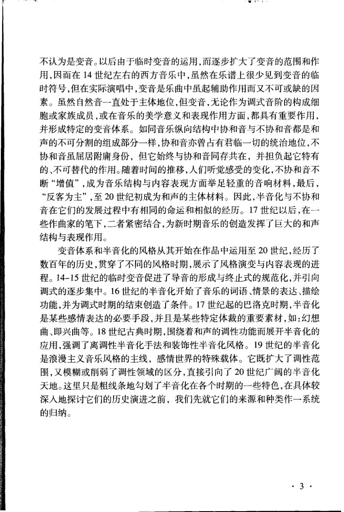

<!-- MANUAL-REFS:p0009 -->

<strong>手册使用本页</strong><ul><li id="ref-claim-chromaticism-historical-periodization-p0009" class="manual-ref-item" data-kind="claim">论点<a href="../和声学手册.html#claim-chromaticism-historical-periodization">半音化与变化和弦 · chromaticism.historical-periodization</a> 手册提炼：半音化在不同时期承担不同功能：巴洛克用于情感与特定体裁，古典围绕调性功能与离调，19世纪成为浪漫主义主线，并延伸至20世纪。</li><li id="ref-period-commonpractice-2-p0009" class="manual-ref-item" data-kind="period">阶段依据<a href="../和声学手册.html#period-basis">历史阶段依据 · 古典与共同实践</a> 阶段结论：调性中心、功能语法与声部规范 原文依据：18世纪古典时期，围绕着和声的调性功能而展开半音化的应用，强调了离调性半音化手法和装饰性半音化风格。</li><li id="ref-period-expandedtonality-2-p0009" class="manual-ref-item" data-kind="period">阶段依据<a href="../和声学手册.html#period-basis">历史阶段依据 · 浪漫主义与调性扩张</a> 阶段结论：交替、变和弦、远关系与色彩功能 原文依据：19世纪的半音化是浪漫主义音乐风格的主线，感情世界的特殊载体。它既扩大了调性范围，又模糊或削弱了调性领域的区分，直接引向了20世纪广阔的半音化天地。</li><li id="ref-profile-profile-sangtong_chromatic-p0009" class="manual-ref-item" data-kind="profile">代表页<a href="../和声学手册.html#book-profiles">教材代表页 · 半音化历史</a> 手册将本页列为《半音化历史》代表页；该书定位：以历史演进为线索：从14–15世纪伪乐、巴洛克情感表达、古典离调、19世纪浪漫半音化，到20世纪无调性与十二音。</li></ul>

不认为是变音。以后由于临时变音的运用，而逐步扩大了变音的范围和作 
用，因而在14世纪左右的西方音乐中，虽然在乐谱上很少见到变音的临 
时符号，但在实际演唱中，变音是乐曲中虽起辅助作用而又不可或缺的因 
素。虽然自然音一直处于主体地位，但变音，无论作为调式音阶的构成细 
胞或家族成员，或在音乐的美学意义和表现作用方面，都具有重要作用， 
并形成特定的变音体系。如同音乐纵向结构中协和音与不协和音都是和 
声的不可分割的组成部分一样，协和音亦曾占有君临一切的统治地位，不 
协和音虽屈居附庸身份，但它始终与协和音同存共在，并担负起它特有 
的、不可替代的作用。随着时间的推移，人们听觉感受的变化，不协和音不 
断“增值”，成为音乐结构与内容表现方面举足轻重的音响材料，最后， 
“反客为主”，至20世纪初成为和声的主体材料。因此，半音化与不协和 
音在它们的发展过程中有相同的命运和相似的经历。17世纪以后，在-一 
些作曲家的笔下，二者紧密结合，为新时期音乐的创造发挥了巨大的和声 
结构与表现作用。 
变音体系和半音化的风格从其开始在作品中运用至20世纪，经历了 
数百年的历史，贯穿了不同的风格时期，展示了风格演变与内容表现的进 
程。14-15世纪的临时变音促进了导音的形成与终止式的规范化，并引向 
调式的逐步集中。16世纪的半音化开始了音乐的词语、情景的表达、描绘 
功能，并为调式时期的结束创造了条件。17世纪起的巴洛克时期，半音化 
是某些感情表达的必要手段，并且是某些特定体裁的重要素材，如：幻想 
曲、即兴曲等。18世纪古典时期，围绕着和声的调性功能而展开半音化的 
应用，强调了离调性半音化手法和装饰性半音化风格。19世纪的半音化 
是浪漫主义音乐风格的主线，感情世界的特殊载体。它既扩大了调性范 
围，又模糊或削弱了调性领域的区分，直接引向了20世纪广阔的半音化 
天地。这里只是粗线条地勾划了半音化在各个时期的一些特色，在具体较 
深人地探讨它们的历史演进之前，我们先就它们的来源和种类作一系统 
的归纳。 
.3·

---

<!-- PAGE:15 -->

## PDF p.15

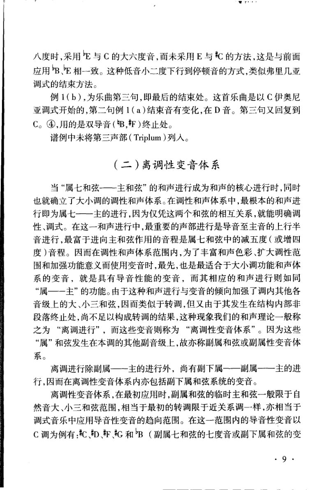

<!-- MANUAL-REFS:p0015 -->

<strong>手册使用本页</strong><ul><li id="ref-claim-dominant-v7-resolution-p0015" class="manual-ref-item" data-kind="claim">论点<a href="../和声学手册.html#claim-dominant-v7-resolution">属功能与属七解决 · dominant.v7-resolution</a> 手册提炼：属七解决的基本声部规则是导音上行到主音、七音下行到三级；外声部导音尤其应上行。</li><li id="ref-claim-dominant-tritone-resolution-p0015" class="manual-ref-item" data-kind="claim">论点<a href="../和声学手册.html#claim-dominant-tritone-resolution">属功能与属七解决 · dominant.tritone-resolution</a> 手册提炼：属七中的三全音按增四度向外、减五度向内收缩，分别解决到主和弦的六度或三度。</li><li id="ref-profile-profile-sangtong_chromatic-p0015" class="manual-ref-item" data-kind="profile">代表页<a href="../和声学手册.html#book-profiles">教材代表页 · 半音化历史</a> 手册将本页列为《半音化历史》代表页；该书定位：以历史演进为线索：从14–15世纪伪乐、巴洛克情感表达、古典离调、19世纪浪漫半音化，到20世纪无调性与十二音。</li></ul>

八度时，采用E与C的大六度音，而未采用E与C的方法，这是与前面 
应用B、E相一致。这种低音小二度下行到停顿音的方式，类似弗里几亚 
调式的结束方法。 
例1（b），为乐曲第三句，即最后的结束处。这首乐曲是以C伊奥尼 
亚调式开始的，第二句例1（a）结束音有变化，在D音。第三句又回复到 
C。④,用的是双导音（B，F)终止处。 
谱例中未将第三声部（Triplum）列人。 
（二）离调性变音体系 
当“属七和弦一主和弦”的和声进行成为和声的核心进行时，同时 
也就确立了大小调的调性和声体系。在调性和声体系中，最根本的和声进 
行即为属七一一一主的进行，因为仅凭这两个和弦的相互关系，就能明确调 
性、调式。在这一和声进行中，最重要的声部进行是导音至主音的上行半 
音进行，最富于进向主和弦作用的音程是属七和弦中的减五度（或增四 
度）音程。因而在调性和声体系范围内，为了丰富和声色彩、扩大调性范 
围和加强功能意义而使用变音时，最先，也是最适合于大小调功能和声体 
系的变音，就是具有导音性能的变音，而其相应的和声进行则如同 
“属一一主”的功能。由于这种和声进行与变音的倾向加强了调内其他各 
音级上的大、小三和弦，因而类似于转调，但又由于其发生在结构内部非 
段落终止处，尚不足以构成转调的结果，这种现象我们的和声理论一般称 
之为“离调进行”，而这些变音则称为“离调性变音体系”。因为这些 
“属”和弦发生在本调的其他副音级上，故亦称副属和弦或副属性变音体 
系。 
离调进行除副属——主的进行外，尚有副下属一—副属一—主的进 
行，因而在离调性变音体系内亦包括副下属和弦系统的变音。 
离调性变音体系，在最初应用时，副属和弦的临时主和弦一般限于自 
然音大、小三和弦范围，相当于最初的转调限于近关系调一样，亦相当于 
调式音乐中应用导音性变音的趋向范围。在这一范围内的导音性变音以 
C调为例有：C、D、F、#G和"B（副属七和弦的七度音或副下属和弦的变 
9

---

<!-- PAGE:28 -->

## PDF p.28

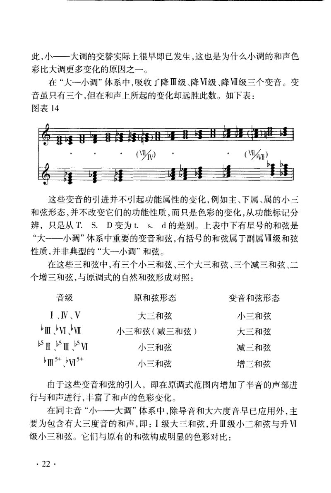

<!-- MANUAL-REFS:p0028 -->

<strong>手册使用本页</strong><ul><li id="ref-claim-diatonic-function-sequence-p0028" class="manual-ref-item" data-kind="claim">论点<a href="../和声学手册.html#claim-diatonic-function-sequence">自然音级功能：T–S–D · diatonic.function-sequence</a> 手册提炼：功能和声的基本序列是稳定—不稳定—稳定，典型为 T–S–D–T；D–S 属特殊情况而非常规。</li></ul>

此，小一大调的交替实际上很早即已发生，这也是为什么小调的和声色 
彩比大调更多变化的原因之一。 
在“大一小调”体系中，吸收了降Ⅲ级、降V级、降VI级三个变音。变 
音虽只有三个，但在和声上所起的变化却远胜此数。如下表： 
图表14 
(V 
这些变音的引进并不引起功能属性的变化，例如主、下属、属的小三 
和弦形态，并不改变它们的功能性质，而只是色彩的变化，从功能标记分 
辨，只是从T．S．D变为t．s．d的差别。上表中下有星号的和弦是 
“大一小调”体系中重要的变音和弦，有括号的和弦属于副属VI级和弦 
性质，并非典型的“大一小调”和弦。 
在这些三和弦中，有三个小三和弦、三个大三和弦、三个减三和弦、二 
个增三和弦，与原调式的自然和弦形成对照： 
音级 
原和弦形态 
变音和弦形态 
I 、V、V 
大三和弦 
小三和弦 
Ⅲ、bvI、bVII 
小三和弦（减三和弦） 
大三和弦 
bs IⅡ、bII、b VI 
小三和弦 
减三和弦 
bm 5+,bvI5+ 
小三和弦 
增三和弦 
由于这些变音和弦的引人，即在原调式范围内增加了半音的声部进 
行与和声进行，丰富了和声的色彩变化。 
在同主音“小一一大调”体系中，除导音和大六度音早已应用外，主 
要为包含有大三度音的和声，即：I级大三和弦，升Ⅲ级小三和弦与升VI 
级小三和弦。它们与原有的和弦构成明显的色彩对比： 
.22·

---

<!-- PAGE:31 -->

## PDF p.31

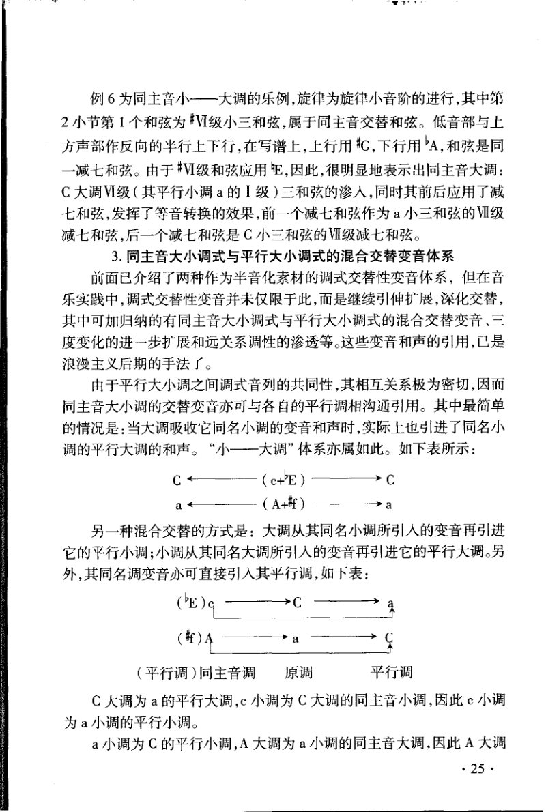

<!-- MANUAL-REFS:p0031 -->

<strong>手册使用本页</strong><ul><li id="ref-claim-diminished-seventh-enharmonic-p0031" class="manual-ref-item" data-kind="claim">论点<a href="../和声学手册.html#claim-diminished-seventh-enharmonic">减七和弦与等音网络 · diminished-seventh.enharmonic</a> 手册提炼：减七和弦由等分小三度构成，只有三种不同音响；每个音响可等音重写为四个不同根音的减七。</li></ul>

例6为同主音小一—大调的乐例，旋律为旋律小音阶的进行，其中第 
2小节第1个和弦为V级小三和弦，属于同主音交替和弦。低音部与上 
方声部作反向的半行上下行，在写谱上，上行用#G，下行用A，和弦是同 
一减七和弦。由于#V级和弦应用E，因此，很明显地表示出同主音大调： 
C大调VI级（其平行小调a的I级）三和弦的渗人，同时其前后应用了减 
七和弦，发挥了等音转换的效果，前一个减七和弦作为a小三和弦的V级 
减七和弦，后一个减七和弦是C小三和弦的I级减七和弦。 
3.同主音大小调式与平行大小调式的混合交替变音体系 
前面已介绍了两种作为半音化素材的调式交替性变音体系，但在音 
乐实践中，调式交替性变音并未仅限于此，而是继续引伸扩展，深化交替， 
其中可加归纳的有同主音大小调式与平行大小调式的混合交替变音、三 
度变化的进一步扩展和远关系调性的渗透等。这些变音和声的引用，已是 
浪漫主义后期的手法了。 
由于平行大小调之间调式音列的共同性，其相互关系极为密切，因而 
同主音大小调的交替变音亦可与各自的平行调相沟通引用。其中最简单 
的情况是：当大调吸收它同名小调的变音和声时，实际上也引进了同名小 
调的平行大调的和声。“小一一大调”体系亦属如此。如下表所示： 
（c+E） 
C← 
&gt;C 
（A+#f） 
a← 
→a 
另一种混合交替的方式是：大调从其同名小调所引|人的变音再引进 
它的平行小调；小调从其同名大调所引人的变音再引进它的平行大调。另 
外，其同名调变音亦可直接引人其平行调，如下表： 
(E)C 
&gt;C 
（）A 
→a 
（平行调）同主音调 
原调 
平行调 
C大调为a的平行大调，c小调为C大调的同主音小调，因此c小调 
为a小调的平行小调。 
a小调为C的平行小调，A大调为a小调的同主音大调，因此A大调 
·25·

---

<!-- PAGE:32 -->

## PDF p.32

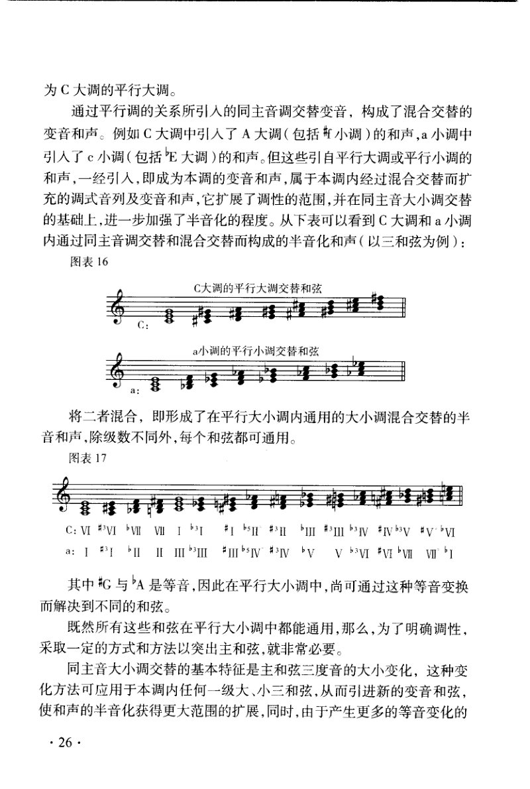

<!-- MANUAL-REFS:p0032 -->

<strong>手册使用本页</strong><ul><li id="ref-claim-modal-interchange-mixed-alternation-p0032" class="manual-ref-item" data-kind="claim">论点<a href="../和声学手册.html#claim-modal-interchange-mixed-alternation">同主音调式交替（借用和弦） · modal-interchange.mixed-alternation</a> 手册提炼：通过平行调关系引入的同主音交替变音构成混合交替，把关系调与同主音调的色彩叠合在同一主音上。</li></ul>

为C大调的平行大调。 
通过平行调的关系所引人的同主音调交替变音，构成了混合交替的 
变音和声。例如C大调中引人了A大调（包括小调）的和声，a小调中 
引人了c小调（包括E大调）的和声。但这些引自平行大调或平行小调的 
和声，一经引人，即成为本调的变音和声，属于本调内经过混合交替而扩 
充的调式音列及变音和声，它扩展了调性的范围，并在同主音大小调交替 
的基础上，进一步加强了半音化的程度。从下表可以看到C大调和a小调 
内通过同主音调交替和混合交替而构成的半音化和声（以三和弦为例）： 
图表16 
C大调的平行大调交替和弦 
a小调的平行小调交替和弦 
将二者混合，即形成了在平行大小调内通用的大小调混合交替的半 
音和声，除级数不同外，每个和弦都可通用。 
图表17 
IAqA#AeqAI#AIeqIIE IIIIe#IIsI#1eqIIIAIAqIAc IA 
IgIA qIAIAeAAqAeAIsqIIIIIleqIII IIIlIeI: 
其中G与A是等音，因此在平行大小调中，尚可通过这种等音变换 
而解决到不同的和弦。 
既然所有这些和弦在平行大小调中都能通用，那么，为了明确调性， 
采取一定的方式和方法以突出主和弦，就非常必要。 
同主音大小调交替的基本特征是主和弦三度音的大小变化，这种变 
化方法可应用于本调内任何一级大、小三和弦，从而引进新的变音和弦， 
使和声的半音化获得更大范围的扩展，同时，由于产生更多的等音变化的 
·26·

---

<!-- PAGE:33 -->

## PDF p.33

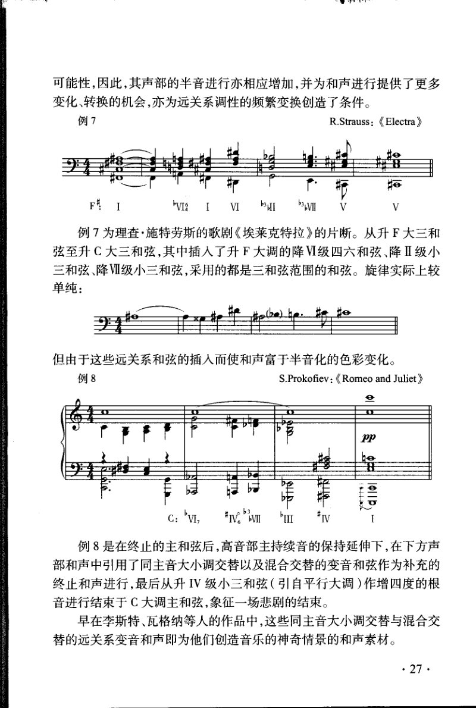

<!-- MANUAL-REFS:p0033 -->

<strong>手册使用本页</strong><ul><li id="ref-example-e01-p0033" class="manual-ref-item" data-kind="example">案例<a href="../和声学手册.html#example-e01">手册案例 E01 · 远关系和弦：半音声部连接</a> 例7｜理查·施特劳斯《埃莱克特拉》 原书要点：从升F大三到升C大三之间插入降VI级四六、降II级小、降V级小三和弦；旋律简单，和声因远关系插入而半音化。 机制：远关系根音之间可用半音声部连接：各声部取最近的半音或全音进行，纵向和弦可以相距很远，横向听感仍然连续。 读谱：逐声部看升F→插入和弦→升C的半音或全音移动，尤其共同音与半音级进；不要只盯根音。 用法：插入远关系和弦时，先写平滑的半音声部，再选择能容纳这些音的和弦；根音关系可以远，声部移动要短。</li><li id="ref-example-e02-p0033" class="manual-ref-item" data-kind="example">案例<a href="../和声学手册.html#example-e02">手册案例 E02 · 主持续音上的调式交替</a> 例8｜普罗科菲耶夫《罗密欧与朱丽叶》 原书要点：终止主和弦后保持高音主持续音，下方用同主音大小调交替与混合交替变音和弦，最后从升IV级小三和弦以增四度根音进行回到 C 主和弦。 机制：持续音固定低音与调中心；上方和弦可频繁改变三音、五音并借用同主音调式，而不形成新调。 读谱：先锁定持续音 C，再看上方和弦的三音、五音怎样改变；最后看低音是否从升IV级以增四度回到 C。 用法：写曲尾色彩段可用主持续音承托混合交替；上方扩大音程与调式色彩，最后用明确的根音进行收束。</li></ul>

可能性，因此，其声部的半音进行亦相应增加，并为和声进行提供了更多 
变化、转换的机会，亦为远关系调性的频繁变换创造了条件。 
例7 
R.Strauss:《Electra》 
9 
FI 
VI8 
例7为理查·施特劳斯的歌剧《埃莱克特拉》的片断。从升F大三和 
弦至升C大三和弦，其中插人了升F大调的降VI级四六和弦、降Ⅱ级小 
三和弦、降V级小三和弦，采用的都是三和弦范围的和弦。旋律实际上较 
单纯： 
但由于这些远关系和弦的插人而使和声富于半音化的色彩变化。 
例8 
S.Prokofiev:《RomeoandJuliet》 
pp 
C:VI 
例8是在终止的主和弦后，高音部主持续音的保持延伸下，在下方声 
部和声中引用了同主音大小调交替以及混合交替的变音和弦作为补充的 
终止和声进行，最后从升IV级小三和弦（引自平行大调）作增四度的根 
音进行结束于C大调主和弦，象征一场悲剧的结束。 
早在李斯特、瓦格纳等人的作品中，这些同主音大小调交替与混合交 
替的远关系变音和声即为他们创造音乐的神奇情景的和声素材。 
·27

---

<!-- PAGE:34 -->

## PDF p.34

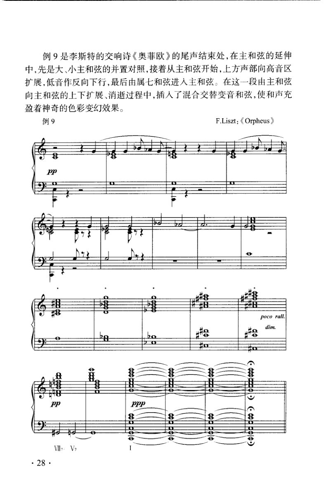

<!-- MANUAL-REFS:p0034 -->

<strong>手册使用本页</strong><ul><li id="ref-example-e03-p0034" class="manual-ref-item" data-kind="example">案例<a href="../和声学手册.html#example-e03">手册案例 E03 · 同名大小三和弦并置</a> 例9｜李斯特《奥菲欧》 原书要点：尾声在主和弦延伸中并置大、小主和弦，上方向高音区扩展、低音反向下行，再以 V7–I 收束；其间插入混合交替变音和弦。 机制：同一主音上的大三和弦与小三和弦共享根音；三音相差半音，五音相同或相近。并置时中心音不变，和弦性质改变。 读谱：以持续的主音或主和弦为参照，观察三音的大/小三度替换、五音是否保持，以及外声部是否反向扩张；最后找 V7→I。 用法：终曲需要延续主和弦时，保持主音，交换大小三音并做反向音区扩张，最后以 V7–I 明确收束。</li></ul>

例9是李斯特的交响诗《奥菲欧》的尾声结束处，在主和弦的延伸 
中，先是大、小主和弦的并置对照，接着从主和弦开始，上方声部向高音区 
扩展，低音作反向下行，最后由属七和弦进人主和弦。在这一段由主和弦 
向主和弦的上下扩展、消逝过程中，插人了混合交替变音和弦，使和声充 
盈着神奇的色彩变幻效果。 
F.Liszt:《Orpheus》 
例9 
8 
pp 
pocorall. 
dim. 
28 
bo 
（ 
量 
88 
8 
8 
880 
pp 
ppp 
VIlV, 
·28·

---

<!-- PAGE:41 -->

## PDF p.41

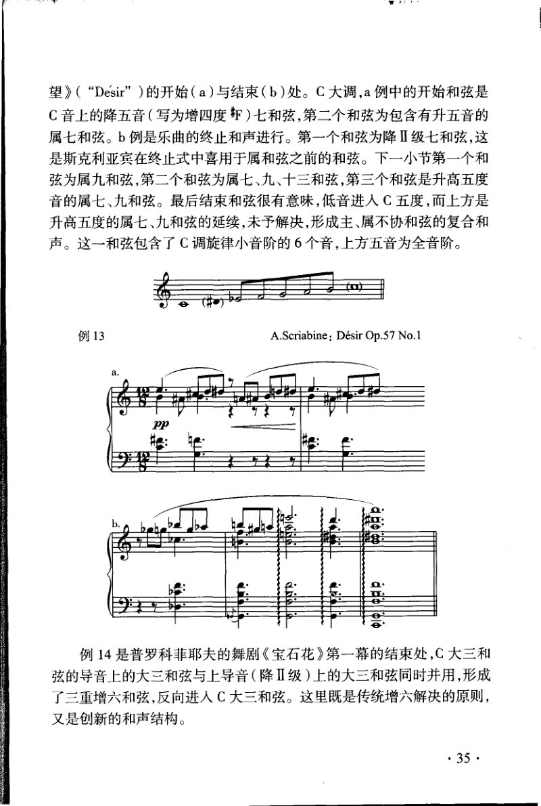

<!-- MANUAL-REFS:p0041 -->

<strong>手册使用本页</strong><ul><li id="ref-example-e06-p0041" class="manual-ref-item" data-kind="example">案例<a href="../和声学手册.html#example-e06">手册案例 E06 · 变属和弦作为终止音响</a> 例13｜斯克里亚宾《愿望》Op.57 No.1 原书要点：结尾经降II级七和弦进入属九、属七九十三与升五音属七九，最后低音到 C 五度而上方保留未解决复合和弦。 机制：变音扩张后的属和弦可以保留不解决，低音落到主音，上方保持属功能复合体，使未解决张力成为终止音响。 读谱：看最后和弦的低音是否到 C，而上方是否仍是升五音属七或属九的延续；找哪些音没有按传统倾向解决。 用法：写悬停终止时，让低音到主音，上方保留属九或升五音属七；降II7 与变属和弦可加强最后的半音进行。</li></ul>

望》（“Desir”）的开始（a）与结束（b）处。C大调,a例中的开始和弦是 
C音上的降五音（写为增四度）七和弦，第二个和弦为包含有升五音的 
属七和弦。b例是乐曲的终止和声进行。第一个和弦为降Ⅱ级七和弦，这 
是斯克利亚宾在终止式中喜用于属和弦之前的和弦。下一小节第一个和 
弦为属九和弦，第二个和弦为属七、九、十三和弦，第三个和弦是升高五度 
音的属七、九和弦。最后结束和弦很有意味，低音进人C五度，而上方是 
升高五度的属七、九和弦的延续，未予解决，形成主、属不协和弦的复合和 
声。这一和弦包含了C调旋律小音阶的6个音，上方五音为全音阶。 
例13 
A.Scriabine:Desir Op.57No.1 
例14是普罗科菲耶夫的舞剧《宝石花》第一幕的结束处，C大三和 
弦的导音上的大三和弦与上导音（降Ⅱ级）上的大三和弦同时并用，形成 
了三重增六和弦，反向进人C大三和弦。这里既是传统增六解决的原则， 
又是创新的和声结构。 
·35.

---

<!-- PAGE:47 -->

## PDF p.47

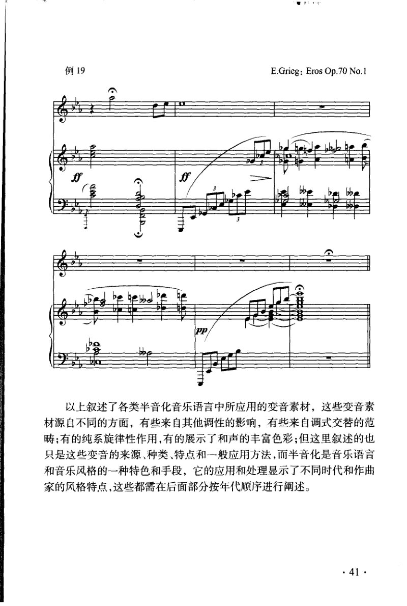

<!-- MANUAL-REFS:p0047 -->

<strong>手册使用本页</strong><ul><li id="ref-profile-profile-sangtong_chromatic-p0047" class="manual-ref-item" data-kind="profile">代表页<a href="../和声学手册.html#book-profiles">教材代表页 · 半音化历史</a> 手册将本页列为《半音化历史》代表页；该书定位：以历史演进为线索：从14–15世纪伪乐、巴洛克情感表达、古典离调、19世纪浪漫半音化，到20世纪无调性与十二音。</li></ul>

例19 
E.Grieg:Eros Op.70No.1 
以上叙述了各类半音化音乐语言中所应用的变音素材，这些变音素 
材源自不同的方面，有些来自其他调性的影响，有些来自调式交替的范 
畴；有的纯系旋律性作用，有的展示了和声的丰富色彩；但这里叙述的也 
只是这些变音的来源、种类、特点和一般应用方法，而半音化是音乐语言 
和音乐风格的一种特色和手段，它的应用和处理显示了不同时代和作曲 
家的风格特点，这些都需在后面部分按年代顺序进行阐述。

---

<!-- PAGE:100 -->

## PDF p.100

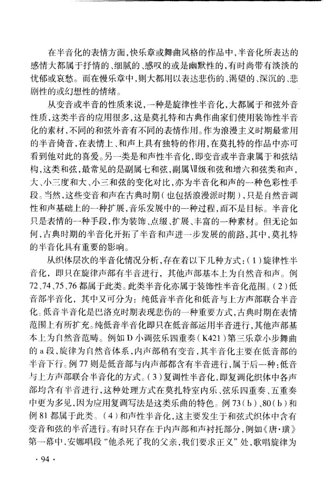

<!-- MANUAL-REFS:p0100 -->

<strong>手册使用本页</strong><ul><li id="ref-profile-profile-sangtong_chromatic-p0100" class="manual-ref-item" data-kind="profile">代表页<a href="../和声学手册.html#book-profiles">教材代表页 · 半音化历史</a> 手册将本页列为《半音化历史》代表页；该书定位：以历史演进为线索：从14–15世纪伪乐、巴洛克情感表达、古典离调、19世纪浪漫半音化，到20世纪无调性与十二音。</li></ul>

在半音化的表情方面，快乐章或舞曲风格的作品中，半音化所表达的 
感情大都属于抒情的、细腻的、感叹的或是幽默性的，有时尚带有淡淡的 
优郁或哀愁。而在慢乐章中，则大都用以表达悲伤的、渴望的、深沉的、悲 
剧性的或幻想性的情绪。 
从变音或半音的性质来说，一种是旋律性半音化，大都属于和弦外音 
性质，这类半音的应用很多，这是莫扎特和古典作曲家们使用装饰性半音 
化的素材，不同的和弦外音有不同的表情作用。作为浪漫主义时期最常用 
的半音倚音，在表情上、和声上具有独特的作用，在莫扎特的作品中亦可 
看到他对此的喜爱。另一类是和声性半音化，即变音或半音隶属于和弦结 
构，这类和弦，最常见的是副属七和弦，副属业级和弦和增六和弦类和声， 
大、小三度和大、小三和弦的变化对比，亦为半音化和声的一种色彩性手 
段。当然，这些变音和声在古典时期（也包括浪漫派时期），只是自然音调 
性和声基础上的一种扩展，音乐发展中的一种过程，而不是目标。半音化 
只是表情的一种手段，作为装饰、点缀、扩展、丰富的一种素材。但无论如 
何，古典时期的半音化开拓了半音和声进一步发展的前路，其中，莫扎特 
的半音化具有重要的影响。 
从织体层次的半音化情况分析，存在着以下几种方式：（1）旋律性半 
音化，即只在旋律声部有半音进行，其他声部基本上为自然音和声。例 
72、74、75、76都属于此类。此类半音化亦属于装饰性半音化范围。（2）低 
音部半音化，其中又可分为：纯低音半音化和低音与上方声部联合半音 
化。低音半音化是巴洛克时期表现悲伤的一种重要方式，古典时期在表情 
范围上有所扩充。纯低音半音化即只在低音部运用半音进行，其他声部基 
本上为自然音范畴。例如D小调弦乐四重奏（K421）第三乐章小步舞曲 
的a段，旋律为自然音体系，内声部稍有变音，其半音化主要在低音部的 
半音下行。例77则是低音部与内声部都含有半音进行，属于后一种：低音 
与上方声部联合半音化的方式。（3）复调性半音化，即复调化织体中各声 
部均含有半音进行，这种处理方式在莫扎特室内乐、弦乐四重奏、五重奏 
中更为多见，因为应用复调写法是这类乐曲的特色。例73（b）、80（b）和 
例81都属于此类。（4）和声性半音化，这主要发生于和弦式织体中含有 
变音和弦的半音进行。有时只存在于内声部和声衬托部分，例如《唐·璜》 
第一幕中，安娜唱段“他杀死了我的父亲，我们要求正义”处，歌唱旋律为 
·94.

---

<!-- PAGE:114 -->

## PDF p.114

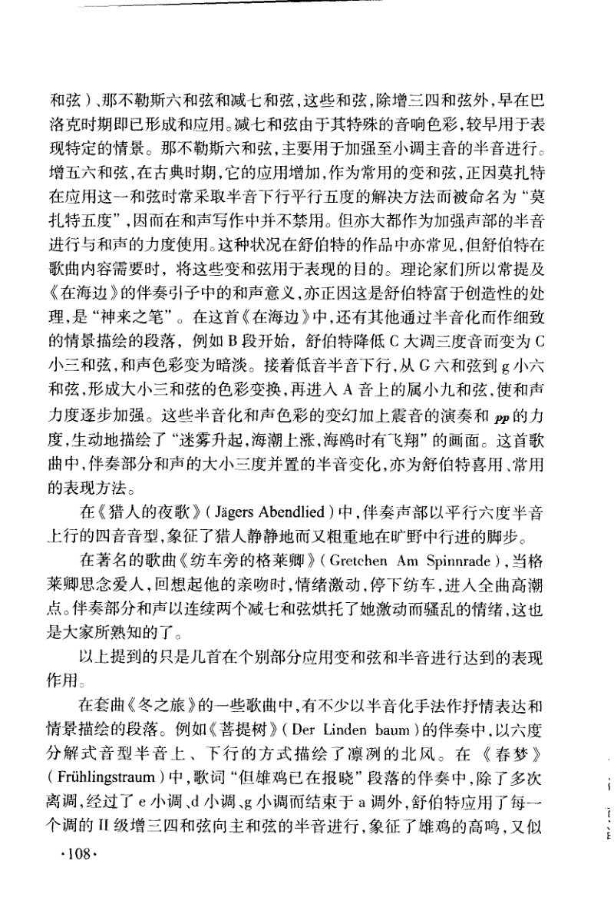

<!-- MANUAL-REFS:p0114 -->

<strong>手册使用本页</strong><ul><li id="ref-claim-voice-leading-parallels-p0114" class="manual-ref-item" data-kind="claim">论点<a href="../和声学手册.html#claim-voice-leading-parallels">声部进行与不协和解决 · voice-leading.parallels</a> 手册提炼：平行纯五度、纯八度削弱声部独立性，因此传统调性写作把它们视为需要避免的进行。</li><li id="ref-prose-cite-sangtong_chromatic-p0114-1-p0114" class="manual-ref-item" data-kind="prose">正文引用<a href="../和声学手册.html#cite-sangtong_chromatic-p0114-1">手册正文引用</a> 平行纯五度、纯八度：两个声部以相同纯音程同向移动到新的纯音程，会削弱独立性，传统写作中避免。桑桐教程 PDF p.24、柴可夫斯基 PDF p.21、《概述》PDF p.103、斯波索宾上册答案 PDF p.20、徐平力 PDF p.379、桑桐《半音化的历史演进》PDF p.114、佩尔西采蒂 PDF p.68、基泽勒 PDF p.56。</li></ul>

和弦）、那不勒斯六和弦和减七和弦，这些和弦，除增三四和弦外，早在巴 
洛克时期即已形成和应用。减七和弦由于其特殊的音响色彩，较早用于表 
现特定的情景。那不勒斯六和弦，主要用于加强至小调主音的半音进行。 
增五六和弦，在古典时期，它的应用增加，作为常用的变和弦，正因莫扎特 
在应用这一和弦时常采取半音下行平行五度的解决方法而被命名为“莫 
扎特五度”，因而在和声写作中并不禁用。但亦大都作为加强声部的半音 
进行与和声的力度使用。这种状况在舒伯特的作品中亦常见，但舒伯特在 
歌曲内容需要时，将这些变和弦用于表现的目的。理论家们所以常提及 
《在海边》的伴奏引子中的和声意义，亦正因这是舒伯特富于创造性的处 
理，是“神来之笔”。在这首《在海边》中，还有其他通过半音化而作细致 
的情景描绘的段落，例如B段开始，舒伯特降低C大调三度音而变为C 
小三和弦，和声色彩变为暗淡。接着低音半音下行，从G六和弦到g小六 
和弦，形成大小三和弦的色彩变换，再进人A音上的属小九和弦，使和声 
力度逐步加强。这些半音化和声色彩的变幻加上震音的演奏和pP的力 
度，生动地描绘了“迷雾升起，海潮上涨，海鸥时有飞翔”的画面。这首歌 
曲中，伴奏部分和声的大小三度并置的半音变化，亦为舒伯特喜用、常用 
的表现方法。 
在《猎人的夜歌》（JagersAbendlied）中，伴奏声部以平行六度半音 
上行的四音音型，象征了猎人静静地而又粗重地在旷野中行进的脚步。 
在著名的歌曲《纺车旁的格莱卿》（GretchenAmSpinnrade），当格 
莱卿思念爱人，回想起他的亲吻时，情绪激动，停下纺车，进人全曲高潮 
点。伴奏部分和声以连续两个减七和弦烘托了她激动而骚乱的情绪，这也 
是大家所熟知的了。 
以上提到的只是几首在个别部分应用变和弦和半音进行达到的表现 
作用。 
在套曲《冬之旅》的一些歌曲中，有不少以半音化手法作抒情表达和 
情景描绘的段落。例如《菩提树》（DerLindenbaum）的伴奏中，以六度 
分解式音型半音上、下行的方式描绘了凛冽的北风。在《春梦》 
（Fruhlingstraum）中，歌词“但雄鸡已在报晓”段落的伴奏中，除了多次 
离调，经过了e小调、d小调、g小调而结束于a调外，舒伯特应用了每一 
!一 
个调的Ⅱ级增三四和弦向主和弦的半音进行，象征了雄鸡的高鸣，又似 
·108?

---

<!-- PAGE:128 -->

## PDF p.128

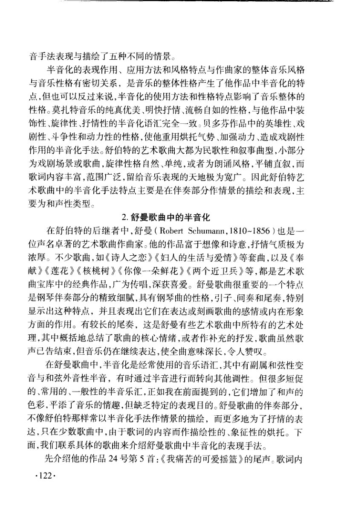

<!-- MANUAL-REFS:p0128 -->

<strong>手册使用本页</strong><ul><li id="ref-profile-profile-sangtong_chromatic-p0128" class="manual-ref-item" data-kind="profile">代表页<a href="../和声学手册.html#book-profiles">教材代表页 · 半音化历史</a> 手册将本页列为《半音化历史》代表页；该书定位：以历史演进为线索：从14–15世纪伪乐、巴洛克情感表达、古典离调、19世纪浪漫半音化，到20世纪无调性与十二音。</li></ul>

音手法表现与描绘了五种不同的情景。 
半音化的表现作用、应用方法和风格特点与作曲家的整体音乐风格 
与音乐性格有密切关系，是音乐的整体性格产生了他作品中半音化的特 
点，但也可以反过来说，半音化的使用方法和性格特点影响了音乐整体的 
性格。莫扎特音乐的纯真优美、明快抒情、流畅自如的性格，与他作品中装 
饰性、旋律性、抒情性的半音化语汇完全一致。贝多芬作品中的英雄性、戏 
剧性、斗争性和动力性的性格，使他重用烘托气势、加强动力、造成戏剧性 
作用的半音化手法。舒伯特的艺术歌曲大都为民歌性和叙事曲型，小部分 
为戏剧场景或歌曲，旋律性格自然、单纯，或者为朗诵风格，平铺直叙，而 
歌词内容丰富，范围广泛，留给音乐表现的天地极为宽广。因此舒伯特艺 
术歌曲中的半音化手法特点主要是在伴奏部分作情景的描绘和表现，主 
要为和声性类型。 
2.舒曼歌曲中的半音化 
在舒伯特的后继者中，舒曼（RobertSchumann，1810~1856）也是一 
位声名卓著的艺术歌曲作曲家。他的作品富于想像和诗意，抒情气质极为 
浓厚。不少歌曲，如《诗人之恋》《妇人的生活与爱情》等套曲，以及《奉 
献》《莲花》《核桃树》《你像一朵鲜花》《两个近卫兵》等，都是艺术歌 
曲宝库中的经典作品，广为传唱，深获喜爱。舒曼歌曲很重要的一个特点 
是钢琴伴奏部分的精致细腻，具有钢琴曲的性格，引子、间奏和尾奏，特别 
显示出这种特点，并且表现出它们在表达或刻画歌曲的感情或内在形象 
方面的作用。有较长的尾奏，这是舒曼有些艺术歌曲中所特有的艺术处 
理，其中概括地总结了歌曲的核心情绪，或者作补充的抒发，歌曲虽然歌 
声已告结束，但音乐仍在继续表达，使全曲意味深长，令人赞叹。 
在舒曼歌曲中，半音化是经常使用的音乐语汇，其中有副属和弦性变 
音与和弦外音性半音，有时通过半音进行而转向其他调性。但很多短促 
的、常用的、一般性的半音乐汇，正如我在前面提到的，它们增加了和声的 
色彩，平添了音乐的情趣，但缺乏特定的表现目的。舒曼歌曲的伴奏部分， 
不像舒伯特那样常以半音化手法作情景的描绘，而更多地为了抒情的表 
达，只在少数歌曲中，由于歌词的内容而作描绘性的、象征性的烘托。下 
面，我们联系具体的歌曲来介绍舒曼歌曲中半音化的表现手法。 
先介绍他的作品24号第5首：《我痛苦的可爱摇篮》的尾声。歌词内 
·122·

---

<!-- PAGE:194 -->

## PDF p.194

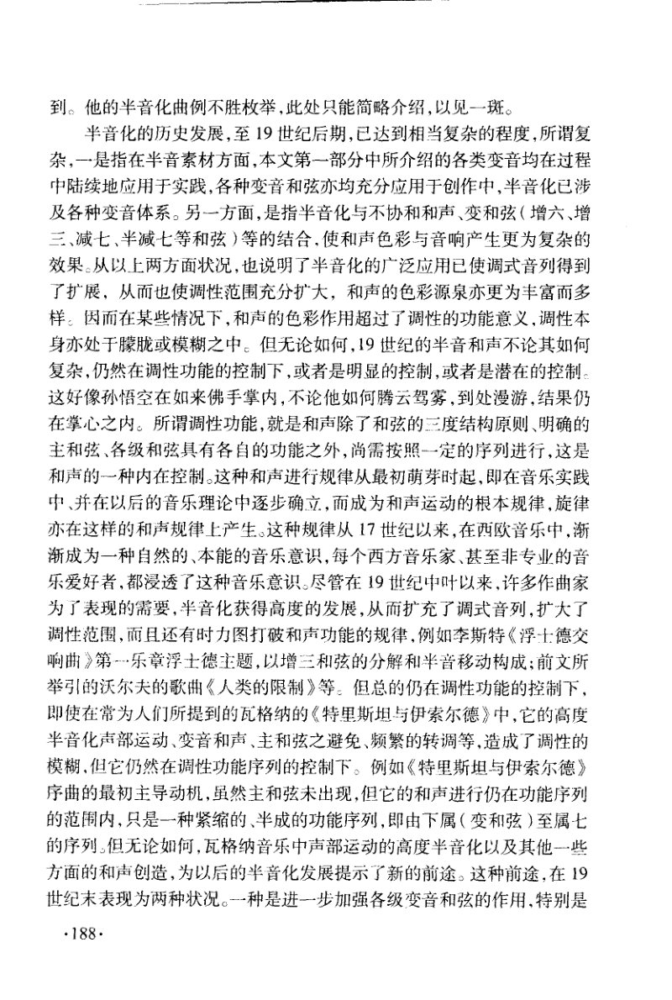

<!-- MANUAL-REFS:p0194 -->

<strong>手册使用本页</strong><ul><li id="ref-claim-chromaticism-functional-control-p0194" class="manual-ref-item" data-kind="claim">论点<a href="../和声学手册.html#claim-chromaticism-functional-control">半音化与变化和弦 · chromaticism.functional-control</a> 手册提炼：19 世纪半音和声即使高度复杂，整体仍受调性功能控制；分析时应区分功能扩张与真正的调性解体。</li></ul>

到。他的半音化曲例不胜枚举，此处只能简略介绍，以见一斑。 
半音化的历史发展，至19世纪后期，已达到相当复杂的程度，所谓复 
杂，一是指在半音素材方面，本文第一部分中所介绍的各类变音均在过程 
中陆续地应用于实践，各种变音和弦亦均充分应用于创作中，半音化已涉 
及各种变音体系。另一方面，是指半音化与不协和和声、变和弦（增六、增 
三、减七、半减七等和弦）等的结合，使和声色彩与音响产生更为复杂的 
效果。从以上两方面状况，也说明了半音化的广泛应用已使调式音列得到 
了扩展，从而也使调性范围充分扩大，和声的色彩源泉亦更为丰富而多 
样。因而在某些情况下，和声的色彩作用超过了调性的功能意义，调性本 
身亦处于朦胧或模糊之中。但无论如何，19世纪的半音和声不论其如何 
复杂，仍然在调性功能的控制下，或者是明显的控制，或者是潜在的控制。 
这好像孙悟空在如来佛手掌内，不论他如何腾云驾雾，到处漫游，结果仍 
在掌心之内。所谓调性功能，就是和声除了和弦的三度结构原则、明确的 
主和弦、各级和弦具有各自的功能之外，尚需按照-一定的序列进行，这是 
和声的一种内在控制。这种和声进行规律从最初萌芽时起，即在音乐实践 
中、并在以后的音乐理论中逐步确立，而成为和声运动的根本规律，旋律 
亦在这样的和声规律上产生。这种规律从17世纪以来，在西欧音乐中，渐 
渐成为一种自然的、本能的音乐意识，每个西方音乐家、甚至非专业的音 
乐爱好者，都浸透了这种音乐意识。尽管在19世纪中叶以来，许多作曲家 
为了表现的需要，半音化获得高度的发展，从而扩充了调式音列，扩大了 
调性范围，而且还有时力图打破和声功能的规律，例如李斯特《浮士德交 
响曲》第---乐章浮士德主题，以增三和弦的分解和半音移动构成；前文所 
举引的沃尔夫的歌曲《人类的限制》等。但总的仍在调性功能的控制下， 
即使在常为人们所提到的瓦格纳的《特里斯坦与伊索尔德》中，它的高度 
半音化声部运动、变音和声、主和弦之避免、频繁的转调等，造成了调性的 
模糊，但它仍然在调性功能序列的控制下。例如《特里斯坦与伊索尔德》 
序曲的最初主导动机，虽然主和弦未出现，但它的和声进行仍在功能序列 
的范围内，只是一种紧缩的、半成的功能序列，即由下属（变和弦）至属七 
的序列，但无论如何，瓦格纳音乐中声部运动的高度半音化以及其他-些 
方面的和声创造，为以后的半音化发展提示了新的前途。这种前途，在19 
世纪末表现为两种状况。一种是进一步加强各级变音和弦的作用，特别是 
·188.

---

<!-- PAGE:219 -->

## PDF p.219

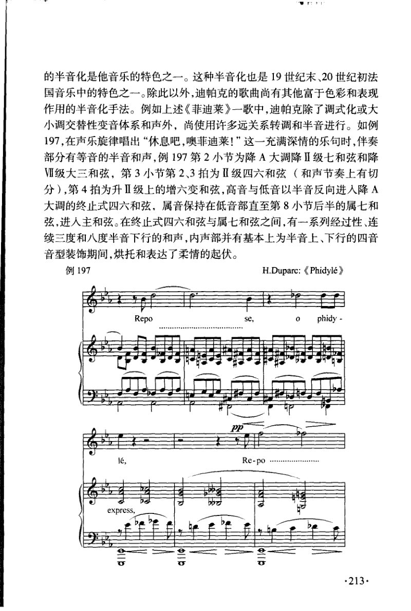

<!-- MANUAL-REFS:p0219 -->

<strong>手册使用本页</strong><ul><li id="ref-profile-profile-sangtong_chromatic-p0219" class="manual-ref-item" data-kind="profile">代表页<a href="../和声学手册.html#book-profiles">教材代表页 · 半音化历史</a> 手册将本页列为《半音化历史》代表页；该书定位：以历史演进为线索：从14–15世纪伪乐、巴洛克情感表达、古典离调、19世纪浪漫半音化，到20世纪无调性与十二音。</li></ul>

的半音化是他音乐的特色之一。这种半音化也是19世纪末、20世纪初法 
国音乐中的特色之一。除此以外，迪帕克的歌曲尚有其他富于色彩和表现 
作用的半音化手法。例如上述《菲迪莱》一一歌中，迪帕克除了调式化或大 
小调交替性变音体系和声外，尚使用许多远关系转调和半音进行。如例 
197，在声乐旋律唱出“休息吧，噢菲迪莱！”这一充满深情的乐句时，伴奏 
VI级大三和弦，第3小节第2、3拍为Ⅱ级四六和弦（和声节奏上有切 
分），第4拍为升Ⅱ级上的增六变和弦，高音与低音以半音反向进人降A 
大调的终止式四六和弦，属音保持在低音部直至第8小节后半的属七和 
弦，进人主和弦。在终止式四六和弦与 
七和弦之间，有一系列经过性、连 
续三度和八度半音下行的和声，内声部并有基本上为半音上、下行的四音 
音型装饰期间，烘托和表达了柔情的起伏。 
例197 
H.Duparc:《Phidyle》 
Repo 
se. 
phidy 
Re-p 
·213.

---

<!-- PAGE:388 -->

## PDF p.388

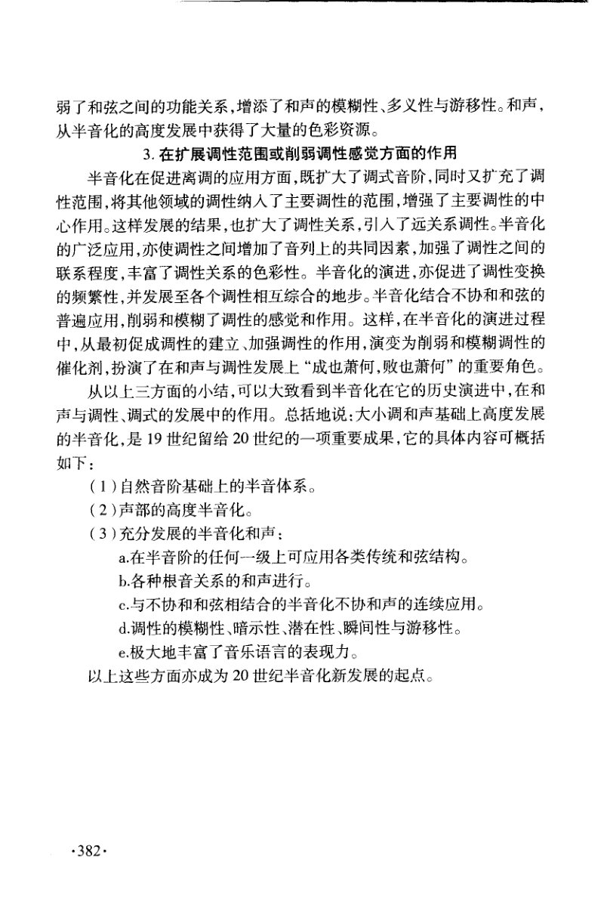

<!-- MANUAL-REFS:p0388 -->

<strong>手册使用本页</strong><ul><li id="ref-claim-color-harmony-late-tonal-p0388" class="manual-ref-item" data-kind="claim">论点<a href="../和声学手册.html#claim-color-harmony-late-tonal">色彩和声与调式色彩 · color-harmony.late-tonal</a> 手册提炼：晚期调性和声通过六度替代属和弦、变化中音、功能九和弦、三度扩张与色彩性连续不断削弱传统功能边界。</li></ul>

弱了和弦之间的功能关系，增添了和声的模糊性、多义性与游移性。和声， 
从半音化的高度发展中获得了大量的色彩资源。 
3.在扩展调性范围或削弱调性感觉方面的作用 
半音化在促进离调的应用方面，既扩大了调式音阶，同时又扩充了调 
性范围，将其他领域的调性纳人了主要调性的范围，增强了主要调性的中 
心作用。这样发展的结果，也扩大了调性关系，引人了远关系调性。半音化 
的广泛应用，亦使调性之间增加了音列上的共同因素，加强了调性之间的 
联系程度，丰富了调性关系的色彩性。半音化的演进，亦促进了调性变换 
的频繁性，并发展至各个调性相互综合的地步。半音化结合不协和和弦的 
普遍应用，削弱和模糊了调性的感觉和作用。这样，在半音化的演进过程 
中，从最初促成调性的建立、加强调性的作用，演变为削弱和模糊调性的 
催化剂，扮演了在和声与调性发展上“成也萧何，败也萧何”的重要角色。 
从以上三方面的小结，可以大致看到半音化在它的历史演进中，在和 
声与调性、调式的发展中的作用。总括地说：大小调和声基础上高度发展 
的半音化，是19世纪留给20世纪的一项重要成果，它的具体内容可概括 
如下： 
（1）自然音阶基础上的半音体系。 
（2）声部的高度半音化。 
（3）充分发展的半音化和声： 
a.在半音阶的任何一级上可应用各类传统和弦结构。 
b.各种根音关系的和声进行。 
c.与不协和和弦相结合的半音化不协和声的连续应用。 
d.调性的模糊性、暗示性、潜在性、瞬间性与游移性。 
e.极大地丰富了音乐语言的表现力。 
以上这些方面亦成为20世纪半音化新发展的起点。 
·382.

---

<!-- PAGE:389 -->

## PDF p.389

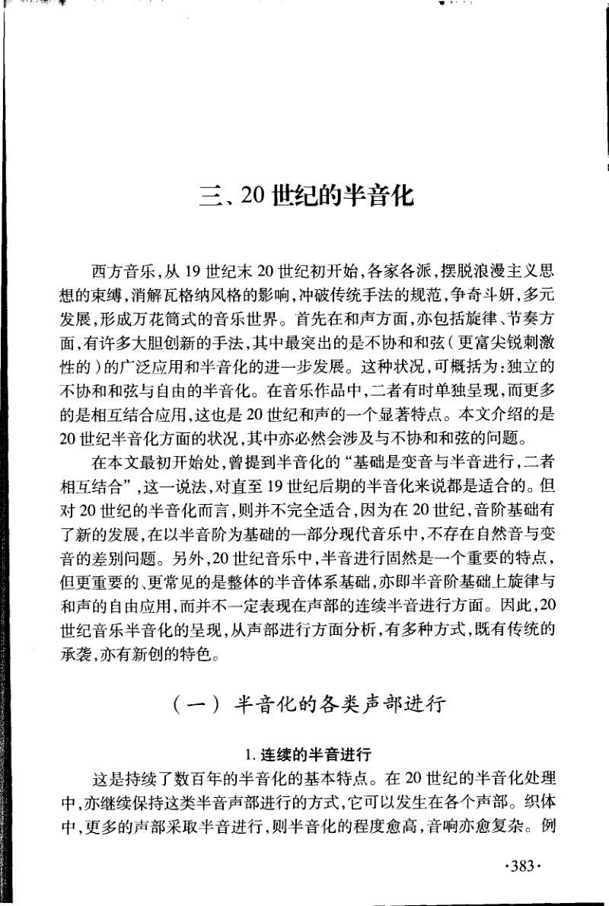

<!-- MANUAL-REFS:p0389 -->

<strong>手册使用本页</strong><ul><li id="ref-claim-chromaticism-twentieth-century-p0389" class="manual-ref-item" data-kind="claim">论点<a href="../和声学手册.html#claim-chromaticism-twentieth-century">半音化与变化和弦 · chromaticism.twentieth-century</a> 手册提炼：20世纪半音化从19世纪末的浪漫主义继承中分化，走向独立不协和和弦、自由半音化与更整体的半音阶基础。</li><li id="ref-profile-profile-sangtong_chromatic-p0389" class="manual-ref-item" data-kind="profile">代表页<a href="../和声学手册.html#book-profiles">教材代表页 · 半音化历史</a> 手册将本页列为《半音化历史》代表页；该书定位：以历史演进为线索：从14–15世纪伪乐、巴洛克情感表达、古典离调、19世纪浪漫半音化，到20世纪无调性与十二音。</li></ul>

三、20世纪的半音化 
西方音乐，从19世纪末20世纪初开始，各家各派，摆脱浪漫主义思 
想的束缚，消解瓦格纳风格的影响，冲破传统手法的规范，争奇斗妍，多元 
发展，形成万花筒式的音乐世界。首先在和声方面，亦包括旋律、节奏方 
面，有许多大胆创新的手法，其中最突出的是不协和和弦（更富尖锐刺激 
性的）的广泛应用和半音化的进一步发展。这种状况，可概括为：独立的 
不协和和弦与自由的半音化。在音乐作品中，二者有时单独呈现，而更多 
的是相互结合应用，这也是20世纪和声的一个显著特点。本文介绍的是 
在本文最初开始处，曾提到半音化的“基础是变音与半音进行，二者 
相互结合”，这一说法，对直至19世纪后期的半音化来说都是适合的。但 
对20世纪的半音化而言，则并不完全适合，因为在20世纪，音阶基础有 
了新的发展，在以半音阶为基础的一部分现代音乐中，不存在自然音与变 
音的差别问题。另外，20世纪音乐中，半音进行固然是一个重要的特点， 
但更重要的、更常见的是整体的半音体系基础，亦即半音阶基础上旋律与 
和声的自由应用，而并不一定表现在声部的连续半音进行方面。因此，20 
世纪音乐半音化的呈现，从声部进行方面分析，有多种方式，既有传统的 
承袭，亦有新创的特色。 
（一）半音化的各类声部进行 
1.连续的半音进行 
这是持续了数百年的半音化的基本特点。在20世纪的半音化处理 
中，亦继续保持这类半音声部进行的方式，它可以发生在各个声部。织体 
中，更多的声部采取半音进行，则半音化的程度愈高，音响亦愈复杂。例 
·383?

---

<!-- PAGE:434 -->

## PDF p.434

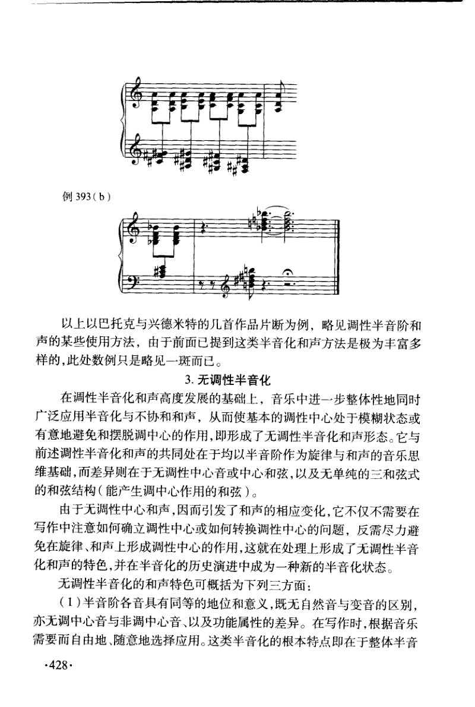

<!-- MANUAL-REFS:p0434 -->

<strong>手册使用本页</strong><ul><li id="ref-claim-atonal-features-p0434" class="manual-ref-item" data-kind="claim">论点<a href="../和声学手册.html#claim-atonal-features">无调性与自由音高组织 · atonal.features</a> 手册提炼：自由无调性常避免主和弦与大三、小三和弦，自由运用半音阶与不协和音，并让每首作品自定进行规则。</li></ul>

88 
例393（b） 
以上以巴托克与兴德米特的几首作品片断为例，略见调性半音阶和 
声的某些使用方法，由于前面已提到这类半音化和声方法是极为丰富多 
样的，此处数例只是略见一斑而已。 
3.无调性半音化 
在调性半音化和声高度发展的基础上，音乐中进一步整体性地同时 
广泛应用半音化与不协和和声，从而使基本的调性中心处于模糊状态或 
有意地避免和摆脱调中心的作用，即形成了无调性半音化和声形态。它与 
前述调性半音化和声的共同处在于均以半音阶作为旋律与和声的音乐思 
维基础，而差异则在于无调性中心音或中心和弦，以及无单纯的三和弦式 
的和弦结构（能产生调中心作用的和弦）。 
由于无调性中心和声，因而引发了和声的相应变化，它不仅不需要在 
写作中注意如何确立调性中心或如何转换调性中心的问题，反需尽力避 
免在旋律、和声上形成调性中心的作用，这就在处理上形成了无调性半音 
化和声的特色，并在半音化的历史演进中成为一种新的半音化状态。 
无调性半音化的和声特色可概括为下列三方面： 
（1）半音阶各音具有同等的地位和意义，既无自然音与变音的区别， 
亦无调中心音与非调中心音、以及功能属性的差异。在写作时，根据音乐 
需要而自由地、随意地选择应用。这类半音化的根本特点即在于整体半音 
·428·

---

<!-- PAGE:436 -->

## PDF p.436

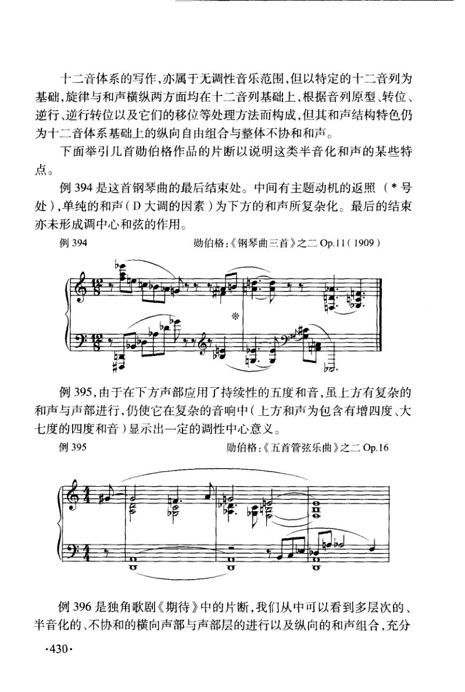

<!-- MANUAL-REFS:p0436 -->

<strong>手册使用本页</strong><ul><li id="ref-period-modernposttonal-2-p0436" class="manual-ref-item" data-kind="period">阶段依据<a href="../和声学手册.html#period-basis">历史阶段依据 · 现代与后调性</a> 阶段结论：对称音阶、集合、无调性与十二音 原文依据：十二音体系的写作，亦属于无调性音乐范围，但以特定的十二音列为基础</li><li id="ref-profile-profile-sangtong_chromatic-p0436" class="manual-ref-item" data-kind="profile">代表页<a href="../和声学手册.html#book-profiles">教材代表页 · 半音化历史</a> 手册将本页列为《半音化历史》代表页；该书定位：以历史演进为线索：从14–15世纪伪乐、巴洛克情感表达、古典离调、19世纪浪漫半音化，到20世纪无调性与十二音。</li></ul>

十二音体系的写作，亦属于无调性音乐范围，但以特定的十二音列为 
基础，旋律与和声横纵两方面均在十二音列基础上，根据音列原型、转位、 
逆行、逆行转位以及它们的移位等处理方法而构成，但其和声结构特色仍 
为十二音体系基础上的纵向自由组合与整体不协和和声。 
下面举引几首勋伯格作品的片断以说明这类半音化和声的某些特 
点。 
例394是这首钢琴曲的最后结束处。中间有主题动机的返照（*号 
处），单纯的和声（D大调的因素）为下方的和声所复杂化。最后的结束 
亦未形成调中心和弦的作用。 
例394 
勋伯格：《钢琴曲三首》之二Op.11（1909） 
例395，由于在下方声部应用了持续性的五度和音，虽上方有复杂的 
和声与声部进行，仍使它在复杂的音响中（上方和声为包含有增四度、大 
七度的四度和音）显示出一定的调性中心意义。 
例395 
勋伯格：《五首管弦乐曲》之二Op.16 
中 
例396是独角歌剧《期待》中的片断，我们从中可以看到多层次的、 
半音化的、不协和的横向声部与声部层的进行以及纵向的和声组合，充分 
·430.

---
