# 勋伯格《和声的结构功能》

> **PDF 文件**：`勋伯格《和声的结构功能》.pdf`  
> **物理页数**：236（从 PDF 第 1 页起计）  
> **OCR 平均置信度**：0.873  
> **字符数**：17291

本文件收录**理论手册实际引用的 14 个 PDF 页**，每页采用整版影印 + OCR 文本。整页图保留谱例、图表、表格、边注和版面关系；OCR 只供检索与复制，具体音符、临时记号、连线和罗马数字以图像为准。被理论手册引用的条目列在图后，可直接回跳。

页码一律使用 **PDF 物理页码**，可能与书内印刷页码不同。

**快速跳页**：[p.9](#p0009) · [p.11](#p0011) · [p.44](#p0044) · [p.60](#p0060) · [p.68](#p0068) · [p.89](#p0089) · [p.98](#p0098) · [p.143](#p0143) · [p.145](#p0145) · [p.166](#p0166) · [p.171](#p0171) · [p.173](#p0173) · [p.178](#p0178) · [p.202](#p0202)

---

<!-- PAGE:9 -->

## PDF p.9

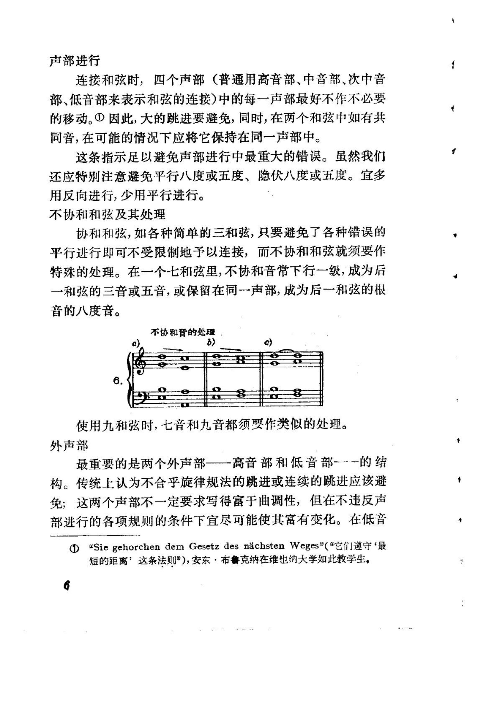

<!-- MANUAL-REFS:p0009 -->

<strong>手册使用本页</strong><ul><li id="ref-claim-voice-leading-parallels-p0009" class="manual-ref-item" data-kind="claim">论点<a href="../和声学手册.html#claim-voice-leading-parallels">声部进行与不协和解决 · voice-leading.parallels</a> 手册提炼：平行纯五度、纯八度削弱声部独立性，因此传统调性写作把它们视为需要避免的进行。</li><li id="ref-claim-seventh-general-resolution-p0009" class="manual-ref-item" data-kind="claim">论点<a href="../和声学手册.html#claim-seventh-general-resolution">七和弦、九和弦与不协和等级 · seventh.general-resolution</a> 手册提炼：七和弦是不协和和弦，需准备并按倾向解决；其七音通常下行级进，属七是最强的功能和声形态。</li><li id="ref-profile-profile-schoenberg_structural_functions-p0009" class="manual-ref-item" data-kind="profile">代表页<a href="../和声学手册.html#book-profiles">教材代表页 · 和声的结构功能</a> 手册将本页列为《和声的结构功能》代表页；该书定位：把功能和声放回结构目的：根音进行、代替音与领域、游移和弦、扩张调性，以及乐句、乐段、过渡、贯串和持续音如何承担曲式功能。</li></ul>

声部进行 
连接和弦时，四个声部（普通用高音部、中音部、次中音 
部、低音部来表示和弦的连接)中的每一声部最好不作不必要 
的移动。①因此，大的跳进要避免，同时，在两个和弦中如有共 
同音，在可能的情况下应将它保持在同一声部中。 
这条指示足以避免声部进行中最重大的错误。虽然我们 
还应特别注意避免平行八度或五度、隐伏八度或五度。宜多 
用反向进行，少用平行进行。 
不协和和弦及其处理 
协和和弦，如各种简单的三和弦，只要避免了各种错误的 
平行进行即可不受限制地予以连接，而不协和和弦就须要作 
特殊的处理。在一个七和弦里，不协和音常下行一级，成为后 
一和弦的三音或五音，或保留在同一声部，成为后一和弦的根 
音的八度音。 
不协和音的处理 
b) 
使用九和弦时，七音和九音都须要作类似的处理。 
外声部 
最重要的是两个外声部——高音部和低音部---的结 
构。传统上认为不合乎旋律规法的跳进或连续的跳进应该避 
免；这两个声部不一定要求写得富于曲调性，但在不违反声 
部进行的各项规则的条件下宜尽可能使其富有变化。在低音 
“Siegehorchen dem Gesetz desnachsten Weges”（“它们遵守‘最 
短的距离’这条法则”），安东·布鲁克纳在维也纳大学如此教学生。

---

<!-- PAGE:11 -->

## PDF p.11

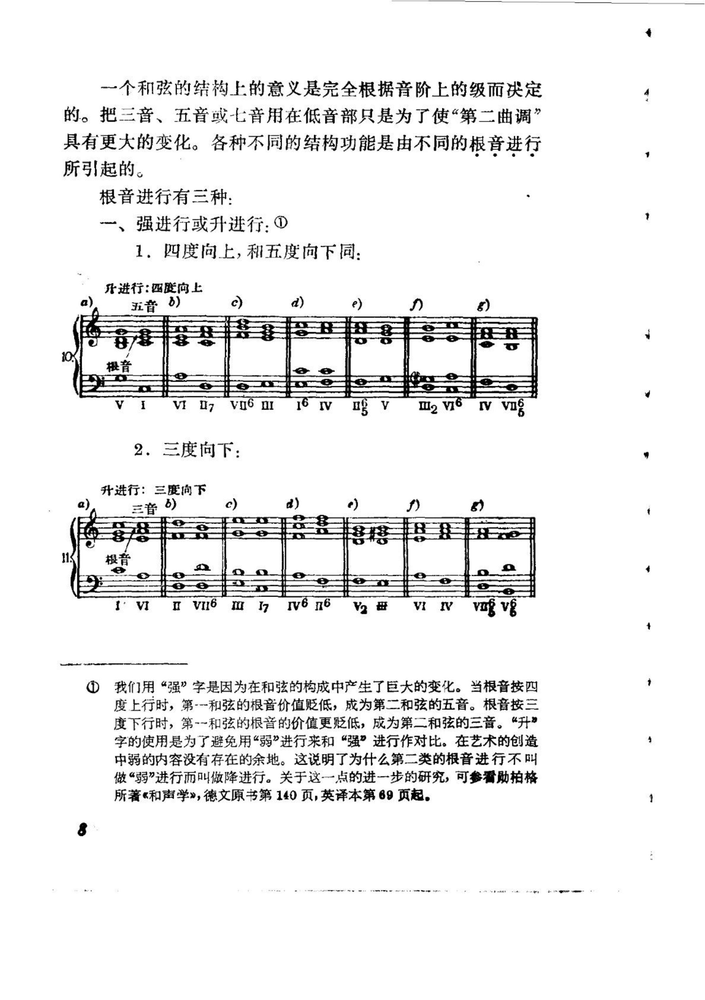

<!-- MANUAL-REFS:p0011 -->

<strong>手册使用本页</strong><ul><li id="ref-claim-root-motion-fourth-up-p0011" class="manual-ref-item" data-kind="claim">论点<a href="../和声学手册.html#claim-root-motion-fourth-up">自然音级功能：T–S–D · root-motion.fourth-up</a> 手册提炼：根音向上四度的进行具有最强的功能推进力；新根音把前一和弦根音纳入自身结构，从听感上提升其功能等级。</li><li id="ref-profile-profile-schoenberg_structural_functions-p0011" class="manual-ref-item" data-kind="profile">代表页<a href="../和声学手册.html#book-profiles">教材代表页 · 和声的结构功能</a> 手册将本页列为《和声的结构功能》代表页；该书定位：把功能和声放回结构目的：根音进行、代替音与领域、游移和弦、扩张调性，以及乐句、乐段、过渡、贯串和持续音如何承担曲式功能。</li></ul>

一个和弦的结构上的意义是完全根据音阶上的级而决定 
的。把三音、五音或七音用在低音部只是为了使“第二曲调” 
具有更大的变化。各种不同的结构功能是由不同的根音进行 
所引起的。 
根音进行有三种： 
一、强进行或升进行：① 
1.四度向上，和五度向下同： 
升进行：四度向上 
五音） 
d) 
e 
8/8 
根音 
16IV 
m2v61vvn 
I 
VIⅡ7 
V 
2.三度向下： 
升进行：三度向下 
三音6 
d) 
c) 
S) 
88 
88 
根音 
D 
1V6n6 
Ⅱ 
V116 
17 
V2母 
VIIV 
我们用“强”字是因为在和弦的构成中产生了巨大的变化。当根音按四 
度上行时，第-一和弦的根音价值贬低，成为第二和弦的五音。根音按三 
度下行时，第～一和弦的根音的价值更贬低，成为第二和弦的三音。“升” 
字的使用是为了避免用“弱”进行来和“强”进行作对比。在艺术的创造 
中弱的内容没有存在的余地。这说明了为什么第二类的根音进行不叫 
做“弱”进行而叫做降进行。关于这一点的进一步的研究，可参看勋拍格 
所著《和声学》，德文原书第140页，英译本第69页起。

---

<!-- PAGE:44 -->

## PDF p.44

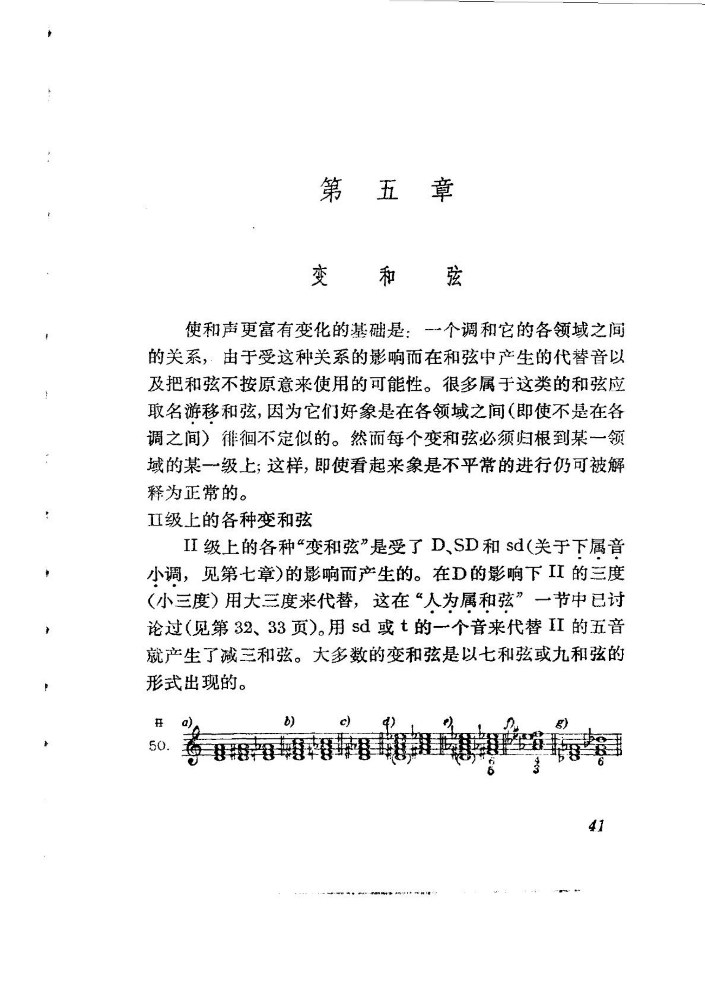

<!-- MANUAL-REFS:p0044 -->

<strong>手册使用本页</strong><ul><li id="ref-claim-function-network-wandering-chords-p0044" class="manual-ref-item" data-kind="claim">论点<a href="../和声学手册.html#claim-function-network-wandering-chords">功能网与功能转换 · function-network.wandering-chords</a> 手册提炼：游移和弦不固定属于某一调，其功能由前后和弦决定，并可在多个方向与远关系调之间连接；同一和弦因此可被重新解释。</li><li id="ref-profile-profile-schoenberg_structural_functions-p0044" class="manual-ref-item" data-kind="profile">代表页<a href="../和声学手册.html#book-profiles">教材代表页 · 和声的结构功能</a> 手册将本页列为《和声的结构功能》代表页；该书定位：把功能和声放回结构目的：根音进行、代替音与领域、游移和弦、扩张调性，以及乐句、乐段、过渡、贯串和持续音如何承担曲式功能。</li></ul>

第五章 
变和弦 
使和声更富有变化的基础是：一个调和它的各领域之间 
的关系，由于受这种关系的影响而在和弦中产生的代替音以 
及把和弦不按原意来使用的可能性。很多属于这类的和弦应 
取名游移和弦，因为它们好象是在各领域之间（即使不是在各 
调之间）徘徊不定似的。然而每个变和弦必须归根到某一领 
域的某一级上；这样，即使看起来象是不平常的进行仍可被解 
释为正常的。 
Ⅱ级上的各种变和弦 
II级上的各种“变和弦”是受了 D、SD和sd(关于下属音 
小调，见第七章)的影响而产生的。在D的影响下 II 的三度 
（小三度）用大三度来代替，这在“人为属和弦”一节中已讨 
论过（见第32、33页)。用sd或t的一个音来代替II的五音 
就产生了减三和弦。大多数的变和弦是以七和弦或九和弦的 
形式出现的。 
c) 
开 
50.

---

<!-- PAGE:60 -->

## PDF p.60

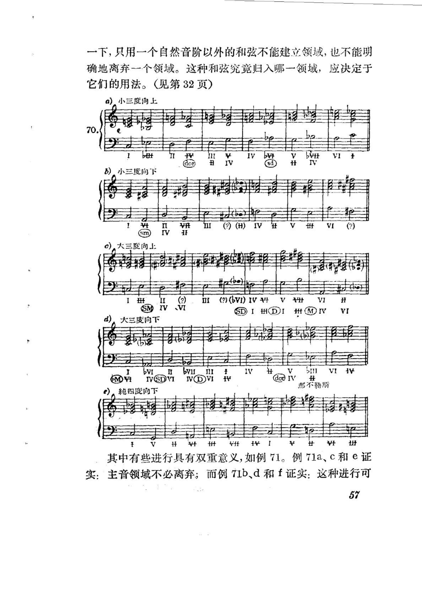

<!-- MANUAL-REFS:p0060 -->

<strong>手册使用本页</strong><ul><li id="ref-claim-pivot-neutral-chord-double-label-p0060" class="manual-ref-item" data-kind="claim">论点<a href="../和声学手册.html#claim-pivot-neutral-chord-double-label">中介和弦与转调 · pivot.neutral-chord-double-label</a> 手册提炼：转调初期以两调共同的中立和弦为媒介，并对其作双重功能标记；随后进入新调属和弦，再用终止式确认新调。</li><li id="ref-profile-profile-schoenberg_structural_functions-p0060" class="manual-ref-item" data-kind="profile">代表页<a href="../和声学手册.html#book-profiles">教材代表页 · 和声的结构功能</a> 手册将本页列为《和声的结构功能》代表页；该书定位：把功能和声放回结构目的：根音进行、代替音与领域、游移和弦、扩张调性，以及乐句、乐段、过渡、贯串和持续音如何承担曲式功能。</li></ul>

一下，只用一个自然音阶以外的和弦不能建立领域，也不能明 
确地离弃一个领域。这种和弦究竟归入哪一领域，应决定于 
它们的用法。（见第32页） 
a)小三度向上 
70 
bivt 
I11 
A 
IV 
V 
VI 
dor 
IV 
sd 
H 
V 
b）小三度向下 
()JA班A开AI(H 
n 
rV 
sm 
c）大三度向上 
ⅡI 
? 
AAI（IA)（) 
VI 
VV 
SM 
SIHDI# 
VI 
大三度向下 
1 
bVI 
Ⅱ 
IV 
V 
AFIA 
GMH 
IVSDVI 
IAAI 
doV# 
那不勒期 
刹四度向下 
丰丰车丰一 
V 
其中有些进行具有双重意义，如例7l。例71a、c和e证 
实：主音领域不必离弃；而例71b、d和f证实：这种进行可 
57

---

<!-- PAGE:68 -->

## PDF p.68

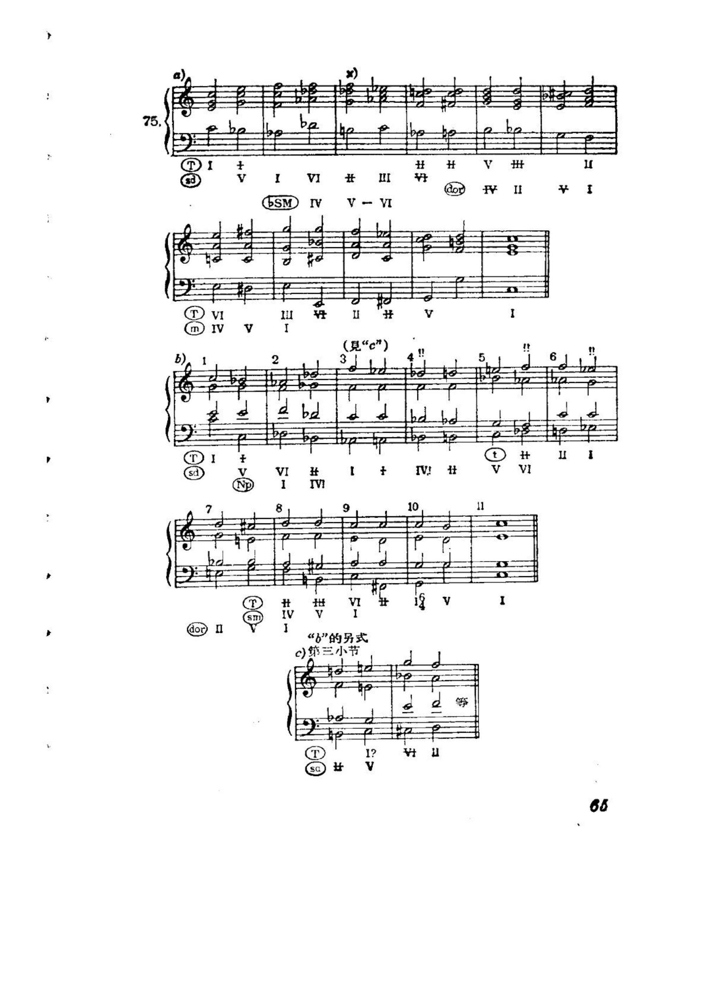

<!-- MANUAL-REFS:p0068 -->

<strong>手册使用本页</strong><ul><li id="ref-profile-profile-schoenberg_structural_functions-p0068" class="manual-ref-item" data-kind="profile">代表页<a href="../和声学手册.html#book-profiles">教材代表页 · 和声的结构功能</a> 手册将本页列为《和声的结构功能》代表页；该书定位：把功能和声放回结构目的：根音进行、代替音与领域、游移和弦、扩张调性，以及乐句、乐段、过渡、贯串和持续音如何承担曲式功能。</li></ul>

75 
# 
H 
V 
丰 
+ 
VI 
V 
InI 
I 
OSM 
AI 
VI 
8 
? 
VI 
ⅡI 
I 
m 
IV 
I 
（見“c”） 
!! 
+ 
IV! 
廿 
V 
V1 
VI 
H 
sd 
ND 
1 
IV 
10 
11 
VI 
I 
H 
世 
IV 
V 
SmI 
n 
“b”的另式 
第三小节 
I? 
V 
sa 
65

---

<!-- PAGE:89 -->

## PDF p.89

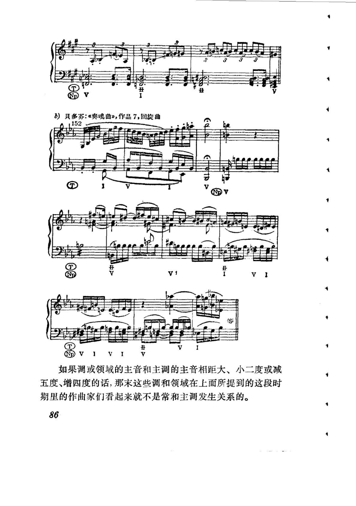

<!-- MANUAL-REFS:p0089 -->

<strong>手册使用本页</strong><ul><li id="ref-claim-modulation-distance-p0089" class="manual-ref-item" data-kind="claim">论点<a href="../和声学手册.html#claim-modulation-distance">转调体系：类型、距离与确认 · modulation.distance</a> 手册提炼：调性远近应综合调号、共同和弦、主音距离与转调方法来判定，不能只看调号差。</li><li id="ref-profile-profile-schoenberg_structural_functions-p0089" class="manual-ref-item" data-kind="profile">代表页<a href="../和声学手册.html#book-profiles">教材代表页 · 和声的结构功能</a> 手册将本页列为《和声的结构功能》代表页；该书定位：把功能和声放回结构目的：根音进行、代替音与领域、游移和弦、扩张调性，以及乐句、乐段、过渡、贯串和持续音如何承担曲式功能。</li></ul>

具多芬：《奏曲》，作品7，回旋曲 
VI 
如果调或领域的主音和主调的主音相距大、小二度或减 
五度、增四度的话，那末这些调和领域在上面所提到的这段时 
期里的作曲家们看起来就不是常和主调发生关系的。 
86

---

<!-- PAGE:98 -->

## PDF p.98

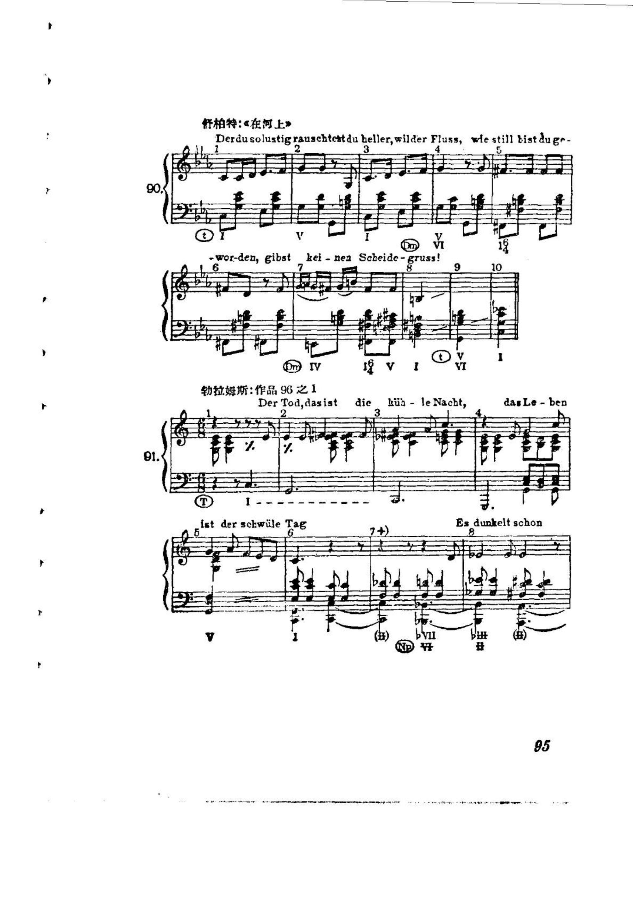

<!-- MANUAL-REFS:p0098 -->

<strong>手册使用本页</strong><ul><li id="ref-profile-profile-schoenberg_structural_functions-p0098" class="manual-ref-item" data-kind="profile">代表页<a href="../和声学手册.html#book-profiles">教材代表页 · 和声的结构功能</a> 手册将本页列为《和声的结构功能》代表页；该书定位：把功能和声放回结构目的：根音进行、代替音与领域、游移和弦、扩张调性，以及乐句、乐段、过渡、贯串和持续音如何承担曲式功能。</li></ul>

舒柏特：《在河上》 
Derdu solustigrauschtestdu heller,wilder Fluss, le still bist dug 
'06 
wor-den,gibst 
kei-nenScheide 
-gruss! 
8 
9 
10 
勃拉姆斯：作品96之1 
dic huh- leNacht, 
danLe-ben 
DerTod,dasist 
2 
3 
91. 
istder schwile Tag 
Es dunkelt schon 
8 
6 
95

---

<!-- PAGE:143 -->

## PDF p.143

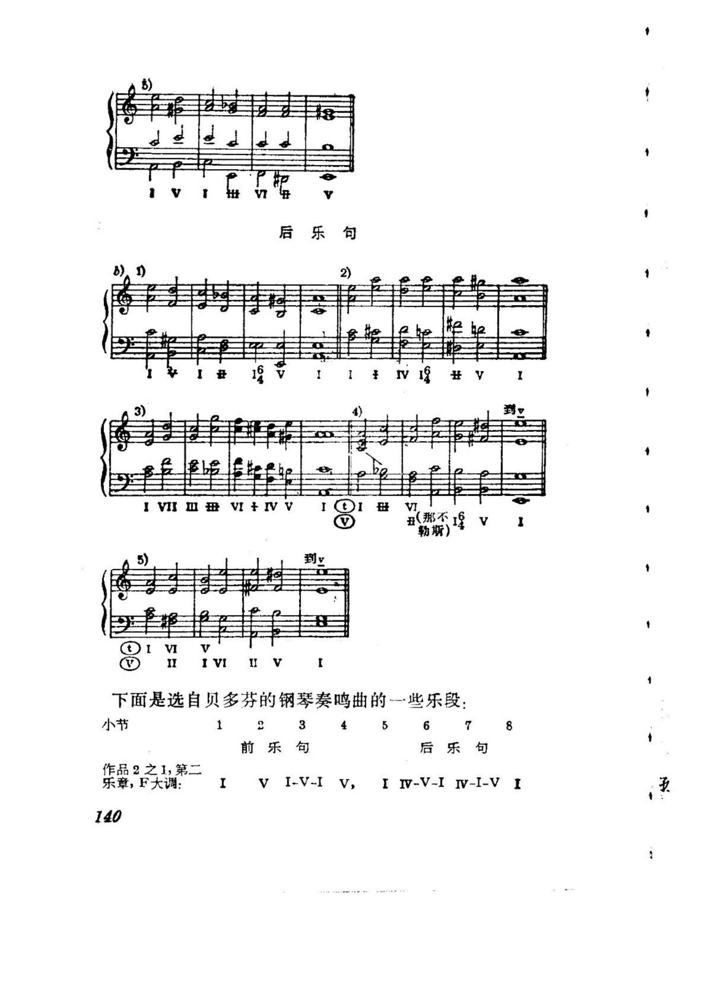

<!-- MANUAL-REFS:p0143 -->

<strong>手册使用本页</strong><ul><li id="ref-profile-profile-schoenberg_structural_functions-p0143" class="manual-ref-item" data-kind="profile">代表页<a href="../和声学手册.html#book-profiles">教材代表页 · 和声的结构功能</a> 手册将本页列为《和声的结构功能》代表页；该书定位：把功能和声放回结构目的：根音进行、代替音与领域、游移和弦、扩张调性，以及乐句、乐段、过渡、贯串和持续音如何承担曲式功能。</li></ul>

后乐句 
2) 
91 
V 
# 
VI 
V 
勒斯） 
到y 
VI 
II 
IVI 
ⅡI 
下面是选自贝多芬的钢琴奏鸣曲的一些乐段： 
小节 
1 
23 
4 
5 
6 
8 
前乐句 
后乐句 
作品2之1，第二 
VI-V-IV, 
乐章，F大调： 
IV-V-IIV-I-V1 
140

---

<!-- PAGE:145 -->

## PDF p.145

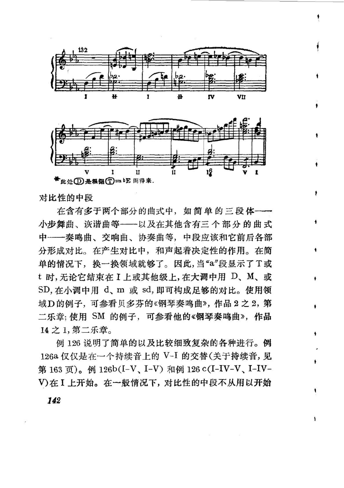

<!-- MANUAL-REFS:p0145 -->

<strong>手册使用本页</strong><ul><li id="ref-claim-form-micro-macro-p0145" class="manual-ref-item" data-kind="claim">论点<a href="../和声学手册.html#claim-form-micro-macro">曲式中的和声策略 · form.micro-macro</a> 手册提炼：微观和声事件需与宏观调性布局互相校验，才能解释其在曲式中的功能。</li><li id="ref-profile-profile-schoenberg_structural_functions-p0145" class="manual-ref-item" data-kind="profile">代表页<a href="../和声学手册.html#book-profiles">教材代表页 · 和声的结构功能</a> 手册将本页列为《和声的结构功能》代表页；该书定位：把功能和声放回结构目的：根音进行、代替音与领域、游移和弦、扩张调性，以及乐句、乐段、过渡、贯串和持续音如何承担曲式功能。</li></ul>

A 
IIA 
V 
I 
LⅡ 
此处D是根据=bE而得来. 
对比性的中段 
在含有多于两个部分的曲式中，如简单的三段体一一一 
小步舞曲、诙谐曲等一一以及在其他含有三个部分的曲式 
中一一奏鸣曲、交响曲、协奏曲等，中段应该和它前后各部 
分形成对比。在产生对比中，和声起着决定性的作用。在简 
单的情况下，换一换领域就够了。因此，当“a”段显示了T或 
t时,无论它结束在I上或其他级上,在大调中用 D、M、或 
SD,在小调中用d、m 或 sd,即可构成足够的对比。使用领 
域D的例子，可参看贝多芬的《钢琴奏鸣曲》，作品2之2，第 
二乐章；使用SM的例子，可参看他的《钢琴奏鸣曲》，作品 
14之1，第二乐章。 
例126说明了简单的以及比较细致复杂的各种进行。例 
126a仅仅是在一个持续音上的V-I的交替（关于持续音，见 
第163页)。例126b(I-V、I-V)和例126 c(I-IV-V、I-IV- 
V)在I上开始。在一般情况下，对比性的中段不从用以开始 
142

---

<!-- PAGE:166 -->

## PDF p.166

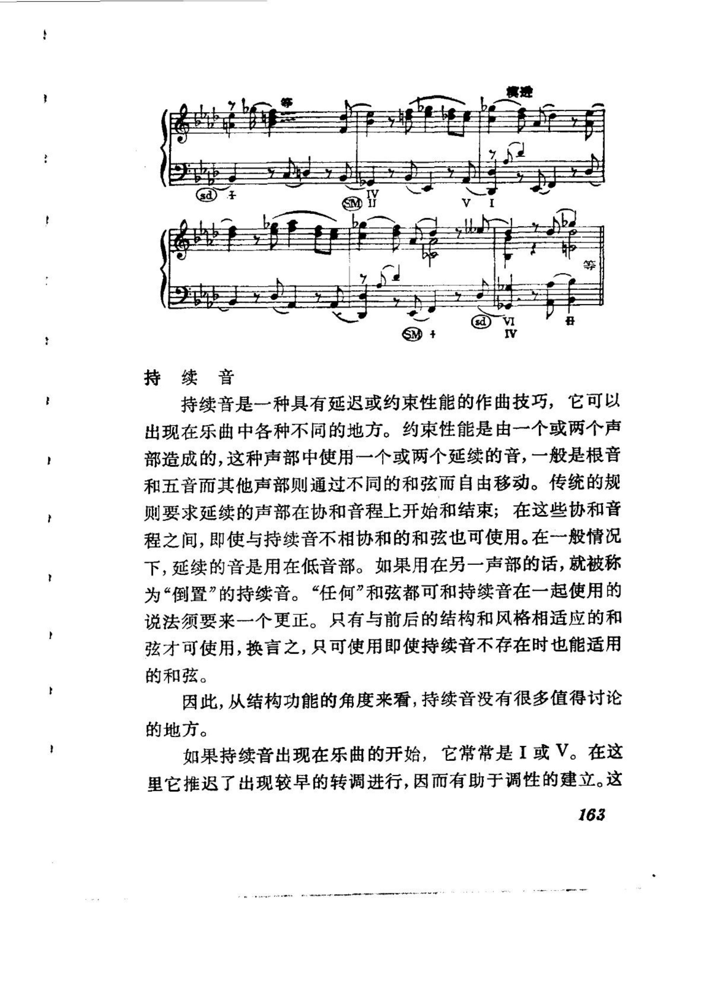

<!-- MANUAL-REFS:p0166 -->

<strong>手册使用本页</strong><ul><li id="ref-profile-profile-schoenberg_structural_functions-p0166" class="manual-ref-item" data-kind="profile">代表页<a href="../和声学手册.html#book-profiles">教材代表页 · 和声的结构功能</a> 手册将本页列为《和声的结构功能》代表页；该书定位：把功能和声放回结构目的：根音进行、代替音与领域、游移和弦、扩张调性，以及乐句、乐段、过渡、贯串和持续音如何承担曲式功能。</li></ul>

持续音 
持续音是一种具有延迟或约束性能的作曲技巧，它可以 
出现在乐曲中各种不同的地方。约束性能是由一个或两个声 
部造成的，这种声部中使用一个或两个延续的音，一般是根音 
和五音而其他声部则通过不同的和弦而自由移动。传统的规 
则要求延续的声部在协和音程上开始和结束；在这些协和音 
程之间，即使与持续音不相协和的和弦也可使用。在一般情况 
下，延续的音是用在低音部。如果用在另一声部的话，就被称 
说法须要来一个更正。只有与前后的结构和风格相适应的和 
弦才可使用，换言之，只可使用即使持续音不存在时也能适用 
的和弦。 
因此，从结构功能的角度来看，持续音没有很多值得讨论 
的地方。 
如果持续音出现在乐曲的开始，它常常是I或V。在这 
里它推迟了出现较早的转调进行，因而有助于调性的建立。这 
163

---

<!-- PAGE:171 -->

## PDF p.171

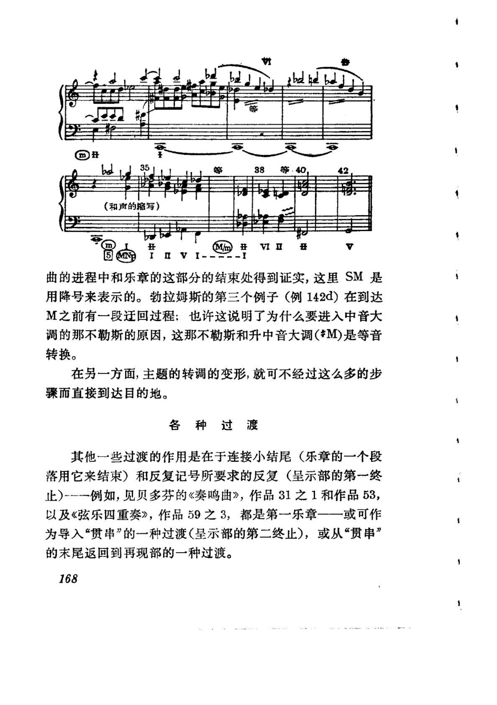

<!-- MANUAL-REFS:p0171 -->

<strong>手册使用本页</strong><ul><li id="ref-profile-profile-schoenberg_structural_functions-p0171" class="manual-ref-item" data-kind="profile">代表页<a href="../和声学手册.html#book-profiles">教材代表页 · 和声的结构功能</a> 手册将本页列为《和声的结构功能》代表页；该书定位：把功能和声放回结构目的：根音进行、代替音与领域、游移和弦、扩张调性，以及乐句、乐段、过渡、贯串和持续音如何承担曲式功能。</li></ul>

等40 
等 
38 
（和声的缩写） 
VⅡ 
Ⅱ 
曲的进程中和乐章的这部分的结束处得到证实，这里SM是 
用降号来表示的。勃拉姆斯的第三个例子（例142d）在到达 
M之前有一段迁回过程；也许这说明了为什么要进入中音大 
调的那不勒斯的原因，这那不勒斯和升中音大调（#M)是等音 
转换。 
在另一方面，主题的转调的变形，就可不经过这么多的步 
骤而直接到达目的地。 
各种过渡 
其他一些过渡的作用是在于连接小结尾（乐章的一个段 
落用它来结束）和反复记号所要求的反复（呈示部的第一终 
止）--一例如，见贝多芬的《奏鸣曲》，作品31之1和作品53， 
以及《弦乐四重奏》，作品59之3，都是第一乐章一一或可作 
为导入“贯串”的一种过渡（呈示部的第二终止），或从“贯串” 
的末尾返回到再现部的一种过渡。 
168

---

<!-- PAGE:173 -->

## PDF p.173

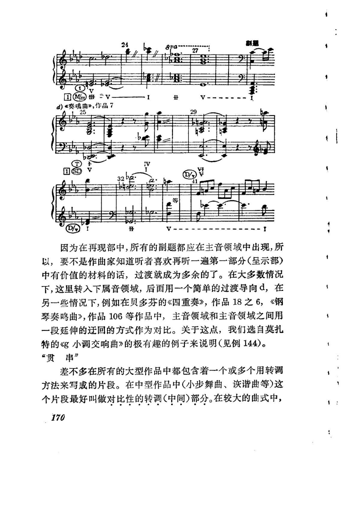

<!-- MANUAL-REFS:p0173 -->

<strong>手册使用本页</strong><ul><li id="ref-claim-form-sonata-conflict-p0173" class="manual-ref-item" data-kind="claim">论点<a href="../和声学手册.html#claim-form-sonata-conflict">曲式中的和声策略 · form.sonata-conflict</a> 手册提炼：奏鸣曲呈示部建立主调与副调的主题/调性冲突，展开部扩大不稳定，再现部把副调主题带回主调解决冲突。</li><li id="ref-profile-profile-schoenberg_structural_functions-p0173" class="manual-ref-item" data-kind="profile">代表页<a href="../和声学手册.html#book-profiles">教材代表页 · 和声的结构功能</a> 手册将本页列为《和声的结构功能》代表页；该书定位：把功能和声放回结构目的：根音进行、代替音与领域、游移和弦、扩张调性，以及乐句、乐段、过渡、贯串和持续音如何承担曲式功能。</li></ul>

①Mm册 
d）《奏骗曲》，作品7 
25 
29 
1 
因为在再现部中，所有的副题都应在主音领域中出现，所 
以，要不是作曲家知道听者喜欢再听一遍第一部分(呈示部) 
中有价值的材料的话，过渡就成为多余的了。在大多数情况 
下，这里转入下属音领域，后面用一个简单的过渡导向d，在 
另一些情况下，例如在贝多芬的《四重奏》，作品18之6，《钢 
琴奏鸣曲》，作品106等作品中，主音领域和主音领域之间用 
一段延伸的迁回的方式作为对比。关于这点，我们选自莫扎 
特的《g小调交响曲》的极有趣的例子来说明（见例144)。 
“贯串” 
差不多在所有的大型作品中都包含着一个或多个用转调 
方法来写成的片段。在中型作品中（小步舞曲、恢谐曲等）这 
个片段最好叫做对比性的转调(中间)部分。在较大的曲式中， 
170

---

<!-- PAGE:178 -->

## PDF p.178

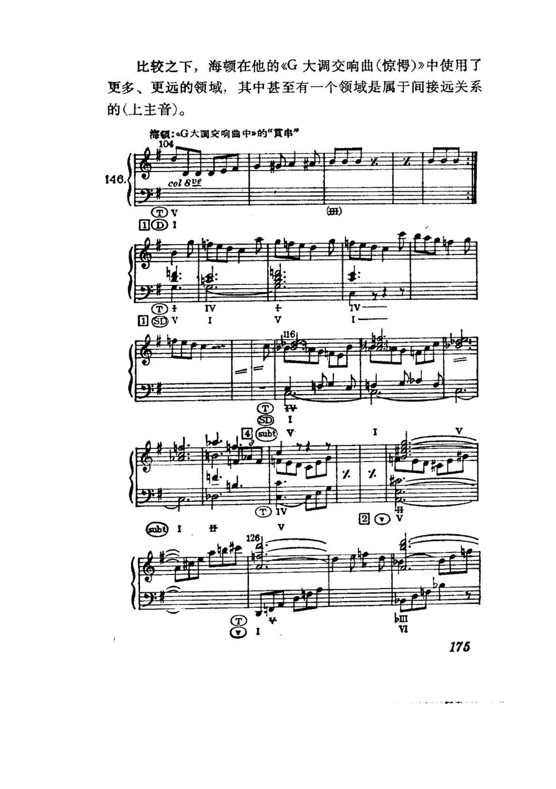

<!-- MANUAL-REFS:p0178 -->

<strong>手册使用本页</strong><ul><li id="ref-profile-profile-schoenberg_structural_functions-p0178" class="manual-ref-item" data-kind="profile">代表页<a href="../和声学手册.html#book-profiles">教材代表页 · 和声的结构功能</a> 手册将本页列为《和声的结构功能》代表页；该书定位：把功能和声放回结构目的：根音进行、代替音与领域、游移和弦、扩张调性，以及乐句、乐段、过渡、贯串和持续音如何承担曲式功能。</li></ul>

比较之下，海顿在他的《G大调交响曲（惊)》中使用了 
更多、更远的领域，其中甚至有一个领域是属于间接远关系 
的(上主音)。 
海顿：G大调交响曲中》的“食串” 
104 
146. 
colsve 
(里) 
TV 
1 
subt 
%. 
%. 
aubt 
bm 
VI 
175

---

<!-- PAGE:202 -->

## PDF p.202

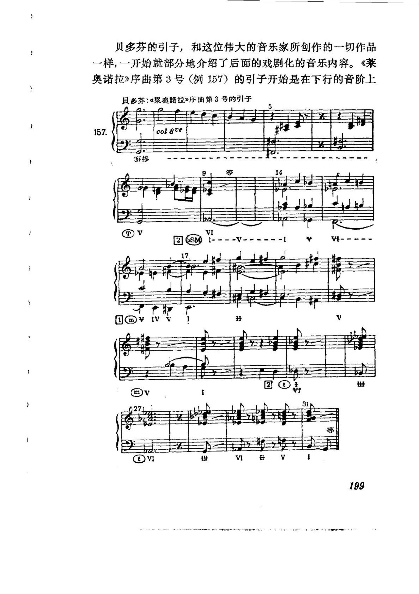

<!-- MANUAL-REFS:p0202 -->

<strong>手册使用本页</strong><ul><li id="ref-profile-profile-schoenberg_structural_functions-p0202" class="manual-ref-item" data-kind="profile">代表页<a href="../和声学手册.html#book-profiles">教材代表页 · 和声的结构功能</a> 手册将本页列为《和声的结构功能》代表页；该书定位：把功能和声放回结构目的：根音进行、代替音与领域、游移和弦、扩张调性，以及乐句、乐段、过渡、贯串和持续音如何承担曲式功能。</li></ul>

贝多芬的引子，和这位伟大的音乐家所创作的一切作品 
一样，一开始就部分地介绍了后面的戏剧化的音乐内容。《莱 
奥诺拉》序曲第3号（例157）的引子开始是在下行的音阶上 
多芬：《黎奥器拉》序曲第3号的引1子 
col8ve 
157. 
游移 
14 
2 
D@?IV 
筹 
V 
V 
199

---
