# 斯波索宾和声学上册答案

> **PDF 文件**：`斯波索宾和声学上册答案.pdf`  
> **物理页数**：250（从 PDF 第 1 页起计）  
> **OCR 平均置信度**：0.947  
> **字符数**：48654

本文件收录**理论手册实际引用的 11 个 PDF 页**，每页采用整版影印 + OCR 文本。整页图保留谱例、图表、表格、边注和版面关系；OCR 只供检索与复制，具体音符、临时记号、连线和罗马数字以图像为准。被理论手册引用的条目列在图后，可直接回跳。

页码一律使用 **PDF 物理页码**，可能与书内印刷页码不同。

**快速跳页**：[p.2](#p0002) · [p.13](#p0013) · [p.20](#p0020) · [p.45](#p0045) · [p.57](#p0057) · [p.92](#p0092) · [p.123](#p0123) · [p.160](#p0160) · [p.168](#p0168) · [p.204](#p0204) · [p.218](#p0218)

---

<!-- PAGE:2 -->

## PDF p.2

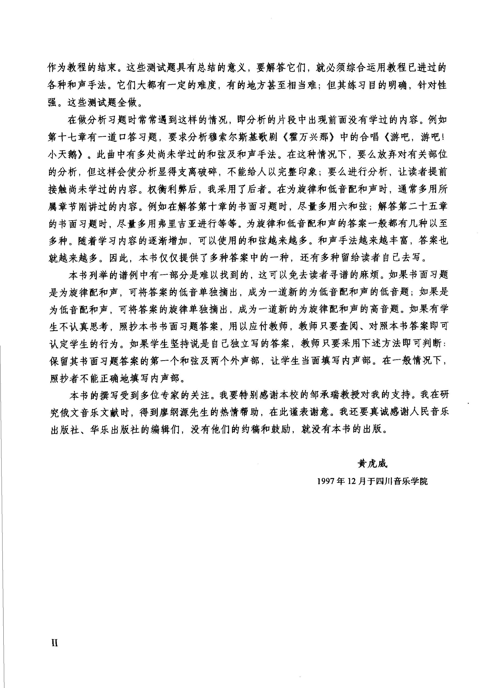

<!-- MANUAL-REFS:p0002 -->

<strong>手册使用本页</strong><ul><li id="ref-claim-voice-leading-multiple-solutions-p0002" class="manual-ref-item" data-kind="claim">论点<a href="../和声学手册.html#claim-voice-leading-multiple-solutions">声部进行与不协和解决 · voice-leading.multiple-solutions</a> 手册提炼：同一旋律与低音可有多条合格的四部写法；语法约束限定可行域，并不产生唯一正确答案。</li></ul>

作为教程的结束。这些测试题具有总结的意义，要解答它们，就必须综合运用教程已进过的 
各种和声手法。它们大都有一定的难度，有的地方甚至相当难；但其练习目的明确，针对性 
强。这些测试题全做。 
在做分析习题时常常遇到这样的情况，即分析的片段中出现前面没有学过的内容。例如 
第十七章有一道口答习题，要求分析穆索尔斯基歌剧《霍万兴那》中的合唱《游吧，游吧！ 
小天鹅》。此曲中有多处尚未学过的和弦及和声手法。在这种情况下，要么放弃对有关部位 
的分析，但这样会使分析显得支离破碎，不能给人以完整印象；要么进行分析，让读者提前 
接触尚未学过的内容。权衡利弊后，我采用了后者。在为旋律和低音配和声时，通常多用所 
属章节刚讲过的内容。例如在解答第十章的书面习题时，尽量多用六和弦；解答第二十五章 
的书面习题时，尽量多用弗里吉亚进行等等。为旋律和低音配和声的答案一般都有几种以至 
多种。随着学习内容的逐渐增加，可以使用的和弦越来越多。和声手法越来越丰富，答案也 
就越来越多。因此，本书仅仅提供了多种答案中的一种，还有多种留给读者自已去写。 
本书列举的谱例中有一部分是难以找到的，这可以免去读者寻谱的麻烦。如果书面习题 
是为旋律配和声，可将答案的低音单独摘出，成为一道新的为低音配和声的低音题；如果是 
为低音配和声，可将答案的旋律单独摘出，成为一道新的为旋律配和声的高音题。如果有学 
生不认真思考，照抄本书书面习题答案，用以应付教师，教师只要查阅、对照本书答案即可 
认定学生的行为。如果学生坚持说是自已独立写的答案，教师只要采用下述方法即可判断： 
保留其书面习题答案的第一个和弦及两个外声部，让学生当面填写内声部。在一般情况下， 
照抄者不能正确地填写内声部。 
本书的撰写受到多位专家的关注。我要特别感谢本校的邹承瑞教授对我的支持。我在研 
究俄文音乐文献时，得到廖纲源先生的热情帮助，在此谨表谢意。我还要真诚感谢人民音乐 
出版社、华乐出版社的编辑们，没有他们的约稿和鼓励，就没有本书的出版。 
黄虎威 
1997年12月于四川音乐学院 
ⅡI

---

<!-- PAGE:13 -->

## PDF p.13

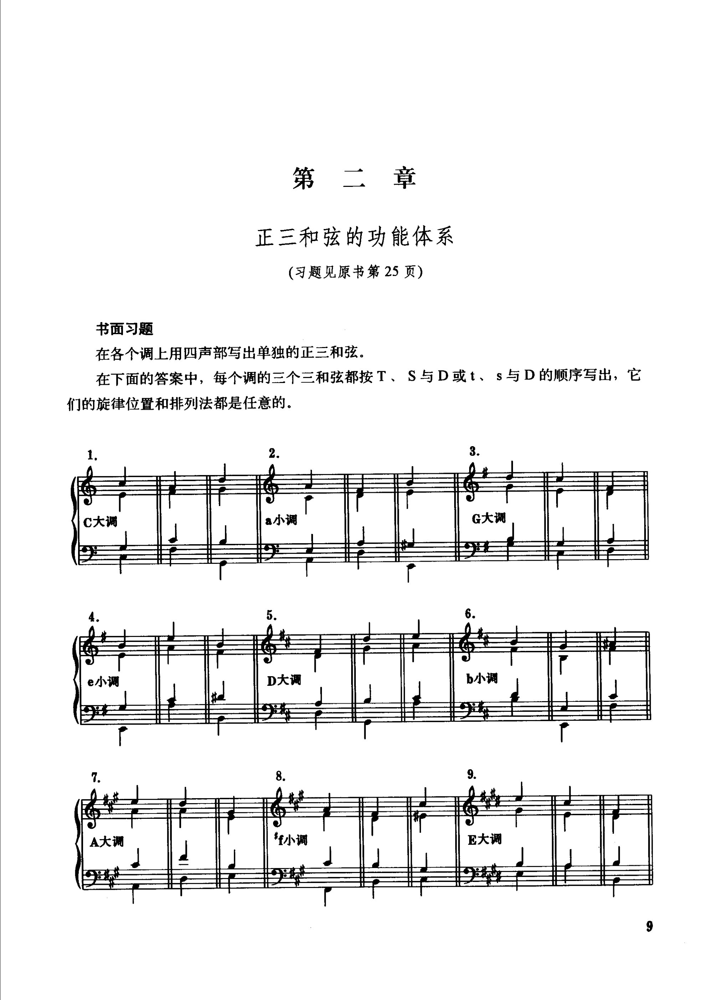

<!-- MANUAL-REFS:p0013 -->

<strong>手册使用本页</strong><ul><li id="ref-claim-diatonic-tonic-subdominant-dominant-p0013" class="manual-ref-item" data-kind="claim">论点<a href="../和声学手册.html#claim-diatonic-tonic-subdominant-dominant">自然音级功能：T–S–D · diatonic.tonic-subdominant-dominant</a> 手册提炼：大调 I、IV、V 分别承担主、下属、属的核心功能，其他自然三和弦按共同音与倾向归入功能组。</li><li id="ref-claim-diatonic-function-sequence-p0013" class="manual-ref-item" data-kind="claim">论点<a href="../和声学手册.html#claim-diatonic-function-sequence">自然音级功能：T–S–D · diatonic.function-sequence</a> 手册提炼：功能和声的基本序列是稳定—不稳定—稳定，典型为 T–S–D–T；D–S 属特殊情况而非常规。</li></ul>

第二章 
正三和弦的功能体系 
(习题见原书第25页) 
书面习题 
在各个调上用四声部写出单独的正三和弦。 
在下面的答案中，每个调的三个三和弦都按T、S与 D或t、s与D 的顺序写出，它 
们的旋律位置和排列法都是任意的。 
3 
2 
G大调 
C大调 
a小调 
5 
D大调 
b小调 
e小调 
9. 
8. 
*年小调 
A大调 
E大调

---

<!-- PAGE:20 -->

## PDF p.20

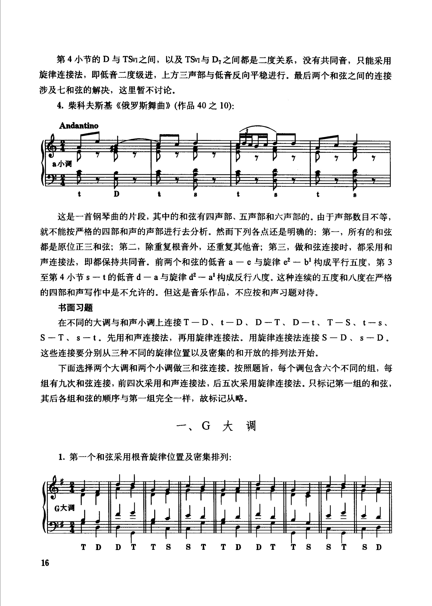

<!-- MANUAL-REFS:p0020 -->

<strong>手册使用本页</strong><ul><li id="ref-claim-voice-leading-parallels-p0020" class="manual-ref-item" data-kind="claim">论点<a href="../和声学手册.html#claim-voice-leading-parallels">声部进行与不协和解决 · voice-leading.parallels</a> 手册提炼：平行纯五度、纯八度削弱声部独立性，因此传统调性写作把它们视为需要避免的进行。</li></ul>

第4小节的D与TSv之间，以及TSv与D之间都是二度关系，没有共同音，只能采用 
旋律连接法，即低音二度级进，上方三声部与低音反向平稳进行。最后两个和弦之间的连接 
涉及七和弦的解决，这里暂不讨论。 
4.柴科夫斯基《俄罗斯舞曲》（作品40之10): 
Andantino 
8小调 
这是一首钢琴曲的片段，其中的和弦有四声部、五声部和六声部的。由于声部数目不等， 
就不能按严格的四部和声的声部进行去分析。然而下列各点还是明确的：第一，所有的和弦 
都是原位正三和弦；第二，除重复根音外，还重复其他音；第三，做和弦连接时，都采用和 
声连接法，即都保持共同音。前两个和弦的低音 a一é与旋律e²一 bl 构成平行五度，第 3 
至第 4 小节s一t的低音d一a与旋律 d²—a构成反行八度。这种连续的五度和八度在严格 
的四部和声写作中是不允许的。但这是音乐作品，不应按和声习题对待。 
书面习题 
在不同的大调与和声小调上连接T一D、t一D、D一T、D一t、T一S、t一s、 
S一T、s一t。先用和声连接法，再用旋律连接法。用旋律连接法连接 S－D、s一 D。 
这些连接要分别从三种不同的旋律位置以及密集的和开放的排列法开始。 
下面选择两个大调和两个小调做三和弦连接。按照题旨，每个调包含六个不同的组，每 
组有九次和弦连接，前四次采用和声连接法，后五次采用旋律连接法。只标记第一组的和弦， 
其后各组和弦的顺序与第一组完全一样，故标记从略。 
一、G大调 
1.第-一个和弦采用根音旋律位置及密集排列： 
TDDTTSSTTDDTTS 
ＳＴSD 
16

---

<!-- PAGE:45 -->

## PDF p.45

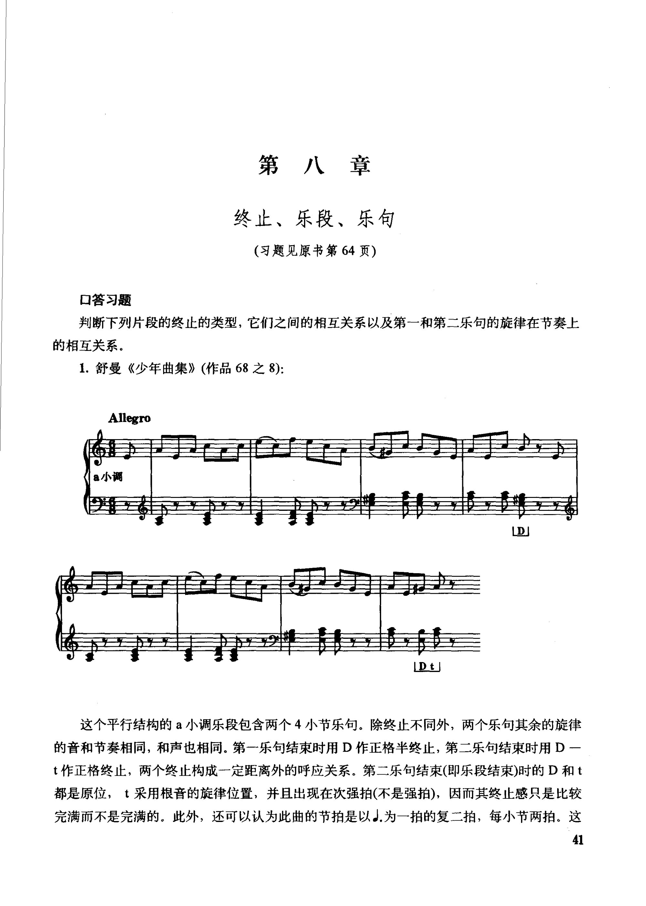

<!-- MANUAL-REFS:p0045 -->

<strong>手册使用本页</strong><ul><li id="ref-claim-cadence-phrase-pair-p0045" class="manual-ref-item" data-kind="claim">论点<a href="../和声学手册.html#claim-cadence-phrase-pair">终止式 · cadence.phrase-pair</a> 手册提炼：典型乐段由两个终止强度不同的乐句构成，常见布局为 HC→PAC/IAC 或 IAC→PAC。</li><li id="ref-profile-profile-spossbin_answers_1-p0045" class="manual-ref-item" data-kind="profile">代表页<a href="../和声学手册.html#book-profiles">教材代表页 · 斯波索宾答案上</a> 手册将本页列为《斯波索宾答案上》代表页；该书定位：上册章节配套的四声部写作范例：正/副三和弦、连接、终止、六和弦、属七、下属与导七、调式音阶和自然模进。</li></ul>

第八章 
终止、乐段、乐句 
（习题见原书第64页） 
口答习题 
判断下列片段的终止的类型，它们之间的相互关系以及第一和第二乐句的旋律在节奏上 
的相互关系。 
1.舒曼《少年曲集》（作品68之8)： 
Allegro 
a小调 
LD 
LDt 
这个平行结构的a小调乐段包含两个4小节乐句。除终止不同外，两个乐句其余的旋律 
的音和节奏相同，和声也相同。第一乐句结束时用D作正格半终止，第二乐句结束时用D一 
t作正格终止，两个终止构成一定距离外的呼应关系。第二乐句结束(即乐段结束)时的D和t 
都是原位，t采用根音的旋律位置，并且出现在次强拍(不是强拍)，因而其终止感只是比较 
完满而不是完满的。此外，还可以认为此曲的节拍是以J.为一拍的复二拍，每小节两拍。这 
41

---

<!-- PAGE:57 -->

## PDF p.57

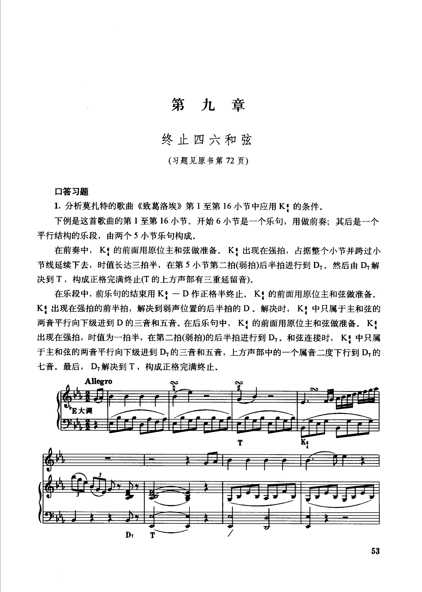

<!-- MANUAL-REFS:p0057 -->

<strong>手册使用本页</strong><ul><li id="ref-profile-profile-spossbin_answers_1-p0057" class="manual-ref-item" data-kind="profile">代表页<a href="../和声学手册.html#book-profiles">教材代表页 · 斯波索宾答案上</a> 手册将本页列为《斯波索宾答案上》代表页；该书定位：上册章节配套的四声部写作范例：正/副三和弦、连接、终止、六和弦、属七、下属与导七、调式音阶和自然模进。</li></ul>

第九章 
终止四六和弦 
（习题见原书第72页） 
口答习题 
1.分析莫扎特的歌曲《致葛洛埃》第1至第16小节中应用K：的条件。 
下例是这首歌曲的第1至第16小节。开始6小节是一个乐句，用做前奏；其后是一个 
平行结构的乐段，由两个5小节乐句构成。 
在前奏中，K：的前面用原位主和弦做准备。K：出现在强拍，占据整个小节并跨过小 
节线延续下去，时值长达三拍半，在第5小节第二拍(弱拍)后半拍进行到D。然后由D解 
决到T，构成正格完满终止(T的上方声部有三重延留音)。 
在乐段中，前乐句的结束用K：一D作正格半终止。K：的前面用原位主和弦做准备。 
K：出现在强拍的前半拍，解决到弱声位置的后半拍的D。解决时，K！中只属于主和弦的 
两音平行向下级进到D的三音和五音。在后乐句中，K的前面用原位主和弦做准备。K 
出现在强拍，时值为一拍半，在第二拍(弱拍)的后半拍进行到D。和弦连接时，K：中只属 
于主和弦的两音平行向下级进到D的三音和五音，上方声部中的一个属音二度下行到D的 
七音。最后，D解决到T，构成正格完满终止。 
Allegro 
E大调 
1 
D 
T 
53

---

<!-- PAGE:92 -->

## PDF p.92

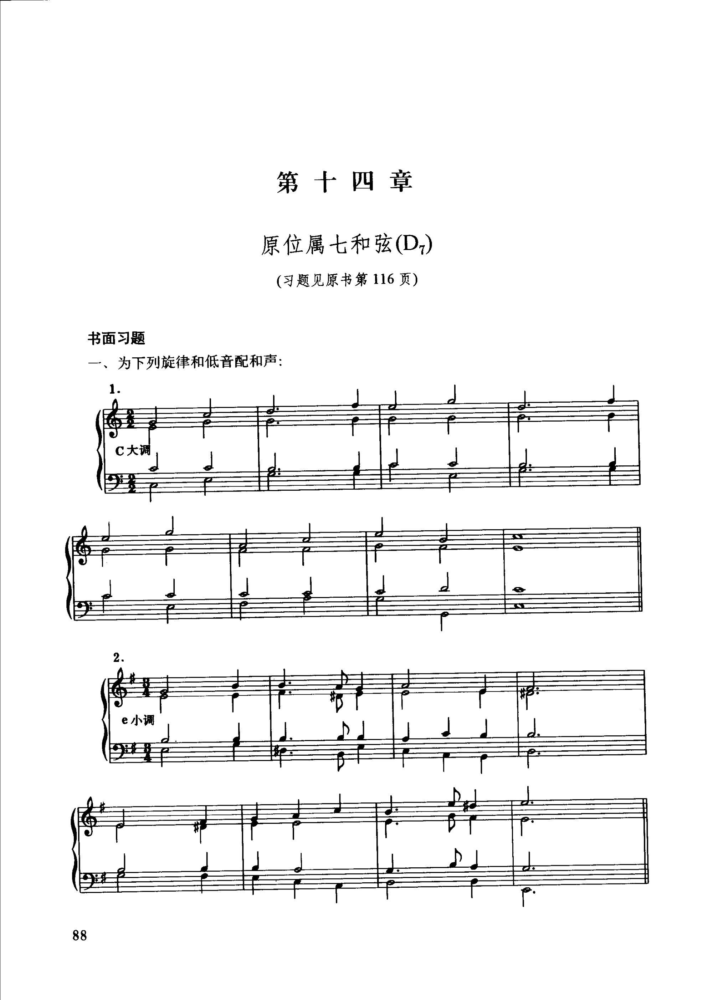

<!-- MANUAL-REFS:p0092 -->

<strong>手册使用本页</strong><ul><li id="ref-profile-profile-spossbin_answers_1-p0092" class="manual-ref-item" data-kind="profile">代表页<a href="../和声学手册.html#book-profiles">教材代表页 · 斯波索宾答案上</a> 手册将本页列为《斯波索宾答案上》代表页；该书定位：上册章节配套的四声部写作范例：正/副三和弦、连接、终止、六和弦、属七、下属与导七、调式音阶和自然模进。</li></ul>

第十四章 
原位属七和弦(D) 
(习题见原书第116页) 
书面习题 
一、为下列旋律和低音配和声： 
1. 
C大调 
e小调 
88

---

<!-- PAGE:123 -->

## PDF p.123

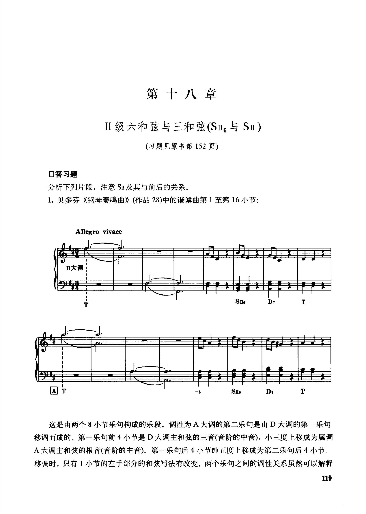

<!-- MANUAL-REFS:p0123 -->

<strong>手册使用本页</strong><ul><li id="ref-profile-profile-spossbin_answers_1-p0123" class="manual-ref-item" data-kind="profile">代表页<a href="../和声学手册.html#book-profiles">教材代表页 · 斯波索宾答案上</a> 手册将本页列为《斯波索宾答案上》代表页；该书定位：上册章节配套的四声部写作范例：正/副三和弦、连接、终止、六和弦、属七、下属与导七、调式音阶和自然模进。</li></ul>

第十八章 
ⅡI级六和弦与三和弦(SI1g与 SⅡ) 
（习题见原书第152页） 
口答习题 
分析下列片段，注意Sn及其与前后的关系。 
1.贝多芬《钢琴奏鸣曲》（作品28)中的谐谑曲第1至第16小节： 
Allegro vivace 
D大调 
Sn 
D7 
Sls 
D7 
T 
这是由两个8小节乐句构成的乐段。调性为A大调的第二乐句是由D大调的第一乐句 
移调而成的。第一乐句前4小节是D大调主和弦的三音(音阶的中音)，小三度上移成为属调 
A大调主和弦的根音(音阶的主音)。第一乐句后4小节纯五度上移成为第二乐句后4小节。 
移调时，只有1小节的左手部分的和弦写法有改变。两个乐句之间的调性关系虽然可以解释 
119

---

<!-- PAGE:160 -->

## PDF p.160

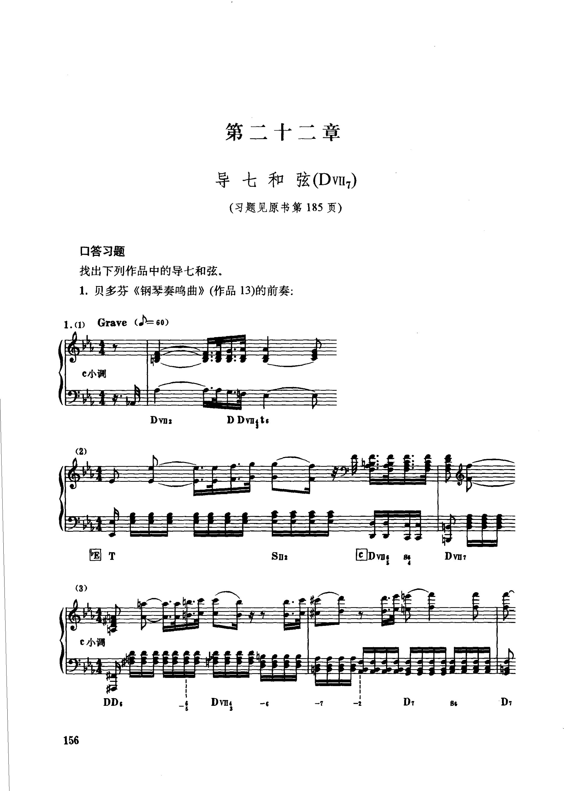

<!-- MANUAL-REFS:p0160 -->

<strong>手册使用本页</strong><ul><li id="ref-profile-profile-spossbin_answers_1-p0160" class="manual-ref-item" data-kind="profile">代表页<a href="../和声学手册.html#book-profiles">教材代表页 · 斯波索宾答案上</a> 手册将本页列为《斯波索宾答案上》代表页；该书定位：上册章节配套的四声部写作范例：正/副三和弦、连接、终止、六和弦、属七、下属与导七、调式音阶和自然模进。</li></ul>

第二十二章 
导七和弦(DvI) 
（习题见原书第185页） 
口答习题 
找出下列作品中的导七和弦。 
1.贝多芬《钢琴奏鸣曲》（作品13)的前奏: 
Grave (=60) 
1.(1) 
c小调 
D Dvmgt6 
DvI2 
回Dm 
国 T 
DvI? 
Sn: 
(3) 
c小调 
DvIy 
DD: 
D 
D 
86 
156

---

<!-- PAGE:168 -->

## PDF p.168

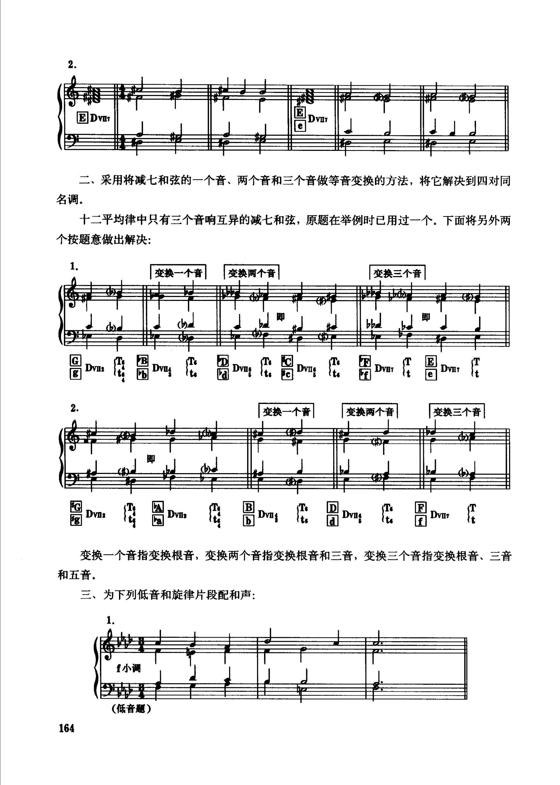

<!-- MANUAL-REFS:p0168 -->

<strong>手册使用本页</strong><ul><li id="ref-claim-diminished-seventh-four-resolutions-p0168" class="manual-ref-item" data-kind="claim">论点<a href="../和声学手册.html#claim-diminished-seventh-four-resolutions">减七和弦与等音网络 · diminished-seventh.four-resolutions</a> 手册提炼：同一减七音响可向四个方向解决，因而能通向二十四个调，是远关系转调的常用连接和弦。</li><li id="ref-claim-enharmonic-modulation-four-directions-p0168" class="manual-ref-item" data-kind="claim">论点<a href="../和声学手册.html#claim-enharmonic-modulation-four-directions">等音转调 · enharmonic-modulation.four-directions</a> 手册提炼：减七和弦可向四个方向解决；大小七和弦因等音关系有两个解决方向，但实际路线受记谱与声部进行约束。</li></ul>

2. 
榨回 
DvI1 
DvIT 
e 
二、采用将减七和弦的一个音、两个音和三个音做等音变换的方法，将它解决到四对同 
名调。 
十二平均律中只有三个音响互异的减七和弦，原题在举例时已用过一个。下面将另外两 
个按题意做出解决： 
变换一个音 
变换两个音 
变换三个音 
即 
国日 
国 
mt 
T 
D 
(T: 
Te 
T 
DVIl2 
DvI7 
DvI17 
DY4 
Dvug 
团 
Itu 
P4 
lta 
lt 
变换一个音 
变换两个音 
变换三个音 
T 
T 
Ts 
D 
Te 
DvI 
Dvn: 
Dvll: 
DvIls 
DvII7 
It 
Ite 
变换一个音指变换根音，变换两个音指变换根音和三音，变换三个音指变换根音、三音 
和五音。 
三、为下列低音和旋律片段配和声： 
1 
f小调 
（低音题) 
164

---

<!-- PAGE:204 -->

## PDF p.204

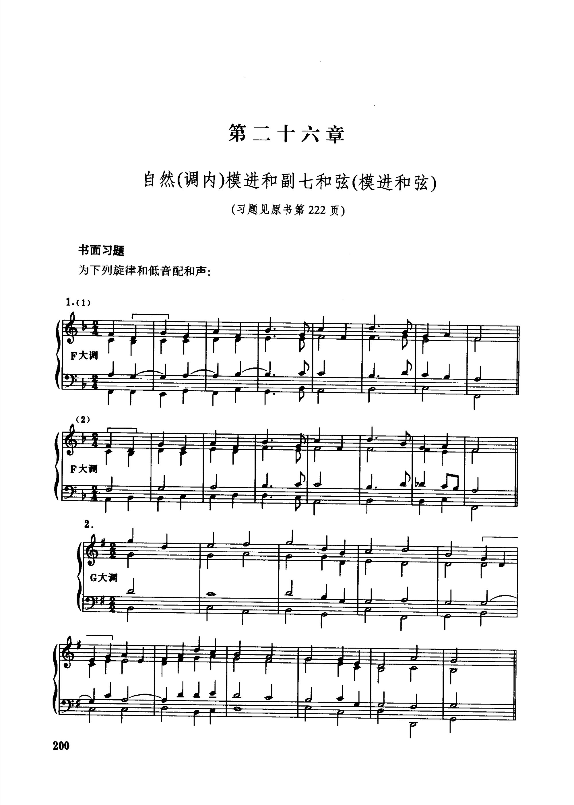

<!-- MANUAL-REFS:p0204 -->

<strong>手册使用本页</strong><ul><li id="ref-profile-profile-spossbin_answers_1-p0204" class="manual-ref-item" data-kind="profile">代表页<a href="../和声学手册.html#book-profiles">教材代表页 · 斯波索宾答案上</a> 手册将本页列为《斯波索宾答案上》代表页；该书定位：上册章节配套的四声部写作范例：正/副三和弦、连接、终止、六和弦、属七、下属与导七、调式音阶和自然模进。</li></ul>

第二十六章 
自然(调内)模进和副七和弦(模进和弦) 
（习题见原书第222页） 
书面习题 
为下列旋律和低音配和声： 
1.(1) 
F大调 
F大调 
G大调 
200

---

<!-- PAGE:218 -->

## PDF p.218

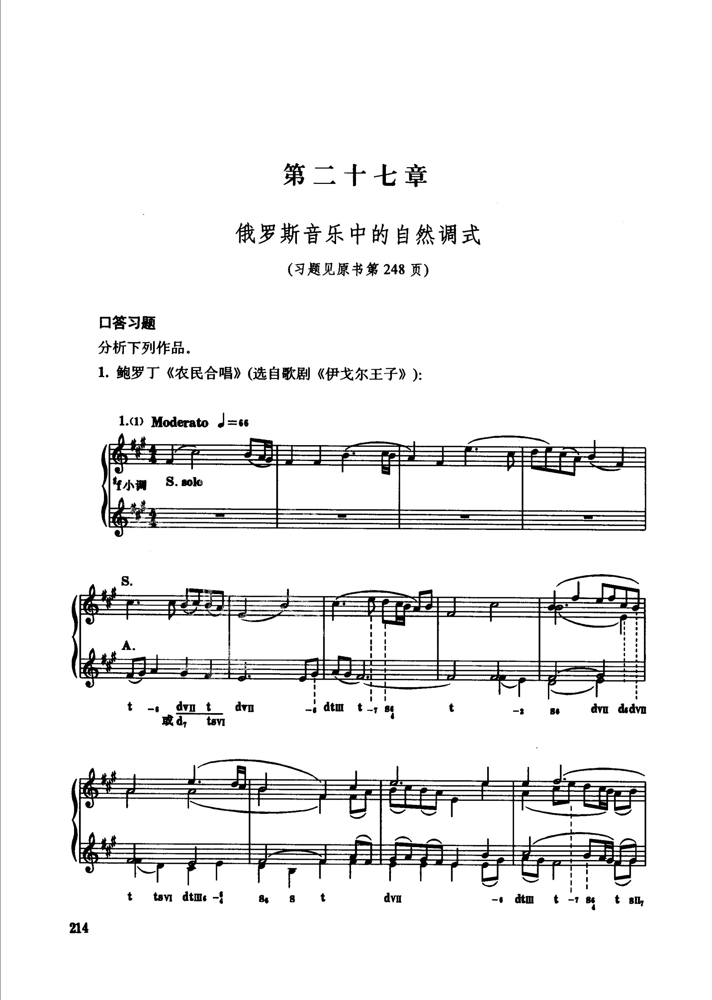

<!-- MANUAL-REFS:p0218 -->

<strong>手册使用本页</strong><ul><li id="ref-profile-profile-spossbin_answers_1-p0218" class="manual-ref-item" data-kind="profile">代表页<a href="../和声学手册.html#book-profiles">教材代表页 · 斯波索宾答案上</a> 手册将本页列为《斯波索宾答案上》代表页；该书定位：上册章节配套的四声部写作范例：正/副三和弦、连接、终止、六和弦、属七、下属与导七、调式音阶和自然模进。</li></ul>

第二十七章 
俄罗斯音乐中的自然调式 
（习题见原书第248页） 
口答习题 
分析下列作品。 
1.鲍罗丁《农民合唱》(选自歌剧《伊戈尔王子》): 
1.(1) Moderato J =66 
三1 
S. solo 
f小调 
dv t dvn 
t- 
dtm 
dvu dsdvn 
t -7 86 
86 
或d,tsv 
tsv dtme -i 
dvnl 
dtm 
t -7 B6 
tL 
8g 
8 
214

---
