# 斯波索宾和声学下册答案

> **PDF 文件**：`斯波索宾和声学下册答案.pdf`  
> **物理页数**：232（从 PDF 第 1 页起计）  
> **OCR 平均置信度**：0.986  
> **字符数**：82670

本文件收录**理论手册实际引用的 14 个 PDF 页**，每页采用整版影印 + OCR 文本。整页图保留谱例、图表、表格、边注和版面关系；OCR 只供检索与复制，具体音符、临时记号、连线和罗马数字以图像为准。被理论手册引用的条目列在图后，可直接回跳。

页码一律使用 **PDF 物理页码**，可能与书内印刷页码不同。

**快速跳页**：[p.2](#p0002) · [p.3](#p0003) · [p.12](#p0012) · [p.40](#p0040) · [p.42](#p0042) · [p.45](#p0045) · [p.63](#p0063) · [p.69](#p0069) · [p.188](#p0188) · [p.192](#p0192) · [p.201](#p0201) · [p.205](#p0205) · [p.221](#p0221) · [p.225](#p0225)

---

<!-- PAGE:2 -->

## PDF p.2

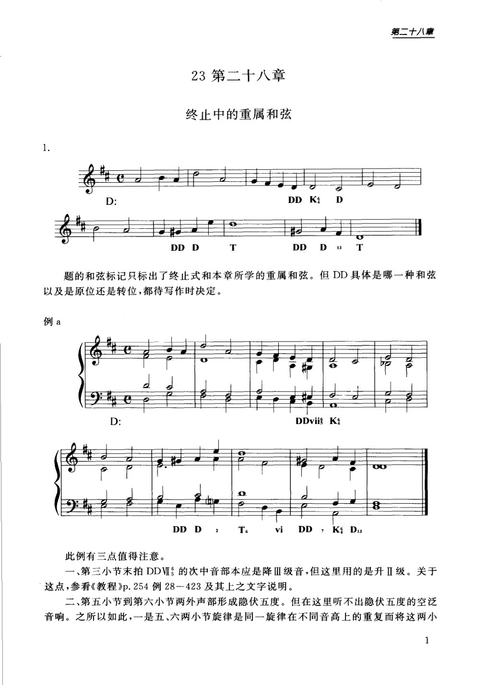

<!-- MANUAL-REFS:p0002 -->

<strong>手册使用本页</strong><ul><li id="ref-profile-profile-spossbin_answers_2-p0002" class="manual-ref-item" data-kind="profile">代表页<a href="../和声学手册.html#book-profiles">教材代表页 · 斯波索宾答案下</a> 手册将本页列为《斯波索宾答案下》代表页；该书定位：下册习题解答：重属与离调、半音体系、各级关系转调、和弦外音、持续音、变和弦与等音转调。</li></ul>

第二十八章 
23 第二十八章 
终止中的重属和弦 
D: 
DDK 
D 
DDD 
T 
DD 
D3 
T 
题的和弦标记只标出了终止式和本章所学的重属和弦。但DD具体是哪一种和弦 
以及是原位还是转位，都待写作时决定。 
例a 
D: 
DDvis K 
DDD 
T6 
vi 
DD，KD3 
此例有三点值得注意。 
一、第三小节末拍DDV的次中音部本应是降Ⅲ级音，但这里用的是升Ⅱ级。关于 
这点，参看《教程》p.254例28一423及其上之文字说明。 
二、第五小节到第六小节两外声部形成隐伏五度。但在这里听不出隐伏五度的空泛 
音响。之所以如此，一是五、六两小节旋律是同一旋律在不同音高上的重复而将这两小 
1

---

<!-- PAGE:3 -->

## PDF p.3

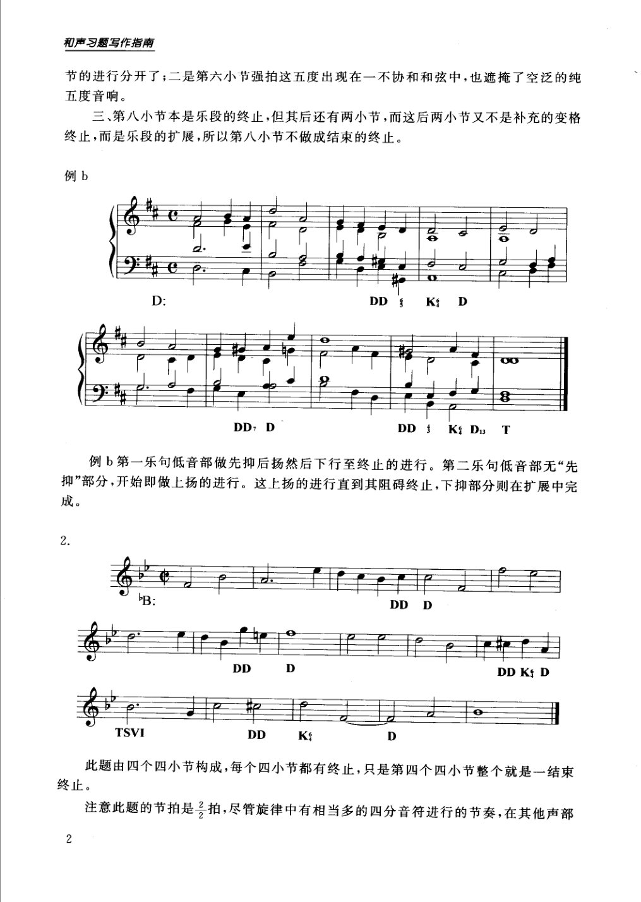

<!-- MANUAL-REFS:p0003 -->

<strong>手册使用本页</strong><ul><li id="ref-claim-prolongation-phrase-extension-p0003" class="manual-ref-item" data-kind="claim">论点<a href="../和声学手册.html#claim-prolongation-phrase-extension">延长、层次与曲式 · prolongation.phrase-extension</a> 手册提炼：终止后继续的小节若不属于补充变格终止，可视为乐段扩展；判定要看它是否继续结构过程，而不只看和弦名称。</li></ul>

和声习题写作指南 
节的进行分开了；二是第六小节强拍这五度出现在一不协和和弦中，也遮掩了空泛的纯 
五度音响。 
三、第八小节本是乐段的终止，但其后还有两小节，而这后两小节又不是补充的变格 
终止，而是乐段的扩展，所以第八小节不做成结束的终止。 
例b 
D: 
DD 
K: 
D 
8 
DDD 
DD1 
KD3T 
例b第一乐句低音部做先抑后扬然后下行至终止的进行。第二乐句低音部无“先 
抑"部分，开始即做上扬的进行。这上扬的进行直到其阻碍终止，下抑部分则在扩展中完 
成。 
DDD 
DD 
D 
DD KD 
TSVI 
DD 
K 
D 
此题由四个四小节构成，每个四小节都有终止，只是第四个四小节整个就是一结束 
终止。 
注意此题的节拍是拍，尽管旋律中有相当多的四分音符进行的节奏，在其他声部

---

<!-- PAGE:12 -->

## PDF p.12

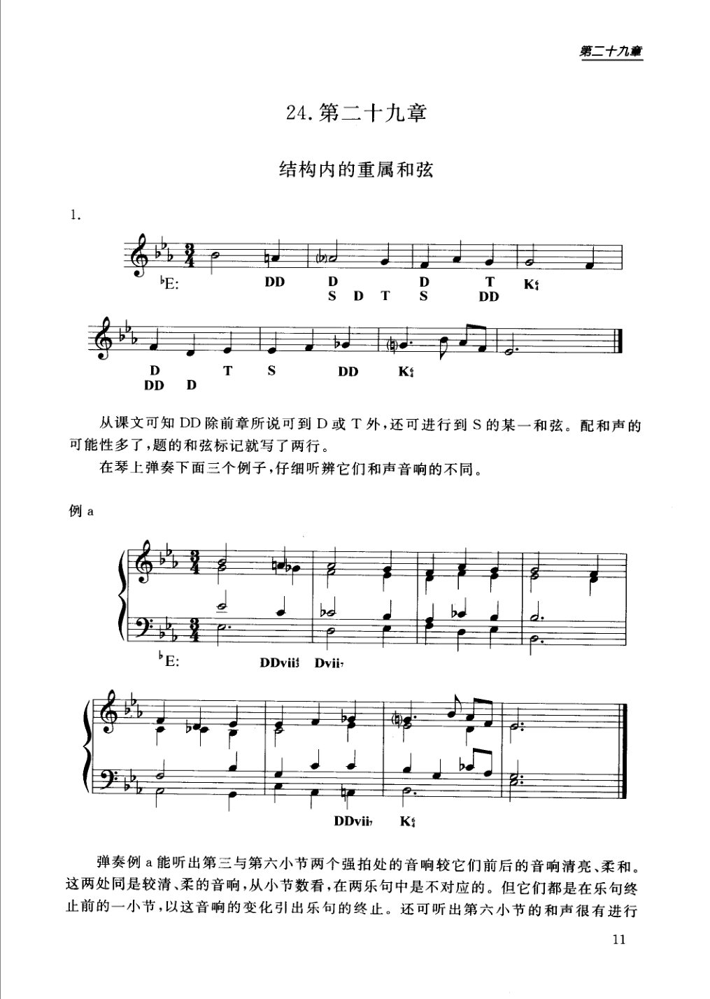

<!-- MANUAL-REFS:p0012 -->

<strong>手册使用本页</strong><ul><li id="ref-claim-secondary-dominant-dd-targets-p0012" class="manual-ref-item" data-kind="claim">论点<a href="../和声学手册.html#claim-secondary-dominant-dd-targets">副属和弦与离调 · secondary-dominant.dd-targets</a> 手册提炼：重属和弦既可解决到属和弦或主和弦，也可进入下属组和弦；其具体形态、转位与变音须由终止位置和声部进行决定。</li></ul>

第二十九章 
24.第二十九章 
结构内的重属和弦 
D 
bE: 
DD 
D 
T 
K: 
T 
S 
DD 
S 
D 
D 
T 
S 
DD 
K: 
DD 
D 
从课文可知DD除前章所说可到D或T外，还可进行到S的某一和弦。配和声的 
可能性多了，题的和弦标记就写了两行。 
在琴上弹奏下面三个例子，仔细听辨它们和声音响的不同。 
例a 
E 
DDviiDvil 
DDvii 
K: 
弹奏例a能听出第三与第六小节两个强拍处的音响较它们前后的音响清亮、柔和。 
这两处同是较清、柔的音响，从小节数看，在两乐句中是不对应的。但它们都是在乐句终 
止前的一小节，以这音响的变化引出乐句的终止。还可听出第六小节的和声很有进行 
11

---

<!-- PAGE:40 -->

## PDF p.40

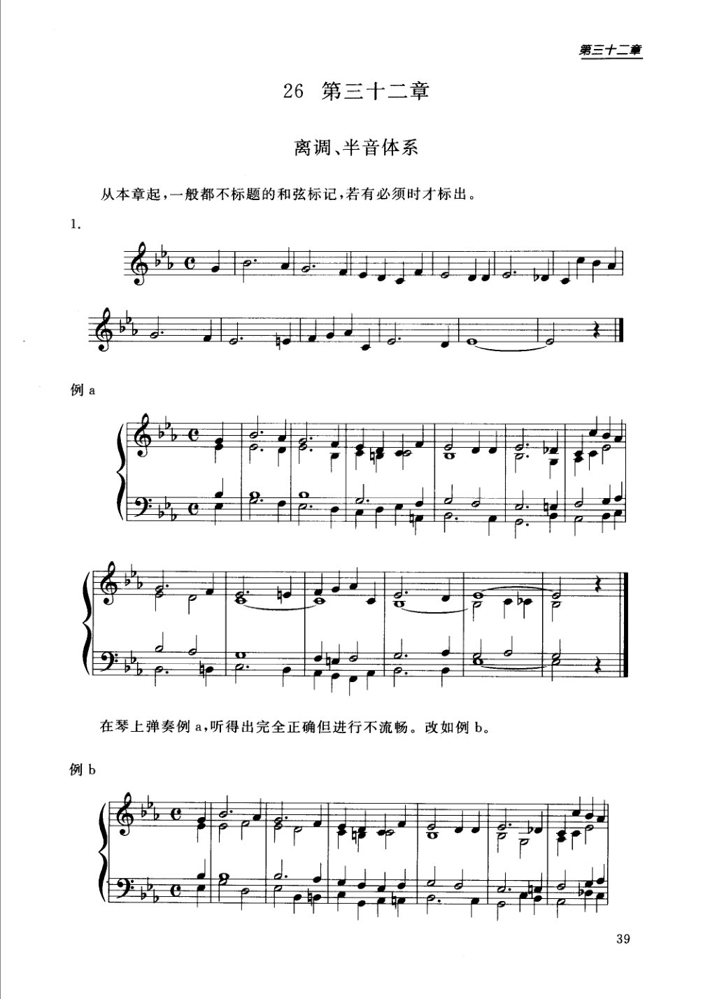

<!-- MANUAL-REFS:p0040 -->

<strong>手册使用本页</strong><ul><li id="ref-profile-profile-spossbin_answers_2-p0040" class="manual-ref-item" data-kind="profile">代表页<a href="../和声学手册.html#book-profiles">教材代表页 · 斯波索宾答案下</a> 手册将本页列为《斯波索宾答案下》代表页；该书定位：下册习题解答：重属与离调、半音体系、各级关系转调、和弦外音、持续音、变和弦与等音转调。</li></ul>

第三十二章 
26第三十二章 
离调、半音体系 
从本章起，一般都不标题的和弦标记，若有必须时才标出。 
在琴上弹奏例a,听得出完全正确但进行不流畅。改如例b。 
例b 
39

---

<!-- PAGE:42 -->

## PDF p.42

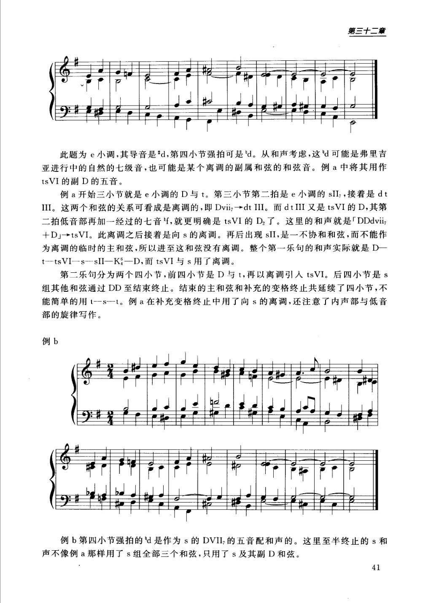

<!-- MANUAL-REFS:p0042 -->

<strong>手册使用本页</strong><ul><li id="ref-claim-tonicization-ambiguity-p0042" class="manual-ref-item" data-kind="claim">论点<a href="../和声学手册.html#claim-tonicization-ambiguity">临时主音化（离调） · tonicization.ambiguity</a> 手册提炼：同一变化音可能解释为自然调式音、副属和弦音或其他功能和弦音；判断离调必须结合前后和弦与临时主音，而不能只看单个音。</li></ul>

第三十二章 
此题为é小调，其导音是"d，第四小节强拍可是d。从和声考虑，这d可能是弗里吉 
亚进行中的自然的七级音，也可能是某个离调的副属和弦的和弦音。例a中将其用作 
tsVI的副D的五音。 
例a开始三小节就是e小调的D与t。第三小节第二拍是e小调的sII，接着是dt 
III。这两个和弦的关系可看成是离调的，即Dviiz→dtIII。而dtIII又是tsVI的D，其第 
二拍低音部再加一经过的七音f，就更明确是tsVI的D2了。这里的和声就是「DDdvi 
+DJ→tsVI。此离调之后接着是向s的离调。再后出现sII,是一不协和和弦，而不能作 
为离调的临时的主和弦，所以进至这和弦没有离调。整个第一乐句的和声实际就是D一 
ttsVI—ssII—K—D，而tsVI与s用了离调。 
第二乐句分为两个四小节，前四小节是D与t，再以离调引人tsVI。后四小节是s 
组其他和弦通过DD至结束终止。结束的主和弦和补充的变格终止共延续了四小节，不 
能简单的用1—-s一t。例a在补充变格终止中用了向s的离调，还注意了内声部与低音 
部的旋律写作。 
例b 
例b第四小节强拍的d是作为s的DVII,的五音配和声的。这里至半终止的s和 
声不像例a那样用了s组全部三个和弦，只用了s及其副D和弦。 
41

---

<!-- PAGE:45 -->

## PDF p.45

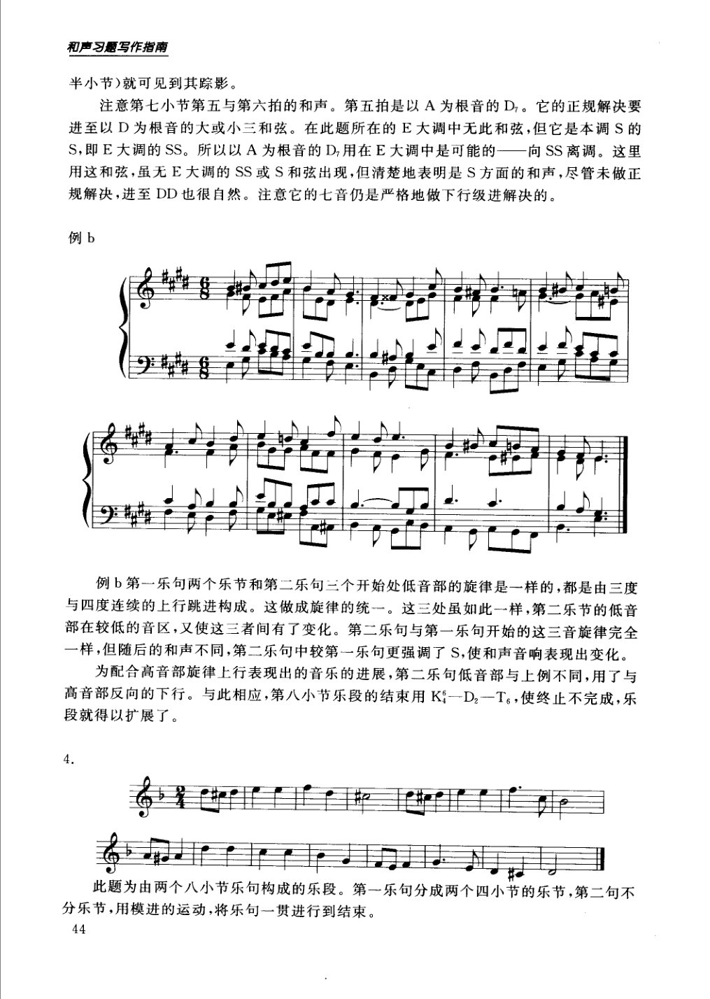

<!-- MANUAL-REFS:p0045 -->

<strong>手册使用本页</strong><ul><li id="ref-claim-dominant-v7-resolution-p0045" class="manual-ref-item" data-kind="claim">论点<a href="../和声学手册.html#claim-dominant-v7-resolution">属功能与属七解决 · dominant.v7-resolution</a> 手册提炼：属七解决的基本声部规则是导音上行到主音、七音下行到三级；外声部导音尤其应上行。</li><li id="ref-claim-seventh-general-resolution-p0045" class="manual-ref-item" data-kind="claim">论点<a href="../和声学手册.html#claim-seventh-general-resolution">七和弦、九和弦与不协和等级 · seventh.general-resolution</a> 手册提炼：七和弦是不协和和弦，需准备并按倾向解决；其七音通常下行级进，属七是最强的功能和声形态。</li></ul>

和声习磨写作指南 
半小节)就可见到其踪影。 
注意第七小节第五与第六拍的和声。第五拍是以A为根音的D。它的正规解决要 
进至以D为根音的大或小三和弦。在此题所在的E大调中无此和弦，但它是本调S的 
S,即E大调的SS。所以以A为根音的D,用在E大调中是可能的—向SS离调。这里 
用这和弦，虽无E大调的SS或S和弦出现，但清楚地表明是S方面的和声，尽管未做正 
规解决，进至DD也很自然。注意它的七音仍是严格地做下行级进解决的。 
例b 
例b第一乐句两个乐节和第二乐句三个开始处低音部的旋律是一样的，都是由三度 
与四度连续的上行跳进构成。这做成旋律的统一。这三处虽如此一样，第二乐节的低音 
部在较低的音区，又使这三者间有了变化。第二乐句与第一乐句开始的这三音旋律完全 
一样，但随后的和声不同，第二乐句中较第一乐句更强调了S，使和声音响表现出变化。 
为配合高音部旋律上行表现出的音乐的进展，第二乐句低音部与上例不同，用了与 
高音部反向的下行。与此相应，第八小节乐段的结束用K一D2一T，使终止不完成，乐 
段就得以扩展了。 
此题为由两个八小节乐句构成的乐段。第一乐句分成两个四小节的乐节，第二句不 
分乐节，用模进的运动，将乐句一贯进行到结束。 
44

---

<!-- PAGE:63 -->

## PDF p.63

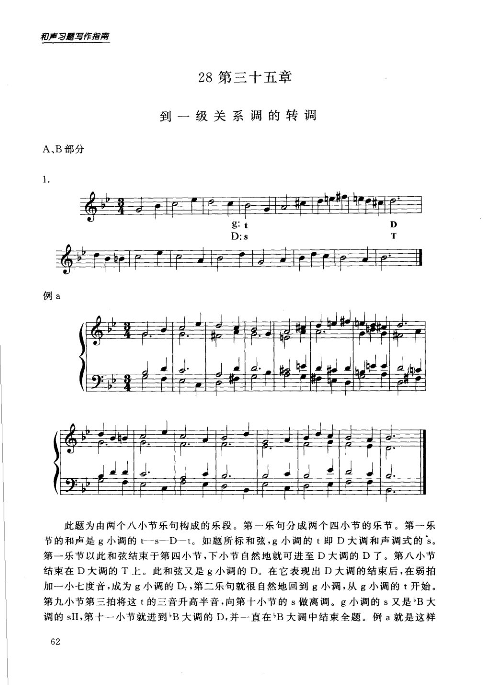

<!-- MANUAL-REFS:p0063 -->

<strong>手册使用本页</strong><ul><li id="ref-profile-profile-spossbin_answers_2-p0063" class="manual-ref-item" data-kind="profile">代表页<a href="../和声学手册.html#book-profiles">教材代表页 · 斯波索宾答案下</a> 手册将本页列为《斯波索宾答案下》代表页；该书定位：下册习题解答：重属与离调、半音体系、各级关系转调、和弦外音、持续音、变和弦与等音转调。</li></ul>

和声习题写作指南 
28 第三十五章 
到一级关系调的转调 
A、B部分 
D 
D:s 
例a 
此题为由两个八小节乐句构成的乐段。第一乐句分成两个四小节的乐节。第一乐 
节的和声是g小调的t一s—D一t。如题所标和弦，g小调的t即D大调和声调式的s。 
第一乐节以此和弦结束于第四小节，下小节自然地就可进至D大调的D了。第八小节 
结束在D大调的T上。此和弦又是g小调的D。在它表现出D大调的结束后，在弱拍 
加一小七度音，成为g小调的D,，第二乐句就很自然地回到g小调，从g小调的t开始。 
第九小节第三拍将这t的三音升高半音，向第十小节的s做离调。g小调的s又是B大 
62

---

<!-- PAGE:69 -->

## PDF p.69

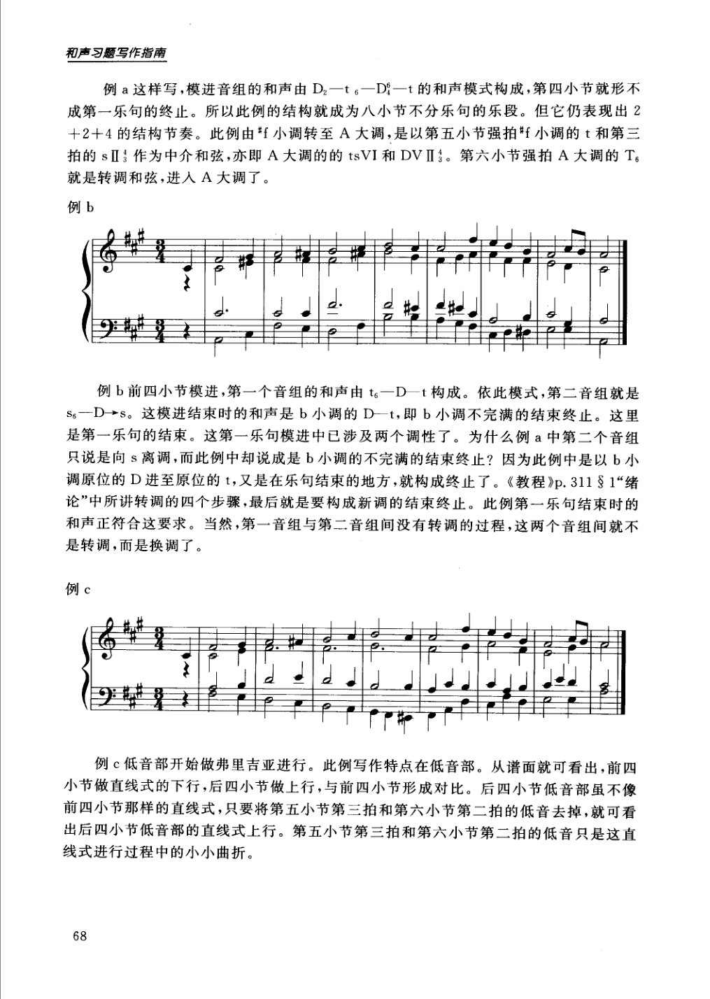

<!-- MANUAL-REFS:p0069 -->

<strong>手册使用本页</strong><ul><li id="ref-claim-modulation-confirmation-p0069" class="manual-ref-item" data-kind="claim">论点<a href="../和声学手册.html#claim-modulation-confirmation">转调体系：类型、距离与确认 · modulation.confirmation</a> 手册提炼：转调必须由新调的和声进行与终止式确认；短促强调或单一副属和弦通常只是离调。</li></ul>

和声习题写作指南 
例a这样写，模进音组的和声由D2一t6一D一t的和声模式构成，第四小节就形不 
成第一乐句的终止。所以此例的结构就成为八小节不分乐句的乐段。但它仍表现出2 
+2十4的结构节奏。此例由*f小调转至A大调，是以第五小节强拍f小调的t和第三 
拍的sⅡ作为中介和弦，亦即A大调的的tsVI和DVⅡ3。第六小节强拍A大调的T 
就是转调和弦，进人A大调了。 
例b 
例b前四小节模进，第一个音组的和声由t6一D一t构成。依此模式，第二音组就是 
S6--D→s。这模进结束时的和声是b小调的D一t,即b小调不完满的结束终止。这里 
是第一乐句的结束。这第一乐句模进中已涉及两个调性了。为什么例a中第二个音组 
只说是向s离调，而此例中却说成是b小调的不完满的结束终止？因为此例中是以b小 
调原位的D进至原位的t，又是在乐句结束的地方，就构成终止了。《教程》p.311&amp;1“绪 
论”中所讲转调的四个步骤，最后就是要构成新调的结束终止。此例第一乐句结束时的 
和声正符合这要求。当然，第一音组与第二音组间没有转调的过程，这两个音组间就不 
是转调，而是换调了。 
例c 
G 
例c低音部开始做弗里吉亚进行。此例写作特点在低音部。从谱面就可看出，前四 
小节做直线式的下行，后四小节做上行，与前四小节形成对比。后四小节低音部虽不像 
前四小节那样的直线式，只要将第五小节第三拍和第六小节第二拍的低音去掉，就可看 
出后四小节低音部的直线式上行。第五小节第三拍和第六小节第二拍的低音只是这直 
线式进行过程中的小小曲折。 
68

---

<!-- PAGE:188 -->

## PDF p.188

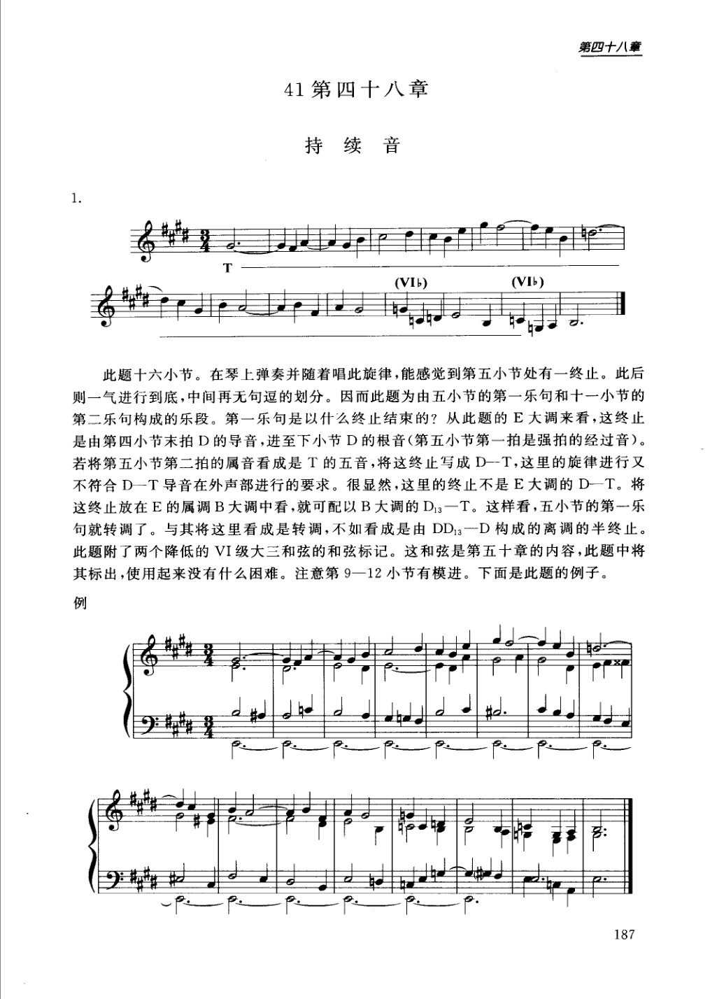

<!-- MANUAL-REFS:p0188 -->

<strong>手册使用本页</strong><ul><li id="ref-profile-profile-spossbin_answers_2-p0188" class="manual-ref-item" data-kind="profile">代表页<a href="../和声学手册.html#book-profiles">教材代表页 · 斯波索宾答案下</a> 手册将本页列为《斯波索宾答案下》代表页；该书定位：下册习题解答：重属与离调、半音体系、各级关系转调、和弦外音、持续音、变和弦与等音转调。</li></ul>

第四十八章 
41第四十八章 
持续音 
(VIb) 
(VIb) 
此题十六小节。在琴上弹奏并随着唱此旋律，能感觉到第五小节处有一终止。此后 
则一气进行到底，中间再无句逗的划分。因而此题为由五小节的第一乐句和十一小节的 
第二乐句构成的乐段。第一乐句是以什么终止结束的？从此题的E大调来看，这终止 
是由第四小节末拍D的导音，进至下小节D的根音（第五小节第一拍是强拍的经过音）。 
若将第五小节第二拍的属音看成是T的五音，将这终止写成D--T，这里的旋律进行又 
不符合D一T导音在外声部进行的要求。很显然，这里的终止不是E大调的D一T。将 
这终止放在E的属调B大调中看，就可配以B大调的D3一T。这样看，五小节的第一乐 
句就转调了。与其将这里看成是转调，不如看成是由DD3一D构成的离调的半终止。 
此题附了两个降低的VI级大三和弦的和弦标记。这和弦是第五十章的内容，此题中将 
其标出，使用起来没有什么困难。注意第9一12小节有模进。下面是此题的例子。 
例 
187

---

<!-- PAGE:192 -->

## PDF p.192

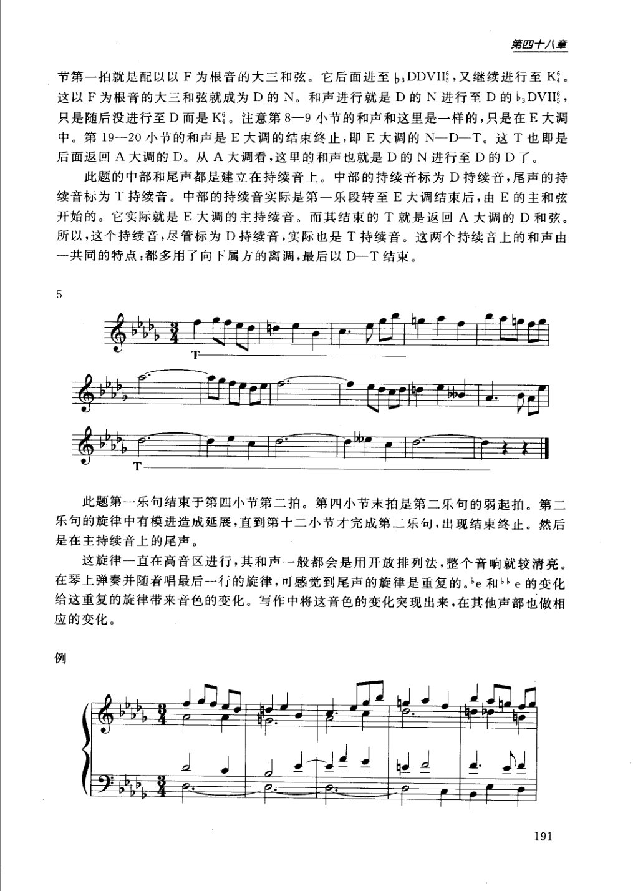

<!-- MANUAL-REFS:p0192 -->

<strong>手册使用本页</strong><ul><li id="ref-claim-prolongation-pedal-reinterpretation-p0192" class="manual-ref-item" data-kind="claim">论点<a href="../和声学手册.html#claim-prolongation-pedal-reinterpretation">延长、层次与曲式 · prolongation.pedal-reinterpretation</a> 手册提炼：持续音上的局部和声可随转调被重新解释：同一低音先作为旧调属持续音，随后可成为新调主持续音，从而延长结构过渡。</li></ul>

第四十八章 
节第一拍就是配以以F为根音的大三和弦。它后面进至bsDDVII，又继续进行至K。 
这以F为根音的大三和弦就成为D的N。 
和声进行就是D的N进行至D的bDVII， 
只是随后没进行至D而是K。注 
注意第8一9小节的和声和这里是一样的，只是在E大调 
中。第19--20小节的和声是E大调的结束终止，即E大调的N一D一T。这T也即是 
后面返回A大调的D。从A大调看，这里的和声也就是D的N进行至D的D了。 
此题的中部和尾声都是建立在持续音上。中部的持续音标为D持续音，尾声的持 
续音标为T持续音。中部的持续音实际是第一乐段转至E大调结束后，由E的主和弦 
开始的。它实际就是E大调的主持续音。而其结束的T就是返回A大调的D和弦。 
所以，这个持续音，尽管标为D持续音，实际也是T持续音。这两个持续音上的和声由 
一共同的特点：都多用了向下属方的离调，最后以D-T结束。 
此题第一乐句结束于第四小节第二拍。第四小节末拍是第二乐句的弱起拍。第二 
乐句的旋律中有模进造成延展，直到第十二小节才完成第二乐句，出现结束终止。然后 
是在主持续音上的尾声。 
这旋律一直在高音区进行，其和声一般都会是用开放排列法，整个音响就较清亮。 
在琴上弹奏并随着唱最后--行的旋律，可感觉到尾声的旋律是重复的。be和bbe的变化 
给这重复的旋律带来音色的变化。写作中将这音色的变化突现出来，在其他声部也做相 
应的变化。 
例 
191

---

<!-- PAGE:201 -->

## PDF p.201

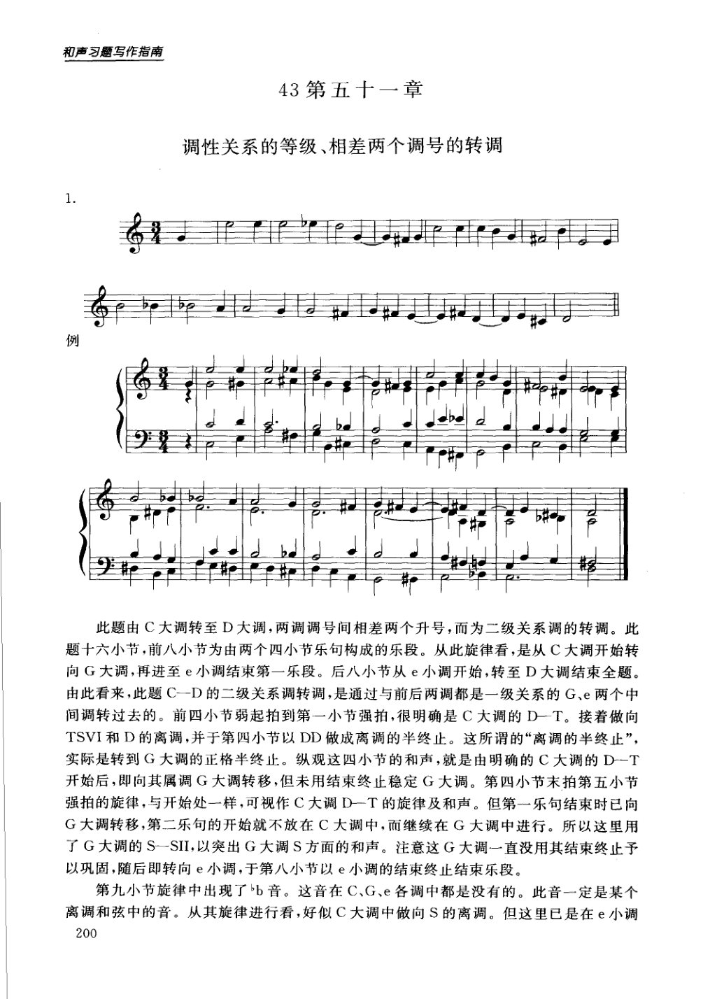

<!-- MANUAL-REFS:p0201 -->

<strong>手册使用本页</strong><ul><li id="ref-claim-modulation-intermediate-keys-p0201" class="manual-ref-item" data-kind="claim">论点<a href="../和声学手册.html#claim-modulation-intermediate-keys">转调体系：类型、距离与确认 · modulation.intermediate-keys</a> 手册提炼：相差两个调号的调可通过一个与前后两调都相邻的中间调连接；这种分段转调把远关系拆成可听的近关系步骤。</li><li id="ref-profile-profile-spossbin_answers_2-p0201" class="manual-ref-item" data-kind="profile">代表页<a href="../和声学手册.html#book-profiles">教材代表页 · 斯波索宾答案下</a> 手册将本页列为《斯波索宾答案下》代表页；该书定位：下册习题解答：重属与离调、半音体系、各级关系转调、和弦外音、持续音、变和弦与等音转调。</li></ul>

和声习题写作指南 
43第五十一章 
调性关系的等级、相差两个调号的转调 
例 
此题由C大调转至D大调，两调调号间相差两个升号，而为二级关系调的转调。此 
题十六小节，前八小节为由两个四小节乐句构成的乐段。从此旋律看，是从C大调开始转 
向G大调，再进至e小调结束第一乐段。后八小节从e小调开始，转至D大调结束全题。 
由此看来，此题C一D的二级关系调转调，是通过与前后两调都是一级关系的G、e两个中 
间调转过去的。前四小节弱起拍到第一小节强拍，很明确是C大调的D一T。接着做向 
TSVI和D的离调，并于第四小节以DD做成离调的半终止。这所谓的“离调的半终止”， 
实际是转到G大调的正格半终止。纵观这四小节的和声，就是由明确的C大调的D-T 
开始后，即向其属调G大调转移，但未用结束终止稳定G大调。第四小节末拍第五小节 
强拍的旋律，与开始处一样，可视作C大调D一T的旋律及和声。但第-一乐句结束时已向 
G大调转移，第二乐句的开始就不放在C大调中，而继续在G大调中进行。所以这里用 
了G大调的S一SII,以突出G大调S方面的和声。注意这G大调一直没用其结束终止予 
以巩固，随后即转向e小调，于第八小节以e小调的结束终止结束乐段。 
第九小节旋律中出现了b音。这音在C、G、e各调中都是没有的。此音一定是某个 
离调和弦中的音。从其旋律进行看，好似C大调中做向S的离调。但这里已是在e小调 
200

---

<!-- PAGE:205 -->

## PDF p.205

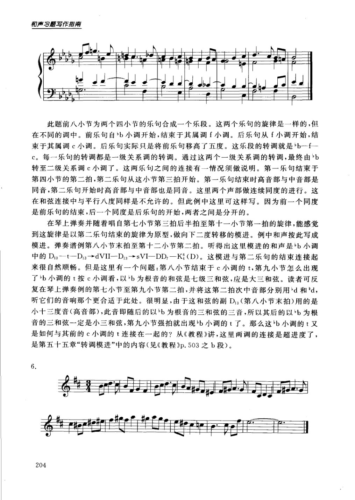

<!-- MANUAL-REFS:p0205 -->

<strong>手册使用本页</strong><ul><li id="ref-claim-sequence-modulating-p0205" class="manual-ref-item" data-kind="claim">论点<a href="../和声学手册.html#claim-sequence-modulating">模进与五度循环 · sequence.modulating</a> 手册提炼：模进可以把同一旋律或和声模式移到不同音高或调上；连续模进既推进音乐，也可作为转调或转调模进的基础。</li><li id="ref-claim-voice-leading-phrase-boundary-exception-p0205" class="manual-ref-item" data-kind="claim">论点<a href="../和声学手册.html#claim-voice-leading-phrase-boundary-exception">声部进行与不协和解决 · voice-leading.phrase-boundary-exception</a> 手册提炼：平行五、八度规则以同一连续声部进行为前提；乐句结束与下一乐句开始之间的断开可使相同音程的相邻出现成为语境例外。</li><li id="ref-profile-profile-spossbin_answers_2-p0205" class="manual-ref-item" data-kind="profile">代表页<a href="../和声学手册.html#book-profiles">教材代表页 · 斯波索宾答案下</a> 手册将本页列为《斯波索宾答案下》代表页；该书定位：下册习题解答：重属与离调、半音体系、各级关系转调、和弦外音、持续音、变和弦与等音转调。</li></ul>

和声习题写作指南 
此题前八小节为两个四小节的乐句合成一个乐段。这两个乐句的旋律是一样的，但 
在不同的调中。前乐句自b小调开始，结束于其属调f小调。后乐句从f小调开始，结 
束于其属调c小调。后乐句实际只是将前乐句移高了五度。这乐段的转调就是b一f- 
C。每一乐句的转调都是一级关系调的转调。通过这两个一级关系调的转调，最终由b 
转至二级关系调c小调了。这两乐句之间的连接有一情况须做说明。第一乐句结束于 
第四小节的第二拍，第二乐句从这小节第三拍开始。第一乐句结束时高音部与中音部是 
同音，第二乐句开始时高音部与中音部也是同音。这里两个声部做连续同度的进行。这 
在和弦连接中与平行八度同样是不允许的。但此例中这里可这样写。因为前一个同度 
是前乐句的结束，后一个同度是后乐句的开始，两者之间是分开的。 
在琴上弹奏并随着唱自第七小节第三拍后半拍至第十一小节第一拍的旋律，能感觉 
到这旋律是以第二乐句结束的旋律为原型，做向下二度转移的模进。例中和声按此写成 
模进。弹奏谱例第八小节末拍至第十二小节第二拍。听得出这里模进的和声是b小调 
中的D3—t—D3→dVII—D3→sVI-DD—K（D)。这模进与第二乐句的结束连接起 
来很自然顺畅。但是这里有一个问题：第八小节结束于c小调的t，第九小节怎么出现 
了b小调的t按c小调看，以b为根音的和弦是七级三和弦，应是大三和弦。读者可反 
听它们的音响那个更合适于此处。很明显，由于这和弦的副D（第八小节末拍）用的是 
小十三度音（高音部），此音即随后的以b为根音的三和弦的三音，所以其后的以b为根 
音的三和弦一定是小三和弦，第九小节强拍就出现b小调的t了。那么这b小调的t又 
是如何与其前的c小调的t连接在一起的？从《教程》讲，这里两调的连接是超进度了， 
是第五十五章“转调模进”中的内容（见《教程》p.503之b段）。 
6. 
204

---

<!-- PAGE:221 -->

## PDF p.221

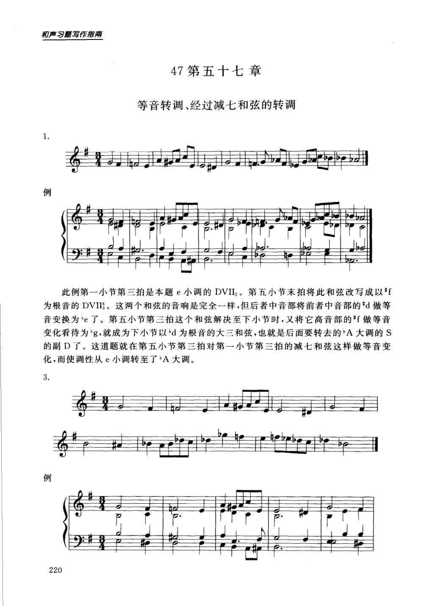

<!-- MANUAL-REFS:p0221 -->

<strong>手册使用本页</strong><ul><li id="ref-profile-profile-spossbin_answers_2-p0221" class="manual-ref-item" data-kind="profile">代表页<a href="../和声学手册.html#book-profiles">教材代表页 · 斯波索宾答案下</a> 手册将本页列为《斯波索宾答案下》代表页；该书定位：下册习题解答：重属与离调、半音体系、各级关系转调、和弦外音、持续音、变和弦与等音转调。</li></ul>

和声习题写作指南 
47第五十七章 
等音转调、经过减七和弦的转调 
例 
此例第一小节第三拍是本题e小调的DVII2。第五小节末拍将此和弦改写成以#f 
为根音的DVII。这两个和弦的音响是完全一样，但后者中音部将前者中音部的d做等 
音变换为"e了。第五小节第三拍这个和弦解决至下小节时，又将它高音部的*f做等音 
变化看待为g，就成为下小节以d为根音的大三和弦，也就是后面要转去的A大调的S 
的副D了。这道题就在第五小节第三拍对第一小节第三拍的减七和弦这样做等音变 
化，而使调性从e小调转至了A大调。 
3 
例 
220

---

<!-- PAGE:225 -->

## PDF p.225

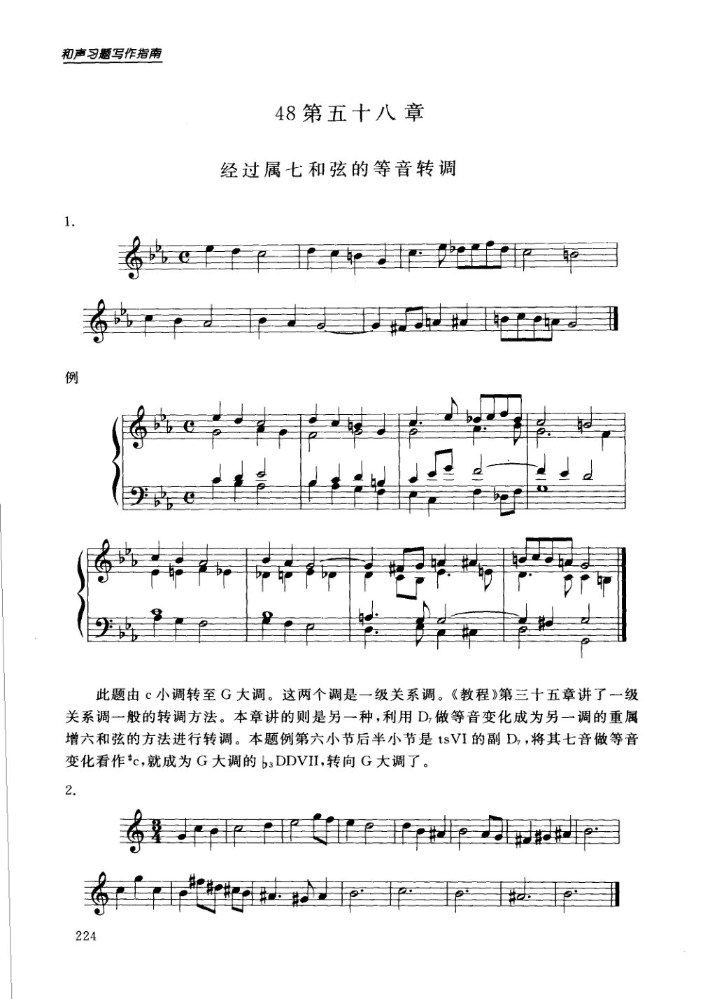

<!-- MANUAL-REFS:p0225 -->

<strong>手册使用本页</strong><ul><li id="ref-profile-profile-spossbin_answers_2-p0225" class="manual-ref-item" data-kind="profile">代表页<a href="../和声学手册.html#book-profiles">教材代表页 · 斯波索宾答案下</a> 手册将本页列为《斯波索宾答案下》代表页；该书定位：下册习题解答：重属与离调、半音体系、各级关系转调、和弦外音、持续音、变和弦与等音转调。</li></ul>

和声习题写作指南 
48第五十八章 
经过属七和弦的等音转调 
例 
此题由c小调转至G大调。这两个调是一级关系调。《教程》第三十五章讲了一级 
关系调一般的转调方法。本章讲的则是另一种，利用D做等音变化成为另一调的重属 
增六和弦的方法进行转调。本题例第六小节后半小节是tsVI的副D，将其七音做等音 
变化看作"c，就成为G大调的bDDVII,转向G大调了。 
2. 
224

---
