# 童忠良《近现代和声的功能网》

> **PDF 文件**：`童忠良《近现代和声的功能网》.pdf`  
> **物理页数**：141（从 PDF 第 1 页起计）  
> **OCR 平均置信度**：0.942  
> **字符数**：38785

本文件收录**理论手册实际引用的 13 个 PDF 页**，每页采用整版影印 + OCR 文本。整页图保留谱例、图表、表格、边注和版面关系；OCR 只供检索与复制，具体音符、临时记号、连线和罗马数字以图像为准。被理论手册引用的条目列在图后，可直接回跳。

页码一律使用 **PDF 物理页码**，可能与书内印刷页码不同。

**快速跳页**：[p.4](#p0004) · [p.5](#p0005) · [p.6](#p0006) · [p.9](#p0009) · [p.15](#p0015) · [p.16](#p0016) · [p.18](#p0018) · [p.28](#p0028) · [p.34](#p0034) · [p.95](#p0095) · [p.111](#p0111) · [p.112](#p0112) · [p.113](#p0113)

---

<!-- PAGE:4 -->

## PDF p.4

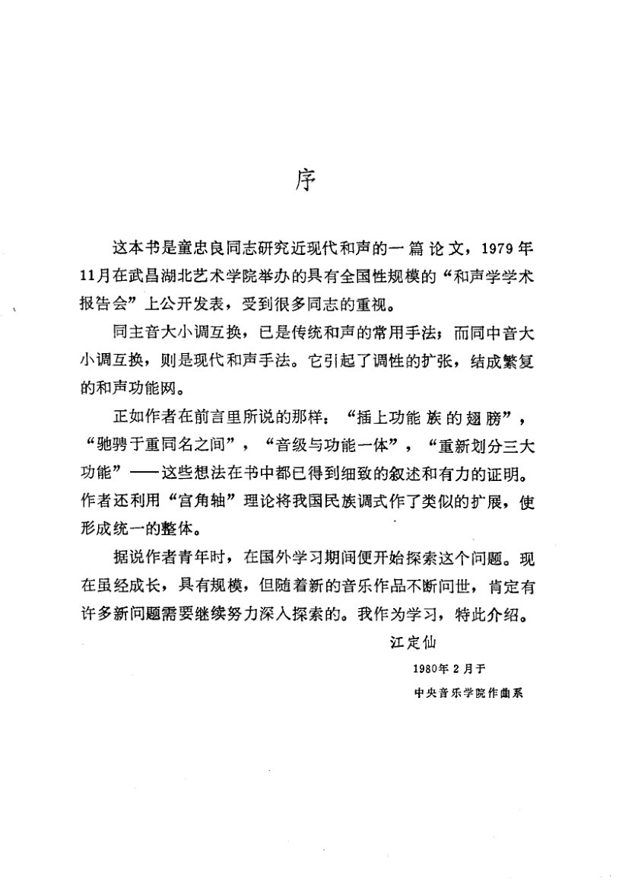

<!-- MANUAL-REFS:p0004 -->

<strong>手册使用本页</strong><ul><li id="ref-claim-function-network-medieval-expansion-p0004" class="manual-ref-item" data-kind="claim">论点<a href="../和声学手册.html#claim-function-network-medieval-expansion">功能网与功能转换 · function-network.medieval-expansion</a> 手册提炼：同主音大小调互换属于传统手法；同中音大小调互换则把调性关系扩展为功能网。</li><li id="ref-profile-profile-tong_function_net-p0004" class="manual-ref-item" data-kind="profile">代表页<a href="../和声学手册.html#book-profiles">教材代表页 · 功能网</a> 手册将本页列为《功能网》代表页；该书定位：把近现代和声功能扩展为网络：同名/同中音、功能族、重中音循环与三大功能重划。</li></ul>

序 
这本书是童忠良同志研究近现代和声的一篇论文，1979年 
11月在武昌湖北艺术学院举办的具有全国性规模的“和声学学术 
报告会”上公开发表，受到很多同志的重视。 
同主音大小调互换，已是传统和声的常用手法；而同中音大 
小调互换，则是现代和声手法。它引起了调性的扩张，结成繁复 
的和声功能网。 
正如作者在前言里所说的那样：“插上功能族的翅膀”， 
“驰骋于重同名之间”，“音级与功能一体”，“重新划分三大 
功能”—这些想法在书中都已得到细致的叙述和有力的证明。 
作者还利用“宫角轴”理论将我国民族调式作了类似的扩展，使 
形成统一的整体。 
据说作者青年时，在国外学习期间便开始探索这个问题。现 
在虽经成长，具有规模，但随着新的音乐作品不断问世，肯定有 
许多新问题需要继续努力深人探索的。我作为学习，特此介绍。 
江定仙 
1980年2月于 
中央音乐学院作曲系

---

<!-- PAGE:5 -->

## PDF p.5

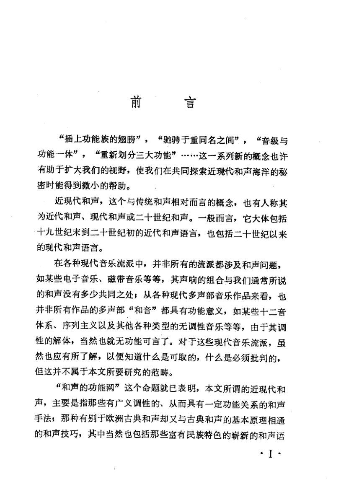

<!-- MANUAL-REFS:p0005 -->

<strong>手册使用本页</strong><ul><li id="ref-profile-profile-tong_function_net-p0005" class="manual-ref-item" data-kind="profile">代表页<a href="../和声学手册.html#book-profiles">教材代表页 · 功能网</a> 手册将本页列为《功能网》代表页；该书定位：把近现代和声功能扩展为网络：同名/同中音、功能族、重中音循环与三大功能重划。</li></ul>

前言 
“插上功能族的翅膀”，“驰骋于重同名之间”，“音级与 
功能一体”，“重新划分三大功能”…·这一系列新的概念也许 
有助于扩大我们的视野，使我们在共同探索近现代和声海洋的秘 
密时能得到微小的帮助。 
近现代和声，这个与传统和声相对而言的概念，也有人称其 
为近代和声、现代和声或二十世纪和声。一般而言，它大体包括 
十九世纪末到二十世纪初的近代和声语言，也包括二十世纪以来 
的现代和声语言。 
在各种现代音乐流派中，并非所有的流派都涉及和声问题， 
如某些电子音乐、磁带音乐等等，其声响的组合与我们通常所说 
的和声没有多少共同之处；从各种现代多声部音乐作品来看，也 
并非所有作品的多声部“和音”都具有功能意义，如某些十二音 
体系、序列主义以及其他各种类型的无调性音乐等等，由于其调 
性的解体，当然也就无功能可言了。对于这些现代音乐流派，虽 
然也应有所了解，以便知道什么是可取的，什么是必须批判的， 
但这并不属于本文所要研究的范畴。 
“和声的功能网”这个命题就已表明，本文所谓的近现代和 
声，主要是指那些有广义调性的、从而具有一定功能关系的和声 
手法；那种有别于欧洲古典和声却又与古典和声的基本原理相通 
的和声技巧，其中当然也包括那些富有民族特色的崭新的和声语 
.I·

---

<!-- PAGE:6 -->

## PDF p.6

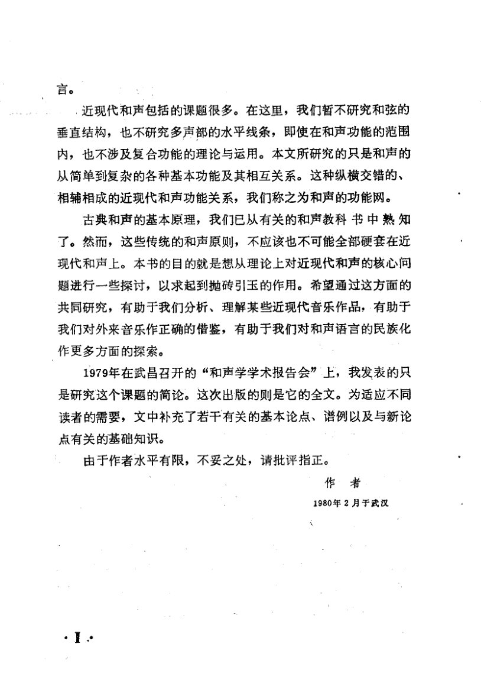

<!-- MANUAL-REFS:p0006 -->

<strong>手册使用本页</strong><ul><li id="ref-profile-profile-tong_function_net-p0006" class="manual-ref-item" data-kind="profile">代表页<a href="../和声学手册.html#book-profiles">教材代表页 · 功能网</a> 手册将本页列为《功能网》代表页；该书定位：把近现代和声功能扩展为网络：同名/同中音、功能族、重中音循环与三大功能重划。</li></ul>

言。 
.近现代和声包括的课题很多。在这里，我们暂不研究和弦的 
垂直结构，也不研究多声部的水平线条，即使在和声功能的范围 
内，也不涉及复合功能的理论与运用。本文所研究的只是和声的 
从简单到复杂的各种基本功能及其相互关系。这种纵横交错的、 
相辅相成的近现代和声功能关系，我们称之为和声的功能网。 
古典和声的基本原理，我们已从有关的和声教科书中熟知 
了。然而，这些传统的和声原则，不应该也不可能全部硬套在近 
现代和声上。本书的目的就是想从理论上对近现代和声的核心问 
题进行一些探讨，以求起到抛砖引玉的作用。希望通过这方面的 
共同研究，有助于我们分析、理解某些近现代音乐作品，有助于 
我们对外来音乐作正确的借鉴，有助于我们对和声语言的民族化 
作更多方面的探索。 
1979年在武昌召开的“和声学学术报告会”上，我发表的只 
是研究这个课题的简论。这次出版的则是它的全文。为适应不同 
读者的需要，文中补充了若干有关的基本论点、谱例以及与新论 
点有关的基础知识。 
由于作者水平有限，不妥之处，请批评指正。 
作者 
1980年2月于武汉 
.1.

---

<!-- PAGE:9 -->

## PDF p.9

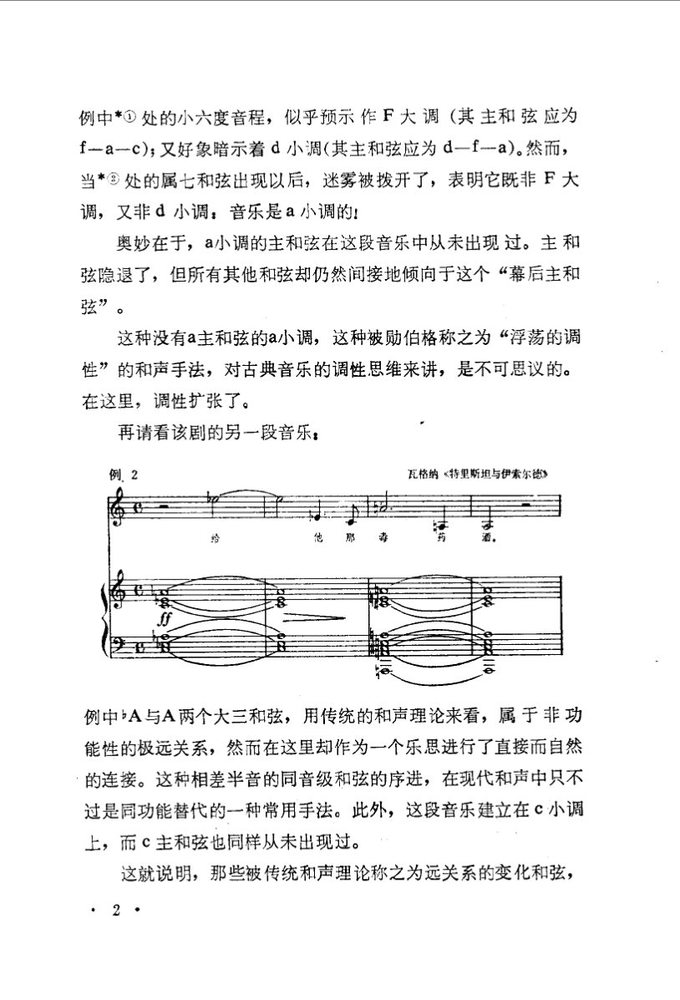

<!-- MANUAL-REFS:p0009 -->

<strong>手册使用本页</strong><ul><li id="ref-example-e05-p0009" class="manual-ref-item" data-kind="example">案例<a href="../和声学手册.html#example-e05">手册案例 E05 · 半音根音与无主和弦段落</a> 例2｜瓦格纳《特里斯坦与伊索尔德》 原书要点：降A与A两个大三和弦被直接连接；这段音乐建立在 c 小调上，但主和弦从未出现，形成“浮荡的调性”。 机制：根音相差半音的两个三和弦可直接连接；若主和弦长期缺席，属功能会成为临时参照，调中心因此不稳定。 读谱：看低音降A→A的半音进行，以及前后是否出现 c 小调主和弦；注意“没有主和弦”本身怎样制造浮荡。 用法：需要无主和弦的段落时，可用半音根音直接连接，并以属或导音暗示中心；不要补主和弦，否则中心会立即明确。</li></ul>

例中*①处的小六度音程，似乎预示作F大调（其主和弦应为 
f-a一c);又好象暗示着d小调(其主和弦应为d—f-a)。然而， 
当*处的属七和弦出现以后，迷雾被拨开了，表明它既非F大 
调，又非d小调：音乐是a小调的！ 
奥妙在于，a小调的主和弦在这段音乐中从未出现过。主和 
弦隐退了，但所有其他和弦却仍然间接地倾向于这个“幕后主和 
弦”。 
这种没有a主和弦的a小调，这种被勋伯格称之为“浮荡的调 
性”的和声手法，对古典音乐的调性思维来讲，是不可思议的。 
在这里，调性扩张了。 
再请看该剧的另一段音乐： 
例2 
瓦格纳《特里斯坦与伊索尔德》 
例中A与A两个大三和弦，用传统的和声理论来看，属于非功 
能性的极远关系，然而在这里却作为一个乐思进行了直接而自然 
的连接。这种相差半音的同音级和弦的序进，在现代和声中只不 
过是同功能替代的一种常用手法。此外，这段音乐建立在c小调 
上，而c主和弦也同样从未出现过。 
这就说明，那些被传统和声理论称之为远关系的变化和弦，

---

<!-- PAGE:15 -->

## PDF p.15

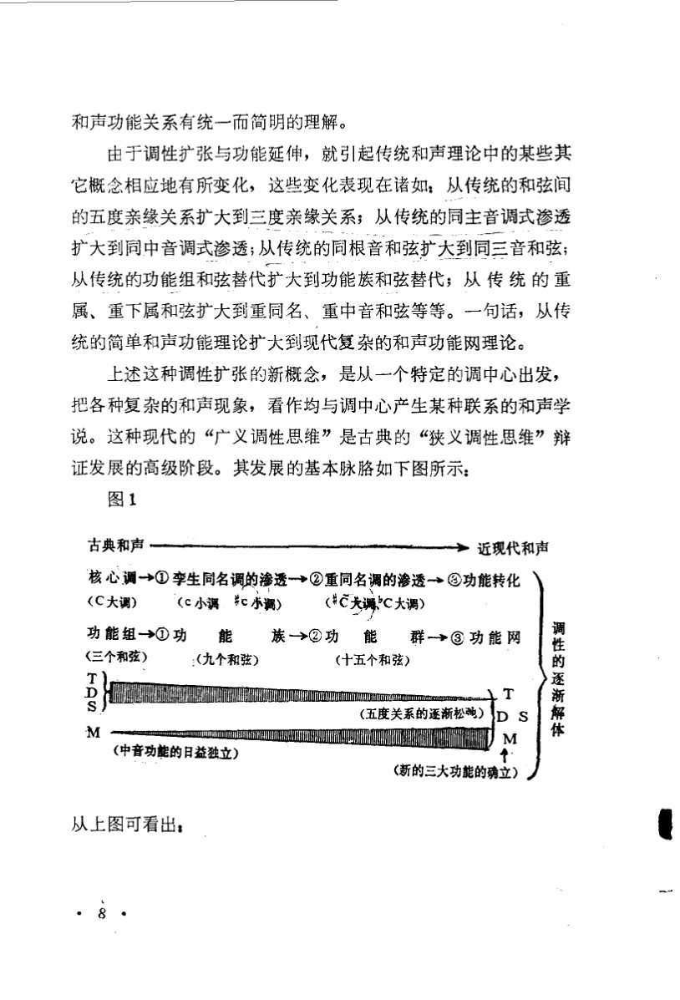

<!-- MANUAL-REFS:p0015 -->

<strong>手册使用本页</strong><ul><li id="ref-profile-profile-tong_function_net-p0015" class="manual-ref-item" data-kind="profile">代表页<a href="../和声学手册.html#book-profiles">教材代表页 · 功能网</a> 手册将本页列为《功能网》代表页；该书定位：把近现代和声功能扩展为网络：同名/同中音、功能族、重中音循环与三大功能重划。</li></ul>

和声功能关系有统一而简明的理解。 
由于调性扩张与功能延伸，就引起传统和声理论中的某些其 
它概念相应地有所变化，这些变化表现在诸如：从传统的和弦间 
的五度亲缘关系扩大到三度亲缘关系；从传统的同主音调式渗透 
扩大到同中音调式渗透；从传统的同根音和弦扩大到同三音和弦； 
从传统的功能组和弦替代扩大到功能族和弦替代；从传统的重 
属、重下属和弦扩大到重同名、重中音和弦等等。一句话，从传 
统的简单和声功能理论扩大到现代复杂的和声功能网理论。 
上述这种调性扩张的新概念，是从一个特定的调中心出发， 
把各种复杂的和声现象，看作均与调中心产生某种联系的和声学 
说。这种现代的“广义调性思维”是古典的“狭义调性思维”辩 
证发展的高级阶段。其发展的基本脉胳如下图所示： 
图1 
古典和声 
&gt;近现代和声 
核心调→①李生同名调的渗透一→②重同名调的渗透一功能转化 
(C大调） 
（c小调c小调） 
(#C关调C大调） 
功能组→①功 
能 
族→②功能群一③功能网 
调性的逐渐解体 
(三个和弦） 
：（九个和弦） 
（十五个和弦） 
T 
D 
S 
（五度关系的逐渐松融） 
D 
S 
M 
M 
（中音功能的日益独立） 
（新的三大功能的确立） 
从上图可看出：

---

<!-- PAGE:16 -->

## PDF p.16

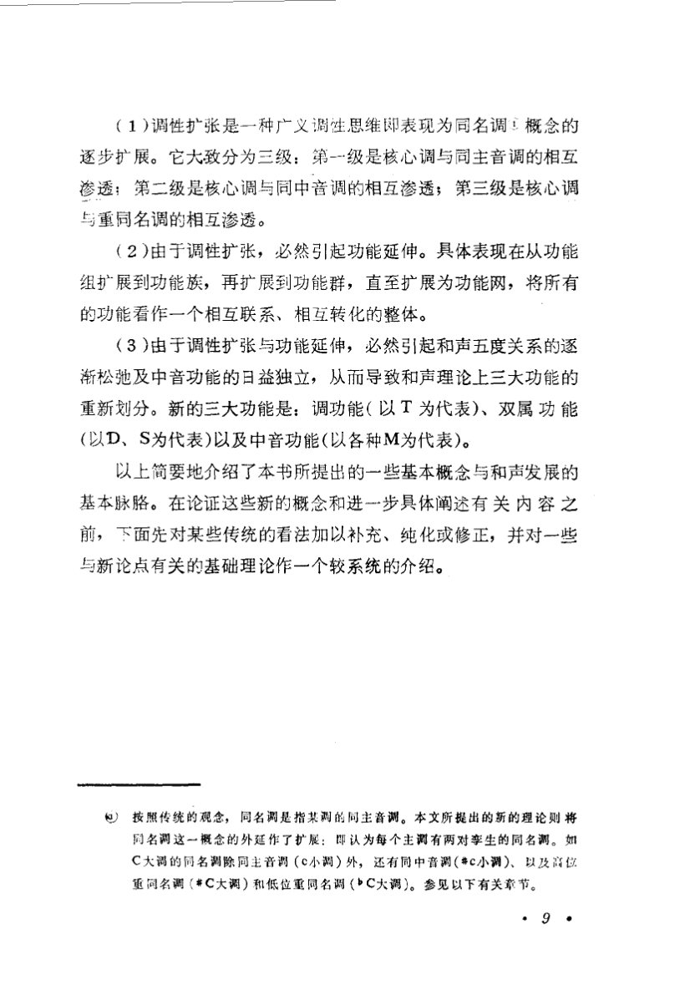

<!-- MANUAL-REFS:p0016 -->

<strong>手册使用本页</strong><ul><li id="ref-claim-function-network-three-functions-p0016" class="manual-ref-item" data-kind="claim">论点<a href="../和声学手册.html#claim-function-network-three-functions">功能网与功能转换 · function-network.three-functions</a> 手册提炼：近现代功能理论把功能重划为调功能、双属功能与中音功能三类；中音功能获得独立地位。</li><li id="ref-profile-profile-tong_function_net-p0016" class="manual-ref-item" data-kind="profile">代表页<a href="../和声学手册.html#book-profiles">教材代表页 · 功能网</a> 手册将本页列为《功能网》代表页；该书定位：把近现代和声功能扩展为网络：同名/同中音、功能族、重中音循环与三大功能重划。</li></ul>

（1）调性扩张是一种广义调性思维即表现为同名调概念的 
逐步扩展。它大致分为三级：第-级是核心调与同主音调的相互 
渗透：第二级是核心调与同中音调的相互渗透；第三级是核心调 
与重同名调的相互渗透。 
（2）由于调性扩张，必然引起功能延伸。具体表现在从功能 
组扩展到功能族，再扩展到功能群，直至扩展为功能网，将所有 
的功能看作一个相互联系、相互转化的整体。 
（3）由于调性扩张与功能延伸，必然引起和声五度关系的逐 
渐松弛及中音功能的日益独立，从而导致和声理论上三大功能的 
重新划分。新的三大功能是：调功能（以T为代表）、双属功能 
（以D、S为代表）以及中音功能（以各种M为代表）。 
以上简要地介绍了本书所提出的一些基本概念与和声发展的 
基本脉胳。在论证这些新的概念和进一步具体阐述有关内容之 
前，下面先对某些传统的看法加以补充、纯化或修正，并对一些 
与新论点有关的基础理论作一个较系统的介绍。 
）按照传统的观念，同名调是指某调的同主音调。本文所提出的新的理论则将 
同名调这一概念的外延作了扩展：即认为每个主调有两对李生的同名调。如 
C大调的同名调除同主音调（c小调）外，还有同中音调（#c小调）、以及高位 
重同名调（#C大调）和低位重同名调（bC大调）。参见以下有关章节。 
.9?

---

<!-- PAGE:18 -->

## PDF p.18

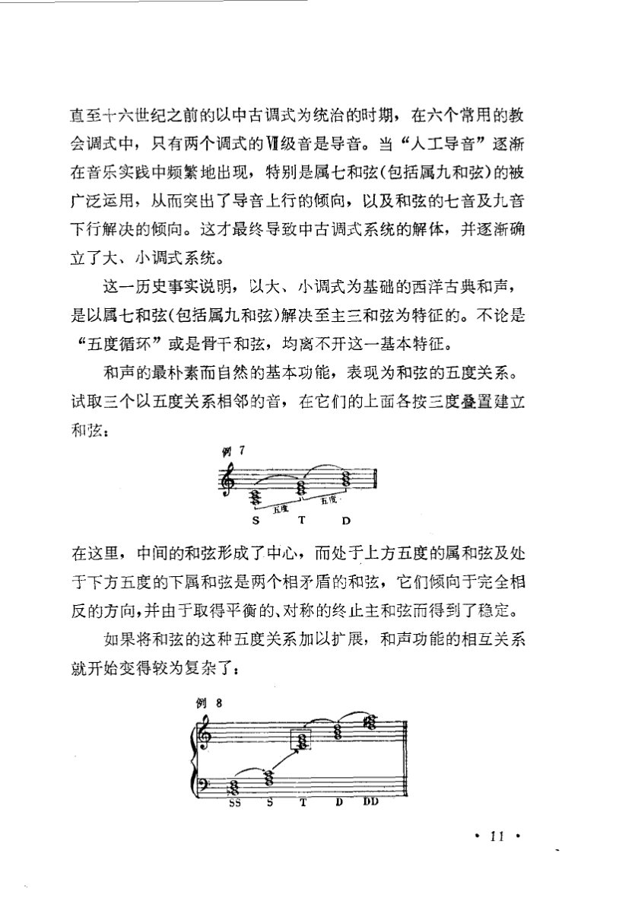

<!-- MANUAL-REFS:p0018 -->

<strong>手册使用本页</strong><ul><li id="ref-claim-voice-leading-leading-tone-p0018" class="manual-ref-item" data-kind="claim">论点<a href="../和声学手册.html#claim-voice-leading-leading-tone">声部进行与不协和解决 · voice-leading.leading-tone</a> 手册提炼：导音具有上行到主音的强烈倾向；当它位于外声部时，这一解决要求尤其严格。</li></ul>

直至十六世纪之前的以中古调式为统治的时期，在六个常用的教 
会调式中，只有两个调式的V级音是导音。当“人工导音”逐渐 
在音乐实践中频繁地出现，特别是属七和弦(包括属九和弦)的被 
广泛运用，从而突出了导音上行的倾向，以及和弦的七音及九音 
下行解决的倾向。这才最终导致中古调式系统的解体，并逐渐确 
立了大、小调式系统。 
这一历史事实说明，以大、小调式为基础的西洋古典和声， 
是以属七和弦(包括属九和弦)解决至主三和弦为特征的。不论是 
“五度循环”或是骨干和弦，均离不开这一基本特征。 
和声的最朴素而自然的基本功能，表现为和弦的五度关系。 
试取三个以五度关系相邻的音，在它们的上面各按三度叠置建立 
和弦： 
D 
在这里，中间的和弦形成了中心，而处于上方五度的属和弦及处 
于下方五度的下属和弦是两个相矛盾的和弦，它们倾向于完全相 
反的方向，并由于取得平衡的、对称的终止主和弦而得到了稳定。 
如果将和弦的这种五度关系加以扩展，和声功能的相互关系 
就开始变得较为复杂了： 
例8 
DD 
sS

---

<!-- PAGE:28 -->

## PDF p.28

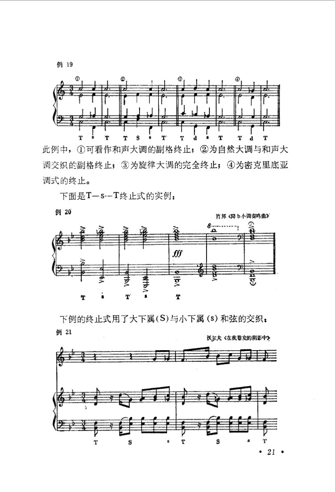

<!-- MANUAL-REFS:p0028 -->

<strong>手册使用本页</strong><ul><li id="ref-example-c07-p0028" class="manual-ref-item" data-kind="example">案例<a href="../和声学手册.html#example-c07">手册案例 C07 · T–s–T：下属回落式终止</a> 例20｜肖邦《降b小调奏鸣曲》 原书要点：此例为 T–s–T 终止式：主功能—下属功能—主功能，用变格关系完成收束。 机制：属和弦以导音和根音支持推进，下属和弦则以低音下行与主音回归收束；T–s–T 的终止力来自低音进行和功能回落。 读谱：看低音与功能和弦：T 之后是否下沉到 s，再回到同一主音；不要找 V。 用法：需要安静收束或避免强属终止时，可用 T–s–T；由下属低音下行回到主音，并以主和弦稳定结束。</li></ul>

例19 
此例中，①可看作和声大调的副格终止；②为自然大调与和声大 
调交织的副格终止；③为旋律大调的完全终止；④为密克里底亚 
调式的终止。 
下面是T-S--T终止式的实例： 
例20 
肖邦《降b小调奏鸣曲》 
Sf 
T 
下例的终止式用了大下属(S)与小下属(s)和弦的交织： 
例21 
沃尔夫《在我卷发的阴影中》

---

<!-- PAGE:34 -->

## PDF p.34

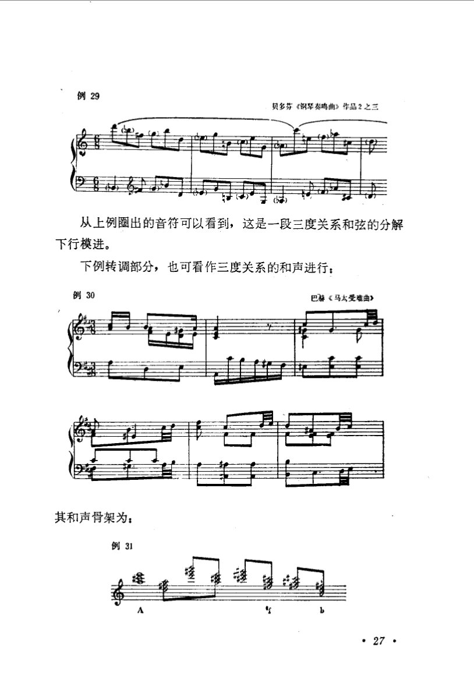

<!-- MANUAL-REFS:p0034 -->

<strong>手册使用本页</strong><ul><li id="ref-example-c08-p0034" class="manual-ref-item" data-kind="example">案例<a href="../和声学手册.html#example-c08">手册案例 C08 · 三度关系：根音落点分析</a> 例30｜巴赫《马太受难曲》 原书要点：教材把该转调片段压缩为三度关系的根音落点。 机制：把转调片段压成根音落点，可看出多个远关系和弦由三度或六度根音关系串联；表面声部运动不改变这一框架。 读谱：把每小节压成一个根音或功能和弦，忽略经过音；看这些落点是否按三度或六度排列。 用法：写色彩转调时先定两三个三度根音落点，再以半音或共同音声部连接填中间；分析时先看落点，不逐和弦贴功能标签。</li></ul>

例29 
贝多芬《钢琴奏鸣曲》作品2之三 
从上例圈出的音符可以看到，这是一段三度关系和弦的分解 
下行模进。 
下例转调部分，也可看作三度关系的和声进行： 
例30 
巴赫《马太受雄曲》 
其和声骨架为： 
例31 
锈 
塔

---

<!-- PAGE:95 -->

## PDF p.95

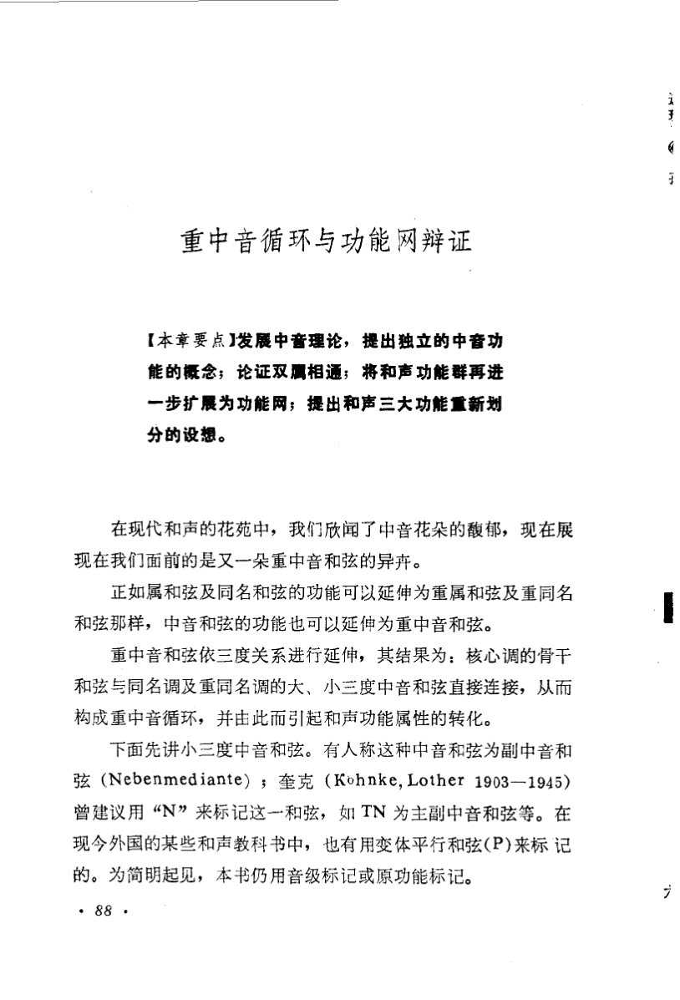

<!-- MANUAL-REFS:p0095 -->

<strong>手册使用本页</strong><ul><li id="ref-claim-function-network-mediant-cycle-p0095" class="manual-ref-item" data-kind="claim">论点<a href="../和声学手册.html#claim-function-network-mediant-cycle">功能网与功能转换 · function-network.mediant-cycle</a> 手册提炼：重中音和弦沿三度关系延伸，把核心调、同名调与重同名调的骨干和弦直接连接成循环，并改变功能属性。</li><li id="ref-profile-profile-tong_function_net-p0095" class="manual-ref-item" data-kind="profile">代表页<a href="../和声学手册.html#book-profiles">教材代表页 · 功能网</a> 手册将本页列为《功能网》代表页；该书定位：把近现代和声功能扩展为网络：同名/同中音、功能族、重中音循环与三大功能重划。</li></ul>

重中音循环与功能网辩证 
【本章要点】发展中音理论，提出独立的中音功 
能的概念；论证双属相通；将和声功能群再进 
一步扩展为功能网；提出和声三大功能重新划 
分的设想。 
在现代和声的花苑中，我们欣闻了中音花朵的馥郁，现在展 
现在我们面前的是又一朵重中音和弦的异卉。 
正如属和弦及同名和弦的功能可以延伸为重属和弦及重同名 
和弦那样，中音和弦的功能也可以延伸为重中音和弦。 
重中音和弦依三度关系进行延伸，其结果为：核心调的骨干 
和弦与同名调及重同名调的大、小三度中音和弦直接连接，从而 
构成重中音循环，并由此而引起和声功能属性的转化。 
下面先讲小三度中音和弦。有人称这种中音和弦为副中音和 
弦（Nebenmediante）；奎克（Kohnke,Lother1903—1945) 
曾建议用“N”来标记这一和弦，如TN为主副中音和弦等。在 
现今外国的某些和声教科书中，也有用变体平行和弦（P)来标记 
的。为简明起见，本书仍用音级标记或原功能标记。 
.88·

---

<!-- PAGE:111 -->

## PDF p.111

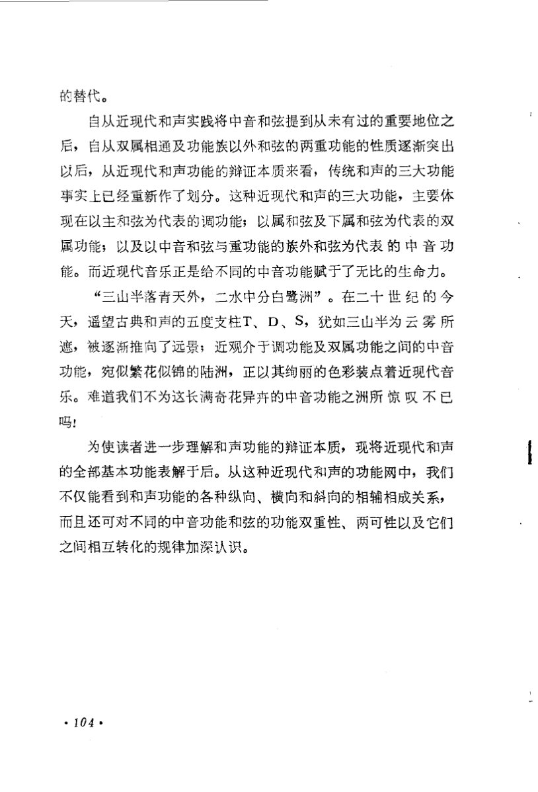

<!-- MANUAL-REFS:p0111 -->

<strong>手册使用本页</strong><ul><li id="ref-profile-profile-tong_function_net-p0111" class="manual-ref-item" data-kind="profile">代表页<a href="../和声学手册.html#book-profiles">教材代表页 · 功能网</a> 手册将本页列为《功能网》代表页；该书定位：把近现代和声功能扩展为网络：同名/同中音、功能族、重中音循环与三大功能重划。</li></ul>

的替代。 
自从近现代和声实践将中音和弦提到从未有过的重要地位之 
后，自从双属相通及功能族以外和弦的两重功能的性质逐渐突出 
以后，从近现代和声功能的辩证本质来看，传统和声的三大功能 
事实上已经重新作了划分。这种近现代和声的三大功能，主要体 
现在以主和弦为代表的调功能；以属和弦及下属和弦为代表的双 
属功能；以及以中音和弦与重功能的族外和弦为代表的中音功 
能。而近现代音乐正是给不同的中音功能赋于了无比的生命力。 
“三山半落青天外，二水中分白鹭洲”。在二十世纪的今 
天，遥望古典和声的五度支柱T、D、S，犹如三山半为云雾所 
遮，被逐渐推向了远景；近观介于调功能及双属功能之间的中音 
功能，宛似繁花似锦的陆洲，正以其绚丽的色彩装点着近现代音 
乐。难道我们不为这长满奇花异卉的中音功能之洲所惊叹不已 
吗！ 
为使读者进一步理解和声功能的辩证本质，现将近现代和声 
的全部基本功能表解于后。从这种近现代和声的功能网中，我们 
不仅能看到和声功能的各种纵向、横向和斜向的相辅相成关系， 
而且还可对不同的中音功能和弦的功能双重性、两可性以及它们 
之间相互转化的规律加深认识。 
·104·

---

<!-- PAGE:112 -->

## PDF p.112

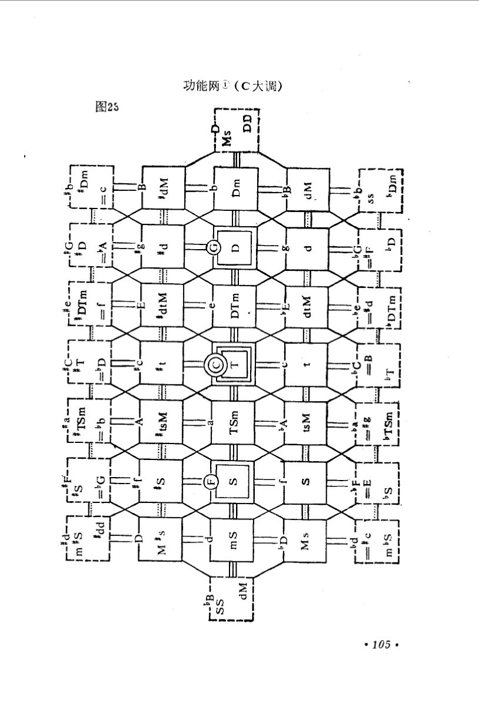

<!-- MANUAL-REFS:p0112 -->

<strong>手册使用本页</strong><ul><li id="ref-profile-profile-tong_function_net-p0112" class="manual-ref-item" data-kind="profile">代表页<a href="../和声学手册.html#book-profiles">教材代表页 · 功能网</a> 手册将本页列为《功能网》代表页；该书定位：把近现代和声功能扩展为网络：同名/同中音、功能族、重中音循环与三大功能重划。</li></ul>

功能网(C大调) 
图23 
DD 
Ms 
#Dm 
NP 
Dm 
dM 
q~ 
SS 
I 
期 
D 
V 
P# 
? 
D 
D 
P 
DTm 
WIP 
DTm 
dtM 
B 
D 
ISm 
NS 
TSm 
tsM 
TSm 
#1 
ba 
S# 
山 
PP 
一P- 
S#N 
m#s 
su 
Ms 
D 
Sq 
日 
dM 
84- 
ss 
·105·

---

<!-- PAGE:113 -->

## PDF p.113

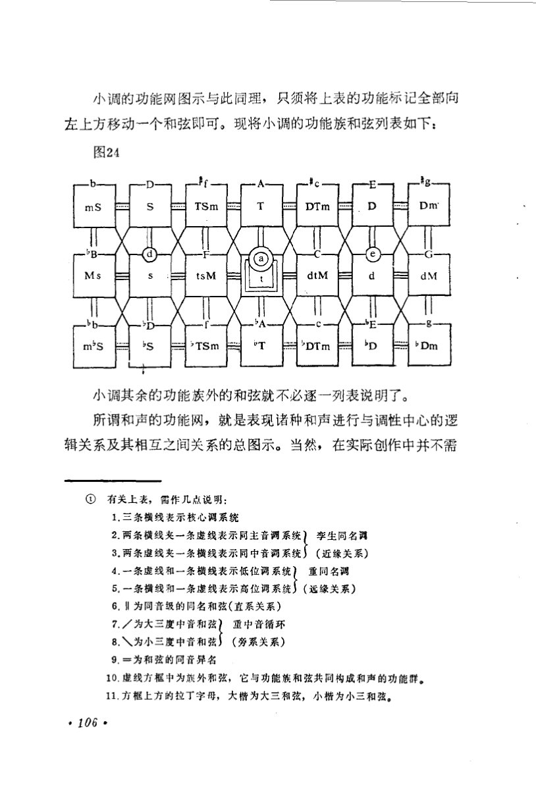

<!-- MANUAL-REFS:p0113 -->

<strong>手册使用本页</strong><ul><li id="ref-claim-function-network-definition-p0113" class="manual-ref-item" data-kind="claim">论点<a href="../和声学手册.html#claim-function-network-definition">功能网与功能转换 · function-network.definition</a> 手册提炼：功能网是诸种和声进行与调性中心之间的逻辑关系及其相互关系的总图，而非单一和弦的功能标签。</li><li id="ref-profile-profile-tong_function_net-p0113" class="manual-ref-item" data-kind="profile">代表页<a href="../和声学手册.html#book-profiles">教材代表页 · 功能网</a> 手册将本页列为《功能网》代表页；该书定位：把近现代和声功能扩展为网络：同名/同中音、功能族、重中音循环与三大功能重划。</li></ul>

小调的功能网图示与此同理，只须将上表的功能标记全部向 
左上方移动一个和弦即可。现将小调的功能族和弦列表如下： 
图24 
mS 
S 
TSm 
DTm 
D 
Dm 
T 
d 
B 
Ms 
S 
tsM 
dtM 
d 
dM 
bb 
A 
C 
E 
D 
m*S 
S 
TSm 
"T 
'DTm 
'D 
Dm 
小调其余的功能族外的和弦就不必逐一一列表说明了。 
所谓和声的功能网，就是表现诸种和声进行与调性中心的逻 
辑关系及其相互之间关系的总图示。当然，在实际创作中并不需 
①有关上表，需作几点说明： 
1.三条横线表示核心调系统 
2.两条横线夹一条虚线表示同主音调系统】李生同名调 
3.两条虚线夹一条横线表示同中音调系统）（近缘关系） 
4.一条虚线和一条横线表示低位调系统）重同名调 
5.一条横线和一条虚线表示高位调系统）（远缘关系） 
6.Ⅱ为同音级的同名和弦（直系关系） 
7./为大三度中音和弦》重中音循环 
8.丶为小三度中音和弦）（旁系关系） 
9.=为和弦的同音异名 
10.虚线方框中为族外和弦，它与功能族和弦共同构成和声的功能群。 
11.方框上方的拉丁字母，大楷为大三和弦，小楷为小三和弦。 
·106·

---
