# 和声学理论体系与离线推演手册

> 本手册以 15 本独立和声教材（16 个 PDF，其中基泽勒两种扫描本经逐页比对为同一版本）为语料，共 5427 页。引用一律使用 **PDF 物理页码**，从 PDF 第 1 页开始计数；它与书内印刷页码可能不同。网页程序位于 `../app/index.html`，可离线运行。

教材可按页查阅：[十六册教材逐页影印与 OCR 文本](books/index.html)。本手册中的教材页码均可点击，直接跳到对应教材页。

手册里的教材链接指向该页的具体引文条目；同一页若有多条依据，各有独立锚点。点击“PDF p.X”会落到“手册使用本页”里的对应原文位置，不再只停在页顶。

被本手册引用的教材页会在整页图后列出“手册使用本页”，其中包括论点提炼、案例的原书要点与机制、阶段依据和正文引用，并可回跳到手册中的对应条目。

本手册不逐章复述教材，只保留三件事：每个阶段改变了哪些音高关系；每条复杂技法依赖哪些音程、声部与功能条件；每个判断能回到哪一页原文。

> 时间少时只读两处：`0.3 八条硬原理`与`1.3 历史阶段`。其余章节按写作或分析任务查阅，不必按教材章节顺序从头读。

## 0. 先读：这套体系回答什么

和声学要回答五个相互约束的问题：

1. **材料是什么**：音高、音程、音阶、和弦如何拼写与分类？
2. **纵向如何成立**：哪些音可以叠置，协和/不协和如何分级？
3. **横向如何连接**：低音、外声部、内声部怎样运动，倾向音怎样解决？
4. **局部如何成句**：功能、终止、模进、离调如何组织乐句？
5. **整体如何成篇**：转调、延长、曲式与调性布局如何形成结构？

> 前置乐理只保留一个“三和弦与七和弦（前置速查）”节点，用于说明后续功能、声部与转调所引用的最小材料；谱号、音名读法、节拍、记谱法等基础教学不在本手册展开。

程序把这五个问题落实为五个页面：**推演台**负责材料与连接，**转调**负责调性移动，**和弦库**负责库存与功能，**集合实验室**负责后调性运算，**理论地图**负责知识先后关系。手册则给出理论解释、应用策略、先修顺序和页码证据。

### 0.1 三类结论必须分开

- **教材直接规则**：有明确页码与原文支持，例如“七音通常下行”“平行纯五、纯八需要避免”。
- **体系性推论**：由多条规则合成，例如“某个调式和弦适合做色彩连接”。这类结论会标明“推论”或“建议”。
- **程序启发式**：由评分函数给出，例如“下一步首选 V7”。它只表示在既定权重下较稳、较顺或较有功能指向，不构成唯一正确答案。

### 0.2 阅读符号

- `T / S / D`：主功能、下属功能、属功能；`C`：色彩或中心不稳定。
- `V7/x`：以 x 为临时主和弦的副属七和弦。
- `♭II6`：拿波里六和弦；`It+6 / Fr+6 / Ger+6`：意大利、法国、德国增六和弦。
- `p.`：PDF 物理页码；`p.32–34` 表示连续页范围。

### 0.3 八条硬原理

每条只保留可检查的因果关系。技术术语按和声学常用含义使用；遇到作品中的具体音响，仍要回到声部、低音、节拍位置和原书原文复核。

<!-- ANCHOR:visual-principles -->
| # | 原理 | 可检验的机制 | 直接操作 | 原文 |
| --- | --- | --- | --- | --- |
| 1 | 音程与拼写共同决定关系 | 音程由音级数和半音数确定。同一键盘音可写成不同音名，因此同一音响可能对应不同解决方向；等音重释必须同时改变记谱与功能。 | 先算半音数，再写音名；遇到增六、属七、减七，先问它要解决到哪个音。 | [柴可夫斯基 p.8](books/tchaikovsky_guide.html#ref-claim-interval-inversion-p0008) · [《概述》p.433](books/tonal_20c_overview.html#ref-claim-enharmonic-modulation-definition-p0433) |
| 2 | 三和弦与七和弦由叠置音决定 | 根音、三音、五音按三度叠置；三音决定大、小、减、增的性质，七音增加不协和并给出解决方向。 | 先定根音与三音；省略或重复时，检查性质音和倾向音是否仍然保留。 | [柴可夫斯基 p.14](books/tchaikovsky_guide.html#ref-claim-triad-construction-p0014) |
| 3 | 倾向音按半音与声部方向解决 | 自然大调与和声小调中，导音到主音是小二度；属七的三音上行到主音、七音下行到主和弦三音，三全音向内或向外收束。 | 先画 7→1 与 4→3，再填内声部；外声部优先保留这两条线。 | [柴可夫斯基 p.46](books/tchaikovsky_guide.html#ref-claim-dominant-v7-resolution-p0046) · [《概述》p.230](books/tonal_20c_overview.html#ref-claim-dominant-tritone-resolution-p0230) |
| 4 | 功能由调内关系与上下文决定 | T、S、D 由主音、属音、下属音、共同音和倾向音形成；同一个音集换一个调中心，级数与功能就会改变。 | 先写调中心、级数、共同音与目标终止，再给和弦贴功能标签。 | [柴可夫斯基 p.15](books/tchaikovsky_guide.html#ref-claim-diatonic-tonic-subdominant-dominant-p0015) · [桑桐教程 p.34](books/sangtong_tutorial.html#ref-claim-diatonic-function-sequence-p0034) |
| 5 | 声部进行是可行域约束 | 传统四声部写作中，平行纯五、纯八使两个声部保持相同音程，会削弱独立性；导音、七音、外声部与低音方向共同限定可行连接。 | 先定外声部与倾向音，再填内声部；平行五八、声部交叉、过大跳进要单独检查。 | [《概述》p.103](books/tonal_20c_overview.html#ref-claim-voice-leading-parallels-p0103) · [柴可夫斯基 p.25](books/tchaikovsky_guide.html#ref-claim-voice-leading-leading-tone-p0025) |
| 6 | 离调与转调按确认范围区分 | 副属只把某一和弦临时主音化；转调要让新调通过新导音、属—主、终止或持续音得到确认。 | 看新调导音是否出现、停留多久、是否有确认终止；只出现一个副属时不要标成转调。 | [《概述》p.273](books/tonal_20c_overview.html#ref-claim-secondary-dominant-definition-p0273) · [《概述》p.316](books/tonal_20c_overview.html#ref-claim-pivot-common-chord-p0316) |
| 7 | 半音扩张依靠变化音与等音重释 | 变化音增加局部导音关系；增六度的两个外音向外扩到八度，减七和弦可等音重写并向多个方向解决。 | 找变化音的半音去向；遇到等音重释，同时核对记谱、根音与新调解决目标。 | [《概述》p.402](books/tonal_20c_overview.html#ref-claim-augmented-sixth-definition-p0402) · [柴可夫斯基 p.109](books/tchaikovsky_guide.html#ref-claim-diminished-seventh-enharmonic-p0109) |
| 8 | 没有功能中心时，结构由不变量承担 | 调性功能可以取消；音程集合、移位与倒影、对称结构、序列顺序、音区、节奏和音色仍能形成可分析的关系。 | 先截段，算集合、原型与音程向量，找重复和变换；不要强行套罗马数字。 | [《概述》p.539](books/tonal_20c_overview.html#ref-claim-set-theory-normal-form-p0539) · [《概述》p.536](books/tonal_20c_overview.html#ref-claim-atonal-definition-p0536) |

适用范围：1–3 在三阶段都成立；4–6 主要描述调性语法；7 是调性扩张的核心手段；8 用于功能中心减弱后的音乐。任何一条都要由具体声部、低音、节拍位置和作品风格复核。

## 1. 总体系：原理—操作—应用—先修/后续

### 1.1 六个层级

<!-- ANCHOR:visual-levels -->
| 层级 | 核心问题 | 主要内容 | 典型输出 |
| --- | --- | --- | --- |
| L0 材料 | 有哪些音与和弦？ | 音高、音程、拼写、音阶、三/七和弦 | 可命名的和弦库存 |
| L1 语法 | 如何连接并收束？ | 功能、声部进行、转位、七和弦、终止 | 可听辨的乐句 |
| L2 半音扩展 | 如何增加倾向与色彩？ | 副属、离调、交替、拿波里、增六、减七、模进 | 局部张力与色彩 |
| L3 调性移动 | 如何更换中心？ | 共同和弦、远近关系、直接/等音/色彩转调 | 新调的确立 |
| L4 后调性 | 没有中心时如何组织？ | 对称音阶、集合、无调性、十二音、整体序列 | 非功能性的音高结构 |
| L5 结构 | 如何控制整首作品？ | 持续音、延长、奏鸣原则、调性布局 | 曲式与叙事 |

每个节点都按四个问题描述：**原理**（为什么成立）、**操作**（怎样做）、**应用**（何时使用）、**先修/后续**（需要先会什么、之后能做什么）。下表由程序中的 28 个节点直接生成，避免手册与网页地图不一致。

<!-- ANCHOR:visual-theory -->
<!-- AUTO:NODES:START -->
| 层 | 节点 | 先修 | 后续 | 一句话原理 | 操作 | 应用 |
| --- | --- | --- | --- | --- | --- | --- |
| L0 | 音程、音高集合与音名拼写 (`interval`) | 无 | 调式、音阶与音级、三和弦与七和弦（前置速查） | 和声分析以音与音之间的音程关系为最小单位；同一音集在不同等音记谱下可能承担不同功能。 | 用半音数计算音程；区分音级距离与音响距离；用音名拼写保留功能线索（如增六度 vs 小七度） | 等音转调；增六和弦记谱；集合论音程向量 |
| L0 | 调式、音阶与音级 (`scale`) | 音程、音高集合与音名拼写 | 自然音级功能：T–S–D、同主音调式交替（借用和弦）、音级集合与集合类 | 调式由“主音 + 音程结构 + 特征音”确定；音阶决定各级和弦质量、倾向与可用材料。 | 从主音和音程结构生成七级音；比较同主音调式的特征音差；判断旋律/和弦的调式归属 | 调式写作；同主音交替；五声/布鲁斯/对称音阶 |
| L0 | 三和弦与七和弦（前置速查） (`triad`) | 音程、音高集合与音名拼写、调式、音阶与音级 | 自然音级功能：T–S–D、声部进行与不协和解决 | 三度叠置产生三和弦；加入七度产生七和弦。和弦的性质由根音、三音、五音、七音的音程决定。 | 识别大/小/减/增三和弦；识别属七/大七/小七/半减七/减七；判断转位与低音 | 所有后续和声材料 |
| L1 | 自然音级功能：T–S–D (`diatonic`) | 三和弦与七和弦（前置速查）、调式、音阶与音级 | 终止式、副属和弦与离调、转调体系：类型、距离与确认 | 调内和弦按根音功能分为主（T）、下属（S）、属（D）三组；功能描述和弦在当前调中心中的倾向角色，同一和弦可因上下文改变功能。 | 给每个音级和弦标功能；用 T→S→D→T 组织进行；用功能替代（vi 代 I、ii 代 IV）扩展 | 功能进行；终止式；曲式层级 |
| L1 | 属功能与属七解决 (`dominant`) | 自然音级功能：T–S–D、声部进行与不协和解决 | 终止式、副属和弦与离调、转调体系：类型、距离与确认、三全音替代 | 属和弦的导音（scale degree 7）上行到主音，属七的七音下行到三级；两个倾向音构成三全音，解决时向内/向外收缩，产生最强的调性确认。 | V→I、V7→I；导音上行、七音下行；属七转位与省略五音；用 V7 的解决方向判断调中心 | 正格终止；副属和弦；转调后的新调确认；三全音替代 |
| L1 | 声部进行与不协和解决 (`voiceLeading`) | 三和弦与七和弦（前置速查） | 属功能与属七解决、中介和弦与转调、色彩中介 | 和声连接的本质是各声部的独立进行；优先共同音、级进、避免平行五八度，倾向音按解决方向移动。 | 找共同音；计算各声部半音移动总和；检查平行五/八度、隐伏五/八度；处理导音、七音、增六度 | 四部和声写作；和弦连接评分；转调连接 |
| L1 | 转位、低音与和声节奏 (`inversion`) | 三和弦与七和弦（前置速查）、声部进行与不协和解决 | 终止式、延长、层次与曲式 | 低音决定和弦的听觉重心与功能强度；转位削弱根音支持，使和弦更适合经过、延长与连接。 | 识别 6、6/4、7 和弦转位；用 I6 延长主功能；用 V6/4 作为经过/辅助；用低音线组织进行 | 低音线写作；终止四六；和声节奏 |
| L1 | 七和弦、九和弦与不协和等级 (`seventh`) | 三和弦与七和弦（前置速查）、声部进行与不协和解决 | 属功能与属七解决、副属和弦与离调、爵士和声 | 七度增加不协和与方向性；属七的三全音最强，减七的对称性最强，大七/小七更偏色彩。 | 按七音解决方向连接；用七和弦替换三和弦；处理九音/十一音的省略与解决 | ii–V–I；副属七；减七转调；爵士延伸音 |
| L1 | 终止式 (`cadence`) | 自然音级功能：T–S–D、属功能与属七解决 | 曲式中的和声策略、转调体系：类型、距离与确认 | 终止式是“功能张力 + 节拍/旋律位置 + 低音”共同形成的收束；同样的 V–I 在不同位置有不同强度。 | 区分完满/不完满/半/变格/阻碍终止；用终止式划分乐句；用终止式确认新调 | 乐段结构；转调确认；曲式分析 |
| L2 | 模进与五度循环 (`sequence`) | 自然音级功能：T–S–D、声部进行与不协和解决 | 转调体系：类型、距离与确认、延长、层次与曲式 | 同一音型在不同音级重复，形成局部功能链；五度下行循环是最自然的模进基础。 | 构建可移位单元；按二度/三度/五度移位；用模进离开原调 | 展开部；连接段；爵士 turnaround |
| L2 | 副属和弦与离调 (`secondaryDominant`) | 属功能与属七解决、自然音级功能：T–S–D | 临时主音化（离调）、转调体系：类型、距离与确认 | 把任一调内和弦临时当作“主”，在它前面插入其属和弦（V/x）或导音和弦（vii°/x），形成局部 tonicization；离调不改变全局调中心。 | 为 ii、iii、IV、V、vi 配 V/x；用 vii°7/x 替代 V/x；解决到目标和弦后继续原调 | 装饰终止；扩展乐句；转调预备 |
| L2 | 临时主音化（离调） (`tonicization`) | 副属和弦与离调 | 转调体系：类型、距离与确认、半音化与变化和弦 | 离调是“短暂地把某音级当主”，通过副属—目标、持续低音或旋律强调建立；与转调的区别在持续时间与终止确认。 | 用 V/x–x 建立临时中心；用持续音/重复巩固；用新调终止式升级为转调 | 副属链；半音化低音；奏鸣曲过渡 |
| L2 | 同主音调式交替（借用和弦） (`modalInterchange`) | 调式、音阶与音级、自然音级功能：T–S–D | 色彩和声与调式色彩、调式转调 | 保持主音，从同主音的其他调式借用和弦；其核心是三度、六度或七度的改变，并由此获得新的和弦质量。 | 从平行小调借 i、iv、♭VI、♭VII、♭III；从平行大调借 I、IV、V；用特征音建立调式色彩 | 流行/摇滚；电影配乐；浪漫主义色彩 |
| L2 | 拿波里和弦（♭II） (`neapolitan`) | 同主音调式交替（借用和弦）、属功能与属七解决 | 转调体系：类型、距离与确认、半音化与变化和弦 | ♭II 是大调/小调中降低二级的大三和弦，常以第一转位出现；其 ♭2 级半音下行到主音/导音，♭6 级下行到属音，形成强烈的下属—属倾向。 | ♭II6→V；♭II6→I6/4→V；用 ♭II 作为远关系桥梁 | 小调戏剧性；模进；转调 |
| L2 | 增六和弦 (`aug6`) | 七和弦、九和弦与不协和等级、声部进行与不协和解决 | 等音转调、半音化与变化和弦 | 增六度（♭6 与 ♯4）向外扩张到八度（5 与 5），因此强烈导向属和弦；意/法/德三种增六和弦区别在中间音。 | It+6：♭6–1–♯4；Fr+6：♭6–1–2–♯4；Ger+6：♭6–1–♭3–♯4；解决到 V；Ger+6 可等音为 V7/♭II | 半音化和声；远关系转调；浪漫主义终止 |
| L2 | 减七和弦与等音网络 (`dim7`) | 七和弦、九和弦与不协和等级、属功能与属七解决 | 等音转调、半音化与变化和弦 | 减七由三个小三度叠置，对称且只有三种转位；同一音响可属于四个调，是等音转调最灵活的连接和弦。 | vii°7→I；vii°7/x→x；等音改写任一首级转调；用共同减七连接远关系调 | 远关系转调；半音化经过；电影/戏剧 |
| L2 | 半音化与变化和弦 (`chromaticism`) | 副属和弦与离调、同主音调式交替（借用和弦） | 色彩和声与调式色彩、后调性 | 半音化的判据是变化音具有明确的声部倾向与功能角色；变化和弦必须能被解决或重释。 | 副属/副导七；借用和弦；增六/拿波里；半音经过与邻音 | 浪漫主义和声；爵士重配；电影配乐 |
| L3 | 中介和弦与转调 (`pivot`) | 副属和弦与离调、声部进行与不协和解决、终止式 | 转调体系：类型、距离与确认、曲式中的和声策略 | 转调是旧调功能逐渐失效、新调功能逐渐确立的过程；中介和弦为两调共有，同一音集在旧调与新调中承担不同功能，重释后再由新调终止确认。 | 找两调共同和弦；选择功能差异大的中介；接新调 V–I 确认；用终止式巩固 | 近关系转调；奏鸣曲展开部；流行桥段 |
| L3 | 转调体系：类型、距离与确认 (`modulation`) | 中介和弦与转调、属功能与属七解决、终止式 | 曲式中的和声策略、作品分析 | 转调距离由音集重合度、共同和弦数、主音关系共同决定；转调成功与否取决于新调属—主是否被终止式确认。 | 判断近/远关系；选择中介/直接/等音/色彩转调；用新调 V–I 确认；用持续音/模进巩固 | 曲式展开；段落对比；电影转场 |
| L3 | 等音转调 (`enharmonicModulation`) | 增六和弦、减七和弦与等音网络、转调体系：类型、距离与确认 | 半音化与变化和弦、后调性 | 同一十二平均律音响可对应不同记谱与功能；等音转调通过“改记谱”把旧和弦变成新调的属/导和弦。 | Ger+6 = V7/♭II；减七等音重释；属七=增六；用等音音程改写后解决 | 远关系转调；浪漫主义；爵士三全音替代 |
| L3 | 色彩和声与调式色彩 (`colorHarmony`) | 同主音调式交替（借用和弦）、声部进行与不协和解决 | 后调性、电影配乐 | 当功能张力减弱，和弦的“色彩”由音程结构、调式特征音、密度、音区与音色共同决定；色彩连接可以替代功能进行。 | 用特征音标记调式色彩；用三度/二度根音关系连接；用持续音/固定音型保持统一；用音区/配器强化色彩 | 印象主义；电影配乐；流行编曲 |
| L3 | 功能网与功能转换 (`functionNetwork`) | 自然音级功能：T–S–D、半音化与变化和弦 | 后调性、作品分析 | 把和弦视为功能网络中的节点，连接权重由共同音、根音关系、倾向音与历史用法决定；功能可转换、可重叠、可网络化。 | 建立 T/S/D 功能分组；用共同音连接功能组；用网络权重评估进行；处理双功能/功能重叠 | 近现代和声分析；和声重配；风格模拟 |
| L4 | 音级集合与集合类 (`setTheory`) | 音程、音高集合与音名拼写 | 无调性与自由音高组织、十二音序列与序列和声 | 无调性音乐用无序音高集合而非调内音级来组织；集合的移位、倒影、互补与音程向量描述其结构关系。 | 求原型/常态/基本形；计算音程向量；找补集与 Z 关系；比较集合相似性 | 无调性分析；动机统一；音高组织 |
| L4 | 对称音阶与有限移位 (`symmetry`) | 音级集合与集合类、调式、音阶与音级 | 后调性、色彩和声与调式色彩 | 全音阶、八声音阶、增三/减七和弦具有移位对称性；对称性削弱调性中心，产生“悬浮/循环”音响。 | 识别有限移位模式；用对称和弦连接；用中心音/中心和弦组织 | 印象主义；电影悬疑；爵士 altered scale |
| L4 | 无调性与自由音高组织 (`atonal`) | 音级集合与集合类、半音化与变化和弦 | 十二音序列与序列和声、作品分析 | 无调性用音程细胞、集合关系、音区、节奏与音色组织音高，调性功能不再承担结构作用。 | 找动机音集；追踪移位/倒影；用集合相似性分段；用音区/密度组织张力 | 第二维也纳乐派；自由无调性；现代配乐 |
| L4 | 十二音序列与序列和声 (`serialism`) | 无调性与自由音高组织、音级集合与集合类 | 后调性、作品分析 | 十二音序列把十二个音级组织成有序集合；和声由序列分段、同时陈述与组合关系产生，而非调内功能。 | 构造 P/R/I/RI 矩阵；选择和声分区；用组合关系连接；处理序列中的三和弦/集合 | 勋伯格/贝尔格/韦伯恩；整体序列；现代作曲 |
| L5 | 延长、层次与曲式 (`prolongation`) | 终止式、中介和弦与转调、模进与五度循环 | 作品分析、曲式中的和声策略 | 表面和弦延长深层的功能关系；分析要区分结构和弦与装饰和弦，并把和声节奏与曲式层级对应。 | 找结构低音/结构终止；标记延长与装饰；分析和声节奏；把局部进行映射到曲式 | 奏鸣曲式；浪漫主义作品；贝多芬分析 |
| L5 | 曲式中的和声策略 (`form`) | 延长、层次与曲式、转调体系：类型、距离与确认 | 作品分析 | 曲式通过调性布局、终止式分布与材料重复来组织；和声策略随段落功能变化（呈示/展开/再现/尾声）。 | 画调性布局图；标终止式；找转调连接点；比较再现调性回归 | 奏鸣曲式；三部性；流行曲式 |
<!-- AUTO:NODES:END -->

### 1.2 先修关系由依赖决定

先修关系表示“理解后一个节点所需的最小知识”，不等于教材章节顺序。例如：

- 学副属和弦之前，必须先理解属功能与“导音—主音”的倾向；否则只会背 `V/V` 符号。
- 学转调之前，必须会找共同和弦并辨认终止；否则“离调”和“转调”会混为一谈。
- 学增六之前，应掌握七和弦与半音倾向；增六和弦以 ♭6 与 ♯4 向外扩张到属音，是强化属前导向的变和弦。
- 学集合论之前，只需音程与音级等价；但若没有听觉分组，集合名与音程向量会退化为算术。

### 1.3 历史阶段：古典—浪漫—现代

历史分期与知识先修图是两套坐标。**先修关系**回答“要学会后一项，最少需要先懂什么”；**历史阶段**回答“和声语法增加了哪些可控变量，又保留了什么约束”。同一个节点可以跨阶段存在，例如属七解决在古典语法中定型，在浪漫派与爵士中继续变形；增六、减七在共同实践中已有原型，到 19 世纪才成为远关系与等音网络的核心。

下面按“新增的可控变量”分三段，不按年份一刀切。19 世纪至 20 世纪中叶允许重叠；同一作品可以同时使用多个阶段的语法。

<!-- ANCHOR:visual-periods -->
<!-- AUTO:PERIODS:START -->
| 历史阶段 | 大致时间 | 新增的可控变量 | 和声结果 | 未改变的条件 |
| --- | --- | --- | --- | --- |
| 古典与共同实践 `commonPractice` | 约 1600–1820 | 自然音级与三/七和弦库存；T–S–D 功能进行；终止式与近关系转调；四声部写作规范 | 中心与收束稳定；半音从属于功能；和弦身份可由级数与低音判断 | 音程与倾向音；声部独立性；不协和需要处理 |
| 浪漫主义与调性扩张 `expandedTonality` | 约 1820–1945 | 同主音调式交替；拿波里、增六、减七；等音重释与远关系转调；色彩和声与功能网 | 可连接更远的和弦；新调确认可被推迟；中心仍可由低音、属主与终止识别 | 半音解决方向；外声部与低音方向；终止的确认作用 |
| 现代与后调性 `modernPostTonal` | 约 1900 至今 | 全音/八声音阶；音级集合与不变量；无调性与十二音；复合和弦、音色与音区组织 | 调中心可保留、悬置或取消；罗马数字分析不再充分；结构由集合、序列、织体等参数承担 | 音程含量与密度；音区、节奏、演奏法；重复、分组与听觉线索 |
<!-- AUTO:PERIODS:END -->

<!-- ANCHOR:visual-period-evidence -->
<!-- AUTO:PERIOD_BASIS:START -->
<!-- ANCHOR:period-basis -->
| 历史阶段 | 教材 | 页码 | 原文依据 |
| --- | --- | --- | --- |
| 古典与共同实践 | 色彩和声 | [PDF p.5](books/huacui_color.html#ref-period-commonpractice-1-p0005) | 第一阶段，从和声学诞生，到维也纳古典乐派这一时期，作曲家们为人类贡献了功能和声技法。 |
| 古典与共同实践 | 半音化历史 | [PDF p.9](books/sangtong_chromatic.html#ref-period-commonpractice-2-p0009) | 18世纪古典时期，围绕着和声的调性功能而展开半音化的应用，强调了离调性半音化手法和装饰性半音化风格。 |
| 浪漫主义与调性扩张 | 色彩和声 | [PDF p.5](books/huacui_color.html#ref-period-expandedtonality-1-p0005) | 第二阶段，自浪漫派到印象派的几乎整个19世纪，是和声的功能性逐步减弱、色彩性逐步增强的时期。 |
| 浪漫主义与调性扩张 | 半音化历史 | [PDF p.9](books/sangtong_chromatic.html#ref-period-expandedtonality-2-p0009) | 19世纪的半音化是浪漫主义音乐风格的主线，感情世界的特殊载体。它既扩大了调性范围，又模糊或削弱了调性领域的区分，直接引向了20世纪广阔的半音化天地。 |
| 现代与后调性 | 色彩和声 | [PDF p.5](books/huacui_color.html#ref-period-modernposttonal-1-p0005) | 第三阶段，20世纪的作曲家们又为人类贡献了无调性、泛调性和声技法。 |
| 现代与后调性 | 半音化历史 | [PDF p.436](books/sangtong_chromatic.html#ref-period-modernposttonal-2-p0436) | 十二音体系的写作，亦属于无调性音乐范围，但以特定的十二音列为基础 |
<!-- AUTO:PERIOD_BASIS:END -->

> 分期是分析标签，不是价值排序。判断阶段时看三件事：调中心是否稳定；功能语法是否支配连接；哪些参数在组织音高。年代只作旁证，具体判断仍以作品的和弦结构、声部进行、终止与调性布局为准。

## 2. 基础语法：材料、倾向与声部

### 2.1 音高相同，不等于和声意义相同

十二平均律把八度分为 12 个音级，等音（如 G♯ 与 A♭）在键盘上同音，却可能承担完全不同的功能。记谱决定：

- 音程名称与解决方向；
- 和弦的根音、三音、七音身份；
- 增六与属七的听觉期待；
- 转调时新调的“导音”怎样书写。

<!-- ANCHOR:cite-tchaikovsky_guide-p0008-1 -->
因此程序同时保存 **pitch class** 与 **拼写音名**。同一个音响可以有多个分析，但具体作品中的记谱与声部进行通常只支持其中一个。音程转位的定义见柴可夫斯基《和声学指南》PDF [p.8](books/tchaikovsky_guide.html#ref-prose-cite-tchaikovsky_guide-p0008-1-p0008)。

### 2.2 和弦的完整、重复与省略

<!-- ANCHOR:cite-sangtong_tutorial-p0020-1 -->
桑桐《和声学教程》PDF [p.20](books/sangtong_tutorial.html#ref-prose-cite-sangtong_tutorial-p0020-1-p0020) 给出一个仍然适用于四部和声的基本层级：

- **根音不可省略**：省略会改变级数与功能身份。
- **三音决定性质**：一般不可省略，也不宜反复重复。
- **五音可重复，必要时可省略**：但减五度、增五度参与时需谨慎。
- **七音通常不可省略**：它是七和弦不协和与方向性的核心；属七尤其如此。
- **导音不重复**：重复会削弱其单向上行倾向。

<!-- ANCHOR:cite-sangtong_tutorial-p0060-1 -->
<!-- ANCHOR:cite-sangtong_tutorial-p0072-1 -->
七和弦常可省略五音，有时省略三音；省略后通常重复根音。属九和弦的九音通常不可省略，因为九音既增加张力，也常暗示调式性质（桑桐 PDF [p.60](books/sangtong_tutorial.html#ref-prose-cite-sangtong_tutorial-p0060-1-p0060)、[p.72](books/sangtong_tutorial.html#ref-prose-cite-sangtong_tutorial-p0072-1-p0072)）。

### 2.3 倾向音与解决

调性听觉依赖若干稳定方向；和弦标签只是对这些方向的概括：

<!-- ANCHOR:visual-tendencies -->
| 倾向音 | 通常解决 | 说明 |
| --- | --- | --- |
| 导音 `7` | 上行到主音 `1` | 位于外声部时要求最强 |
| 七和弦的七音 `4` | 下行到三音 `3` | “七音几乎总是下行级进解决” |
| 属七三全音 | 增四向外、减五向内 | 收缩到主和弦的六度或三度 |
| 增六度外音 | 半音向外扩张到八度属音 | 也可转入 V7 的七音，但受声部位置限制 |
| 拿波里根音 `♭2` | 下行到导音或主音 | 常以减三度进入导音 |

<!-- ANCHOR:cite-tonal_20c_overview-p0229-1 -->
<!-- ANCHOR:cite-tonal_20c_overview-p0402-1 -->
<!-- ANCHOR:cite-tchaikovsky_guide-p0046-1 -->
这些规则分别见《调性和声及20世纪音乐概述》PDF [p.229–230](books/tonal_20c_overview.html#ref-prose-cite-tonal_20c_overview-p0229-1-p0229)、[p.402–403](books/tonal_20c_overview.html#ref-prose-cite-tonal_20c_overview-p0402-1-p0402)，以及柴可夫斯基 PDF [p.46](books/tchaikovsky_guide.html#ref-prose-cite-tchaikovsky_guide-p0046-1-p0046)。

### 2.4 声部独立性：平行五、八度与隐伏进行

四部和声需要维持声部独立：共同音保持、级进优先、反向进行与倾向音解决共同作用。

<!-- ANCHOR:cite-sangtong_tutorial-p0024-1 -->
<!-- ANCHOR:cite-tchaikovsky_guide-p0021-1 -->
<!-- ANCHOR:cite-tonal_20c_overview-p0103-1 -->
<!-- ANCHOR:cite-spossbin_answers_1-p0020-1 -->
<!-- ANCHOR:cite-xu_advanced-p0379-1 -->
<!-- ANCHOR:cite-sangtong_chromatic-p0114-1 -->
<!-- ANCHOR:cite-persichetti_20c-p0068-1 -->
<!-- ANCHOR:cite-kizler_20c-p0056-1 -->
- **平行纯五度、纯八度**：两个声部以相同纯音程同向移动到新的纯音程，会削弱独立性，传统写作中避免。桑桐教程 PDF [p.24](books/sangtong_tutorial.html#ref-prose-cite-sangtong_tutorial-p0024-1-p0024)、柴可夫斯基 PDF [p.21](books/tchaikovsky_guide.html#ref-prose-cite-tchaikovsky_guide-p0021-1-p0021)、《概述》PDF [p.103](books/tonal_20c_overview.html#ref-prose-cite-tonal_20c_overview-p0103-1-p0103)、斯波索宾上册答案 PDF [p.20](books/spossbin_answers_1.html#ref-prose-cite-spossbin_answers_1-p0020-1-p0020)、徐平力 PDF [p.379](books/xu_advanced.html#ref-prose-cite-xu_advanced-p0379-1-p0379)、桑桐《半音化的历史演进》PDF [p.114](books/sangtong_chromatic.html#ref-prose-cite-sangtong_chromatic-p0114-1-p0114)、佩尔西采蒂 PDF [p.68](books/persichetti_20c.html#ref-prose-cite-persichetti_20c-p0068-1-p0068)、基泽勒 PDF [p.56](books/kizler_20c.html#ref-prose-cite-kizler_20c-p0056-1-p0056)。
- **隐伏五、八度**：外声部同向进入纯五/纯八，尤其上方声部跳进时需避免；保留共同音或改反向可消除。
- **平行三、六度**：通常可用，但仍需服从整体声部平衡与终止处理。
- **声部交叉与过大跳进**：会破坏声部身份与可唱性，即使未被列为硬性禁则。

<!-- ANCHOR:cite-spossbin_answers_2-p0205-1 -->
平行规则以同一连续声部进行为前提；乐句断开处的相同音程不必按连续平行处理（斯波索宾下册答案 PDF [p.205](books/spossbin_answers_2.html#ref-prose-cite-spossbin_answers_2-p0205-1-p0205)）。

程序的 `listVoicings()` 从和弦音、SATB 音域、声部顺序与间距生成实际四声部；`bestVoicingForChord()` 可按固定高音和指定转位筛选，并以最小声部移动与最少禁忌项选择排列；`analyzeVoiceLeading()` 对相邻四声部逐一检查平行五度、平行八度、平行同度、隐伏五八、交叉、重叠和倾向音解决。

<!-- ANCHOR:cite-sangtong_six-p0123-1 -->
<!-- ANCHOR:cite-spossbin_answers_1-p0002-1 -->
<!-- ANCHOR:cite-tonal_20c_overview-p0600-1 -->
同一旋律与低音通常存在多条合格四部写法；语法约束限定可行域，而不是产生唯一答案（桑桐《和声学专题六讲》PDF [p.123](books/sangtong_six.html#ref-prose-cite-sangtong_six-p0123-1-p0123)、斯波索宾上册答案 PDF [p.2](books/spossbin_answers_1.html#ref-prose-cite-spossbin_answers_1-p0002-1-p0002)、《概述》PDF [p.600](books/tonal_20c_overview.html#ref-prose-cite-tonal_20c_overview-p0600-1-p0600)）。

### 2.5 功能语法：T–S–D–T 及其例外

<!-- ANCHOR:cite-sangtong_tutorial-p0032-1 -->
桑桐 PDF [p.32–34](books/sangtong_tutorial.html#ref-prose-cite-sangtong_tutorial-p0032-1-p0032) 将调内三和弦按稳定/不稳定与倾向关系归入三类功能：

- **T**：主功能，中心和弦；
- **S**：下属功能，常用 ii、IV、vi 等替代；
- **D**：属功能，常用 V、vii° 等替代。

最常见功能进行是 `T–S–D–T`，即“稳定—不稳定—更强不稳定—回归稳定”。特殊情况下可见 `T–D–S–T`，但 D→S 通常需要低音、模进、阻碍或色彩条件支持。开放进行从 T 走向不稳定，收拢进行从不稳定回到 T；这两种方向共同划分乐句的开合。

功能描述和弦在当前调性上下文中的角色。同一个音集在 C 大调可能是 `vi`，在 a 小调可能是 `i`，在转调过程中还可能成为中介和弦；离开上下文，功能标记并不充分。

## 3. 十六种调式：库存、连接与终止

### 3.1 调式身份由中心音与音程结构决定

<!-- ANCHOR:cite-tonal_20c_overview-p0496-1 -->
<!-- ANCHOR:cite-tonal_20c_overview-p0497-1 -->
调式身份由 **中心音 + 音程结构** 共同确定。把 C 大调音阶的每个音轮流当中心，就得到七种自然调式；移调到 12 个主音可获得全部调式音阶（《概述》PDF [p.496](books/tonal_20c_overview.html#ref-prose-cite-tonal_20c_overview-p0496-1-p0496)）。调式色彩可按主音上方大音程、增音程数量排列为“明亮度”序列（PDF [p.497](books/tonal_20c_overview.html#ref-prose-cite-tonal_20c_overview-p0497-1-p0497)），但实际听感还受旋律、配器、持续音与和声节奏影响。

下表以 C 为主音生成。最后一列是程序在“七和弦 + 变化和弦开启”时的完整库存数量，包含副属、借用、拿波里、增六、三全音替代与色彩中介；纯调内和弦数量少于这个总数。

<!-- ANCHOR:visual-modes -->
<!-- AUTO:MODES:START -->
| 调式 | C 主音音阶 | 色彩/中心感 | 调内三和弦库存（以 C 为主音） | 完整库存数 |
| --- | --- | --- | --- | --- |
| 大调（Ionian） (`major`) | C D E F G A B | 明亮、稳定、中心明确 | I C·E·G；ii D·F·A；iii E·G·B；IV F·A·C；V G·B·D；vi A·C·E；vii° B·D·F | 55 |
| 自然小调（Aeolian） (`naturalMinor`) | C D E♭ F G A♭ B♭ | 柔和、暗淡、下属色彩重 | i C·E♭·G；ii° D·F·A♭；III E♭·G·B♭；iv F·A♭·C；v G·B♭·D；VI A♭·C·E♭；VII B♭·D·F | 52 |
| 和声小调 (`harmonicMinor`) | C D E♭ F G A♭ B | 张力强、导音明确、东方/戏剧色彩 | i C·E♭·G；ii° D·F·A♭；III+ E♭·G·B；iv F·A♭·C；V G·B·D；VI A♭·C·E♭；vii° B·D·F | 47 |
| 旋律小调（上行） (`melodicMinor`) | C D E♭ F G A B | 明亮化的小调、爵士/浪漫色彩 | i C·E♭·G；ii D·F·A；III+ E♭·G·B；IV F·A·C；V G·B·D；vi° A·C·E♭；vii° B·D·F | 44 |
| 多利亚（Dorian） (`dorian`) | C D E♭ F G A B♭ | 小调底色、自然 VI、明亮 IV | i C·E♭·G；ii D·F·A；III E♭·G·B♭；IV F·A·C；v G·B♭·D；vi° A·C·E♭；VII B♭·D·F | 47 |
| 弗里几亚（Phrygian） (`phrygian`) | C D♭ E♭ F G A♭ B♭ | 西班牙/东方色彩、♭II 强烈倾向 | i C·E♭·G；II D♭·F·A♭；III E♭·G·B♭；iv F·A♭·C；v° G·B♭·D♭；VI A♭·C·E♭；vii B♭·D♭·F | 48 |
| 利底亚（Lydian） (`lydian`) | C D E F♯ G A B | 明亮、悬浮、♯IV 色彩 | I C·E·G；II D·F♯·A；iii E·G·B；iv° F♯·A·C；V G·B·D；vi A·C·E；vii B·D·F♯ | 50 |
| 混合利底亚（Mixolydian） (`mixolydian`) | C D E F G A B♭ | 大调底色、♭VII 回归、布鲁斯/摇滚 | I C·E·G；ii D·F·A；iii° E·G·B♭；IV F·A·C；v G·B♭·D；vi A·C·E；VII B♭·D·F | 47 |
| 洛克里亚（Locrian） (`locrian`) | C D♭ E♭ F G♭ A♭ B♭ | 不稳定、减五度中心、色彩性 | i° C·E♭·G♭；II D♭·F·A♭；iii E♭·G♭·B♭；iv F·A♭·C；V G♭·B♭·D♭；VI A♭·C·E♭；vii B♭·D♭·F | 50 |
| 和声大调 (`harmonicMajor`) | C D E F G A♭ B | 大调中的小下属、♭VI 色彩 | I C·E·G；ii° D·F·A♭；iii E·G·B；iv F·A♭·C；V G·B·D；VI+ A♭·C·E；vii° B·D·F | 47 |
| 双和声大调 (`doubleHarmonic`) | C D♭ E F G A♭ B | 强烈异域色彩、♭II 与 ♯IV | I C·E·G；II D♭·F·A♭；iii E·G·B；iv F·A♭·C；V G·B·D♭；VI+ A♭·C·E；VII B·D♭·F | 52 |
| 全音阶 (`wholeTone`) | C D E F♯ G♯ A♯ | 悬浮、无导音、对称 | 无七声三度叠置库存；由音阶子集生成 12 个三/七和弦 | 12 |
| 八声音阶（半-全） (`octatonicHW`) | C C♯ D♯ E F♯ G A A♯ | 对称、属七/减七混合 | 无七声三度叠置库存；由音阶子集生成 36 个三/七和弦 | 36 |
| 八声音阶（全-半） (`octatonicWH`) | C D D♯ F F♯ G♯ A B | 对称、减三/增三混合 | 无七声三度叠置库存；由音阶子集生成 36 个三/七和弦 | 36 |
| 大调五声 (`majorPentatonic`) | C D E G A | 开放、无半音、民族/流行 | 无七声三度叠置库存；由音阶子集生成 3 个三/七和弦 | 3 |
| 小调五声 (`minorPentatonic`) | C D♯ F G A♯ | 开放、布鲁斯基础 | 无七声三度叠置库存；由音阶子集生成 3 个三/七和弦 | 3 |
<!-- AUTO:MODES:END -->

### 3.2 七声调式的功能和声策略

- **大调 / 自然小调 / 和声小调 / 旋律小调**：功能语法最完整。大调可用 `ii–V–I`、`IV–V–I`；小调中 `V` 常由导音升高形成，`iv–V–i` 与 `iiø7–V7–i` 最稳。
- **多利亚**：`IV` 大三和弦与自然大六度是特征；常用 `i–IV–i`、`i–VII–IV`。它缺少导音化属和弦，终止更多依赖中心音重复、低音进行与旋律落点。
- **弗里几亚**：`♭II` 与主音的小二度关系极强，`i–♭II–i` 是标志性色彩；`♭II–I` 可作弗里几亚终止。使用 `V` 会引入导音，从而暂时拉回功能和声。
- **利底亚**：`♯4` 使 `II` 成为大三和弦，`I–II–I` 有悬浮、明亮效果；`♯IV°` 可作色彩性属前，但不如 V 稳定。
- **混合利底亚**：`♭7` 使 `VII` 成为大三和弦，`I–♭VII–I` 与 `I–IV–♭VII` 具有民谣/摇滚回归感；V 仍可用，但常缺少导音的强解决。
- **洛克里亚**：主和弦为减三和弦，缺少稳定纯五度；传统功能终止很弱。更可靠的组织方式是固定低音、重复音型、中心音强调与集合式色彩；强行套用 V–I 收效有限。
- **和声大调 / 双和声大调**：以 `♭6`、`♭3` 或 `♭2` 形成小下属与强烈异域色彩；`iv–V–I`、`♭VI–V–I`、`♭II–I` 可制造“明亮外壳中的暗色转折”。

<!-- ANCHOR:cite-sangtong_tutorial-p0103-1 -->
桑桐 PDF [p.103–105](books/sangtong_tutorial.html#ref-prose-cite-sangtong_tutorial-p0103-1-p0103) 特别指出：除宫调式外，许多调式缺少导音，因此确立中心不能主要依赖属七，而要靠旋律终止感、结构位置与相应终止式。

### 3.3 对称音阶与五声性

<!-- ANCHOR:cite-sangtong_tutorial-p0410-1 -->
- **全音阶**：八度等分为六个全音，只有两种不同组成音的移位，无导音、无纯五度，功能属—主进行被削弱。适合悬浮、梦境、紧张渐强与色彩块（桑桐 PDF [p.410](books/sangtong_tutorial.html#ref-prose-cite-sangtong_tutorial-p0410-1-p0410)）。
- **八声音阶**：半全/全半交替，只有三种移位；同时包含属七、减七、增三与小二度资源，常用于晚期浪漫派、电影与爵士。
- **大/小五声**：无半音与三全音（大五声），纵向可生成四度、二度、附加音与五声纵合化和弦。它适合“音阶与和弦同源”的写法；完整功能和声在此并不适用。

### 3.4 调式和弦的实用/功利性应用表

> 以下为编配建议，不是教材强制规则。实际效果取决于旋律、节奏、音区、织体与持续时间；“色彩标签”不能代替听觉判断。

<!-- ANCHOR:visual-goals -->
| 目标效果 | 优先调式/材料 | 常用进行 | 风险与修正 |
| --- | --- | --- | --- |
| 明亮、胜利、稳定 | 大调、利底亚 | `I–V–I`、`I–II–I`、`IV–V–I` | 利底亚的 `♯4` 不宜长期停留，否则主音感变弱 |
| 民谣、凯尔特、开放 | 多利亚、混合利底亚、五声 | `i–IV–i`、`I–♭VII–I`、五声平行三/四度 | 缺导音时用低音与旋律落点确认中心 |
| 西班牙、东方、戏剧 | 弗里几亚、双和声 | `i–♭II–i`、`i–♭VII–♭VI–V` | 避免同时堆叠过多增二度，注意旋律拼写 |
| 悬浮、梦魇、印象主义 | 全音阶、利底亚、增和弦 | 平行增三/属七、`I–♯IV°–I` | 功能终止弱，需持续音或音色结构支撑 |
| 悬疑、恐怖、机械 | 洛克里亚、八声音阶、音簇 | 固定低音、半音邻音、减七/属七并置 | 不要期待传统 V–I 收束；用重复与织体建立中心 |
| 摇滚、布鲁斯、后门 | 混合利底亚、自然小调 | `I–♭VII–IV`、`i–♭VII–♭VI–V`、`♭VII7–I` | `♭VII7–I` 是后门属，不是传统属功能 |
| 苦涩、浪漫、电影 | 和声大调、同主音交替 | `I–iv–I`、`♭VI–V–I`、`iv–V–i` | 借用和弦需有预备或旋律支持，避免突然贴标签 |
| 爵士、都市、复杂 | 旋律小调、八声音阶 | `ii7–V7–I`、`V7alt–I`、三全音替代 | 延伸音与解决方向要一致，避免“音堆” |

### 3.5 逐和弦速查：接下去与转出去

下表由程序引擎以 **C 为主音** 生成，为每个七声调式中的每个三和弦列出“可直接接什么 / 可把同一音集重释到哪些调式”，并不穷举所有正确进行。实际使用时只需把主音换成你的调；转调页会按同一算法重算。

列义：

- **同调式直接连接**：只取当前调式内的自然三和弦，优先功能流、共同音与声部平滑；它是“留在原地”的候选。
- **可转目标**：同一音集在别的调/调式中仍能获得自然或借用层面的解释；标“中介”表示它已经在两个调中都有级数身份，适合作为 pivot；“借”表示目标调中的这个和弦来自同主音交替而非自然音阶。
- **不是自动答案**：同一音集可能有多种解释，最终仍需由新调 `V–I`、终止式、低音与结构位置确认。

<!-- ANCHOR:visual-mode-actions -->
<!-- AUTO:MODE_ACTIONS:START -->
| 调式（C 主音） | 和弦 | 功能 | 同调式直接连接 | 可转目标（同一音集的重释） |
| --- | --- | --- | --- | --- |
| 大调（Ionian） (`major`) | I C·E·G | 主功能 | IV(F·A·C)；V(G·B·D) | C 自然小调 I（中介·借）；F 大调 V（中介）；A 自然小调 III（中介）；G 大调 IV（中介） |
| 大调（Ionian） (`major`) | ii D·F·A | 下属功能 | V(G·B·D)；vii°(B·D·F) | C 自然小调 ii（中介·借）；A 自然小调 iv（中介）；G 自然小调 v（中介）；D 和声小调 i（中介） |
| 大调（Ionian） (`major`) | iii E·G·B | 主功能（弱） | V(G·B·D)；vii°(B·D·F) | C 自然小调 iii（中介·借）；A 自然小调 v（中介）；G 大调 vi（中介）；D 大调 ii（中介） |
| 大调（Ionian） (`major`) | IV F·A·C | 下属功能 | V(G·B·D)；vi(A·C·E) | C 自然小调 IV（中介·借）；B♭ 大调 V（中介）；A 自然小调 VI（中介）；G 自然小调 VII（中介） |
| 大调（Ionian） (`major`) | V G·B·D | 属功能 | I(C·E·G)；vi(A·C·E) | C 自然小调 V（中介·借）；A 自然小调 VII（中介）；G 大调 I（中介）；D 大调 IV（中介） |
| 大调（Ionian） (`major`) | vi A·C·E | 主功能（替代） | ii(D·F·A)；IV(F·A·C) | C 自然小调 vi（中介·借）；A 自然小调 i（中介）；D 自然小调 v（中介）；F 大调 iii（中介） |
| 大调（Ionian） (`major`) | vii° B·D·F | 属功能 | I(C·E·G)；vi(A·C·E) | C 自然小调 vii°（中介·借）；A 自然小调 ii°（中介）；D 旋律小调 vi°（中介） |
| 自然小调（Aeolian） (`naturalMinor`) | i C·E♭·G | 主功能 | iv(F·A♭·C)；VI(A♭·C·E♭) | C 和声小调 i（中介）；F 自然小调 v（中介）；E♭ 大调 vi（中介）；G 和声大调 iv（中介） |
| 自然小调（Aeolian） (`naturalMinor`) | ii° D·F·A♭ | 下属功能 | v(G·B♭·D)；VII(B♭·D·F) | C 和声小调 ii°（中介）；E♭ 大调 vii°（中介）；F 旋律小调 vi°（中介） |
| 自然小调（Aeolian） (`naturalMinor`) | III E♭·G·B♭ | 主功能（中介） | VI(A♭·C·E♭)；v(G·B♭·D) | C 和声大调 ♭III（中介·借）；E♭ 大调 I（中介）；F 自然小调 VII（中介）；B♭ 大调 IV（中介） |
| 自然小调（Aeolian） (`naturalMinor`) | iv F·A♭·C | 下属功能 | VII(B♭·D·F)；v(G·B♭·D) | C 和声小调 iv（中介）；B♭ 自然小调 v（中介）；E♭ 大调 ii（中介）；F 和声小调 i（中介） |
| 自然小调（Aeolian） (`naturalMinor`) | v G·B♭·D | 属功能（弱） | i(C·E♭·G)；III(E♭·G·B♭) | C 和声大调 v（中介·借）；E♭ 大调 iii（中介）；G 和声小调 i（中介）；D 和声大调 iv（中介） |
| 自然小调（Aeolian） (`naturalMinor`) | VI A♭·C·E♭ | 下属功能 | VII(B♭·D·F)；v(G·B♭·D) | C 和声小调 VI（中介）；E♭ 大调 IV（中介）；B♭ 自然小调 VII（中介）；F 自然小调 III（中介） |
| 自然小调（Aeolian） (`naturalMinor`) | VII B♭·D·F | 属功能（下主音） | i(C·E♭·G)；III(E♭·G·B♭) | C 和声大调 ♭VII（中介·借）；E♭ 大调 V（中介）；F 大调 IV（中介）；B♭ 大调 I（中介） |
| 和声小调 (`harmonicMinor`) | i C·E♭·G | 主功能 | iv(F·A♭·C)；VI(A♭·C·E♭) | C 自然小调 i（中介）；F 自然小调 v（中介）；G 和声大调 iv（中介）；B♭ 大调 ii（中介） |
| 和声小调 (`harmonicMinor`) | ii° D·F·A♭ | 下属功能 | V(G·B·D)；vii°(B·D·F) | C 自然小调 ii°（中介）；F 旋律小调 vi°（中介）；E♭ 大调 vii°（中介） |
| 和声小调 (`harmonicMinor`) | III+ E♭·G·B | 主功能（增三） | V(G·B·D)；VI(A♭·C·E♭) | C 旋律小调 III+（中介）；G 和声大调 VI+（中介）；G 双和声 VI+（中介） |
| 和声小调 (`harmonicMinor`) | iv F·A♭·C | 下属功能 | V(G·B·D)；vii°(B·D·F) | C 自然小调 iv（中介）；B♭ 自然小调 v（中介）；F 和声小调 i（中介）；D♭ 大调 iii（中介） |
| 和声小调 (`harmonicMinor`) | V G·B·D | 属功能（强） | i(C·E♭·G)；III+(E♭·G·B) | C 自然小调 V（中介·借）；G 大调 I（中介）；D 大调 IV（中介）；A 自然小调 VII（中介） |
| 和声小调 (`harmonicMinor`) | VI A♭·C·E♭ | 下属功能 | V(G·B·D)；vii°(B·D·F) | C 自然小调 VI（中介）；B♭ 自然小调 VII（中介）；F 自然小调 III（中介）；D♭ 大调 V（中介） |
| 和声小调 (`harmonicMinor`) | vii° B·D·F | 属功能（导音） | i(C·E♭·G)；III+(E♭·G·B) | C 自然小调 vii°（中介·借）；D 旋律小调 vi°（中介）；A 和声大调 ii°（中介） |
| 旋律小调（上行） (`melodicMinor`) | i C·E♭·G | 主功能 | IV(F·A·C)；V(G·B·D) | C 自然小调 i（中介）；F 自然小调 v（中介）；G 和声大调 iv（中介）；B♭ 大调 ii（中介） |
| 旋律小调（上行） (`melodicMinor`) | ii D·F·A | 下属功能 | V(G·B·D)；vii°(B·D·F) | C 自然小调 ii（中介·借）；G 自然小调 v（中介）；D 和声小调 i（中介）；F 大调 vi（中介） |
| 旋律小调（上行） (`melodicMinor`) | III+ E♭·G·B | 主功能（增三） | V(G·B·D)；vii°(B·D·F) | C 和声小调 III+（中介）；G 和声大调 VI+（中介）；G 双和声 VI+（中介） |
| 旋律小调（上行） (`melodicMinor`) | IV F·A·C | 下属功能 | V(G·B·D)；vii°(B·D·F) | C 自然小调 IV（中介·借）；B♭ 大调 V（中介）；G 自然小调 VII（中介）；F 大调 I（中介） |
| 旋律小调（上行） (`melodicMinor`) | V G·B·D | 属功能（强） | i(C·E♭·G)；III+(E♭·G·B) | C 自然小调 V（中介·借）；G 大调 I（中介）；D 大调 IV（中介）；A 自然小调 VII（中介） |
| 旋律小调（上行） (`melodicMinor`) | vi° A·C·E♭ | 下属/属前 | V(G·B·D)；i(C·E♭·G) | C 多利亚 vi°（中介）；B♭ 大调 vii°（中介）；G 和声大调 ii°（中介） |
| 旋律小调（上行） (`melodicMinor`) | vii° B·D·F | 属功能（导音） | i(C·E♭·G)；III+(E♭·G·B) | C 自然小调 vii°（中介·借）；D 旋律小调 vi°（中介）；A 和声大调 ii°（中介） |
| 多利亚（Dorian） (`dorian`) | i C·E♭·G | 主功能 | IV(F·A·C)；vi°(A·C·E♭) | C 自然小调 i（中介）；G 自然小调 iv（中介）；F 自然小调 v（中介）；B♭ 大调 ii（中介） |
| 多利亚（Dorian） (`dorian`) | ii D·F·A | 下属功能 | v(G·B♭·D)；VII(B♭·D·F) | C 自然小调 ii（中介·借）；G 自然小调 v（中介）；B♭ 大调 iii（中介）；D 和声小调 i（中介） |
| 多利亚（Dorian） (`dorian`) | III E♭·G·B♭ | 主功能（弱） | v(G·B♭·D)；VII(B♭·D·F) | C 自然小调 III（中介）；B♭ 大调 IV（中介）；G 自然小调 VI（中介）；F 自然小调 VII（中介） |
| 多利亚（Dorian） (`dorian`) | IV F·A·C | 下属功能（明亮） | VII(B♭·D·F)；v(G·B♭·D) | C 自然小调 IV（中介·借）；B♭ 大调 V（中介）；G 自然小调 VII（中介）；F 大调 I（中介） |
| 多利亚（Dorian） (`dorian`) | v G·B♭·D | 属功能（弱） | i(C·E♭·G)；III(E♭·G·B♭) | C 自然小调 v（中介）；G 自然小调 i（中介）；B♭ 大调 vi（中介）；D 和声大调 iv（中介） |
| 多利亚（Dorian） (`dorian`) | vi° A·C·E♭ | 下属功能 | v(G·B♭·D)；i(C·E♭·G) | C 旋律小调 vi°（中介）；B♭ 大调 vii°（中介）；G 自然小调 ii°（中介） |
| 多利亚（Dorian） (`dorian`) | VII B♭·D·F | 属功能（下主音） | i(C·E♭·G)；III(E♭·G·B♭) | C 自然小调 VII（中介）；B♭ 大调 I（中介）；G 自然小调 III（中介）；F 大调 IV（中介） |
| 弗里几亚（Phrygian） (`phrygian`) | i C·E♭·G | 主功能 | iv(F·A♭·C)；VI(A♭·C·E♭) | C 自然小调 i（中介）；F 自然小调 v（中介）；A♭ 大调 iii（中介）；G 和声大调 iv（中介） |
| 弗里几亚（Phrygian） (`phrygian`) | II D♭·F·A♭ | 色彩/属前（♭II） | iv(F·A♭·C)；vii(B♭·D♭·F) | C 洛克里亚 II（中介）；A♭ 大调 IV（中介）；F 自然小调 VI（中介）；B♭ 自然小调 III（中介） |
| 弗里几亚（Phrygian） (`phrygian`) | III E♭·G·B♭ | 主功能（弱） | VI(A♭·C·E♭)；v°(G·B♭·D♭) | C 自然小调 III（中介）；A♭ 大调 V（中介）；F 自然小调 VII（中介）；B♭ 大调 IV（中介） |
| 弗里几亚（Phrygian） (`phrygian`) | iv F·A♭·C | 下属功能 | vii(B♭·D♭·F)；v°(G·B♭·D♭) | C 自然小调 iv（中介）；F 自然小调 i（中介）；B♭ 自然小调 v（中介）；A♭ 大调 vi（中介） |
| 弗里几亚（Phrygian） (`phrygian`) | v° G·B♭·D♭ | 属功能（弱） | i(C·E♭·G)；III(E♭·G·B♭) | C 八声半全 vi°（中介）；A♭ 大调 vii°（中介）；F 自然小调 ii°（中介）；B♭ 旋律小调 vi°（中介） |
| 弗里几亚（Phrygian） (`phrygian`) | VI A♭·C·E♭ | 下属功能 | vii(B♭·D♭·F)；i(C·E♭·G) | C 自然小调 VI（中介）；A♭ 大调 I（中介）；F 自然小调 III（中介）；B♭ 自然小调 VII（中介） |
| 弗里几亚（Phrygian） (`phrygian`) | vii B♭·D♭·F | 属功能（下主音） | i(C·E♭·G)；III(E♭·G·B♭) | C 洛克里亚 vii（中介）；F 自然小调 iv（中介）；A♭ 大调 ii（中介）；B♭ 和声小调 i（中介） |
| 利底亚（Lydian） (`lydian`) | I C·E·G | 主功能 | vi(A·C·E)；V(G·B·D) | C 自然小调 I（中介·借）；G 大调 IV（中介）；F 大调 V（中介）；E 自然小调 VI（中介） |
| 利底亚（Lydian） (`lydian`) | II D·F♯·A | 下属/色彩（II） | V(G·B·D)；vii(B·D·F♯) | C 八声全半 II（中介）；G 大调 V（中介）；E 自然小调 VII（中介）；D 大调 I（中介） |
| 利底亚（Lydian） (`lydian`) | iii E·G·B | 主功能（弱） | V(G·B·D)；vi(A·C·E) | C 自然小调 iii（中介·借）；E 自然小调 i（中介）；G 大调 vi（中介）；D 大调 ii（中介） |
| 利底亚（Lydian） (`lydian`) | iv° F♯·A·C | 色彩/属前（♯IV°） | vi(A·C·E)；II(D·F♯·A) | C 八声半全 v°（中介）；G 大调 vii°（中介）；E 自然小调 ii°（中介）；A 旋律小调 vi°（中介） |
| 利底亚（Lydian） (`lydian`) | V G·B·D | 属功能 | I(C·E·G)；iii(E·G·B) | C 自然小调 V（中介·借）；G 大调 I（中介）；E 自然小调 III（中介）；D 大调 IV（中介） |
| 利底亚（Lydian） (`lydian`) | vi A·C·E | 下属功能 | V(G·B·D)；vii(B·D·F♯) | C 自然小调 vi（中介·借）；E 自然小调 iv（中介）；D 自然小调 v（中介）；G 大调 ii（中介） |
| 利底亚（Lydian） (`lydian`) | vii B·D·F♯ | 属功能（导音） | I(C·E·G)；iii(E·G·B) | C 八声全半 i（中介）；E 自然小调 v（中介）；G 大调 iii（中介）；D 大调 vi（中介） |
| 混合利底亚（Mixolydian） (`mixolydian`) | I C·E·G | 主功能 | vi(A·C·E)；IV(F·A·C) | C 自然小调 I（中介·借）；F 大调 V（中介）；D 自然小调 VII（中介）；G 大调 IV（中介） |
| 混合利底亚（Mixolydian） (`mixolydian`) | ii D·F·A | 下属功能 | v(G·B♭·D)；iii°(E·G·B♭) | C 自然小调 ii（中介·借）；D 自然小调 i（中介）；G 自然小调 v（中介）；F 大调 vi（中介） |
| 混合利底亚（Mixolydian） (`mixolydian`) | iii° E·G·B♭ | 属功能（弱） | I(C·E·G)；vi(A·C·E) | C 八声半全 iv°（中介）；F 大调 vii°（中介）；D 自然小调 ii°（中介）；G 旋律小调 vi°（中介） |
| 混合利底亚（Mixolydian） (`mixolydian`) | IV F·A·C | 下属功能 | v(G·B♭·D)；VII(B♭·D·F) | C 自然小调 IV（中介·借）；F 大调 I（中介）；B♭ 大调 V（中介）；D 自然小调 III（中介） |
| 混合利底亚（Mixolydian） (`mixolydian`) | v G·B♭·D | 属功能（弱） | I(C·E·G)；VII(B♭·D·F) | C 自然小调 v（中介）；D 自然小调 iv（中介）；F 大调 ii（中介）；G 和声小调 i（中介） |
| 混合利底亚（Mixolydian） (`mixolydian`) | vi A·C·E | 下属功能 | iii°(E·G·B♭)；v(G·B♭·D) | C 自然小调 vi（中介·借）；D 自然小调 v（中介）；F 大调 iii（中介）；G 大调 ii（中介） |
| 混合利底亚（Mixolydian） (`mixolydian`) | VII B♭·D·F | 色彩/属前（♭VII） | ii(D·F·A)；v(G·B♭·D) | C 自然小调 VII（中介）；F 大调 IV（中介）；D 自然小调 VI（中介）；B♭ 大调 I（中介） |
| 洛克里亚（Locrian） (`locrian`) | i° C·E♭·G♭ | 中心不稳定 | iv(F·A♭·C)；VI(A♭·C·E♭) | C 八声半全 i°（中介）；D♭ 大调 vii°（中介）；B♭ 自然小调 ii°（中介）；E♭ 旋律小调 vi°（中介） |
| 洛克里亚（Locrian） (`locrian`) | II D♭·F·A♭ | 下属功能 | vii(B♭·D♭·F)；V(G♭·B♭·D♭) | C 弗里几亚 II（中介）；D♭ 大调 I（中介）；B♭ 自然小调 III（中介）；F 和声小调 VI（中介） |
| 洛克里亚（Locrian） (`locrian`) | iii E♭·G♭·B♭ | 主功能（弱） | VI(A♭·C·E♭)；vii(B♭·D♭·F) | C 八声半全 iii（中介）；B♭ 自然小调 iv（中介）；D♭ 大调 ii（中介）；A♭ 自然小调 v（中介） |
| 洛克里亚（Locrian） (`locrian`) | iv F·A♭·C | 下属功能 | vii(B♭·D♭·F)；II(D♭·F·A♭) | C 自然小调 iv（中介）；B♭ 自然小调 v（中介）；D♭ 大调 iii（中介）；F 和声小调 i（中介） |
| 洛克里亚（Locrian） (`locrian`) | V G♭·B♭·D♭ | 色彩（♭V） | iii(E♭·G♭·B♭)；vii(B♭·D♭·F) | C 八声半全 V（中介）；D♭ 大调 IV（中介）；B♭ 自然小调 VI（中介）；B 大调 V（中介） |
| 洛克里亚（Locrian） (`locrian`) | VI A♭·C·E♭ | 下属功能 | vii(B♭·D♭·F)；iv(F·A♭·C) | C 自然小调 VI（中介）；D♭ 大调 V（中介）；B♭ 自然小调 VII（中介）；F 自然小调 III（中介） |
| 洛克里亚（Locrian） (`locrian`) | vii B♭·D♭·F | 属功能（弱） | iii(E♭·G♭·B♭)；V(G♭·B♭·D♭) | C 弗里几亚 vii（中介）；B♭ 自然小调 i（中介）；D♭ 大调 vi（中介）；F 和声大调 iv（中介） |
| 和声大调 (`harmonicMajor`) | I C·E·G | 主功能 | iv(F·A♭·C)；V(G·B·D) | C 自然小调 I（中介·借）；F 大调 V（中介）；G 大调 IV（中介）；D 自然小调 VII（中介） |
| 和声大调 (`harmonicMajor`) | ii° D·F·A♭ | 下属功能（减） | V(G·B·D)；vii°(B·D·F) | C 自然小调 ii°（中介）；F 旋律小调 vi°（中介）；E♭ 大调 vii°（中介） |
| 和声大调 (`harmonicMajor`) | iii E·G·B | 主功能（弱） | V(G·B·D)；VI+(A♭·C·E) | C 自然小调 iii（中介·借）；G 大调 vi（中介）；D 大调 ii（中介）；A 自然小调 v（中介） |
| 和声大调 (`harmonicMajor`) | iv F·A♭·C | 下属功能 | V(G·B·D)；vii°(B·D·F) | C 自然小调 iv（中介）；B♭ 自然小调 v（中介）；F 和声小调 i（中介）；E♭ 大调 ii（中介） |
| 和声大调 (`harmonicMajor`) | V G·B·D | 属功能 | I(C·E·G)；iii(E·G·B) | C 自然小调 V（中介·借）；G 大调 I（中介）；D 大调 IV（中介）；A 自然小调 VII（中介） |
| 和声大调 (`harmonicMajor`) | VI+ A♭·C·E | 下属功能（♭VI） | V(G·B·D)；vii°(B·D·F) | C 双和声 VI+（中介）；F 和声小调 III+（中介）；B♭ 全音阶 VI+（中介） |
| 和声大调 (`harmonicMajor`) | vii° B·D·F | 属功能（导音） | I(C·E·G)；iii(E·G·B) | C 自然小调 vii°（中介·借）；D 旋律小调 vi°（中介）；A 和声大调 ii°（中介） |
| 双和声大调 (`doubleHarmonic`) | I C·E·G | 主功能 | iv(F·A♭·C)；VI+(A♭·C·E) | C 自然小调 I（中介·借）；F 大调 V（中介）；G 大调 IV（中介）；D 自然小调 VII（中介） |
| 双和声大调 (`doubleHarmonic`) | II D♭·F·A♭ | 色彩/属前（♭II） | iv(F·A♭·C)；VI+(A♭·C·E) | C 弗里几亚 II（中介）；F 和声小调 VI（中介）；B♭ 自然小调 III（中介）；G♭ 大调 V（中介） |
| 双和声大调 (`doubleHarmonic`) | iii E·G·B | 主功能（弱） | V(G·B·D♭)；VI+(A♭·C·E) | C 自然小调 iii（中介·借）；G 大调 vi（中介）；D 大调 ii（中介）；A 自然小调 v（中介） |
| 双和声大调 (`doubleHarmonic`) | iv F·A♭·C | 下属功能 | V(G·B·D♭)；VII(B·D♭·F) | C 自然小调 iv（中介）；B♭ 自然小调 v（中介）；F 和声小调 i（中介）；D♭ 大调 iii（中介） |
| 双和声大调 (`doubleHarmonic`) | V G·B·D♭ | 属功能 | I(C·E·G)；iii(E·G·B) | — |
| 双和声大调 (`doubleHarmonic`) | VI+ A♭·C·E | 下属功能（♭VI） | VII(B·D♭·F)；V(G·B·D♭) | C 和声大调 VI+（中介）；F 和声小调 III+（中介）；B♭ 全音阶 VI+（中介） |
| 双和声大调 (`doubleHarmonic`) | VII B·D♭·F | 属功能（导音） | I(C·E·G)；iii(E·G·B) | — |
<!-- AUTO:MODE_ACTIONS:END -->

表中的 `—` 表示当前“自然/借用三和弦库存”没有找到同音集目标，不等于不能通过共同音、半音声部、等音或色彩中介强行连接；遇到这种情况，转调页的直接对置、增六、减七或色彩中介路线仍然可用。

全音阶、八声音阶与五声调式没有固定的七级功能，程序改用“音阶子集和弦”生成库存；它们的连接应优先看共同音、音区、持续音与织体，而不是强套 T–S–D。具体库存见 3.1 与和弦库。

## 4. 和弦库存与连接

### 4.1 六类库存

程序的当前调性库存分为六类：

1. **调内（diatonic）**：完全由当前音阶构成的三/七和弦。
2. **副属/离调（secondary）**：`V/x`、`vii°/x` 及其七和弦。
3. **借用/交替（borrowed）**：来自同主音或其他调式的和弦，如 `iv`、`♭VI`、`♭VII`。
4. **变化/色彩（chromatic）**：拿波里、增六、三全音替代、变化中音。
5. **调式/对称（modal）**：非七声音阶的子集和弦、后门属等。
6. **转调中介（pivot）**：在转调页动态计算，不属于固定库存。

以 C 大调、七和弦与变化和弦全开为例，程序库存为 55 个；关闭扩展后数量会下降。数量不是“好坏”，只是可用材料集合。

### 4.2 低音与转位

原位和弦的低音是根音，转位改变低音与音程结构。低音不是“随便换一个和弦音”：

- `I6` 常延长主功能、形成级进低音；
- `V6` 比原位 V 更轻，适合经过与弱终止；
- `I6/4` 作为终止四六延迟 V，功能上仍属属和声，不能当作独立主和弦；
- 七和弦转位由低音与七音、根音的度数命名，解决方向仍由倾向音决定。

<!-- ANCHOR:cite-tonal_20c_overview-p0173-1 -->
<!-- ANCHOR:cite-tchaikovsky_guide-p0036-1 -->
终止四六应出现在比其后 V 更强的节奏位置，并尽量平稳进出（《概述》PDF [p.173](books/tonal_20c_overview.html#ref-prose-cite-tonal_20c_overview-p0173-1-p0173)）。柴可夫斯基 PDF [p.36](books/tchaikovsky_guide.html#ref-prose-cite-tchaikovsky_guide-p0036-1-p0036) 则强调原位与转位的“和声精神”不同：转位缺少纯五度支撑，更具前进动力。

### 4.3 七和弦、九和弦与不协和等级

七和弦增加七度与三全音，使和弦具有明确方向。属七的解决最强；减七的对称性最强；大七、小七、半减七更多承担色彩或下属准备。

- **属七 `V7`**：导音上行、七音下行，根音常四度上行或五度下行到主。
- **ii7**：下属准备，常进入 V7；在爵士中可扩展为 ii9、ii11。
- **viiø7 / vii°7**：导音功能；减七可通过等音转换通向四个方向。
- **大七 / 小七**：色彩较稳定，功能依赖根音与上下文。
- **属九**：复合功能，九音不可省略，常级进下行。
- **十三和弦 / 附加音**：纵向扩张并不自动带来功能变化，需看低音、解决与织体。

<!-- ANCHOR:cite-sangtong_tutorial-p0060-2 -->
<!-- ANCHOR:cite-sangtong_tutorial-p0072-2 -->
<!-- ANCHOR:cite-tchaikovsky_guide-p0046-2 -->
桑桐 PDF [p.60](books/sangtong_tutorial.html#ref-prose-cite-sangtong_tutorial-p0060-2-p0060)、[p.72](books/sangtong_tutorial.html#ref-prose-cite-sangtong_tutorial-p0072-2-p0072) 与柴可夫斯基 PDF [p.46](books/tchaikovsky_guide.html#ref-prose-cite-tchaikovsky_guide-p0046-2-p0046) 对七/九和弦的省略、重复、解决给出了可操作规则；程序的 `tendencyWarnings()` 会对未解决到目标音的导音、七音、增六音给出警告。

### 4.4 推荐的连接判据

程序给“下一步”排序时同时考虑：

- **功能语法**：T→S、S→D、D→T 权重最高；D→S 权重最低。
- **根音进行**：下行五度/上行四度最强；三度、二度次之；三全音最弱。
- **声部平滑**：共同音越多、半音总移动越小，得分越高。
- **倾向音**：导音、七音、增六音是否按方向解决。
- **和弦稳定性**：原位三和弦高于转位与高度不协和和弦。
- **上下文奖励**：S→D、D→T、V/V 的中介潜力、新调 V7 等会获得加分。
- **历史语法**：古典、浪漫、现代三档改变可用和弦类别与评分权重；它约束推演语境，不把某个和弦判定为只属于一个时代。

该评分把功能、低音、声部与倾向音转化为可解释的排序，服务于推演，不能替代作曲判断。每一个推荐都应显示理由与警告；若只有分数没有理由，就不应当作理论结论。

## 5. 终止式：收束强度由多个变量决定

<!-- ANCHOR:cite-tonal_20c_overview-p0174-1 -->
<!-- ANCHOR:cite-tonal_20c_overview-p0184-1 -->
终止式由**功能张力、低音、旋律位置、节拍强位、前文准备**共同决定。相同的 `V–I` 在乐句内部可能只是经过，在段落结尾才成为终止；并非所有 V–I 都是终止式（《概述》PDF [p.174](books/tonal_20c_overview.html#ref-prose-cite-tonal_20c_overview-p0174-1-p0174)、[p.184](books/tonal_20c_overview.html#ref-prose-cite-tonal_20c_overview-p0184-1-p0184)）。

<!-- ANCHOR:visual-cadences -->
<!-- AUTO:CADENCES:START -->
| 终止式 | 公式 | 功能 | 判据 |
| --- | --- | --- | --- |
| 完满正格终止 | V(7) → I | D→T | 属和弦（常含七音）解决到原位主和弦，主音在最高声部；属七的导音上行、七音下行。 |
| 不完满正格终止 | V(7) → I | D→T | 仍为属到主，但主和弦转位、旋律不在主音、或属和弦转位，收束感较弱。 |
| 半终止 | … → V（或 V7） | →D | 停在属功能上，制造未完成感；前接 ii、IV、vi 或 I6。 |
| 变格终止 | IV → I（或 iv → I） | S→T | 下属到主，常用于宗教/赞美诗/尾声；小下属 iv→I 色彩更暗。 |
| 阻碍终止 | V(7) → vi（或 VI） | D→T替代 | 属和弦本应到主，却到六级，延长乐句；六级的根音常为属七导音的上行解决。 |
| 弗里几亚终止 | iv6 → V（或 ♭II → I） | S→D | 小调中 iv6 的 ♭6 级下行到属的导音/五音；♭II→I 为弗里几亚色彩终止。 |
| 安达卢西亚终止 | i → ♭VII → ♭VI → V | 下行tetrachord | 低音下行四音列，最后 V→i；也可 i–♭VII–♭VI–♭V–iv–i。 |
| 调式变格终止 | ♭VII → I（Mixolydian） | C→T | 下主音大三和弦直接回主，弱化导音、强化调式色彩。 |
<!-- AUTO:CADENCES:END -->

### 5.1 终止强度的六个变量

1. **功能方向**：D→T 强于 S→T；S→D 是开放，不是收束。
2. **低音**：原位 V→原位 I 强于转位；终止四六可增强期待但不能代替 V。
3. **旋律位置**：最高声部落在主音，完满度最高；落在三音或五音则不完满。
4. **节拍位置**：终止主和弦通常落在比前和弦更强的拍位。
5. **准备**：ii–V–I、IV–V–I、K6/4–V–I 比孤立 V–I更有结构感。
6. **后文**：若紧接着继续发展，收束会被听成“逗号”而非“句号”。

### 5.2 乐段与曲式的开合

<!-- ANCHOR:cite-tonal_20c_overview-p0184-2 -->
<!-- ANCHOR:cite-tonal_20c_overview-p0353-1 -->
典型乐段由两个乐句构成“前提—结论”关系：第一句常停在 HC 或 IAC，第二句以 PAC 收束（《概述》PDF [p.184](books/tonal_20c_overview.html#ref-prose-cite-tonal_20c_overview-p0184-2-p0184)）。如果两句终止强度相同，结构上更像重复乐句而非真正的乐段。奏鸣曲式进一步把这种开合扩大为呈示部、展开部、再现部的调性冲突与解决（PDF [p.353](books/tonal_20c_overview.html#ref-prose-cite-tonal_20c_overview-p0353-1-p0353)）。

### 5.3 调式终止

- **弗里几亚终止**：`iv6–V` 或 `♭II–I`，低音/旋律的半音下行是核心。
- **安达卢西亚终止**：`i–♭VII–♭VI–V`，低音四音列与最后 V→i 共同生效。
- **调式变格终止**：`♭VII–I`（混合利底亚）以大三下主音回主，弱化导音。
- **五声/全音/八声**：通常没有传统属—主终止，依靠持续低音、固定音型、旋律落点、音色与结构重复建立中心。

## 6. 转调：距离、中介与确认

### 6.1 先判断“有多远”

<!-- ANCHOR:cite-xu_advanced-p0094-1 -->
徐平力 PDF [p.94](books/xu_advanced.html#ref-prose-cite-xu_advanced-p0094-1-p0094) 给出四个标准：

1. 调号相差多少；
2. 共同音、共同和弦有多少；
3. 主音之间是什么音程关系；
4. 采用什么转调方法。

只看调号会产生误判。例如 C 大调与 f 小调调号相差四个降号，但主音的四五度关系使它们在功能上很近；C 与 C♯ 虽然主音只差半音，却几乎无共同自然和弦。程序的 `keyRelation()` 综合主音、音阶音集、五度圈距离与共同音数量，分为同调、同主音、关系调、近关系、中关系、色彩关系与远关系。

### 6.2 中介和弦的五步操作

1. 列出源调与目标调的自然三和弦。
2. 找音集完全相同的和弦，必要时也考虑七和弦与变化和弦。
3. 给同一音集写出两个调中的不同级数与功能。
4. 选择目标功能较自然的中介（常为 ii、IV、V、vi），避免只用目标 V 作中介。
5. 接目标调 V（或 V7）与 I，并用终止式或持续确认新中心。

<!-- ANCHOR:cite-tonal_20c_overview-p0316-1 -->
《概述》PDF [p.316–317](books/tonal_20c_overview.html#ref-prose-cite-tonal_20c_overview-p0316-1-p0316) 用共同和弦连接两个调，并指出任何两个近关系调至少有一个共同自然三和弦，远关系调则不一定。中介转调要求同一和弦在旧调与新调中承担不同功能；仅找到同音和弦还不够。

### 6.3 程序生成的路线样例

下面的转调图由 `engine.js` 的实时数据生成：外环是大小调中心，中环是七声调式，内环是对称音阶与五声材料。点击目标节点可查看最多六条候选路线；`I–vi(=ii)–V7–I` 中的重释节点表示同一音集在两个调中的不同解释。得分是启发式，不是历史作品的唯一答案。原始路线表保留在“展开全部路线原始表格”中。

<!-- ANCHOR:visual-routes -->
<!-- AUTO:ROUTES:START -->
| 路线 | 关系判定 | 方案 | 和弦步骤（音名） | 启发式得分 |
| --- | --- | --- | --- | --- |
| C 大调 → G 大调 | 近关系（相差一个升降号） | #1 中介和弦转调 | I(C·E·G) → vi = ii(A·C·E) → V7(D·F♯·A·C) → I(G·B·D) | 0.812 |
| C 大调 → G 大调 | 近关系（相差一个升降号） | #2 中介 + 新调 ii–V–I | I(C·E·G) → vi = ii(A·C·E) → ii7(A·C·E·G) → V7(D·F♯·A·C) → I(G·B·D) | 0.782 |
| C 大调 → F 大调 | 近关系（相差一个升降号） | #1 中介和弦转调 | I(C·E·G) → ii = vi(D·F·A) → V7(C·E·G·B♭) → I(F·A·C) | 0.798 |
| C 大调 → F 大调 | 近关系（相差一个升降号） | #2 中介 + 新调 ii–V–I | I(C·E·G) → ii = vi(D·F·A) → ii7(G·B♭·D·F) → V7(C·E·G·B♭) → I(F·A·C) | 0.768 |
| C 大调 → D 大调 | 近关系（相差两个升降号） | #1 中介和弦转调 | I(C·E·G) → iii = ii(E·G·B) → V7(A·C♯·E·G) → I(D·F♯·A) | 0.800 |
| C 大调 → D 大调 | 近关系（相差两个升降号） | #2 中介 + 新调 ii–V–I | I(C·E·G) → iii = ii(E·G·B) → ii7(E·G·B·D) → V7(A·C♯·E·G) → I(D·F♯·A) | 0.770 |
| C 大调 → Bb 大调 | 近关系（相差两个升降号） | #1 中介和弦转调 | I(C·E·G) → IV = V(F·A·C) → V7(F·A·C·E♭) → I(B♭·D·F) | 0.797 |
| C 大调 → Bb 大调 | 近关系（相差两个升降号） | #2 中介和弦转调 | I(C·E·G) → ii = iii(D·F·A) → V7(F·A·C·E♭) → I(B♭·D·F) | 0.786 |
| C 大调 → A 大调 | 中关系（相差三个升降号） | #1 目标主和弦对置 | I(C·E·G) → I(A·C♯·E) → V7(E·G♯·B·D) → I(A·C♯·E) | 0.740 |
| C 大调 → A 大调 | 中关系（相差三个升降号） | #2 新调 ii–V–I | I(C·E·G) → ii7(B·D·F♯·A) → V7(E·G♯·B·D) → I(A·C♯·E) | 0.654 |
| C 大调 → Eb 大调 | 中关系（相差三个升降号） | #1 目标主和弦对置 | I(C·E·G) → I(E♭·G·B♭) → V7(B♭·D·F·A♭) → I(E♭·G·B♭) | 0.740 |
| C 大调 → Eb 大调 | 中关系（相差三个升降号） | #2 新调 ii–V–I | I(C·E·G) → ii7(F·A♭·C·E♭) → V7(B♭·D·F·A♭) → I(E♭·G·B♭) | 0.654 |
| C 大调 → E 大调 | 中远关系（相差四个升降号） | #1 目标主和弦对置 | I(C·E·G) → I(E·G♯·B) → V7(B·D♯·F♯·A) → I(E·G♯·B) | 0.740 |
| C 大调 → E 大调 | 中远关系（相差四个升降号） | #2 新调 ii–V–I | I(C·E·G) → ii7(F♯·A·C♯·E) → V7(B·D♯·F♯·A) → I(E·G♯·B) | 0.642 |
| C 大调 → Ab 大调 | 中远关系（相差四个升降号） | #1 目标主和弦对置 | I(C·E·G) → I(A♭·C·E♭) → V7(E♭·G·B♭·D♭) → I(A♭·C·E♭) | 0.740 |
| C 大调 → Ab 大调 | 中远关系（相差四个升降号） | #2 新调 ii–V–I | I(C·E·G) → ii7(B♭·D♭·F·A♭) → V7(E♭·G·B♭·D♭) → I(A♭·C·E♭) | 0.642 |
| C 大调 → B 大调 | 色彩关系（三度/半音） | #1 新调 ii–V–I | I(C·E·G) → ii7(C♯·E·G♯·B) → V7(F♯·A♯·C♯·E) → I(B·D♯·F♯) | 0.642 |
| C 大调 → B 大调 | 色彩关系（三度/半音） | #2 目标主和弦对置 | I(C·E·G) → I(B·D♯·F♯) → V7(F♯·A♯·C♯·E) → I(B·D♯·F♯) | 0.620 |
| C 大调 → Db 大调 | 色彩关系（三度/半音） | #1 新调 ii–V–I | I(C·E·G) → ii7(E♭·G♭·B♭·D♭) → V7(A♭·C·E♭·G♭) → I(D♭·F·A♭) | 0.642 |
| C 大调 → Db 大调 | 色彩关系（三度/半音） | #2 目标主和弦对置 | I(C·E·G) → I(D♭·F·A♭) → V7(A♭·C·E♭·G♭) → I(D♭·F·A♭) | 0.620 |
| C 大调 → F# 大调 | 色彩关系（三度/半音） | #1 新调 ii–V–I | I(C·E·G) → ii7(G♯·B·D♯·F♯) → V7(C♯·E♯·G♯·B) → I(F♯·A♯·C♯) | 0.642 |
| C 大调 → F# 大调 | 色彩关系（三度/半音） | #2 新调 IV–V–I | I(C·E·G) → IV(B·D♯·F♯) → V7(C♯·E♯·G♯·B) → I(F♯·A♯·C♯) | 0.615 |
| C 大调 → C# 大调 | 色彩关系（三度/半音） | #1 新调 ii–V–I | I(C·E·G) → ii7(D♯·F♯·A♯·C♯) → V7(G♯·B♯·D♯·F♯) → I(C♯·E♯·G♯) | 0.642 |
| C 大调 → C# 大调 | 色彩关系（三度/半音） | #2 目标主和弦对置 | I(C·E·G) → I(C♯·E♯·G♯) → V7(G♯·B♯·D♯·F♯) → I(C♯·E♯·G♯) | 0.620 |
| C 大调 → A 自然小调 | 关系调（同音阶） | #1 中介和弦转调 | I(C·E·G) → iii = v(E·G·B) → V7(E·G♯·B·D) → i(A·C·E) | 0.821 |
| C 大调 → A 自然小调 | 关系调（同音阶） | #2 中介 + 新调 ii–V–I | I(C·E·G) → iii = v(E·G·B) → ii7(B·D·F♯·A) → V7(E·G♯·B·D) → i(A·C·E) | 0.791 |
| C 大调 → E 自然小调 | 中远关系（相差四个升降号） | #1 中介和弦转调 | I(C·E·G) → V = III(G·B·D) → V7(B·D♯·F♯·A) → i(E·G·B) | 0.759 |
| C 大调 → E 自然小调 | 中远关系（相差四个升降号） | #2 中介 + 新调 ii–V–I | I(C·E·G) → vi = iv(A·C·E) → ii7(F♯·A·C♯·E) → V7(B·D♯·F♯·A) → i(E·G·B) | 0.742 |
| C 大调 → B 自然小调 | 共同音较多 | #1 中介和弦转调 | I(C·E·G) → V = VI(G·B·D) → V7(F♯·A♯·C♯·E) → i(B·D·F♯) | 0.784 |
| C 大调 → B 自然小调 | 共同音较多 | #2 中介 + 新调 ii–V–I | I(C·E·G) → iii = iv(E·G·B) → ii7(C♯·E·G♯·B) → V7(F♯·A♯·C♯·E) → i(B·D·F♯) | 0.754 |
| C 大调 → D 自然小调 | 近关系（相差两个升降号） | #1 中介和弦转调 | I(C·E·G) → vi = v(A·C·E) → V7(A·C♯·E·G) → i(D·F·A) | 0.797 |
| C 大调 → D 自然小调 | 近关系（相差两个升降号） | #2 中介和弦转调 | I(C·E·G) → IV = III(F·A·C) → V7(A·C♯·E·G) → i(D·F·A) | 0.786 |
| C 大调 → F# 自然小调 | 共同音较多 | #1 新调 ii–V–I | I(C·E·G) → ii7(G♯·B·D♯·F♯) → V7(C♯·E♯·G♯·B) → i(F♯·A·C♯) | 0.654 |
| C 大调 → F# 自然小调 | 共同音较多 | #2 新调 IV–V–I | I(C·E·G) → iv(B·D·F♯) → V7(C♯·E♯·G♯·B) → i(F♯·A·C♯) | 0.625 |
| C 大调 → C 自然小调 | 同主音调式交替 | #1 同主音调式切换 | I(C·E·G) → i(C·E♭·G) → V7(G·B·D·F) → i(C·E♭·G) | 0.860 |
| C 大调 → C 自然小调 | 同主音调式交替 | #2 新调 ii–V–I | I(C·E·G) → ii7(D·F·A·C) → V7(G·B·D·F) → i(C·E♭·G) | 0.690 |
| C 大调 → C 和声小调 | 同主音调式交替 | #1 同主音调式切换 | I(C·E·G) → i(C·E♭·G) → V7(G·B·D·F) → i(C·E♭·G) | 0.860 |
| C 大调 → C 和声小调 | 同主音调式交替 | #2 中介和弦转调 | I(C·E·G) → V = V(G·B·D) → V7(G·B·D·F) → i(C·E♭·G) | 0.758 |
| C 大调 → C 旋律小调 | 同主音调式交替 | #1 同主音调式切换 | I(C·E·G) → i(C·E♭·G) → V7(G·B·D·F) → i(C·E♭·G) | 0.860 |
| C 大调 → C 旋律小调 | 同主音调式交替 | #2 中介和弦转调 | I(C·E·G) → V = V(G·B·D) → V7(G·B·D·F) → i(C·E♭·G) | 0.758 |
| C 大调 → C 多利亚 | 同主音调式交替 | #1 同主音调式切换 | I(C·E·G) → i(C·E♭·G) → V7(G·B·D·F) → i(C·E♭·G) | 0.860 |
| C 大调 → C 多利亚 | 同主音调式交替 | #2 中介和弦转调 | I(C·E·G) → ii = ii(D·F·A) → V7(G·B·D·F) → i(C·E♭·G) | 0.736 |
| C 大调 → C 弗里几亚 | 同主音调式交替 | #1 同主音调式切换 | I(C·E·G) → i(C·E♭·G) → V7(G·B·D·F) → i(C·E♭·G) | 0.860 |
| C 大调 → C 弗里几亚 | 同主音调式交替 | #2 拿波里枢纽 | I = ♭II6(C·E·G) → V(G·B·D) → i(C·E♭·G) | 0.662 |
| C 大调 → C 利底亚 | 同主音调式交替 | #1 中介和弦转调 | I(C·E·G) → vi = vi(A·C·E) → V(G·B·D) → I(C·E·G) | 0.820 |
| C 大调 → C 利底亚 | 同主音调式交替 | #2 中介和弦转调 | I(C·E·G) → iii = iii(E·G·B) → V(G·B·D) → I(C·E·G) | 0.701 |
| C 大调 → C 混合利底亚 | 同主音调式交替 | #1 调式色彩并置 | I(C·E·G) → ii(D·F·A) → I(C·E·G) | 0.415 |
| C 大调 → C 洛克里亚 | 同主音调式交替 | #1 同主音调式切换 | I(C·E·G) → Imaj7(C·E·G·B) → V(G♭·B♭·D♭) → Imaj7(C·E·G·B) | 0.860 |
| C 大调 → C 洛克里亚 | 同主音调式交替 | #2 新调 IV–V–I | I(C·E·G) → iv(F·A♭·C) → V(G♭·B♭·D♭) → Imaj7(C·E·G·B) | 0.655 |
| C 大调 → C 和声大调 | 同主音调式交替 | #1 中介和弦转调 | I(C·E·G) → V = V(G·B·D) → V7(G·B·D·F) → I(C·E·G) | 0.758 |
| C 大调 → C 和声大调 | 同主音调式交替 | #2 中介和弦转调 | I(C·E·G) → iii = iii(E·G·B) → V7(G·B·D·F) → I(C·E·G) | 0.701 |
| C 大调 → C 双和声 | 同主音调式交替 | #1 中介和弦转调 | I(C·E·G) → iii = iii(E·G·B) → V(G·B·D♭) → I(C·E·G) | 0.701 |
| C 大调 → C 双和声 | 同主音调式交替 | #2 新调 IV–V–I | I(C·E·G) → iv(F·A♭·C) → V(G·B·D♭) → I(C·E·G) | 0.655 |
| C 大调 → C 全音阶 | 同主音调式交替 | #1 调式色彩并置 | I(C·E·G) → II+(D·F♯·A♯) → I+(C·E·G♯) | 0.415 |
| C 大调 → C 八声半全 | 同主音调式交替 | #1 中介和弦转调 | I(C·E·G) → vi = vii(A·C·E) → V7(F♯·A♯·C♯·E) → I(C·E·G) | 0.802 |
| C 大调 → C 八声半全 | 同主音调式交替 | #2 直接转调 | I(C·E·G) → V7(F♯·A♯·C♯·E) → I(C·E·G) | 0.570 |
| C 大调 → C 八声全半 | 同主音调式交替 | #1 调式色彩并置 | I(C·E·G) → II(D·F♯·A) → i°(C·D♯·F♯) | 0.415 |
| C 大调 → C 五声大调 | 同主音调式交替 | #1 调式色彩并置 | I(C·E·G) → v(A·C·E) → I(C·E·G) | 0.415 |
| C 大调 → C 五声小调 | 同主音调式交替 | #1 调式色彩并置 | I(C·E·G) → II(D♯·F♯♯·A♯) → i(C·E♭·G) | 0.415 |
<!-- AUTO:ROUTES:END -->

### 6.4 转调类型

<!-- ANCHOR:visual-modulation-types -->
| 类型 | 做法 | 适用 | 主要风险 |
| --- | --- | --- | --- |
| 中介和弦 | 共同和弦重释，接新调 V–I | 近关系、古典奏鸣曲 | 中介过多，功能变得含糊 |
| 直接转调/对置 | 旧调停住，直接进入新调 V7–I | 浪漫派、电影、流行副歌 | 新调若缺少后续确认，会被分析为离调 |
| 共同音转调 | 保持一个音，逐步替换其余声部 | 远关系、色彩转调 | 共同音被埋没时失去桥梁 |
| 模进转调 | 同一音型整体移位，终点用终止确认 | 巴洛克、展开部 | 移位方向与调性目标不清 |
| 拿波里连接 | 新调 `♭II6–V–I` | 小调、戏剧性段落 | `♭2` 解决与拼写错误 |
| 增六连接 | `Ger+6–V–I`，或等音为 `V7` | 浪漫派、远关系 | 平行五度、等音记谱混乱 |
| 减七等音 | 同一减七重释为四个方向的导音和弦 | 远关系、戏剧性转折 | 新调确认不足 |
| 大小七等音 | `V7` 等音为德国增六或另一调 `V7` | 浪漫派 | 只用音响相同，忽略功能重释 |
| 色彩中介 | 三度关系大三/小三和弦平滑连接 | 电影、后调性色彩 | 缺少新调终止会变成色彩漂移 |
| 调式转调 | 主音不变，改变三、六、七度 | 民谣、摇滚、印象主义 | 应称“交替/换调”而非调中心转移 |

### 6.5 离调还是转调？

<!-- ANCHOR:visual-tonicization -->
| 判据 | 离调/临时主音化 | 转调 |
| --- | --- | --- |
| 持续时间 | 短，常在一句内部 | 较长，跨越乐句或段落 |
| 结构位置 | 内部、经过性 | 段落结束或新段落开始 |
| 终止 | 缺少新调完满终止 | 有新调 PAC/IAC 或明确属—主确认 |
| 功能归属 | 临时主和弦仍从属原调 | 新调成为新的功能中心 |
| 后续 | 很快回到原调 | 后续继续在新调展开 |
| 听感 | “强调某级” | “中心已经换了” |

<!-- ANCHOR:cite-tonal_20c_overview-p0313-1 -->
<!-- ANCHOR:cite-sangtong_tutorial-p0178-1 -->
时间是最重要的因素之一（《概述》PDF [p.313](books/tonal_20c_overview.html#ref-prose-cite-tonal_20c_overview-p0313-1-p0313)）；桑桐 PDF [p.178](books/sangtong_tutorial.html#ref-prose-cite-sangtong_tutorial-p0178-1-p0178) 则把结构位置与终止确认作为区分离调、交替、转调的关键。实际作品中存在连续过渡，分析应说明证据强弱，而不是强行二选一。

### 6.6 等音与对称网络

<!-- ANCHOR:cite-tchaikovsky_guide-p0109-1 -->
<!-- ANCHOR:cite-sangtong_tutorial-p0354-1 -->
<!-- ANCHOR:cite-tonal_20c_overview-p0433-1 -->
减七和弦可等音重写为四个不同根音的减七，分别解决到四个方向；同一减七音响因此可通向 24 个调（柴可夫斯基 PDF [p.109](books/tchaikovsky_guide.html#ref-prose-cite-tchaikovsky_guide-p0109-1-p0109)；桑桐 PDF [p.354](books/sangtong_tutorial.html#ref-prose-cite-sangtong_tutorial-p0354-1-p0354)）。大小七和弦可等音为德国增六或另一调属七，形成两个主要解决方向（《概述》PDF [p.433–434](books/tonal_20c_overview.html#ref-prose-cite-tonal_20c_overview-p0433-1-p0433)）。等音转调的关键不只是“音响相同”，而是：

1. 哪个音被重新解释；
2. 新调中它承担什么功能；
3. 解决方向是否符合新调倾向；
4. 后续是否有足够长度与终止巩固新中心。

## 7. 半音化：从变化音到调性解体

### 7.1 四类变化音

<!-- ANCHOR:cite-xu_advanced-p0012-1 -->
徐平力 PDF [p.12](books/xu_advanced.html#ref-prose-cite-xu_advanced-p0012-1-p0012) 把变化音分为四类，这一分类对分析极有用：

- **离调变化音**：副属/副下属造成临时主音化；
- **调式交替变化音**：同主音大小调或其他调式借用；
- **变和弦变化音**：不改变调式，只增强某音的倾向（如升五音的属和弦）；
- **装饰性变化音**：由经过、辅助、倚音、延留等外音形成。

同一个变化音在不同上下文可以有不同解释。例如 `♭6` 可能是 iv 的根音、♭VI 的三音、拿波里的五音，也可能只是半音经过音。分析必须先看低音、时值、解决与重复，而不能只凭音名。

### 7.2 同主音交替

<!-- ANCHOR:cite-tonal_20c_overview-p0374-1 -->
<!-- ANCHOR:cite-sangtong_tutorial-p0234-1 -->
大调借用同主音小调资源，最常见的是含 `♭6` 的 `iv`、`♭VI`、`iiø7`、`vii°7`；`♭3` 与 `♭7` 进一步扩展为 `♭III`、`♭VII`（《概述》PDF [p.374–377](books/tonal_20c_overview.html#ref-prose-cite-tonal_20c_overview-p0374-1-p0374)）。小调借用大调常表现为升高三音、六音、七音，形成“交替小—大调”（桑桐 PDF [p.234](books/sangtong_tutorial.html#ref-prose-cite-sangtong_tutorial-p0234-1-p0234)）。

交替和弦的功能取决于用法：

- `iv–I`：小下属变格，暗色但稳定；
- `♭VI–V`：下属/属前色彩，常用于终止前；
- `♭III–I`：三度色彩，可能弱化功能；
- `♭VII–I`：下主音回归，调式/摇滚色彩；
- `♭VII7–I`：后门属，七音下行、三音保持。

### 7.3 拿波里和弦

<!-- ANCHOR:cite-tonal_20c_overview-p0389-1 -->
拿波里是降低二级音上的大三和弦，通常第一转位，承担属前功能（《概述》PDF [p.389–390](books/tonal_20c_overview.html#ref-prose-cite-tonal_20c_overview-p0389-1-p0389)）。操作要点：

1. 重复三音，而非根音 `♭2`；
2. `♭2` 通常下行到导音，尤其在旋律声部；
3. 后接 V、K6/4–V，或 `vii°7/V`；
4. 避免在 N 后直接接 ii 或 iv；
5. 大调中需要 `♭2` 与 `♭6` 两个变化音，记谱要清楚。

拿波里也可作临时主和弦、副属目标或转调中介，但需要后续终止确认，否则只是色彩和弦。

### 7.4 增六和弦

<!-- ANCHOR:cite-tonal_20c_overview-p0402-2 -->
增六和弦是属前和弦，基本音响是 `♭6` 与 `♯4` 构成增六度，向外半音解决到八度属音（《概述》PDF [p.402–403](books/tonal_20c_overview.html#ref-prose-cite-tonal_20c_overview-p0402-2-p0402)）。三类常见形态：

- **意大利增六 `It+6`**：`♭6–1–♯4`，常重复 `1` 或 `♭6`，解决到 V；
- **法国增六 `Fr+6`**：在意大利基础上加 `2`，色彩更明亮，常直接到 V；
- **德国增六 `Ger+6`**：在意大利基础上加 `♭3`，音响等同另一调 `V7`，解决到 V 时需防止平行五度，可经 `I6/4` 或 `V7`。

<!-- ANCHOR:cite-tchaikovsky_guide-p0154-1 -->
增六的“强”来自双半音向外解决；若声部方向被破坏，它只剩怪异音响。柴可夫斯基 PDF [p.154–157](books/tchaikovsky_guide.html#ref-prose-cite-tchaikovsky_guide-p0154-1-p0154) 还提醒：增六解决到小三和弦较少见，转调时若没有较长终止，听感可能只是离调。

### 7.5 减七与等音网络

<!-- ANCHOR:cite-tchaikovsky_guide-p0109-2 -->
<!-- ANCHOR:cite-sangtong_tutorial-p0352-1 -->
减七由三个小三度叠置，完全对称；转位后小三度可写为增二度，用等音小三度替换即产生新减七。每个减七有三种等音写法（同一音响）和四个解决方向，可作为属功能、副属功能或导音和弦进入不同调（柴可夫斯基 PDF [p.109](books/tchaikovsky_guide.html#ref-prose-cite-tchaikovsky_guide-p0109-2-p0109)；桑桐 PDF [p.352–354](books/sangtong_tutorial.html#ref-prose-cite-sangtong_tutorial-p0352-1-p0352)）。

操作时先问：**它在新调中是导音和弦、副属导音和弦，还是属七的等音重释？** 然后按新调导音/七音方向解决。仅写“等音转调”而不说明新调功能，等于没有分析。

### 7.6 三全音替代与色彩中介

在爵士与流行中，`♭II7` 可替代 `V7`，因为二者共享三全音；这是等音/功能替代的延伸，不是传统意义上的拿波里。`♭II7` 的七音与三音交换解决方向时，要注意旋律与低音。

色彩中介是根音三度关系、调式结构不同的大/小三和弦连接。它常保留一个共同音，其他声部半音或全音移动，制造“平滑但突然”的调性转弯。电影配乐、浪漫派与后调性作品常用；若没有后续新调终止，它更接近色彩漂移而非转调。

## 8. 二十世纪：从调性扩展至后调性

### 8.1 自然调式与色彩和声

<!-- ANCHOR:cite-tonal_20c_overview-p0496-2 -->
十九世纪晚期对半音化的反拨之一是重新发现自然调式。自然调式既可以借用大调调号，也可以用临时记号；每个调式的半音位置不同，因此“同一主音上的不同调式”会产生不同色彩（《概述》PDF [p.496–499](books/tonal_20c_overview.html#ref-prose-cite-tonal_20c_overview-p0496-2-p0496)）。印象主义、民谣、摇滚与电影配乐都大量使用这种“同主音调式交换”。

桑桐《和声学专题六讲》《半音化的历史演进》、华萃康《色彩和声》与童忠良《近现代和声的功能网》进一步从历史、色彩与功能网络角度解释：传统 T–S–D 并未简单消失，而是被扩展、重组或相对化。调性可以保留中心但弱化终止，也可以把功能关系投射到三度、半音与对称网络上。

#### 8.1.1 功能组—特性和弦—功能转移—色彩序列（操作版）

1. **先定功能组**：用 T/S/D（或近现代功能网中的调功能、双属功能、中音功能）标出和弦在当下调域中的功能位置，不要先被和弦名称带走。
<!-- ANCHOR:cite-huacui_color-p0039-1 -->
2. **再圈特性和弦**：华萃康把“包含调式特性音的和弦”统称为**特性和弦组**（《色彩和声》PDF [p.39](books/huacui_color.html#ref-prose-cite-huacui_color-p0039-1-p0039)）。它们最能标记调式身份，也最适合做同主音调式交替与色彩中介。
<!-- ANCHOR:cite-huacui_color-p0327-1 -->
3. **检查功能转移**：若根音级数提示某个功能，但特性音把重心移向另一功能，就要按特性音的倾向与解决重判。华萃康以小重属和弦说明，主要功能特性音可以从下属音转移到大六度音（PDF [p.327](books/huacui_color.html#ref-prose-cite-huacui_color-p0327-1-p0327)）。
<!-- ANCHOR:cite-huacui_color-p0341-1 -->
4. **最后组织色彩序列**：连续采用较强色彩对比的和声进行可称为**色彩性和弦序列**（PDF [p.341](books/huacui_color.html#ref-prose-cite-huacui_color-p0341-1-p0341)）。写作时同时记录共同音、半音移动、低音方向、张力峰值与解决点；若没有新调主和弦与终止确认，仍应标为色彩进行，而不是转调。

这套顺序把“好不好听”拆成可检查的步骤：功能组确定基本进行，特性和弦标出调式特征音，功能转移解释意外连接，色彩序列描述局部张力。它用于传统标签不足以解释音响时，不替代传统功能分析。

### 8.2 对称音阶与有限移位

- **全音阶**：六个全音，只有两种移位；无导音、无纯五度，功能进行被削弱。
- **八声音阶**：半全/全半交替，三种移位；可同时提供减七、属七、增三与小二度。
- **增三和弦**：三个等分大三度，只有四种移位；常作为色彩和弦或等音连接点。
- **减七和弦**：三个等分小三度，只有三种不同音响；是等音转调与对称结构的核心。

对称材料削弱“唯一中心”与“单向解决”，因此分析重点从功能标签转向**音集、音程结构、对称轴、移位限制、织体与持续音**。

### 8.3 音级集合：从音名到关系

后调性理论把八度内的 12 个音级视为模 12 的整数集合。常用操作：

- **标准型（normal form）**：把集合旋转到最紧凑的升序排列；
- **基本形（prime form）**：进一步比较原形与倒影，取更小者，得到集合类；
- **音程向量**：统计 ic1–ic6 的出现次数；
- **补集**：12 音中不属于集合的音；
- **移位 `Tn` / 倒影 `TnI`**：整体平移或镜像；
- **子集/母集**：一个动机集合可以嵌入哪些音阶或和弦。

<!-- ANCHOR:cite-tonal_20c_overview-p0539-1 -->
《概述》PDF [p.539–542](books/tonal_20c_overview.html#ref-prose-cite-tonal_20c_overview-p0539-1-p0539) 对标准型与模 12 运算给出直接说明。程序的集合实验室会自动计算标准型、基本形、音程向量、补集、包含音阶与当前调性和弦；输入 `C E G B♭` 时显示为 `C · E · G · B♭`，说明集合运算仍保留用户输入中的降号拼写。

### 8.4 新里曼变换

新里曼理论用三个三和弦变换描述调性内部的平滑移动：

- **P（Parallel）**：保持根音与五音，三音改变，C 大三 ↔ c 小三；
- **L（Leittonwechsel）**：保持小三度，另一声部半音移动；
- **R（Relative）**：关系大小调互换，C 大三 ↔ a 小三。

这些变换建立在三和弦之间的邻接关系上，不按传统功能进行组织。程序中可从任意大三/小三和弦连续执行 P/L/R，并把结果回送集合分析；它适合观察色彩中介、远关系转调与后调性三和弦循环。

### 8.5 无调性与自由音高组织

<!-- ANCHOR:cite-sangtong_tutorial-p0563-1 -->
<!-- ANCHOR:cite-tonal_20c_overview-p0536-1 -->
无调性避免形成可辨认的调中心。桑桐 PDF [p.563](books/sangtong_tutorial.html#ref-prose-cite-sangtong_tutorial-p0563-1-p0563) 列出其主要特征：无主和弦、半音阶自由运用、纵向不协和、避免功能进行、织体多层次等。《概述》PDF [p.536](books/tonal_20c_overview.html#ref-prose-cite-tonal_20c_overview-p0536-1-p0536) 把无调性定义为“避免形成任何调中心或中心的作曲方法”。分析时应关注：

- 动机集合的重复、变形与组合；
- 音区、音色、节奏、力度形成的分组；
- 对称轴、中心音幻觉与回归；
- 不协和音程的分布与解决抑制。

### 8.6 十二音与整体序列

<!-- ANCHOR:cite-tonal_20c_overview-p0550-1 -->
<!-- ANCHOR:cite-tonal_20c_overview-p0552-1 -->
十二音技法把 12 个音级排成序列，通过原型 `P`、逆行 `R`、倒影 `I`、逆行倒影 `RI` 及其 12 个移位组织全曲，共 48 种形式（《概述》PDF [p.550](books/tonal_20c_overview.html#ref-prose-cite-tonal_20c_overview-p0550-1-p0550)）。12×12 矩阵把 48 种形式集中呈现：横向为 P/R，纵向为 I/RI（PDF [p.552](books/tonal_20c_overview.html#ref-prose-cite-tonal_20c_overview-p0552-1-p0552)）。

<!-- ANCHOR:cite-tonal_20c_overview-p0562-1 -->
整体序列进一步把节奏、力度、音色、发音法等参数也序列化（PDF [p.562](books/tonal_20c_overview.html#ref-prose-cite-tonal_20c_overview-p0562-1-p0562)）。程序提供十二音矩阵生成器，并检查输入必须恰好包含 12 个不同音级；它不替用户判断序列的音乐质量，只保证运算结构正确。

### 8.7 复合和声、双调性与非三度结构

二十世纪和声包含多条并行路径：

<!-- ANCHOR:cite-tonal_20c_overview-p0508-1 -->
- **复合和弦**：两个或更多和弦单元同时发声，根音可呈半音、三全音或三度关系（《概述》PDF [p.508–509](books/tonal_20c_overview.html#ref-prose-cite-tonal_20c_overview-p0508-1-p0508)）。
<!-- ANCHOR:cite-tonal_20c_overview-p0510-1 -->
- **双调性/多调性**：两个或更多调中心同时存在；实际听感通常只能稳定把握两个中心（PDF [p.510](books/tonal_20c_overview.html#ref-prose-cite-tonal_20c_overview-p0510-1-p0510)）。
<!-- ANCHOR:cite-tonal_20c_overview-p0512-1 -->
- **四度/五度和声**：以纯四度叠置削弱三度功能和声的根音支持（PDF [p.512](books/tonal_20c_overview.html#ref-prose-cite-tonal_20c_overview-p0512-1-p0512)）。
<!-- ANCHOR:cite-tonal_20c_overview-p0513-1 -->
- **二度/音簇**：以密集邻音制造打击性、噪声性或织体性音响（PDF [p.513–514](books/tonal_20c_overview.html#ref-prose-cite-tonal_20c_overview-p0513-1-p0513)）。
<!-- ANCHOR:cite-tonal_20c_overview-p0514-1 -->
- **平行进行**：在二十世纪被重新接受，用于色彩、织体与去功能化（PDF [p.514](books/tonal_20c_overview.html#ref-prose-cite-tonal_20c_overview-p0514-1-p0514)）。

这些技法在程序中以“调式/对称”“色彩中介”“集合”与“平行/线性”方式出现；它们遵循另一套音高组织原则，不能按传统功能语法的正误判断。

## 9. 分析工作流：从音响到结构

### 9.1 八步法

1. **定中心**：看开头、结尾、持续音、低音、旋律落点与重复；不要只看调号。
2. **切句**：以终止、长音、织体变化、模进单元与旋律停顿划分乐句。
3. **标低音**：低音线决定转位、功能关系与经过/辅助和弦。
4. **辨和弦**：先找根音与三音，再判七音、附加音与外音；注意拼写。
5. **判功能**：在当前调性中标 T/S/D/C；不要把所有三度关系都强行归入传统功能。
6. **查倾向**：导音、七音、增六、拿波里 `♭2` 是否按方向解决；平行五八是否出现。
7. **辨离调/转调**：用时间、结构位置、终止与后续确认四项证据。
8. **看结构**：该进行是延长、模进、终止准备、转调连接点，还是曲式分界？

### 9.2 常见误判

- **只看和弦名，不看低音**：同一个音集可能是不同转位与不同功能。
- **把 V–I 都叫终止**：终止需要结构位置与节奏支撑。
- **把色彩和弦都叫转调**：没有新调确认就只是临时色彩。
- **把等音当等功能**：同音音响可以承担完全不同的调性功能。
- **把集合名当分析结论**：集合类只说明音高关系，不说明作品如何组织时间与织体。
- **用 OCR 谱例直接下结论**：扫描谱例的临时记号、罗马数字易误识，关键处必须回看 PDF。

## 10. 学习顺序：从写作到分析

### 10.1 四阶段

**阶段 A：材料与四部写作（约 4–6 周）**

- 音程、音阶、三和弦、七和弦拼写；
- 重复/省略、密集/开放排列、共同音连接；
- 平行五八、隐向进行、导音与七音解决；
- 写 `I–IV–V–I`、`i–iv–V–i`、`ii–V–I` 的四部实例。

**阶段 B：功能与句法（约 6–8 周）**

- T–S–D–T、功能替代、转位、终止四六；
- PAC/IAC/HC/PC/阻碍终止；
- 乐段、模进、副属、离调；
- 分析巴赫众赞歌、古典奏鸣曲主题与流行歌曲主歌/副歌。

**阶段 C：半音化与转调（约 8–10 周）**

- 同主音交替、拿波里、增六、减七、等音转调；
- 共同和弦、直接/模进/色彩中介转调；
- 用 24 个大小调练习“找中介—接 V–I—终止确认”；
- 分析肖邦、李斯特、瓦格纳、勃拉姆斯与晚期浪漫派片段。

**阶段 D：后调性与综合（约 8–10 周）**

- 自然调式、对称音阶、五声性、复合和声；
- 集合标准型/基本形/音程向量；
- 新里曼变换、无调性、十二音矩阵、整体序列；
- 以贝多芬奏鸣曲、20 世纪作品与电影配乐做综合分析。

### 10.2 每节课的固定练习

1. **拼写**：给定根音与性质，写出正确音名而非只写音级。
2. **连接**：写两条不同低音/旋律位置的四部连接，比较平行五八与声部平滑。
3. **听辨**：判断终止类型、转位、属七/减七/增六与离调/转调。
4. **分析**：用“中心—乐句—低音—功能—倾向—结构”六栏记录。
5. **重配**：同一旋律分别用功能、调式、色彩与集合思路配和声，比较效果。

## 11. 程序如何推演

### 11.1 数据与确定性

程序完全离线，不依赖服务器。核心模块：

- `pitch.js`：音名解析、拼写、音级、频率与五度圈；
- `theory-data.js`：16 调式、终止、配方、28 个理论节点与常用集合类；
- `engine.js`：和弦库存、连接评分、转调路线、集合运算、十二音矩阵；
- `audio.js`、`midi.js`：Web Audio 试听与标准 MIDI 导出；
- `app.js`：五页 UI 与交互；
- `evidence/source-map.js`：由 JSON 证据库生成，供理论地图显示页码与引文。

### 11.2 下一步推荐的评分

**指定音约束。** `requiredPcs` 在评分前执行硬过滤：候选和弦的音级集合必须包含全部指定音；若一个音都不少，才进入功能、根音、声部与倾向音评分。界面再用 `chordToneRole()` 标出指定音在该和弦中的身份（根音、三音、五音、七音、九音等）。约束按音级工作，不锁定八度、转位或声部排列。

不选时期时，已有和弦后的基础分为：

`0.34 × 功能流 + 0.20 × 根音进行 + 0.20 × (1 - 声部移动代价) + 0.10 × 共同音比例 + 0.06 × 稳定性`

选择时期后，类别范围与权重同时改变：

| 时期语法 | 可用类别 | 功能流 | 根音 | 声部 | 共同音 | 稳定 |
| --- | --- | ---: | ---: | ---: | ---: | ---: |
| 古典 / 共同实践 | 调内、副属/副导、拿波里、增六 | 0.46 | 0.18 | 0.16 | 0.07 | 0.05 |
| 浪漫 / 调性扩张 | 古典类别 + 同主音交替、色彩中介 | 0.31 | 0.18 | 0.22 | 0.11 | 0.06 |
| 现代 / 后调性 | 全部库存，包括三全音替代、调式/对称材料 | 0.16 | 0.12 | 0.28 | 0.21 | 0.10 |

权重的含义是：古典档让功能流占主导；浪漫档把更多重量移向半音声部与共同音；现代档进一步降低功能流，优先考察音程、声部距离、共同音与调式/对称色彩。现代档仍以本台的三和弦、七和弦及调式和弦为库存，不等同于完整的无调性或十二音生成器。

“时期”推荐视角按各档的关键材料各取代表和弦；它用于比较语法差异，不是历史年代鉴定。每个候选返回 `periodFits`，标签表示“可适用的语法”，同一和弦可以跨阶段出现。各阶段新增变量与教材页码依据见 [1.3 历史阶段](#h-9) 与第 13 章案例图集。

再根据上下文加入或扣除：

- S→D、D→T、解决到原位主和弦：加分；
- D→S、三全音根音、未解决倾向音：减分；
- 副属、借用、拿波里、增六、色彩中介：按类别略降，再由所选时期加入类别奖励，原因写入“理由”；
- 目标和弦可作转调中介或新调 V7：加分；
- 七和弦默认轻微降权；现代档取消这项惩罚；调式/对称与三全音替代在现代档加分。

`rootMotionScore()` 对下行五度给 1.0，三度/二度约 0.6–0.8，半音约 0.32，三全音约 0.28。`voiceLeading()` 用最小权匹配估算半音移动，不模拟真实四声部音域与声部交叉，因此只能作为初筛。

### 11.3 单和弦跨调式重释

`chordInterpretations(chord, sourceTonic, sourceMode)` 将当前和弦的音级集合与 12 个主音 × 16 种调式的自然/借用和弦库存逐项比对，返回目标调、目标级数、目标功能、源调级数、调性关系、是否为中介、理由与启发式分数。它不判定和弦的绝对归属，只列出可能的调式重释与中介候选。

以 C 大调 `vi = A–C–E` 为例，候选包括：

- A 自然小调 `i`：共享同一音阶，`vi → i`；
- G 大调 `ii`：可作中介，`vi = ii`；
- D 多利亚 `v`、E 弗里几亚 `iv`、F 利底亚 `iii`：同一和弦在不同中心/调式中的功能重释；
- C 同主音调式中的 `vi` 等：保留主音，只改变调式色彩。

“可作中介”只表示同一音集在源调与目标调都能得到自然/借用层面的解释，并不保证历史风格上一定平滑。最终仍要由目标调 `V–I`、终止式、持续音或结构位置确认。若从 C 大调 `vi` 转向 G 大调，程序给出的一条可播放路线是：

`vi(A–C–E) → I = IV(C–E–G) → ii7(D–F–A–C) → V7(G–B–D–F) → I(G–B–D)`

也可以直接写作 `vi = ii → V7 → I`；前者声部更平顺，后者更短。分数只是候选排序，不是唯一答案。

### 11.4 目标调式雷达

`modulationTargets(sourceTonic, sourceMode, progression, opts)` 读取当前进行的最后一个和弦，反查它能否成为各目标调的中介，并综合以下因素排序：

- 调性关系与实现难度；
- 当前和弦在目标调中的级数/功能；
- 源调是否已有目标主和弦与属和弦；
- 目标是否为同主音、关系调或近关系；
- 对应转调路线的质量；
- 对每个主音设置数量上限，避免同主音调式垄断结果。

`scope` 可取 `near`（近关系、关系调、同主音）、`parallel`（同主音）与 `all`（全部 16 调式）。C 大调停在 `vi` 时，近关系雷达会出现 C 自然/和声/旋律小调、A 自然小调、F 大调、G 大调等候选；其中 G 大调的理由是当前 `vi` 可作目标 `ii`，并生成从 `vi` 开始的中介路线。雷达用于发现“这个末和弦还能去哪里”，不是自动作曲结论；同分候选应按旋律、低音与曲式位置人工取舍。

### 11.5 转调路线

`commonPivots()` 找两调自然三和弦中的同音集，按“功能是否改变、目标功能权重、同功能惩罚”评分。`modulationRoutes()` 生成：

- 直接对置、目标 `ii–V–I`、目标 `IV–V–I`；
- 中介和弦、中介 + 新调 `ii–V–I`；
- 拿波里、增六、色彩中介；
- 同主音/关系调的直接主和弦切换。

路线分数考虑调性距离、方案复杂度、中介质量与目标确认强度。它是“可行路线排序”，不是“历史风格概率”。

`startChord` 与 `startKeyLabel` 选项让路线从当前进行末和弦开始，而不是总从主和弦开始。例如 C 大调 `vi` 转向 G 大调时，第一条路线可直接写成 `vi → I = IV → ii7 → V7 → I`；第一个步骤保留 `vi` 的源调身份，后续步骤逐步转入目标功能。

### 11.6 集合与序列

- `normalForm()`：枚举旋转，取外部音程最小、同跨度时字典序最小者；
- `primeForm()`：比较原形与倒影的标准型；
- `intervalVector()`：统计 6 类音程；
- `complement()`：求 12 音补集；
- `twelveToneMatrix()`：以首行为 P0，逐行移位生成 12×12 矩阵；
- `neoRiemann()`：按 P/L/R 定义返回根音与性质。

### 11.7 测试覆盖

自动化测试覆盖：16 调式定义与拼写、C 大调库存去重、五度圈距离与等音拼写、副属/借用/拿波里/增六/三全音替代/色彩中介、指定音硬过滤与和弦音身份、各时期类别范围与推荐视角、时期标签、单和弦跨调式重释、目标调式雷达、从当前和弦开始转调、集合标准型与音程向量、新里曼变换、十二音矩阵、MIDI 文件结构、V7→I 评分、共同和弦、调性距离、转调路线与终止分析。最终版本还检查全部 16 种目标调式转调不崩溃、理论图引用有效、证据页码可核验。

## 12. 十五本教材如何分工

这些教材代表不同历史立场、教学传统与分析尺度，互证时需要保留差异。下表列出每本教材在本体系中的主要角色与代表页码；逐页影印与 OCR 全文见 [十六册教材库](books/index.html)。当前 15 本教材均已完成全量 OCR（5427 页），状态为 `complete`；若未来重跑，`partial` 表示仅完成部分页。

<!-- ANCHOR:visual-books -->
<!-- AUTO:BOOKS:START -->
<!-- ANCHOR:book-profiles -->
| 简称 | 教材 | 在本体系中的角色 | 代表页 | 状态 |
| --- | --- | --- | --- | --- |
| 桑桐教程 | 桑桐《和声学教程》 | 汉语功能体系和声的主干教材：写作规则、T–S–D、七/九和弦、离调、交替、转调、调式与近现代概览。 | [p.20](books/sangtong_tutorial.html#p0020)、[p.24](books/sangtong_tutorial.html#p0024)、[p.32](books/sangtong_tutorial.html#p0032)、[p.34](books/sangtong_tutorial.html#p0034)、[p.60](books/sangtong_tutorial.html#p0060)、[p.72](books/sangtong_tutorial.html#p0072)、[p.103](books/sangtong_tutorial.html#p0103)、[p.132](books/sangtong_tutorial.html#p0132)、[p.178](books/sangtong_tutorial.html#p0178)、[p.221](books/sangtong_tutorial.html#p0221)、[p.352](books/sangtong_tutorial.html#p0352)、[p.354](books/sangtong_tutorial.html#p0354)、[p.410](books/sangtong_tutorial.html#p0410)、[p.563](books/sangtong_tutorial.html#p0563) | complete |
| 徐平力高级 | 徐平力《高级和声学教程》 | 高级功能和声：变和弦、持续音、调性远近、交替转调、线性与平行进行。 | [p.12](books/xu_advanced.html#p0012)、[p.46](books/xu_advanced.html#p0046)、[p.54](books/xu_advanced.html#p0054)、[p.94](books/xu_advanced.html#p0094)、[p.96](books/xu_advanced.html#p0096)、[p.247](books/xu_advanced.html#p0247)、[p.257](books/xu_advanced.html#p0257)、[p.345](books/xu_advanced.html#p0345)、[p.347](books/xu_advanced.html#p0347) | complete |
| 调性和声概述 | 《调性和声及20世纪音乐概述》 | 从四部和声基础到 20 世纪后调性技法的完整课程，是本项目最系统的结构参照。 | [p.94](books/tonal_20c_overview.html#p0094)、[p.103](books/tonal_20c_overview.html#p0103)、[p.174](books/tonal_20c_overview.html#p0174)、[p.184](books/tonal_20c_overview.html#p0184)、[p.229](books/tonal_20c_overview.html#p0229)、[p.273](books/tonal_20c_overview.html#p0273)、[p.313](books/tonal_20c_overview.html#p0313)、[p.316](books/tonal_20c_overview.html#p0316)、[p.374](books/tonal_20c_overview.html#p0374)、[p.389](books/tonal_20c_overview.html#p0389)、[p.402](books/tonal_20c_overview.html#p0402)、[p.433](books/tonal_20c_overview.html#p0433)、[p.496](books/tonal_20c_overview.html#p0496)、[p.508](books/tonal_20c_overview.html#p0508)、[p.536](books/tonal_20c_overview.html#p0536)、[p.550](books/tonal_20c_overview.html#p0550) | complete |
| 柴可夫斯基指南 | 柴可夫斯基《和声学指南》 | 以实践写作为中心的简明教程：连接法、平行五八、属七解决、模进、转调、和弦外音与增六。 | [p.8](books/tchaikovsky_guide.html#p0008)、[p.14](books/tchaikovsky_guide.html#p0014)、[p.21](books/tchaikovsky_guide.html#p0021)、[p.25](books/tchaikovsky_guide.html#p0025)、[p.36](books/tchaikovsky_guide.html#p0036)、[p.46](books/tchaikovsky_guide.html#p0046)、[p.68](books/tchaikovsky_guide.html#p0068)、[p.100](books/tchaikovsky_guide.html#p0100)、[p.109](books/tchaikovsky_guide.html#p0109)、[p.154](books/tchaikovsky_guide.html#p0154)、[p.196](books/tchaikovsky_guide.html#p0196) | complete |
| 勋伯格和声学 | 勋伯格《和声学》 | 功能与表现性和声的理论解释，强调倾向、预备与解决、根音进行、转调的双重标记以及游移和弦的多义性。 | [p.24](books/schoenberg_harmony.html#p0024)、[p.59](books/schoenberg_harmony.html#p0059)、[p.81](books/schoenberg_harmony.html#p0081)、[p.82](books/schoenberg_harmony.html#p0082)、[p.107](books/schoenberg_harmony.html#p0107)、[p.115](books/schoenberg_harmony.html#p0115)、[p.154](books/schoenberg_harmony.html#p0154) | complete |
| 斯波索宾答案上 | 斯波索宾和声学上册答案 | 上册章节配套的四声部写作范例：正/副三和弦、连接、终止、六和弦、属七、下属与导七、调式音阶和自然模进。 | [p.45](books/spossbin_answers_1.html#p0045)、[p.57](books/spossbin_answers_1.html#p0057)、[p.92](books/spossbin_answers_1.html#p0092)、[p.123](books/spossbin_answers_1.html#p0123)、[p.160](books/spossbin_answers_1.html#p0160)、[p.204](books/spossbin_answers_1.html#p0204)、[p.218](books/spossbin_answers_1.html#p0218) | complete |
| 斯波索宾答案下 | 斯波索宾和声学下册答案 | 下册习题解答：重属与离调、半音体系、各级关系转调、和弦外音、持续音、变和弦与等音转调。 | [p.2](books/spossbin_answers_2.html#p0002)、[p.40](books/spossbin_answers_2.html#p0040)、[p.63](books/spossbin_answers_2.html#p0063)、[p.188](books/spossbin_answers_2.html#p0188)、[p.201](books/spossbin_answers_2.html#p0201)、[p.205](books/spossbin_answers_2.html#p0205)、[p.221](books/spossbin_answers_2.html#p0221)、[p.225](books/spossbin_answers_2.html#p0225) | complete |
| 桑桐六讲 | 桑桐《和声学专题六讲》 | 从创作写法出发的专题研究：衬托声部、低音十型、和声变奏、复合和弦、贝多芬对比处理，以及稳定/紧张度/节奏/功能—色彩四种关系。 | [p.3](books/sangtong_six.html#p0003)、[p.5](books/sangtong_six.html#p0005)、[p.76](books/sangtong_six.html#p0076)、[p.104](books/sangtong_six.html#p0104)、[p.123](books/sangtong_six.html#p0123)、[p.185](books/sangtong_six.html#p0185)、[p.225](books/sangtong_six.html#p0225)、[p.236](books/sangtong_six.html#p0236)、[p.281](books/sangtong_six.html#p0281)、[p.334](books/sangtong_six.html#p0334) | complete |
| 半音化历史 | 桑桐《半音化的历史演进》 | 以历史演进为线索：从14–15世纪伪乐、巴洛克情感表达、古典离调、19世纪浪漫半音化，到20世纪无调性与十二音。 | [p.9](books/sangtong_chromatic.html#p0009)、[p.15](books/sangtong_chromatic.html#p0015)、[p.47](books/sangtong_chromatic.html#p0047)、[p.100](books/sangtong_chromatic.html#p0100)、[p.128](books/sangtong_chromatic.html#p0128)、[p.219](books/sangtong_chromatic.html#p0219)、[p.389](books/sangtong_chromatic.html#p0389)、[p.436](books/sangtong_chromatic.html#p0436) | complete |
| 色彩和声 | 华萃康《色彩和声》 | 以功能、张力、色彩三元框架量化和弦色彩，讨论调式色彩、和弦组与色彩性和声进行。 | [p.5](books/huacui_color.html#p0005)、[p.6](books/huacui_color.html#p0006)、[p.46](books/huacui_color.html#p0046)、[p.95](books/huacui_color.html#p0095)、[p.175](books/huacui_color.html#p0175)、[p.198](books/huacui_color.html#p0198) | complete |
| 功能网 | 童忠良《近现代和声的功能网》 | 把近现代和声功能扩展为网络：同名/同中音、功能族、重中音循环与三大功能重划。 | [p.4](books/tong_function_net.html#p0004)、[p.5](books/tong_function_net.html#p0005)、[p.6](books/tong_function_net.html#p0006)、[p.15](books/tong_function_net.html#p0015)、[p.16](books/tong_function_net.html#p0016)、[p.95](books/tong_function_net.html#p0095)、[p.111](books/tong_function_net.html#p0111)、[p.112](books/tong_function_net.html#p0112)、[p.113](books/tong_function_net.html#p0113) | complete |
| 贝多芬研究 | 王晔《贝多芬钢琴奏鸣曲和声研究》 | 以贝多芬28首奏鸣曲第一乐章为对象，分析和声技法、调性布局、展开部策略与再现回归，连接古典规范与浪漫扩张。 | [p.6](books/beethoven_sonata.html#p0006)、[p.13](books/beethoven_sonata.html#p0013)、[p.20](books/beethoven_sonata.html#p0020)、[p.81](books/beethoven_sonata.html#p0081)、[p.91](books/beethoven_sonata.html#p0091) | complete |
| 佩尔西采蒂 | 佩尔西采蒂《二十世纪和声学》 | 按材料组织二十世纪和声：音阶素材、三度/四度/二度叠置、复和弦、平行和声、调中心与无调性。 | [p.30](books/persichetti_20c.html#p0030)、[p.37](books/persichetti_20c.html#p0037)、[p.83](books/persichetti_20c.html#p0083)、[p.112](books/persichetti_20c.html#p0112)、[p.126](books/persichetti_20c.html#p0126)、[p.226](books/persichetti_20c.html#p0226)、[p.235](books/persichetti_20c.html#p0235) | complete |
| 基泽勒 | 基泽勒《二十世纪音乐的和声技法》 | 从功能/非功能、和弦构造、和弦序进、音响场、中心音与微分音等角度梳理二十世纪和声技法。 | [p.2](books/kizler_20c.html#p0002)、[p.10](books/kizler_20c.html#p0010)、[p.12](books/kizler_20c.html#p0012)、[p.16](books/kizler_20c.html#p0016)、[p.118](books/kizler_20c.html#p0118)、[p.151](books/kizler_20c.html#p0151)、[p.202](books/kizler_20c.html#p0202) | complete |
| 福特 | 福特《无调性音乐的结构》 | 以音级集合、标准序/原型、音程向量、不变量、补集、截段与集合复合型分析无调性音乐。 | [p.10](books/forte_atonal.html#p0010)、[p.25](books/forte_atonal.html#p0025)、[p.28](books/forte_atonal.html#p0028)、[p.35](books/forte_atonal.html#p0035)、[p.47](books/forte_atonal.html#p0047)、[p.95](books/forte_atonal.html#p0095)、[p.108](books/forte_atonal.html#p0108)、[p.109](books/forte_atonal.html#p0109) | complete |
<!-- AUTO:BOOKS:END -->

### 12.1 阅读时的互证原则

- **规则冲突**：优先看文体、时期、织体与声部条件；不要用一条禁则否定整首作品。
- **术语差异**：功能标记、变和弦命名、调式名称在不同传统中可能不同；以音高关系与用法为准。
- **谱例优先**：教材文字给规则，谱例给边界。OCR 不可靠时回看 PDF。
- **多书同证**：一个节点至少一条直接引文；关键规则尽量由两本以上教材互证。

## 13. 典型案例图集：24 个机制节点

> 这套图集只保留每个案例可验证的机制：哪些音在动、向哪里解决、哪些音程或集合关系保持不变。每例三行：**机制**、**读谱位置**、**操作**。需要完整论述时，再按页回原书。

### 13.0 六条机制，先掌握

- **倾向音决定收束**：属七的七音下行到三音，导音上行到主音；和弦完整度、色彩与根音关系让位于这两个方向（C01–C03）。
- **半音声部连接远关系**：根音可相距很远，只要各声部以半音或全音作最近移动，横向进行仍连续（E01、E05）。
- **固定音或固定音集限制变化**：持续音、共同音与三度根音关系越明确，上方和声可变化的范围越大（C08、E02、E03）。
- **功能由上下文决定**：同一音集改变前后和弦、低音或解决目标，就会获得不同功能（C04、E04、E08）。
- **复杂音响先分层再命名**：音区、音色、节奏把和弦分成可听层次；继续堆音通常降低分辨度（M03、M04、M07）。
- **无调性结构依赖音高关系**：音阶模式、集合等价、Z 关系与序列截段承担统一与变化（M01、M02、M05、M06、M08）。

以下图均从本项目所收 PDF 的原页直接裁切；清晰度受扫描件限制，需要核对细节时按所标 PDF 物理页码回查。点击图片可打开原尺寸图。

<!-- AUTO:EXAMPLES:START -->
### 13.1 古典与共同实践 · 约 1600–1820
> 解决语法由倾向音、低音与终止共同决定；先确认 4→3、7→1 与终止位置，再谈和弦完整度。
<!-- ANCHOR:example-c01 -->
#### C01｜属七七音：下行级进解决
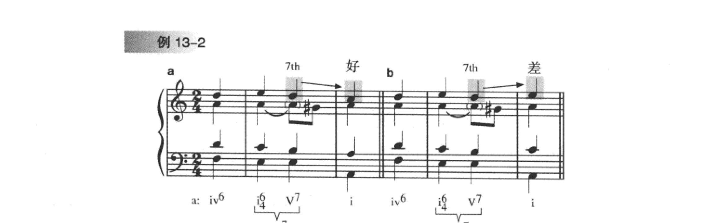
- **机制**：属七的七音与主和弦三音相差半音；七音下行解决时，半音级进把未完成的和声张力收束到主和弦。
- **读谱位置**：只盯 V7 的七音（4）到主和弦三音（3）的级进；导音（7）若在外声部，再另看它是否上行到 1。
- **操作**：写终止时先确定 4→3，再安排 7→1；若声部冲突，改排列或转位，保留七音下行。
> 来源：[调性和声概述，PDF p.229](books/tonal_20c_overview.html#ref-example-c01-p0229)，例13-2｜四声部教材模型（教材模型）。关联：`dominant`、`voiceLeading`、`seventh`
<!-- ANCHOR:example-c02 -->
#### C02｜不完全主和弦：省略五音仍完成终止
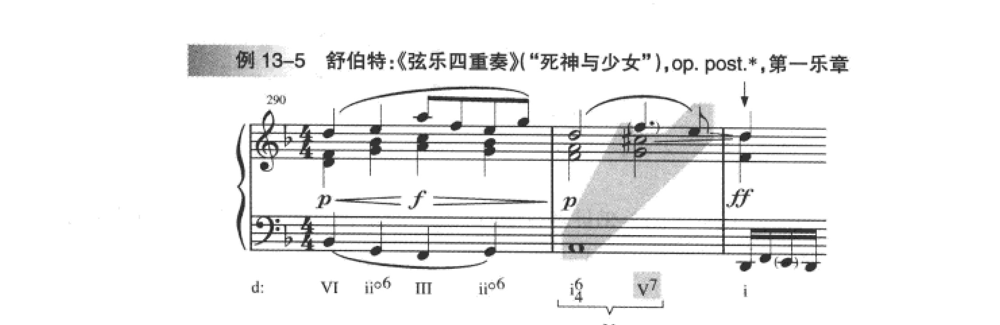
- **机制**：终止的完成感由 4→3、7→1 的解决建立；主和弦省略五音、重复根音，可以避免声部反向。
- **读谱位置**：看 V7 到 i 的最后一步：导音是否上行到主音、七音是否下行到三音，主和弦是否省五音并重复根音。
- **操作**：四声部终止若补全会迫使某声部反向，可省五音、重复根音；保留 4→3 与 7→1 的方向。
> 来源：[调性和声概述，PDF p.230](books/tonal_20c_overview.html#ref-example-c02-p0230)，例13-5｜舒伯特《弦乐四重奏》“死神与少女”第一乐章（作品片段）。关联：`dominant`、`voiceLeading`、`cadence`、`seventh`
<!-- ANCHOR:example-c03 -->
#### C03｜省五音属七：保留导音级进
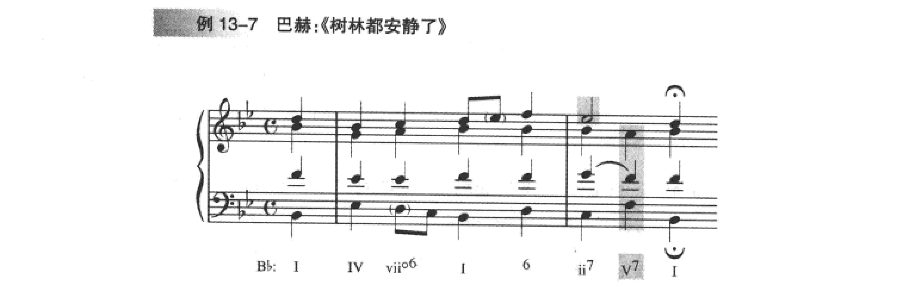
- **机制**：完全主和弦要求导音上行到主音；省略属七五音并重复根音，可减少声部挤压，保留 7→1 与 4→3。
- **读谱位置**：看 V7 是否省五音并重复根音；再看进入 I 时七音是否到三音、导音是否到主音。
- **操作**：需要完全主和弦时，可先试“省 V7 五音、重复根音”；不要重复导音或让导音跳进。
> 来源：[调性和声概述，PDF p.231](books/tonal_20c_overview.html#ref-example-c03-p0231)，例13-7｜巴赫《树林都安静了》（作品片段）。关联：`dominant`、`voiceLeading`、`cadence`、`inversion`
<!-- ANCHOR:example-c04 -->
#### C04｜副属和弦：局部主音化
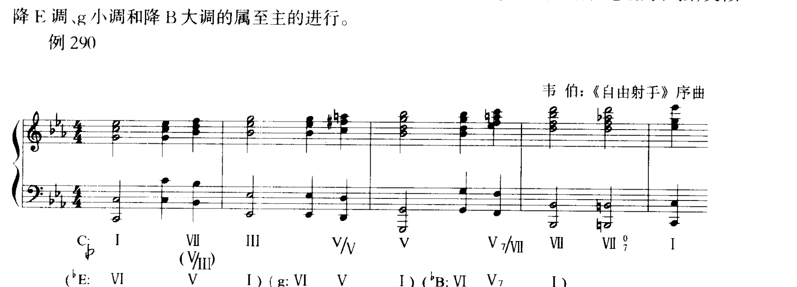
- **机制**：副属和弦把目标和弦临时当作主音：它自身的导音或三全音指向目标和弦，目标出现后临时主音化结束。
- **读谱位置**：从每个副属和弦看三全音或导音指向哪个目标和弦；目标一出现，临时主音化就结束。
- **操作**：让某级和弦获得到达感时，在它前面写自己的 V(7)；目标出现后回到原调，避免临时中心持续过久。
> 来源：[桑桐教程，PDF p.131](books/sangtong_tutorial.html#ref-example-c04-p0131)，例290｜韦伯《自由射手》序曲（作品片段）。关联：`secondaryDominant`、`tonicization`、`chromaticism`
<!-- ANCHOR:example-c05 -->
#### C05｜对斜：变化音保持同一声部
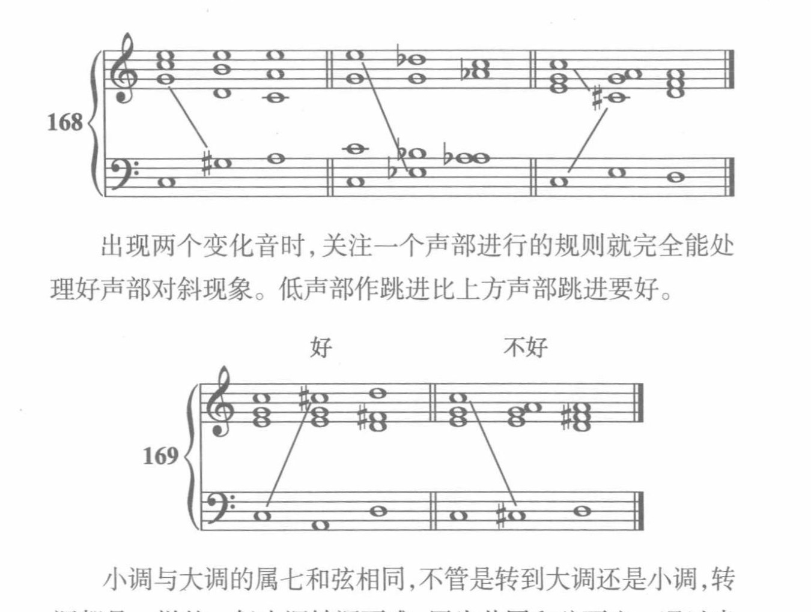
- **机制**：对斜来自同一音级的变化音在相邻和弦间换了声部。把变化音保留在同一声部，可让音级身份与进行方向连续。
- **读谱位置**：找变化音前后两次出现，确认是否沿同一声部横向移动；若跨声部跳走，即形成对斜。
- **操作**：转调或变和弦前先标出变化音轨迹；可由低音跳进承担换位，但不要让变化音跨声部。
> 来源：[柴可夫斯基指南，PDF p.94](books/tchaikovsky_guide.html#ref-example-c05-p0094)，转调示例｜教材转调示例（教材模型）。关联：`voiceLeading`、`chromaticism`、`modulation`
<!-- ANCHOR:example-c06 -->
#### C06｜转调模进：局部属—主链
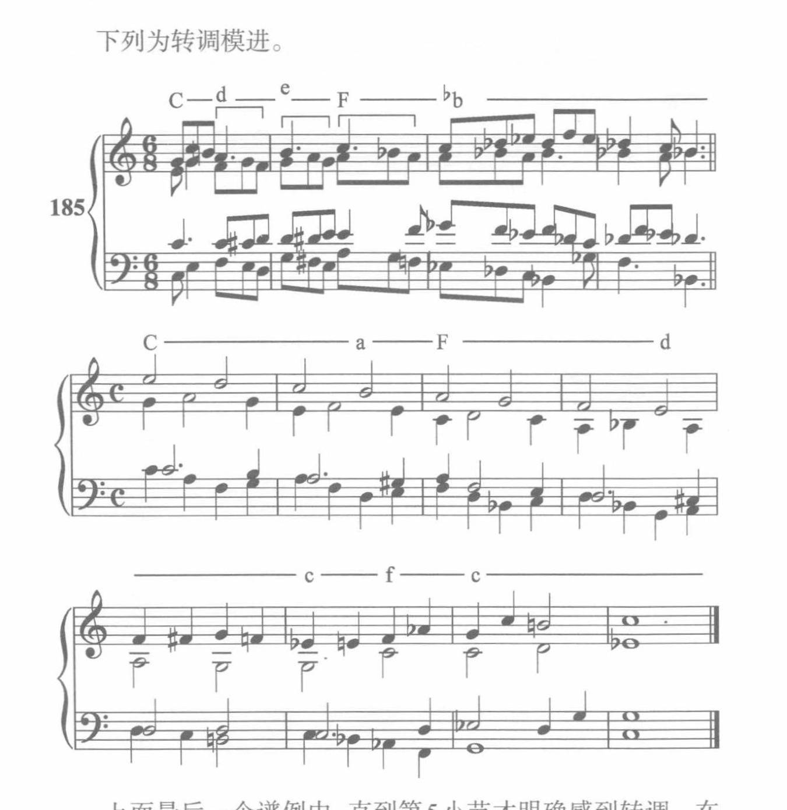
- **机制**：模进以同一音型连续移位，每次 ii7–V 指向不同临时主音；目标主和弦出现并稳定后，转调才被确认。
- **读谱位置**：标出每小节 II7→V 的局部目标和低音落点；数真正的新主和弦到第几小节才出现。
- **操作**：写转调模进时连续使用 ii7–V 保留多个出口，最后用一个目标主和弦和终止式确认新调。
> 来源：[柴可夫斯基指南，PDF p.102](books/tchaikovsky_guide.html#ref-example-c06-p0102)，转调模进示例｜教材转调模进示例（教材模型）。关联：`sequence`、`modulation`、`pivot`、`secondaryDominant`
<!-- ANCHOR:example-c07 -->
#### C07｜T–s–T：下属回落式终止
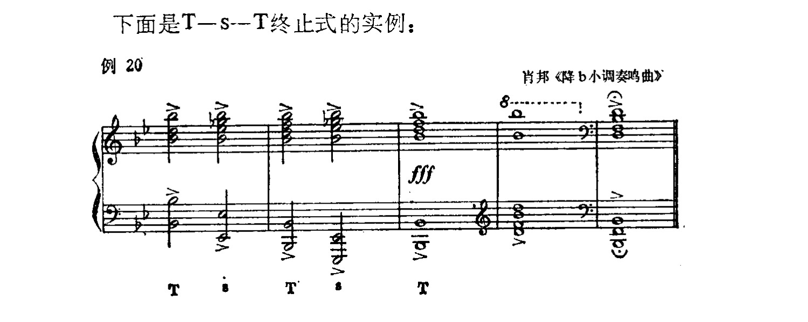
- **机制**：属和弦以导音和根音支持推进，下属和弦则以低音下行与主音回归收束；T–s–T 的终止力来自低音进行和功能回落。
- **读谱位置**：看低音与功能和弦：T 之后是否下沉到 s，再回到同一主音；不要找 V。
- **操作**：需要安静收束或避免强属终止时，可用 T–s–T；由下属低音下行回到主音，并以主和弦稳定结束。
> 来源：[功能网，PDF p.28](books/tong_function_net.html#ref-example-c07-p0028)，例20｜肖邦《降b小调奏鸣曲》（作品片段）。关联：`cadence`、`diatonic`、`functionNetwork`、`prolongation`
<!-- ANCHOR:example-c08 -->
#### C08｜三度关系：根音落点分析
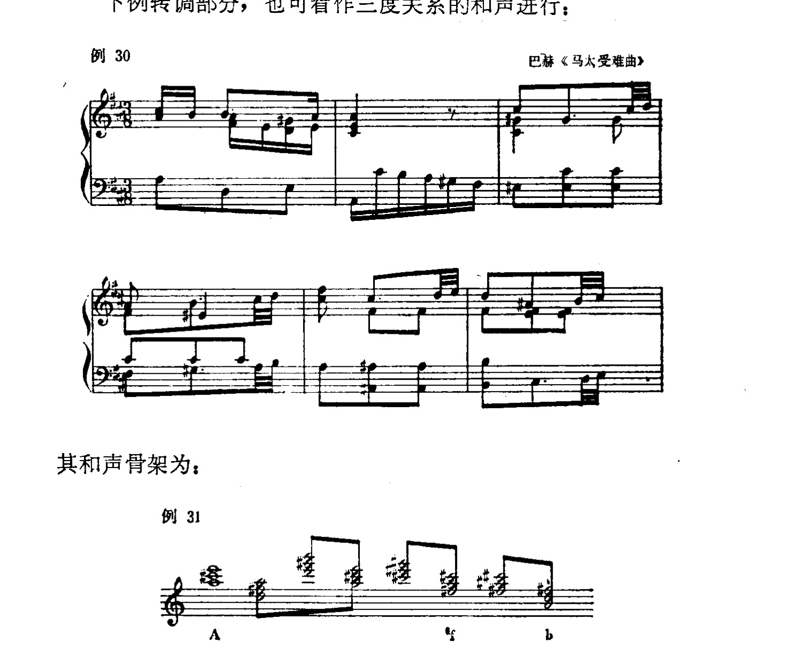
- **机制**：把转调片段压成根音落点，可看出多个远关系和弦由三度或六度根音关系串联；表面声部运动不改变这一框架。
- **读谱位置**：把每小节压成一个根音或功能和弦，忽略经过音；看这些落点是否按三度或六度排列。
- **操作**：写色彩转调时先定两三个三度根音落点，再以半音或共同音声部连接填中间；分析时先看落点，不逐和弦贴功能标签。
> 来源：[功能网，PDF p.34](books/tong_function_net.html#ref-example-c08-p0034)，例30｜巴赫《马太受难曲》（作品片段）。关联：`functionNetwork`、`colorHarmony`、`modulation`、`prolongation`
### 13.2 浪漫主义与调性扩张 · 约 1820–1945
> 调中心仍被确认，但半音、持续音与等音重释扩大和弦范围；分析时同时追踪中心音与声部半音进行。
<!-- ANCHOR:example-e01 -->
#### E01｜远关系和弦：半音声部连接
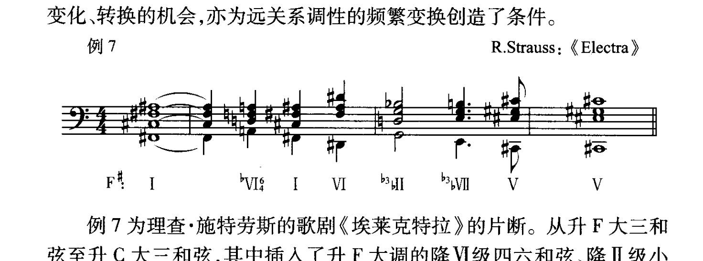
- **机制**：远关系根音之间可用半音声部连接：各声部取最近的半音或全音进行，纵向和弦可以相距很远，横向听感仍然连续。
- **读谱位置**：逐声部看升F→插入和弦→升C的半音或全音移动，尤其共同音与半音级进；不要只盯根音。
- **操作**：插入远关系和弦时，先写平滑的半音声部，再选择能容纳这些音的和弦；根音关系可以远，声部移动要短。
> 来源：[半音化历史，PDF p.33](books/sangtong_chromatic.html#ref-example-e01-p0033)，例7｜理查·施特劳斯《埃莱克特拉》（作品片段）。关联：`chromaticism`、`voiceLeading`、`colorHarmony`
<!-- ANCHOR:example-e02 -->
#### E02｜主持续音上的调式交替
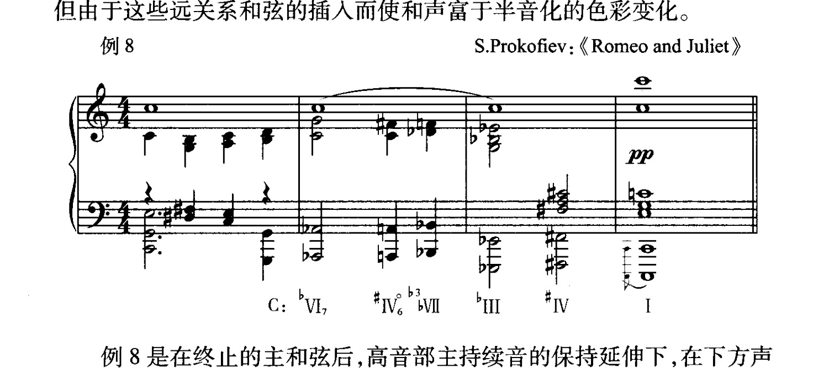
- **机制**：持续音固定低音与调中心；上方和弦可频繁改变三音、五音并借用同主音调式，而不形成新调。
- **读谱位置**：先锁定持续音 C，再看上方和弦的三音、五音怎样改变；最后看低音是否从升IV级以增四度回到 C。
- **操作**：写曲尾色彩段可用主持续音承托混合交替；上方扩大音程与调式色彩，最后用明确的根音进行收束。
> 来源：[半音化历史，PDF p.33](books/sangtong_chromatic.html#ref-example-e02-p0033)，例8｜普罗科菲耶夫《罗密欧与朱丽叶》（作品片段）。关联：`modalInterchange`、`colorHarmony`、`prolongation`、`chromaticism`
<!-- ANCHOR:example-e03 -->
#### E03｜同名大小三和弦并置
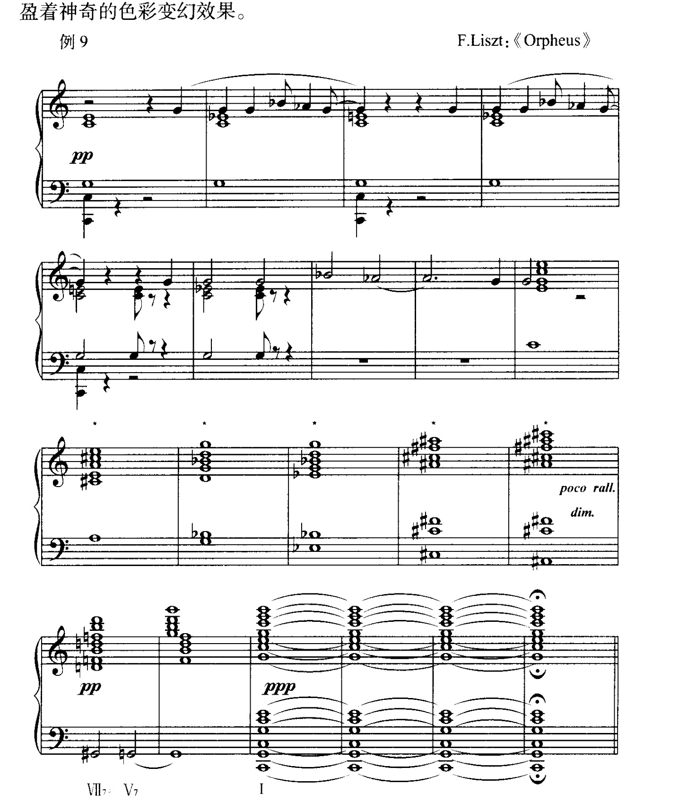
- **机制**：同一主音上的大三和弦与小三和弦共享根音；三音相差半音，五音相同或相近。并置时中心音不变，和弦性质改变。
- **读谱位置**：以持续的主音或主和弦为参照，观察三音的大/小三度替换、五音是否保持，以及外声部是否反向扩张；最后找 V7→I。
- **操作**：终曲需要延续主和弦时，保持主音，交换大小三音并做反向音区扩张，最后以 V7–I 明确收束。
> 来源：[半音化历史，PDF p.34](books/sangtong_chromatic.html#ref-example-e03-p0034)，例9｜李斯特《奥菲欧》（作品片段）。关联：`colorHarmony`、`modalInterchange`、`prolongation`、`cadence`
<!-- ANCHOR:example-e04 -->
#### E04｜同一和弦的功能重释
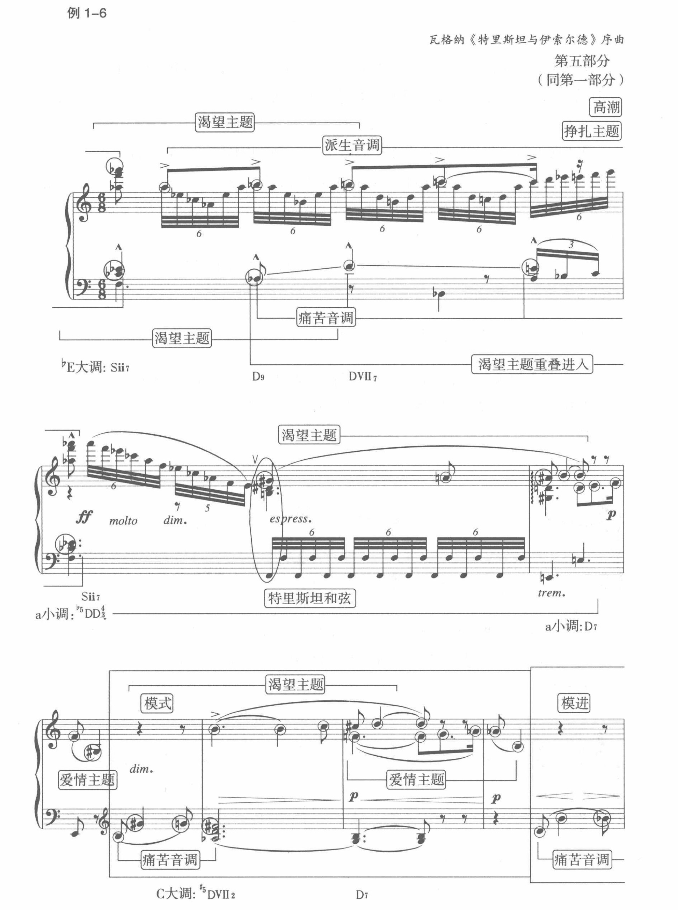
- **机制**：同一组音在和弦结构上可以不变，但前后和弦、低音与解决目标会指定不同的临时主音，从而改变其功能与张力方向。
- **读谱位置**：找反复出现的同一音集或同一和弦，比较它每次前后的功能标记与低音；不要急着重算音名。
- **操作**：写模糊调性时，固定一个音集，改变它的前后文、低音或解决目标；功能多义由上下文建立，无需增加音高。
> 来源：[徐平力高级，PDF p.16](books/xu_advanced.html#ref-example-e04-p0016)，例1-6｜瓦格纳《特里斯坦与伊索尔德》序曲（作品片段）。关联：`chromaticism`、`functionNetwork`、`enharmonicModulation`
<!-- ANCHOR:example-e05 -->
#### E05｜半音根音与无主和弦段落
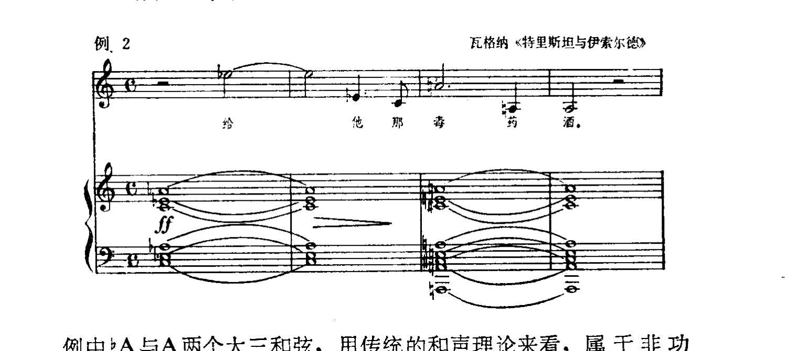
- **机制**：根音相差半音的两个三和弦可直接连接；若主和弦长期缺席，属功能会成为临时参照，调中心因此不稳定。
- **读谱位置**：看低音降A→A的半音进行，以及前后是否出现 c 小调主和弦；注意“没有主和弦”本身怎样制造浮荡。
- **操作**：需要无主和弦的段落时，可用半音根音直接连接，并以属或导音暗示中心；不要补主和弦，否则中心会立即明确。
> 来源：[功能网，PDF p.9](books/tong_function_net.html#ref-example-e05-p0009)，例2｜瓦格纳《特里斯坦与伊索尔德》（作品片段）。关联：`chromaticism`、`modulation`、`functionNetwork`、`prolongation`
<!-- ANCHOR:example-e06 -->
#### E06｜变属和弦作为终止音响
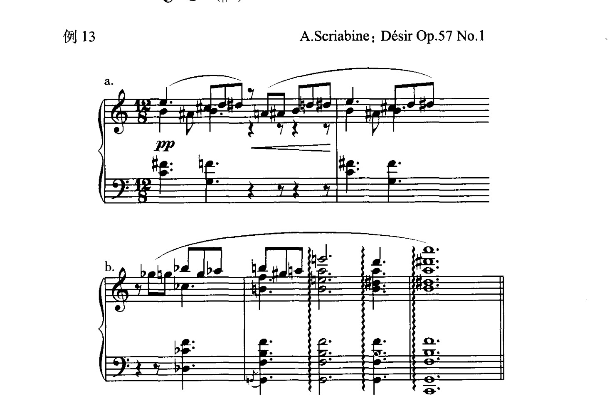
- **机制**：变音扩张后的属和弦可以保留不解决，低音落到主音，上方保持属功能复合体，使未解决张力成为终止音响。
- **读谱位置**：看最后和弦的低音是否到 C，而上方是否仍是升五音属七或属九的延续；找哪些音没有按传统倾向解决。
- **操作**：写悬停终止时，让低音到主音，上方保留属九或升五音属七；降II7 与变属和弦可加强最后的半音进行。
> 来源：[半音化历史，PDF p.41](books/sangtong_chromatic.html#ref-example-e06-p0041)，例13｜斯克里亚宾《愿望》Op.57 No.1（作品片段）。关联：`chromaticism`、`seventh`、`colorHarmony`
<!-- ANCHOR:example-e07 -->
#### E07｜平行和弦：保持音程结构
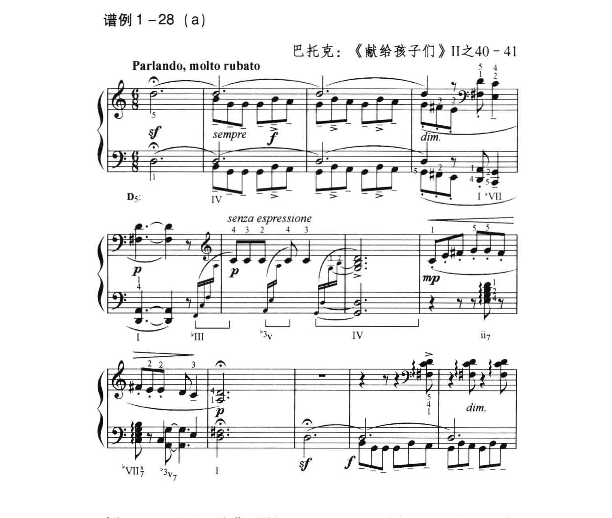
- **机制**：平行进行保持各和弦的音程结构，以相同方向移动；连接感减弱，但 T–s–d–T 的根音与功能关系仍可由低音和句法辨认。
- **读谱位置**：先标 T→s→d→T 的功能进行，再看各和弦是否保持同一音程结构平行移动；比较低音落点与声部间距。
- **操作**：需要平行和声色彩时，保留 T–s–d–T 的功能进行，将中间和弦做成相同结构的平行进行；用低音和句法维持中心。
> 来源：[色彩和声，PDF p.80](books/huacui_color.html#ref-example-e07-p0080)，谱例1-28｜巴托克《献给孩子们》II 之40–41（作品片段）。关联：`colorHarmony`、`diatonic`、`voiceLeading`
<!-- ANCHOR:example-e08 -->
#### E08｜变副属：按解决目标命名
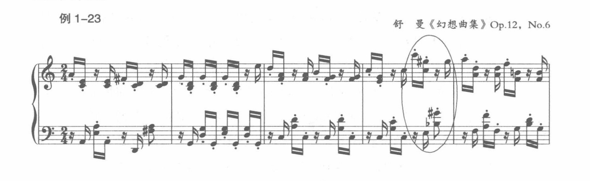
- **机制**：变副属的结构可能与另一调的导七相同；判断功能应看它解决到哪个和弦，以及升高三音或五音形成的半音方向。
- **读谱位置**：先确认目标和弦是否为下属，再检查所谓“属”的三音或五音是否升高；命名以解决目标为准。
- **操作**：为下属和弦加强导向时，可写升五音副属到下属；命名依据是解决目标与声部方向，和弦外形只是线索。
> 来源：[徐平力高级，PDF p.25](books/xu_advanced.html#ref-example-e08-p0025)，例1-23｜舒曼《幻想曲集》Op.12 No.6（作品片段）。关联：`secondaryDominant`、`chromaticism`、`functionNetwork`、`voiceLeading`
### 13.3 现代与后调性 · 约 1900 至今
> 调中心可保留、悬置或取消；组织力来自音阶结构、音集关系、音区、音色与序列。
<!-- ANCHOR:example-m01 -->
#### M01｜全音阶：缺少导音后的组织方式
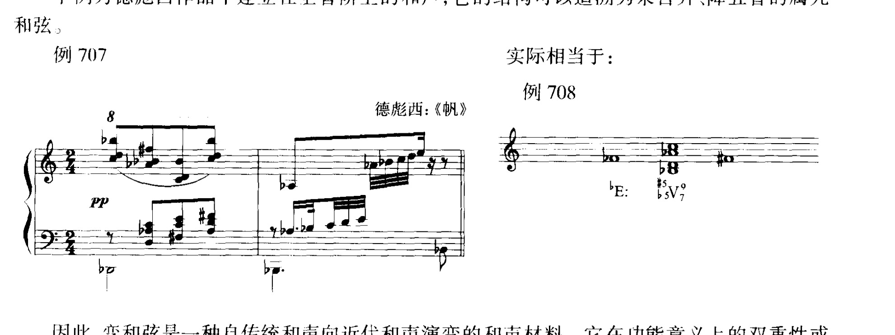
- **机制**：全音阶没有半音导音，因此 V→I 的倾向被削弱；音高组织更多依赖音集、低音、音区与节奏的重复和变化。
- **读谱位置**：先圈出是否只有全音阶六音，找有没有半音导音；再看低音是否提供唯一的方向感。
- **操作**：需要弱化功能方向时，可选全音阶截段与属九变体，省略导音；用低音与音区变化组织段落。
> 来源：[桑桐教程，PDF p.313](books/sangtong_tutorial.html#ref-example-m01-p0313)，例707｜德彪西《帆》（作品片段）。关联：`symmetry`、`scale`、`colorHarmony`、`chromaticism`
<!-- ANCHOR:example-m02 -->
#### M02｜八声音阶：音程模式决定身份
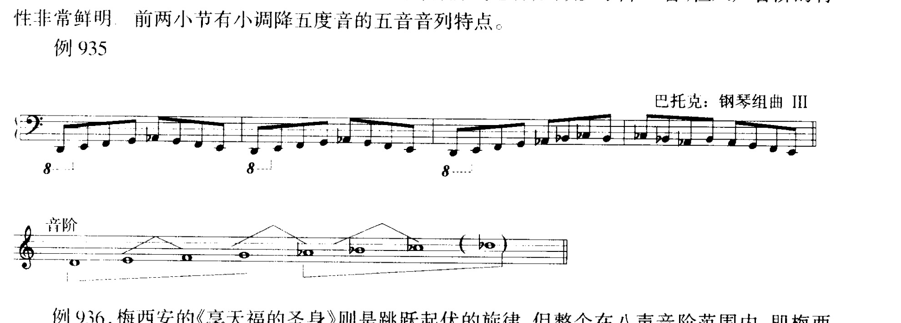
- **机制**：八声音阶由半音与全音交替构成；判断身份看小二、增二、大三度的固定排列，缺一个音仍是省略。
- **读谱位置**：把旋律音按半音整数排列，找小二—大三或全—半的交替模式；确认缺的是哪个音，而非误判成其他音阶。
- **操作**：写八声色彩时先定 1–2–1–2 的对称结构，可省略一个音避免过密；让特征小二度落在句法重音上。
> 来源：[桑桐教程，PDF p.423](books/sangtong_tutorial.html#ref-example-m02-p0423)，例935｜巴托克钢琴组曲 III（作品片段）。关联：`symmetry`、`scale`、`colorHarmony`
<!-- ANCHOR:example-m03 -->
#### M03｜复合和弦：两个完整和弦的叠置
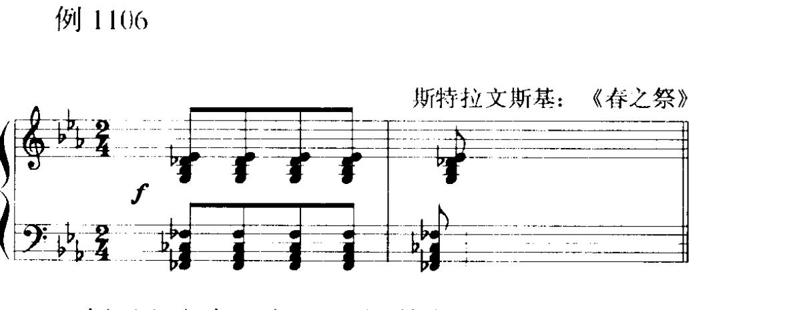
- **机制**：复合和弦由两个可分别命名的完整和弦同时构成；根音距离、音区分离与音色分工决定两层是否可辨。
- **读谱位置**：分别给下方和上方写和弦名，确认两层各自完整；再看根音是否半音、音区是否拉开。
- **操作**：写复合和弦时先分别写两个完整和弦，使根音相差半音或三全音，再用音区或节奏分开；避免随机堆音。
> 来源：[桑桐教程，PDF p.498](books/sangtong_tutorial.html#ref-example-m03-p0498)，例1106｜斯特拉文斯基《春之祭》（作品片段）。关联：`chromaticism`、`colorHarmony`、`atonal`
<!-- ANCHOR:example-m04 -->
#### M04｜多层材料：独立音集与声部连接
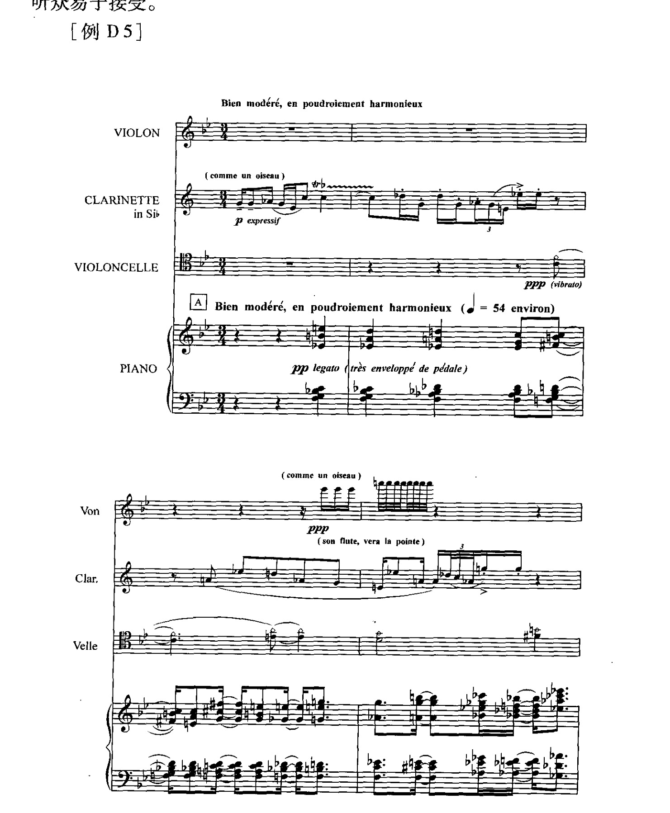
- **机制**：多层并置时，每层可拥有独立音集、节奏与音色；层间共同音或级进负责连接，统一性来自声部进行而非共同调性。
- **读谱位置**：按乐器分层：钢琴看和弦对置、单簧管数12音、大提琴认全音阶、小提琴看半音加全音；再找层间共同音或级进。
- **操作**：写多层音乐时，先给每层独立音集与节奏，再用共同音或级进连接；不必强迫各层共用一个调。
> 来源：[基泽勒，PDF p.113](books/kizler_20c.html#ref-example-m04-p0113)，例D5｜梅西安《时间终结四重奏》第一乐章（作品片段）。关联：`scale`、`atonal`、`colorHarmony`、`symmetry`
<!-- ANCHOR:example-m05 -->
#### M05｜移位相等：集合的音程不变量
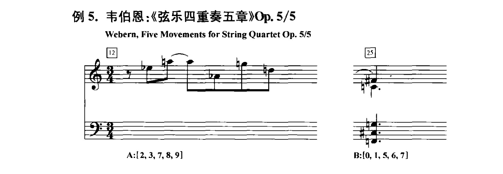
- **机制**：移位只改变集合的绝对音高，不改变内部音程与音程向量；A 与 B 若相差固定整数，就属于同一集合类的不同移位。
- **读谱位置**：把两集合都写成整数，逐项核对 B 的每个数是否等于 A 加 10；不要被音名、八度或书中“反行”字样带偏。
- **操作**：分析无调性片段时，先算移位 Tn 与原型，再谈音区、配器造成的听感差异；同一集合不等于同一效果。
> 来源：[福特，PDF p.15](books/forte_atonal.html#ref-example-m05-p0015)，例5｜韦伯恩《弦乐四重奏五章》Op.5/5（作品片段）。关联：`setTheory`、`atonal`、`interval`
<!-- ANCHOR:example-m06 -->
#### M06｜Z 关系：不同集合，相同音程向量
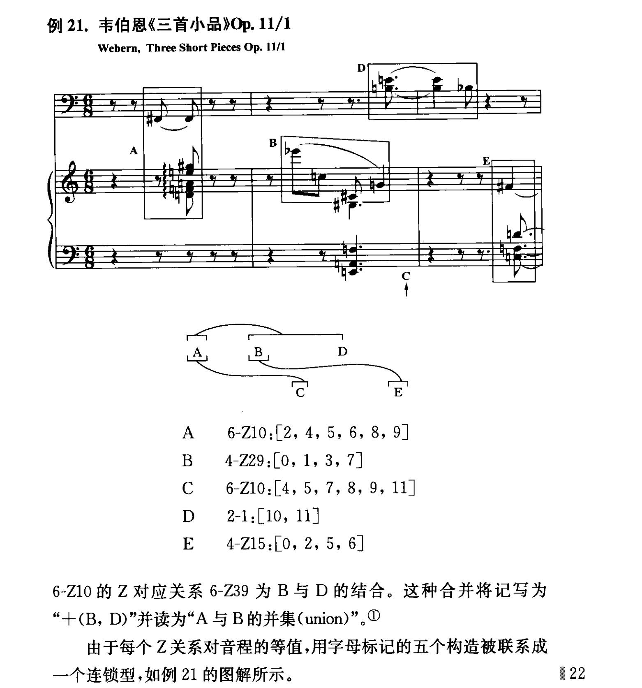
- **机制**：Z 关系指两个集合互不包含，却具有相同音程向量；它们音高内容不同，但内部音程分布一致，可形成远层联系。
- **读谱位置**：先列 A、B、C、D、E 的集合与 Z 标记；验证 B 与 D 的并集是否得到 6-Z39，再看它们在谱面上的位置与音区。
- **操作**：需要统一而不重复的集合网络时，可用 Z 对或并集建立远层联系；音程向量负责统一，具体音高与音区负责变化。
> 来源：[福特，PDF p.36](books/forte_atonal.html#ref-example-m06-p0036)，例21｜韦伯恩《三首小品》Op.11/1（作品片段）。关联：`setTheory`、`atonal`、`interval`
<!-- ANCHOR:example-m07 -->
#### M07｜十二音和弦：音区与音色分层
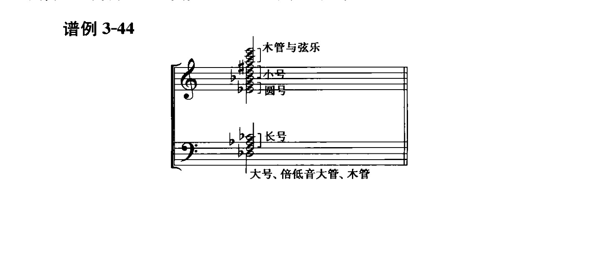
- **机制**：十二个音同时发声时，听觉分辨受音区密度限制；把音高分配到不同音区与音色，能让协和音程和内部层次重新可辨。
- **读谱位置**：按乐器或音区把和弦拆成三到四组，找每组内部的协和音程；再看密集音簇是否被移到高音区或被音色隔开。
- **操作**：写十二音和弦时先做音区与音色分层：低音保留根音或五度，中部承担冲突，高音分开音色；避免全部挤在同一八度。
> 来源：[佩尔西采蒂，PDF p.81](books/persichetti_20c.html#ref-example-m07-p0081)，谱例3-44｜十二音和弦配器模型（教材模型）。关联：`triad`、`atonal`、`colorHarmony`、`seventh`
<!-- ANCHOR:example-m08 -->
#### M08｜序列和声：连续截段的纵向叠置
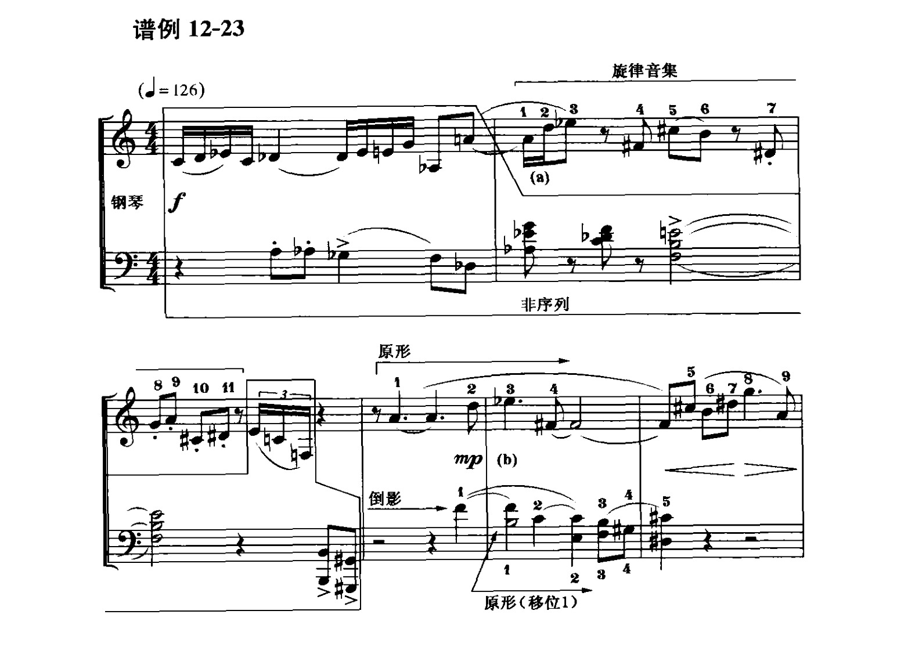
- **机制**：把序列的连续音级截段同时奏响，就得到纵向和声；横向顺序决定截段内容，移位、倒影与音区决定它们之间的关系。
- **读谱位置**：把原形、倒影、移位1按序号对齐；看哪些相邻序号被同时奏响，哪些被分到不同声部。
- **操作**：需要序列和声时，从音列取连续截段纵向叠置；用移位、倒影保持关系，用音区与节奏区分不同截段。
> 来源：[佩尔西采蒂，PDF p.236](books/persichetti_20c.html#ref-example-m08-p0236)，谱例12-23｜序列和声模型（教材模型）。关联：`serialism`、`setTheory`、`atonal`、`interval`
<!-- AUTO:EXAMPLES:END -->

## 14. 页码证据索引

以下索引由 `evidence/source-map.json` 生成。每条包含论点、教材、PDF 页码与短引文；测试会验证引文能在对应页的 OCR 文本中回查。OCR 对谱例、临时记号与罗马数字不可靠，因此这里只引用可读的论述句，不把 OCR 谱例当作证据。

<!-- AUTO:EVIDENCE:START -->
### 音程、音高集合与音名拼写 · `interval`
<!-- ANCHOR:claim-interval-inversion -->
- **interval.inversion**：音程转位会改变度数，但保持两音的等音音高关系，是拼写、和弦转位与集合运算的共同前提。
  - [柴可夫斯基指南，PDF p.8](books/tchaikovsky_guide.html#ref-claim-interval-inversion-p0008)：`音程的“转位”是指将冠音移低八度，或将根音移高八度。`
  - [勋伯格和声学，PDF p.25](books/schoenberg_harmony.html#ref-claim-interval-inversion-p0025)：`音程或和弦的转位即最低音升高一个八度，或最高音降低一个八度的意思，但不影响其他的音`
  - [调性和声概述，PDF p.45](books/tonal_20c_overview.html#ref-claim-interval-inversion-p0045)：`二度音程转位后变为七度音程，三度音程转位后变为六度音程，等等(例1-24)`
  - [佩尔西采蒂，PDF p.15](books/persichetti_20c.html#ref-claim-interval-inversion-p0015)：`转位与间隔音程转位后，其间隔与音区发生了变化，其协和与不协和特性也随之转变，改变的程度依音程的不同而不同`
### 调式、音阶与音级 · `scale`
<!-- ANCHOR:claim-scale-natural-modes -->
- **scale.natural-modes**：自然七调式可由同一音列移位并更换中心音得到；中心音与调式名称共同决定音阶身份。
  - [调性和声概述，PDF p.496](books/tonal_20c_overview.html#ref-claim-scale-natural-modes-p0496)：`这七个调式可以按照这种方式移位到12个大调的任何一个调上。`
  - [佩尔西采蒂，PDF p.42](books/persichetti_20c.html#ref-claim-scale-natural-modes-p0042)：`产生七种自然调式(多里亚调式、弗里吉亚调式等)的调式构成原理可以运用于任何音阶中，创作出多种不同的变体`
  - [徐平力高级，PDF p.83](books/xu_advanced.html#ref-claim-scale-natural-modes-p0083)：`在平行交替形式中，又分为两种形式：自然调式的平行交替（C自然大调与a自然小调）与和声调式的平行交替（C和声大调与a和声小调，这里不包括同音列之间的其他各种教会调式之间的交替）`
  - [色彩和声，PDF p.27](books/huacui_color.html#ref-claim-scale-natural-modes-p0027)：`“自然七声音阶”中的任何一个音都可能被用作主音，所以一个“自然七声音阶”可以构成七个主音不同的七声调式`
  - [桑桐教程，PDF p.125](books/sangtong_tutorial.html#ref-claim-scale-natural-modes-p0125)：`同音列调式交替是指在调式音列相同、宫音位置不变的情况下，调式的中心音改变。`
<!-- ANCHOR:claim-scale-brightness-order -->
- **scale.brightness-order**：调式色彩可按主音上方大音程、增音程的数量排序，形成从利底亚到洛克里亚的明亮度序列。
  - [调性和声概述，PDF p.497](books/tonal_20c_overview.html#ref-claim-scale-brightness-order-p0497)：`自然调式也可以按照下面的顺序排列，即按照“明亮度”降低的顺序`
  - [徐平力高级，PDF p.273](books/xu_advanced.html#ref-claim-scale-brightness-order-p0273)：`他通过不同调式音阶明亮度不一样的原理，列出从明到暗或从暗到明的七种教会调式音阶，其特征为：凡音阶中包含的增、大音程越多，其明亮度越高`
<!-- ANCHOR:claim-scale-twentieth-century-materials -->
- **scale.twentieth-century-materials**：二十世纪音阶材料扩展到多种人工音阶、五声/六声、全音与半音音阶；七种自然调式仍可使用，但中心与用法不再受共同实践语法约束。
  - [佩尔西采蒂，PDF p.30](books/persichetti_20c.html#ref-claim-scale-twentieth-century-materials-p0030)：`二十世纪的作曲家们采用了许多类型的音阶，除其他一些音阶外，他们较频繁地使用由全音和半音构成的七种音阶。每一种音阶都各具特性，其中的任何一个音级都可以作为主音。`
  - [徐平力高级，PDF p.469](books/xu_advanced.html#ref-claim-scale-twentieth-century-materials-p0469)：`这种趋势的进一步发展，形成了各种人工调式音阶的产生，如全音阶、各种循环音阶及各种中古合成音阶的产生`
  - [调性和声概述，PDF p.500](books/tonal_20c_overview.html#ref-claim-scale-twentieth-century-materials-p0500)：`作曲家也会大量地使用人工音阶（syntheticscales）。`
  - [佩尔西采蒂，PDF p.41](books/persichetti_20c.html#ref-claim-scale-twentieth-century-materials-p0041)：`音级的自由排列致使新创的音阶构成超出了大调式与小调式的范围。`
### 三和弦与七和弦（前置速查） · `triad`
<!-- ANCHOR:claim-triad-construction -->
- **triad.construction**：三和弦由根音、三音、五音按三度叠置；三度与五度的性质决定大、小、减、增四类结构。
  - [柴可夫斯基指南，PDF p.14](books/tchaikovsky_guide.html#ref-claim-triad-construction-p0014)：`根据三和弦中三度和五度的性质进行分类。`
  - [勋伯格和声学，PDF p.14](books/schoenberg_harmony.html#ref-claim-triad-construction-p0014)：`这些三和弦的第一种叫大三和弦，这在第I、IV和V级上构成`
  - [调性和声概述，PDF p.64](books/tonal_20c_overview.html#ref-claim-triad-construction-p0064)：`三和弦在“写给学生”（第VI一X页）中我们讲过，调性和声使用三度叠置（按三度关系建构）和弦`
  - [色彩和声，PDF p.18](books/huacui_color.html#ref-claim-triad-construction-p0018)：`早期的这类作品，调性中心较明确，而且仍以传统三度叠置和弦为主，不过对主调来说，十二平均律各音级上的和弦运用得较为自由，不受传统功能和声的约束`
### 自然音级功能：T–S–D · `diatonic`
<!-- ANCHOR:claim-diatonic-tonic-subdominant-dominant -->
- **diatonic.tonic-subdominant-dominant**：大调 I、IV、V 分别承担主、下属、属的核心功能，其他自然三和弦按共同音与倾向归入功能组。
  - [柴可夫斯基指南，PDF p.15](books/tchaikovsky_guide.html#ref-claim-diatonic-tonic-subdominant-dominant-p0015)：`I级上建立的三和弦为主和弦。IV上建立的三和弦为下属和弦。V上建立的三和弦为属和弦。`
  - [桑桐教程，PDF p.33](books/sangtong_tutorial.html#ref-claim-diatonic-tonic-subdominant-dominant-p0033)：`和弦之间的功能关系是调性和声体系中和弦之间的主要关系。`
  - [勋伯格和声学，PDF p.14](books/schoenberg_harmony.html#ref-claim-diatonic-tonic-subdominant-dominant-p0014)：`我们还可对I用“主”（Tonic)这个术语，对V用“属"(Dominant)，对IV用“下属"(Sub-Dominant)，对IⅡI用“中1音”(Mediant)，对VI用“下中音"(Sub-Mediant)，对VII用“减三和弦”(DiminishedTriad)`
  - [斯波索宾答案上，PDF p.13](books/spossbin_answers_1.html#ref-claim-diatonic-tonic-subdominant-dominant-p0013)：`在下面的答案中，每个调的三个三和弦都按T、S与D或t、s与D的顺序写出，它们的旋律位置和排列法都是任意的`
  - [徐平力高级，PDF p.429](books/xu_advanced.html#ref-claim-diatonic-tonic-subdominant-dominant-p0429)：`如：主和弦，简写为T（Tonic，调主音和弦）`
<!-- ANCHOR:claim-diatonic-function-sequence -->
- **diatonic.function-sequence**：功能和声的基本序列是稳定—不稳定—稳定，典型为 T–S–D–T；D–S 属特殊情况而非常规。
  - [桑桐教程，PDF p.34](books/sangtong_tutorial.html#ref-claim-diatonic-function-sequence-p0034)：`总的特点是：稳定—一不稳定——稳定，具体表现为：主一—下属--属-一主的功能序列`
  - [斯波索宾答案上，PDF p.13](books/spossbin_answers_1.html#ref-claim-diatonic-function-sequence-p0013)：`在下面的答案中，每个调的三个三和弦都按T、S与D或t、s与D的顺序写出，它们的旋律位置和排列法都是任意的`
  - [桑桐六讲，PDF p.253](books/sangtong_six.html#ref-claim-diatonic-function-sequence-p0253)：`它的和声进行图式可以用下列方式标记出来：e:IbIV-—V(IV.I)(F:IV,I)(14)从上述图式可以看出这个主题第一部分的和声骨架是e小调：t—*SⅡ--D一t的功能序列`
  - [半音化历史，PDF p.28](books/sangtong_chromatic.html#ref-claim-diatonic-function-sequence-p0028)：`如下表：图表14(V这些变音的引进并不引起功能属性的变化，例如主、下属、属的小三和弦形态，并不改变它们的功能性质，而只是色彩的变化，从功能标记分辨，只是从T．S．D变为t．s．d的差别`
  - [徐平力高级，PDF p.389](books/xu_advanced.html#ref-claim-diatonic-function-sequence-p0389)：`从稳定与不稳定的角度来看，主和弦经历了稳定与不稳定再回到稳定这种循环现象，就是以调为中心（出发点）进行的调性扩张与调性回归的过程`
<!-- ANCHOR:claim-root-motion-fourth-up -->
- **root-motion.fourth-up**：根音向上四度的进行具有最强的功能推进力；新根音把前一和弦根音纳入自身结构，从听感上提升其功能等级。
  - [勋伯格和声学，PDF p.59](books/schoenberg_harmony.html#ref-claim-root-motion-fourth-up-p0059)：`最强的进行是根音向上四度进行`
  - [桑桐教程，PDF p.26](books/sangtong_tutorial.html#ref-claim-root-motion-fourth-up-p0026)：`根音四度上行（或五度下行）属于强进行`
  - [桑桐教程，PDF p.27](books/sangtong_tutorial.html#ref-claim-root-motion-fourth-up-p0027)：`后一和弦的根音是前--和弦中未包含的新音，具有新鲜的效果。因此，这种和弦连接肯定有力，称之为强进行`
  - [调性和声概述，PDF p.112](books/tonal_20c_overview.html#ref-claim-root-motion-fourth-up-p0112)：`调性音乐中最基本的和声运动之一就是下行纯五度(或上行纯四度)进行`
  - [柴可夫斯基指南，PDF p.47](books/tchaikovsky_guide.html#ref-claim-root-motion-fourth-up-p0047)：`根音四度上行跳进或五度下行跳进到主和弦的根音`
### 属功能与属七解决 · `dominant`
<!-- ANCHOR:claim-dominant-v7-resolution -->
- **dominant.v7-resolution**：属七解决的基本声部规则是导音上行到主音、七音下行到三级；外声部导音尤其应上行。
  - [柴可夫斯基指南，PDF p.46](books/tchaikovsky_guide.html#ref-claim-dominant-v7-resolution-p0046)：`属七和弦的解决方式：七音（与所有不协和和弦一样）级进下行，也就是解决到主和弦的三音。`
  - [调性和声概述，PDF p.229](books/tonal_20c_overview.html#ref-claim-dominant-v7-resolution-p0229)：`任何七和弦所要面对的最基本问题都是对和弦七音的处理：七音几乎总是下行级进解决。`
  - [勋伯格和声学，PDF p.37](books/schoenberg_harmony.html#ref-claim-dominant-v7-resolution-p0037)：`将七和弦的预备和解决用根音位置做出(以后再用转位)`
  - [斯波索宾答案下，PDF p.45](books/spossbin_answers_2.html#ref-claim-dominant-v7-resolution-p0045)：`注意它的七音仍是严格地做下行级进解决的`
  - [半音化历史，PDF p.15](books/sangtong_chromatic.html#ref-claim-dominant-v7-resolution-p0015)：`在这一和声进行中，最重要的声部进行是导音至主音的上行半音进行，最富于进向主和弦作用的音程是属七和弦中的减五度（或增四度）音程`
<!-- ANCHOR:claim-dominant-tritone-resolution -->
- **dominant.tritone-resolution**：属七中的三全音按增四度向外、减五度向内收缩，分别解决到主和弦的六度或三度。
  - [调性和声概述，PDF p.230](books/tonal_20c_overview.html#ref-claim-dominant-tritone-resolution-p0230)：`增四度倾向于向外解决于六度（例13-4a），减五度倾向于向内解决于三度（例13-4b)。`
  - [半音化历史，PDF p.15](books/sangtong_chromatic.html#ref-claim-dominant-tritone-resolution-p0015)：`最富于进向主和弦作用的音程是属七和弦中的减五度（或增四度）音程。`
  - [柴可夫斯基指南，PDF p.183](books/tchaikovsky_guide.html#ref-claim-dominant-tritone-resolution-p0183)：`增四度或其转位在二声部写作中，可以出现在强拍上。但只有当导音上行解决到主音，IV级音作二度下行时才可以。`
### 声部进行与不协和解决 · `voiceLeading`
<!-- ANCHOR:claim-voice-leading-parallels -->
- **voice-leading.parallels**：平行纯五度、纯八度削弱声部独立性，因此传统调性写作把它们视为需要避免的进行。
  - [调性和声概述，PDF p.103](books/tonal_20c_overview.html#ref-claim-voice-leading-parallels-p0103)：`避免平行五度和平行八度的原因与对位法的要求有关。`
  - [柴可夫斯基指南，PDF p.21](books/tchaikovsky_guide.html#ref-claim-voice-leading-parallels-p0021)：`不允许的平行进行有平行五度和平行八度。`
  - [桑桐教程，PDF p.24](books/sangtong_tutorial.html#ref-claim-voice-leading-parallels-p0024)：`平行五度由于纯五度的过于协调的音响，使声部失去进行上的独立性,造成音响上的不平衡`
  - [斯波索宾答案上，PDF p.20](books/spossbin_answers_1.html#ref-claim-voice-leading-parallels-p0020)：`这种连续的五度和八度在严格的四部和声写作中是不允许的`
  - [佩尔西采蒂，PDF p.68](books/persichetti_20c.html#ref-claim-voice-leading-parallels-p0068)：`谱例3-14低音木管(=72)P平静地F调中心8F调中心当含有根音和五音的声部以平行五度方式进行时（通常是两个低声部），三和弦经常使用在关键位置上`
  - [徐平力高级，PDF p.379](books/xu_advanced.html#ref-claim-voice-leading-parallels-p0379)：`如早期的平行八度、五度、四度到后来的平行三度、六度都说明音乐中协和与不协和的标准是相对的，是随着时间的推移可以改变的`
  - [基泽勒，PDF p.56](books/kizler_20c.html#ref-claim-voice-leading-parallels-p0056)：`建立在平行五度和四度之上的混合音栓和弦一一种在调性体系中至少是颇成问题的进行`
  - [半音化历史，PDF p.114](books/sangtong_chromatic.html#ref-claim-voice-leading-parallels-p0114)：`增五六和弦，在古典时期，它的应用增加，作为常用的变和弦，正因莫扎特在应用这一和弦时常采取半音下行平行五度的解决方法而被命名为“莫扎特五度”，因而在和声写作中并不禁用`
<!-- ANCHOR:claim-voice-leading-leading-tone -->
- **voice-leading.leading-tone**：导音具有上行到主音的强烈倾向；当它位于外声部时，这一解决要求尤其严格。
  - [柴可夫斯基指南，PDF p.25](books/tchaikovsky_guide.html#ref-claim-voice-leading-leading-tone-p0025)：`导音带有倾向性，要上行半音解决到主音。`
  - [桑桐教程，PDF p.32](books/sangtong_tutorial.html#ref-claim-voice-leading-leading-tone-p0032)：`而导音对于主音的倾向是属功能和声中很重要的特性`
  - [勋伯格和声学，PDF p.37](books/schoenberg_harmony.html#ref-claim-voice-leading-leading-tone-p0037)：`由于b是音阶的第V1I级，这叫导音，或者，更正确地说，叫上行导音`
  - [调性和声概述，PDF p.118](books/tonal_20c_overview.html#ref-claim-voice-leading-leading-tone-p0118)：`在第一个Bb大调的V一vi进行中，导音在内声部（中音部），巴赫没有让它解决到主音(如例6-9c)`
  - [功能网，PDF p.18](books/tong_function_net.html#ref-claim-voice-leading-leading-tone-p0018)：`当“人工导音”逐渐在音乐实践中频繁地出现，特别是属七和弦(包括属九和弦)的被广泛运用，从而突出了导音上行的倾向，以及和弦的七音及九音下行解决的倾向`
  - [色彩和声，PDF p.31](books/huacui_color.html#ref-claim-voice-leading-leading-tone-p0031)：`以和弦的功能特性来说，大调D组和弦的属功能特性主要是和弦的上极点音一导音强烈地倾向于主音在起作用`
<!-- ANCHOR:claim-voice-leading-dissonance-preparation -->
- **voice-leading.dissonance-preparation**：不协和音应在前一和弦中作为协和音出现，并在同一人声部进入下一和弦的不协和位置，随后按倾向解决；这使不协和成为可追踪的声部事件。
  - [勋伯格和声学，PDF p.24](books/schoenberg_harmony.html#ref-claim-voice-leading-dissonance-preparation-p0024)：`不协和音必须作为协和音出现在前一和弦中，而且当它在下一和弦中变为不协和音时必须保持在前后和弦的同一声部。`
  - [柴可夫斯基指南，PDF p.12](books/tchaikovsky_guide.html#ref-claim-voice-leading-dissonance-preparation-p0012)：`四个或五个音组成的和弦，往往都包含不协和音程，因此都不是独立出现，必须要有准备并解决到一个大三或小三和弦上。`
  - [柴可夫斯基指南，PDF p.120](books/tchaikovsky_guide.html#ref-claim-voice-leading-dissonance-preparation-p0120)：`延留音要有预备和解决。延留音的预备是指前一和弦同一声部要包含延留音。`
<!-- ANCHOR:claim-voice-leading-phrase-boundary-exception -->
- **voice-leading.phrase-boundary-exception**：平行五、八度规则以同一连续声部进行为前提；乐句结束与下一乐句开始之间的断开可使相同音程的相邻出现成为语境例外。
  - [斯波索宾答案下，PDF p.205](books/spossbin_answers_2.html#ref-claim-voice-leading-phrase-boundary-exception-p0205)：`因为前一个同度是前乐句的结束，后一个同度是后乐句的开始，两者之间是分开的。`
<!-- ANCHOR:claim-voice-leading-multiple-solutions -->
- **voice-leading.multiple-solutions**：同一旋律与低音可有多条合格的四部写法；语法约束限定可行域，并不产生唯一正确答案。
  - [斯波索宾答案上，PDF p.2](books/spossbin_answers_1.html#ref-claim-voice-leading-multiple-solutions-p0002)：`为旋律和低音配和声的答案一般都有几种以至多种。`
  - [桑桐六讲，PDF p.123](books/sangtong_six.html#ref-claim-voice-leading-multiple-solutions-p0123)：`一个旋律并不只有一种配置方法。`
  - [调性和声概述，PDF p.600](books/tonal_20c_overview.html#ref-claim-voice-leading-multiple-solutions-p0600)：`因为同一个问题也许会有多种正确的答案。`
### 转位、低音与和声节奏 · `inversion`
<!-- ANCHOR:claim-inversion-bass-function -->
- **inversion.bass-function**：转位由低音是否为根音决定；低音改变会削弱根音支持，并改变和弦的连接与结构功能。
  - [柴可夫斯基指南，PDF p.36](books/tchaikovsky_guide.html#ref-claim-inversion-bass-function-p0036)：`将根音转移到上方其他声部，低声部不是根音的三和弦，被称为和弦的转位。`
  - [桑桐教程，PDF p.22](books/sangtong_tutorial.html#ref-claim-inversion-bass-function-p0022)：`原位和弦因根音在低音部，根音与低音基础相一致，效果较稳定`
  - [柴可夫斯基指南，PDF p.48](books/tchaikovsky_guide.html#ref-claim-inversion-bass-function-p0048)：`88879S30.属七和弦的三种转位：IⅡIⅢ80属七和弦的转位名称是根据低音与七音和根音之间构成的音程度数来命名的`
  - [勋伯格和声学，PDF p.25](books/schoenberg_harmony.html#ref-claim-inversion-bass-function-p0025)：`音程或和弦的转位即最低音升高一个八度，或最高音降低一个八度的意思，但不影响其他的音`
<!-- ANCHOR:claim-inversion-cadential-six-four -->
- **inversion.cadential-six-four**：终止四六和弦延迟 V 的到来，应处于比其后 V 更强的节奏位置，并以平稳声部进出。
  - [调性和声概述，PDF p.173](books/tonal_20c_overview.html#ref-claim-inversion-cadential-six-four-p0173)：`终止四六和弦是主四六和弦，它延迟了其后V和弦的到来。`
  - [桑桐教程，PDF p.60](books/sangtong_tutorial.html#ref-claim-inversion-cadential-six-four-p0060)：`在终止式中，属七和弦之前，常有I级四六和弦在强拍位置`
  - [柴可夫斯基指南，PDF p.81](books/tchaikovsky_guide.html#ref-claim-inversion-cadential-six-four-p0081)：`8008150B646664664）四六和弦在强拍位置时，直接连接在原位三和弦之后，70`
  - [调性和声概述，PDF p.168](books/tonal_20c_overview.html#ref-claim-inversion-cadential-six-four-p0168)：`例9-9为三声部织体，包含一个经过四六和弦（第25小节)和一个终止四六和弦（第27小节）`
  - [贝多芬研究，PDF p.13](books/beethoven_sonata.html#ref-claim-inversion-cadential-six-four-p0013)：`第42小节突强的那波里六和弦把音乐带到同主音小调一一降a小调，经过43小节的终止四六和弦停顿在属七和弦上开放着`
  - [佩尔西采蒂，PDF p.68](books/persichetti_20c.html#ref-claim-inversion-cadential-six-four-p0068)：`具有轻微紧张度的第二转位与终止式的句逗有助于定义更长的三和弦段落`
<!-- ANCHOR:claim-inversion-bass-role -->
- **inversion.bass-role**：低音部不仅是和弦的最低音，还决定原位/转位、功能属性、织体基础与结构位置；分析低音线是判断和声句法的入口。
  - [桑桐六讲，PDF p.76](books/sangtong_six.html#ref-claim-inversion-bass-role-p0076)：`低音部是和声的基础声部，它确定和声的位置与功能属性。`
  - [柴可夫斯基指南，PDF p.36](books/tchaikovsky_guide.html#ref-claim-inversion-bass-role-p0036)：`将根音转移到上方其他声部，低声部不是根音的三和弦，被称为和弦的转位。`
  - [调性和声概述，PDF p.68](books/tonal_20c_overview.html#ref-claim-inversion-bass-role-p0068)：`和弦中的任何一个音都可以出现在最下方。`
<!-- ANCHOR:claim-inversion-harmonic-rhythm-flex -->
- **inversion.harmonic-rhythm-flex**：和声节奏的宽紧与动静变化形成结构弹性；分析转位与低音时应同时记录和弦更换频率。
  - [贝多芬研究，PDF p.14](books/beethoven_sonata.html#ref-claim-inversion-harmonic-rhythm-flex-p0014)：`贝多芬的和声节奏宽紧结合、动静结合，非常富有弹力性。`
### 七和弦、九和弦与不协和等级 · `seventh`
<!-- ANCHOR:claim-seventh-general-resolution -->
- **seventh.general-resolution**：七和弦是不协和和弦，需准备并按倾向解决；其七音通常下行级进，属七是最强的功能和声形态。
  - [柴可夫斯基指南，PDF p.46](books/tchaikovsky_guide.html#ref-claim-seventh-general-resolution-p0046)：`所有由四个或五个音组成的和弦都属于不协和和弦`
  - [桑桐教程，PDF p.60](books/sangtong_tutorial.html#ref-claim-seventh-general-resolution-p0060)：`一般来说，七和弦的五音或三音有时可省略。`
  - [勋伯格和声学，PDF p.37](books/schoenberg_harmony.html#ref-claim-seventh-general-resolution-p0037)：`将七和弦的预备和解决用根音位置做出(以后再用转位)`
  - [斯波索宾答案下，PDF p.45](books/spossbin_answers_2.html#ref-claim-seventh-general-resolution-p0045)：`注意它的七音仍是严格地做下行级进解决的`
  - [色彩和声，PDF p.42](books/huacui_color.html#ref-claim-seventh-general-resolution-p0042)：`下面来讨论几个较特殊的七和弦的功能属性问题：1.大调及第四调式的I，上极点音是大七度音，主要是D组和弦，但大七度音是和弦的七音，通常下行级进解决，而减弱了它主下导音的意义，所以这个和弦有时也稍具主功能特性（次要功能T组）`
  - [徐平力高级，PDF p.186](books/xu_advanced.html#ref-claim-seventh-general-resolution-p0186)：`③传统和声中的意外进行一般在功能序进上意外，声部进行上不意外，不协和音（如七和弦的七音）还是要解决的`
<!-- ANCHOR:claim-seventh-ninth-composite -->
- **seventh.ninth-composite**：属九和弦在属功能上叠入下属功能因素，形成复合功能；九音通常不可省略并下行解决。
  - [桑桐教程，PDF p.72](books/sangtong_tutorial.html#ref-claim-seventh-ninth-composite-p0072)：`属九和弦属于高度叠置的和弦结构，由于音的叠置增加，在属和弦的基础上又产生了新的特性`
  - [勋伯格和声学，PDF p.218](books/schoenberg_harmony.html#ref-claim-seventh-ninth-composite-p0218)：`如果286有人拒绝接受音阶中其他各级上的九和弦，但至少也应承认副属七和弦上可以有大九度或小九度，即在每一级上构成副属九和弦，尽管不把这些和弦作为音阶音和弦来用`
  - [调性和声概述，PDF p.451](books/tonal_20c_overview.html#ref-claim-seventh-ninth-composite-p0451)：`例26-16舒曼：《痛苦的想象》，op.124，no.2Langsam上述所列举的所有九和弦的例子都是属九和弦`
  - [徐平力高级，PDF p.364](books/xu_advanced.html#ref-claim-seventh-ninth-composite-p0364)：`它们只是一些结构上的属九和弦，实际上并不具有功能关系`
### 终止式 · `cadence`
<!-- ANCHOR:claim-cadence-pac-iac -->
- **cadence.pac-iac**：完满正格终止由原位属到原位主、且主音位于最高声部构成；其余 V–I 多为不完满正格终止。
  - [柴可夫斯基指南，PDF p.196](books/tchaikovsky_guide.html#ref-claim-cadence-pac-iac-p0196)：`如果这两个和弦为原位形式，而且主和弦的旋律音为根音时，这种终止被称为完满终止。`
  - [调性和声概述，PDF p.174](books/tonal_20c_overview.html#ref-claim-cadence-pac-iac-p0174)：`我们用终止来表示和声目标，特指在到达和声目标时所使用的一组和弦。`
  - [勋伯格和声学，PDF p.202](books/schoenberg_harmony.html#ref-claim-cadence-pac-iac-p0202)：`最有确定性的结束是用完全终止式，的终止式`
  - [徐平力高级，PDF p.75](books/xu_advanced.html#ref-claim-cadence-pac-iac-p0075)：`”终止中的交替用法，体现在原有的正格终止、变格终止、完全终止、阻碍终止等典型的终止式中加人调式和声特征因素`
<!-- ANCHOR:claim-cadence-half-plagal-deceptive -->
- **cadence.half-plagal-deceptive**：半终止停在属功能，变格终止为 IV–I，阻碍进行为 V–vi；三者收束强度与结构作用不同。
  - [调性和声概述，PDF p.178](books/tonal_20c_overview.html#ref-claim-cadence-half-plagal-deceptive-p0178)：`变格终止（plagalcadence,缩写：PC)特指IV一I进行。`
  - [柴可夫斯基指南，PDF p.197](books/tchaikovsky_guide.html#ref-claim-cadence-half-plagal-deceptive-p0197)：`半终止是不完全终止。半终止的第一个和弦是主和弦或下属功能组的和弦，后一个和弦为属三和弦。`
  - [桑桐教程，PDF p.35](books/sangtong_tutorial.html#ref-claim-cadence-half-plagal-deceptive-p0035)：`在收拢性和声进行与开放性和声进行中，各包括四种和声进行方式：(D-T(t)正格进行S(s)--T(t)变格进行收拢性和声进行S(s)—D---T(1)复式正格进行(D--S(s)--T(t)复式变格进行[T(1)-D)正格半成进行S(s)--I)半成进行开放性和声进行T(t)--S(s)变格半成进行(D-S(s)阻碍进行上述各种和声进行当运用于乐句或段落的结束处时，即成为各种类型的终止式和声进行，如：正格终止、变格终止、半终止与阻碍终止`
  - [勋伯格和声学，PDF p.203](books/schoenberg_harmony.html#ref-claim-cadence-half-plagal-deceptive-p0203)：`三、所有不是完全终止式的正格终止式(由于转位等），还有所有由其他和弦系列结束，我们称之为半终止式(halfcadence)`
  - [徐平力高级，PDF p.75](books/xu_advanced.html#ref-claim-cadence-half-plagal-deceptive-p0075)：`”终止中的交替用法，体现在原有的正格终止、变格终止、完全终止、阻碍终止等典型的终止式中加人调式和声特征因素`
  - [调性和声概述，PDF p.176](books/tonal_20c_overview.html#ref-claim-cadence-half-plagal-deceptive-p0176)：`阻碍终止（deceptivecadence，缩写：DC)是当我们的耳朵对V—I正格终止形成期待而听到的却是V—？时的进行`
<!-- ANCHOR:claim-cadence-phrase-pair -->
- **cadence.phrase-pair**：典型乐段由两个终止强度不同的乐句构成，常见布局为 HC→PAC/IAC 或 IAC→PAC。
  - [调性和声概述，PDF p.184](books/tonal_20c_overview.html#ref-claim-cadence-phrase-pair-p0184)：`典型的乐段由两个乐句组成，二者之间形成“前提一结论”（或“问题一回答”）关系`
  - [斯波索宾答案上，PDF p.45](books/spossbin_answers_1.html#ref-claim-cadence-phrase-pair-p0045)：`1.舒曼《少年曲集》（作品68之8)：Allegroa小调LDLDt这个平行结构的a小调乐段包含两个4小节乐句`
  - [桑桐六讲，PDF p.310](books/sangtong_six.html#ref-claim-cadence-phrase-pair-p0310)：`例19是一个平行乐段，前后两个乐句之间采用侵入终止的处理方法`
### 模进与五度循环 · `sequence`
<!-- ANCHOR:claim-sequence-transposition -->
- **sequence.transposition**：模进把同一和声单元整体移位，可保持局部连接语法，同时累积离开原调的压力。
  - [柴可夫斯基指南，PDF p.68](books/tchaikovsky_guide.html#ref-claim-sequence-transposition-p0068)：`如果将属七和弦到主和弦这一进行重复多次，而且每次重复下行二度，会出现一系列和弦的模进。`
  - [勋伯格和声学，PDF p.45](books/schoenberg_harmony.html#ref-claim-sequence-transposition-p0045)：`将其引用在这里是因为过去的作曲家常常用此种方式来构成模进中动机反复的和声骨架`
  - [调性和声概述，PDF p.328](books/tonal_20c_overview.html#ref-claim-sequence-transposition-p0328)：`模进转调通过使用模进形成转调的情况并不少见`
  - [桑桐教程，PDF p.171](books/sangtong_tutorial.html#ref-claim-sequence-transposition-p0171)：`离调模进（半音模进）应用副属和弦和副下属和弦（包括副重属和弦）的模进，具有离调作用和声部半音化进行的特征.故称为离调模进或半音模进，以区别于自然音体系范围的调内模进`
  - [徐平力高级，PDF p.172](books/xu_advanced.html#ref-claim-sequence-transposition-p0172)：`模进现象综述1612.模进音组（动机）移位一—按全音向上或向下移位`
<!-- ANCHOR:claim-sequence-modulating -->
- **sequence.modulating**：模进可以把同一旋律或和声模式移到不同音高或调上；连续模进既推进音乐，也可作为转调或转调模进的基础。
  - [斯波索宾答案下，PDF p.205](books/spossbin_answers_2.html#ref-claim-sequence-modulating-p0205)：`后乐句实际只是将前乐句移高了五度。`
  - [柴可夫斯基指南，PDF p.26](books/tchaikovsky_guide.html#ref-claim-sequence-modulating-p0026)：`和声模进是指将一组和声进行（包括两个或两个以上的和弦构成一个动机）在不同的音级上予以重复，获得连续上行或下行。`
  - [调性和声概述，PDF p.126](books/tonal_20c_overview.html#ref-claim-sequence-modulating-p0126)：`完全模进，如例7-2b，是将旋律型转移到新的调上。`
### 副属和弦与离调 · `secondaryDominant`
<!-- ANCHOR:claim-secondary-dominant-definition -->
- **secondary-dominant.definition**：副属和弦把调内某一大三或小三和弦临时当主，以 V/x 或 vii°/x 加强它而不改变全局主调。
  - [调性和声概述，PDF p.273](books/tonal_20c_overview.html#ref-claim-secondary-dominant-definition-p0273)：`一个其功能更接近于另一个调而不是本段音乐主要调性的和弦，被称做副属功能和弦。`
  - [桑桐教程，PDF p.132](books/sangtong_tutorial.html#ref-claim-secondary-dominant-definition-p0132)：`但实际上，所谓离调，并没有真正离开原有的调，只是加强了调内其他各级和弦的作用。`
  - [勋伯格和声学，PDF p.100](books/schoenberg_harmony.html#ref-claim-secondary-dominant-definition-p0100)：`一个副属和弦(F的第ⅡI级上`
<!-- ANCHOR:claim-secondary-dominant-targets -->
- **secondary-dominant.targets**：除主和弦外，调内自然大三、小三和弦都可成为副属或副属七的临时主和弦。
  - [调性和声概述，PDF p.274](books/tonal_20c_overview.html#ref-claim-secondary-dominant-targets-p0274)：`都可以成为副属V或V7和弦的临时主和弦`
  - [勋伯格和声学，PDF p.102](books/schoenberg_harmony.html#ref-claim-secondary-dominant-targets-p0102)：`副属和弦同样适用于小调，而且不需要增加什么新的规则`
  - [柴可夫斯基指南，PDF p.68](books/tchaikovsky_guide.html#ref-claim-secondary-dominant-targets-p0068)：`也称为副属七和弦（auxiliarychordsoftheseventh）`
  - [桑桐教程，PDF p.132](books/sangtong_tutorial.html#ref-claim-secondary-dominant-targets-p0132)：`应用副属和弦与副下属和弦的和声进行后，得到加强的不是调内的主和弦而是其他各级和弦，形成-种暂时进入另-一个调的现象，因而这种和声进行称之为“离调”`
<!-- ANCHOR:claim-secondary-dominant-usage -->
- **secondary-dominant.usage**：副属和弦可用于任何能被自然音级目标和弦接收的位置，但实际用法受根音进行与不协和音处理约束。
  - [勋伯格和声学，PDF p.107](books/schoenberg_harmony.html#ref-claim-secondary-dominant-usage-p0107)：`副属和弦用在可以用音阶自然音级的任何地方，如果根音进行允许的话。`
  - [调性和声概述，PDF p.274](books/tonal_20c_overview.html#ref-claim-secondary-dominant-usage-p0274)：`所有其他的自然三和弦（当然除了1)都可以成为副属V或V7和弦的临时主和弦。`
  - [徐平力高级，PDF p.81](books/xu_advanced.html#ref-claim-secondary-dominant-usage-p0081)：`而副属和弦总是要解决的，其特征是半音向上。`
<!-- ANCHOR:claim-secondary-dominant-dd-targets -->
- **secondary-dominant.dd-targets**：重属和弦既可解决到属和弦或主和弦，也可进入下属组和弦；其具体形态、转位与变音须由终止位置和声部进行决定。
  - [斯波索宾答案下，PDF p.12](books/spossbin_answers_2.html#ref-claim-secondary-dominant-dd-targets-p0012)：`从课文可知DD除前章所说可到D或T外，还可进行到S的某一和弦。`
### 临时主音化（离调） · `tonicization`
<!-- ANCHOR:claim-tonicization-time-structure -->
- **tonicization.time-structure**：离调与转调的界限主要取决于持续时间、结构位置与终止确认；单靠一个变化和弦不能判定转调。
  - [调性和声概述，PDF p.313](books/tonal_20c_overview.html#ref-claim-tonicization-time-structure-p0313)：`让听者确定是否转调的一个最重要的因素是时间`
  - [桑桐教程，PDF p.178](books/sangtong_tutorial.html#ref-claim-tonicization-time-structure-p0178)：`转调发生于段落的结束部分或新段落的呈示部分，有完满的终止或明确的和声进行来确立或呈示新调性。`
  - [柴可夫斯基指南，PDF p.157](books/tchaikovsky_guide.html#ref-claim-tonicization-time-structure-p0157)：`离调完整转调290$104.还有一个包含增六度的和弦，常运用在结尾中`
  - [徐平力高级，PDF p.103](books/xu_advanced.html#ref-claim-tonicization-time-structure-p0103)：`2.通过离调到中介和弦的转调`
  - [调性和声概述，PDF p.338](books/tonal_20c_overview.html#ref-claim-tonicization-time-structure-p0338)：`向D大调和c小调短暂的离调可以看做是直接转调，因为没有更为合理的解释`
<!-- ANCHOR:claim-tonicization-ambiguity -->
- **tonicization.ambiguity**：同一变化音可能解释为自然调式音、副属和弦音或其他功能和弦音；判断离调必须结合前后和弦与临时主音，而不能只看单个音。
  - [斯波索宾答案下，PDF p.42](books/spossbin_answers_2.html#ref-claim-tonicization-ambiguity-p0042)：`从和声考虑，这d可能是弗里吉亚进行中的自然的七级音，也可能是某个离调的副属和弦的和弦音。`
<!-- ANCHOR:claim-tonicization-opening-chord -->
- **tonicization.opening-chord**：段落开头的和弦会被听觉暂时赋予主和弦权重；判断离调或转调时应结合开头、持续与终止，而不只看单个和弦的调性归属。
  - [徐平力高级，PDF p.151](books/xu_advanced.html#ref-claim-tonicization-opening-chord-p0151)：`一个段落一开始出现的和弦往往给人以主和弦的感觉`
### 同主音调式交替（借用和弦） · `modalInterchange`
<!-- ANCHOR:claim-modal-interchange-borrowed -->
- **modal-interchange.borrowed**：同主音交替以主音不变为前提，把另一调式的特性音级与和弦借入当前调式，是变化和弦的重要来源。
  - [调性和声概述，PDF p.374](books/tonal_20c_overview.html#ref-claim-modal-interchange-borrowed-p0374)：`我们也称调式交替和弦为借用和弦或变音和弦。`
  - [桑桐教程，PDF p.221](books/sangtong_tutorial.html#ref-claim-modal-interchange-borrowed-p0221)：`由于这些交替变化是在同一调性-一主音不变的情况下发生的，因此，称为同主音大小调交替。`
  - [徐平力高级，PDF p.434](books/xu_advanced.html#ref-claim-modal-interchange-borrowed-p0434)：`同主音调式交替与同主音调式交替有所不同`
<!-- ANCHOR:claim-modal-interchange-flat-degrees -->
- **modal-interchange.flat-degrees**：大调借用中最常见的是含 ♭6 的 iv、♭VI、iiø7、vii°7；♭3 与 ♭7 进一步扩展色彩。
  - [调性和声概述，PDF p.377](books/tonal_20c_overview.html#ref-claim-modal-interchange-flat-degrees-p0377)：`另一 些较常见的调式交替和弦是由b3形成的`
  - [桑桐教程，PDF p.222](books/sangtong_tutorial.html#ref-claim-modal-interchange-flat-degrees-p0222)：`大调引人同主音小调后的调式音列如下，其中包含有Ⅲ、bVI、I音：例465在这一音列上所构成的各级三和弦如下表：例466明8vI°'vIC:1IIII1°IⅢIVVVVIbVI大调中的这一和声系列称交替大小调和声：小主和弦`
  - [徐平力高级，PDF p.107](books/xu_advanced.html#ref-claim-modal-interchange-flat-degrees-p0107)：`在第二段（B）中，从D大调的同主音小调开始，首先形成调式对比`
<!-- ANCHOR:claim-modal-interchange-beethoven-mode-mixture -->
- **modal-interchange.beethoven-mode-mixture**：贝多芬把调式交替用于奏鸣曲式的主题与调性对比，使色彩变化承担结构作用，而非只是局部装饰。
  - [贝多芬研究，PDF p.12](books/beethoven_sonata.html#ref-claim-modal-interchange-beethoven-mode-mixture-p0012)：`这种调式交替在贝多芬的钢琴奏鸣曲中得到了充分体现。`
<!-- ANCHOR:claim-modal-interchange-parallel-key-modulation -->
- **modal-interchange.parallel-key-modulation**：以同主音交替和弦转调需检查前后调关系、交替和弦的引入、音级计算与新调终止式四个要点。
  - [徐平力高级，PDF p.145](books/xu_advanced.html#ref-claim-modal-interchange-parallel-key-modulation-p0145)：`从前面所讲述的内容中，我们可以将通过同主音交替和弦转调的要点归纳为如下四点：前后调关系、同主音和弦的引人、计算、后调终止式。`
<!-- ANCHOR:claim-modal-interchange-mixed-alternation -->
- **modal-interchange.mixed-alternation**：通过平行调关系引入的同主音交替变音构成混合交替，把关系调与同主音调的色彩叠合在同一主音上。
  - [半音化历史，PDF p.32](books/sangtong_chromatic.html#ref-claim-modal-interchange-mixed-alternation-p0032)：`通过平行调的关系所引人的同主音调交替变音，构成了混合交替的变音和声。`
  - [徐平力高级，PDF p.257](books/xu_advanced.html#ref-claim-modal-interchange-mixed-alternation-p0257)：`混合交替（主音不同，音列不同）`
### 拿波里和弦（♭II） · `neapolitan`
<!-- ANCHOR:claim-neapolitan-definition -->
- **neapolitan.definition**：拿波里和弦是降低二级音上建立的大三和弦，常以第一转位出现并承担属前功能。
  - [调性和声概述，PDF p.389](books/tonal_20c_overview.html#ref-claim-neapolitan-definition-p0389)：`那波里和弦是一个建立在降低音阶Ⅱ级音上的大三和弦。`
  - [桑桐教程，PDF p.300](books/sangtong_tutorial.html#ref-claim-neapolitan-definition-p0300)：`由于最初常用六和弦，并在17世纪那不勒斯乐派作曲家的作品中应用，因而称为“那不勒斯六和弦”`
  - [勋伯格和声学，PDF p.146](books/schoenberg_harmony.html#ref-claim-neapolitan-definition-p0146)：`那不勒斯六和弦使用的方式`
  - [徐平力高级，PDF p.33](books/xu_advanced.html#ref-claim-neapolitan-definition-p0033)：`例2-31米亚斯科夫斯基《第15交响曲》[注：19世纪末在小调中应用的小拿波里和弦（bib3si`
<!-- ANCHOR:claim-neapolitan-resolution -->
- **neapolitan.resolution**：拿波里的 ♭2 通常下行到导音，再进入属；应避免在它后面接 iv 或 ii。
  - [调性和声概述，PDF p.390](books/tonal_20c_overview.html#ref-claim-neapolitan-resolution-p0390)：`b2(N?的根音)应下行进行，特别是当它出现在旋律声部时。`
  - [桑桐教程，PDF p.301](books/sangtong_tutorial.html#ref-claim-neapolitan-resolution-p0301)：`（4）解决到属和弦时，bⅡ级音到导音可应用减三度进行`
  - [勋伯格和声学，PDF p.146](books/schoenberg_harmony.html#ref-claim-neapolitan-resolution-p0146)：`一般解决到I或V`
### 增六和弦 · `aug6`
<!-- ANCHOR:claim-augmented-sixth-definition -->
- **augmented-sixth.definition**：增六和弦以增六度音程半音向外解决到属音，是强属前和弦，包含意大利、法国、德国三类常见形态。
  - [调性和声概述，PDF p.402](books/tonal_20c_overview.html#ref-claim-augmented-sixth-definition-p0402)：`到达属音的这种方法产生了属前和弦的一个种类，叫做增六和弦。`
  - [柴可夫斯基指南，PDF p.154](books/tchaikovsky_guide.html#ref-claim-augmented-sixth-definition-p0154)：`包含增六度的和弦要解决到主和弦。`
  - [桑桐教程，PDF p.276](books/sangtong_tutorial.html#ref-claim-augmented-sixth-definition-p0276)：`由于这些和弦在应用中常排列为增六度形式，故通常总称为：增六和弦（1）"\/V.降Ⅱ音的重属和弦，第二转位为"增四六和弦，但应用较少`
  - [勋伯格和声学，PDF p.157](books/schoenberg_harmony.html#ref-claim-augmented-sixth-definition-p0157)：`凡是可以使用增六五和弦(或增四三、二和弦)的地方都可使用增六和弦，它的使用也可能是为了避免平行五度的缘故(例184d`
  - [徐平力高级，PDF p.24](books/xu_advanced.html#ref-claim-augmented-sixth-definition-p0024)：`DD增六和弦（A）`
<!-- ANCHOR:claim-augmented-sixth-resolution -->
- **augmented-sixth.resolution**：增六度的两个外音半音向外扩张到八度属音；上方音偶尔可下行成为 V7 的七音。
  - [调性和声概述，PDF p.403](books/tonal_20c_overview.html#ref-claim-augmented-sixth-resolution-p0403)：`增六度音程通常遵循两个音的自然倾向半音向外解决而导向属音。`
  - [桑桐教程，PDF p.293](books/sangtong_tutorial.html#ref-claim-augmented-sixth-resolution-p0293)：`例644888888由于瓦格纳作品中喜用这类变和弦，故人们亦称为“瓦格纳和弦”，上例中的第三种是典型的处理方法，增六度解决至八度（属音），另两声部保持至属和弦，为属和弦之三音与五音`
  - [徐平力高级，PDF p.18](books/xu_advanced.html#ref-claim-augmented-sixth-resolution-p0018)：`]2.解决：同DD变和弦的解决一样，其声部进行是增六度解决到纯八度，减十度解决到纯八度`
### 减七和弦与等音网络 · `dim7`
<!-- ANCHOR:claim-diminished-seventh-enharmonic -->
- **diminished-seventh.enharmonic**：减七和弦由等分小三度构成，只有三种不同音响；每个音响可等音重写为四个不同根音的减七。
  - [柴可夫斯基指南，PDF p.109](books/tchaikovsky_guide.html#ref-claim-diminished-seventh-enharmonic-p0109)：`每个减七和弦都有三个等和弦。`
  - [佩尔西采蒂，PDF p.89](books/persichetti_20c.html#ref-claim-diminished-seventh-enharmonic-p0089)：`谱例4-3由纯四度构成的和弦与所有的由等音程构成的和弦（减七和弦或增三和弦)一样含糊不清，似乎任何一个音都能作为根音`
  - [半音化历史，PDF p.31](books/sangtong_chromatic.html#ref-claim-diminished-seventh-enharmonic-p0031)：`由于#V级和弦应用E，因此，很明显地表示出同主音大调：C大调VI级（其平行小调a的I级）三和弦的渗人，同时其前后应用了减七和弦，发挥了等音转换的效果，前一个减七和弦作为a小三和弦的V级减七和弦，后一个减七和弦是C小三和弦的I级减七和弦`
  - [勋伯格和声学，PDF p.155](books/schoenberg_harmony.html#ref-claim-diminished-seventh-enharmonic-p0155)：`【183】a)在减七和弦中我们已接受了把e重新解释成d的观念`
<!-- ANCHOR:claim-diminished-seventh-four-resolutions -->
- **diminished-seventh.four-resolutions**：同一减七音响可向四个方向解决，因而能通向二十四个调，是远关系转调的常用连接和弦。
  - [柴可夫斯基指南，PDF p.109](books/tchaikovsky_guide.html#ref-claim-diminished-seventh-four-resolutions-p0109)：`每一个减七和弦通过等音程转换，可解决到四个不同的三和弦上。`
  - [桑桐教程，PDF p.354](books/sangtong_tutorial.html#ref-claim-diminished-seventh-four-resolutions-p0354)：`改变其位置与功能意义而属于二十四个不同的调`
  - [斯波索宾答案上，PDF p.168](books/spossbin_answers_1.html#ref-claim-diminished-seventh-four-resolutions-p0168)：`采用将减七和弦的一个音、两个音和三个音做等音变换的方法，将它解决到四对同名调`
### 半音化与变化和弦 · `chromaticism`
<!-- ANCHOR:claim-chromaticism-four-sources -->
- **chromaticism.four-sources**：变化音需区分四类来源：离调、调式交替、变和弦、装饰性外音；四者的调性与功能含义不同。
  - [徐平力高级，PDF p.12](books/xu_advanced.html#ref-claim-chromaticism-four-sources-p0012)：`它们是离调变化音、调式交替变化音、变和弦变化音、装饰性（外音）变化音。`
<!-- ANCHOR:claim-chromaticism-nineteenth-century-complexity -->
- **chromaticism.nineteenth-century-complexity**：19 世纪后期起，表现需求推动和弦结构复杂化：高度叠置、附加音、非三度叠置与复合和弦共同扩大色彩与紧张度。
  - [桑桐六讲，PDF p.185](books/sangtong_six.html#ref-claim-chromaticism-nineteenth-century-complexity-p0185)：`从十九世纪后期起，在外国音乐创作中，由于题材范围的扩大，风格创新的要求，引起了音乐表现手段的发展，在和声的运用中也产生了许多新的手法。`
  - [徐平力高级，PDF p.474](books/xu_advanced.html#ref-claim-chromaticism-nineteenth-century-complexity-p0474)：`如采用高叠和弦、复合和弦、非三度叠置和弦、附加音和弦、五声音调纵合化和弦及线性和声造成的偶然结合和弦等。`
<!-- ANCHOR:claim-chromaticism-historical-periodization -->
- **chromaticism.historical-periodization**：半音化在不同时期承担不同功能：巴洛克用于情感与特定体裁，古典围绕调性功能与离调，19世纪成为浪漫主义主线，并延伸至20世纪。
  - [半音化历史，PDF p.9](books/sangtong_chromatic.html#ref-claim-chromaticism-historical-periodization-p0009)：`17世纪起的巴洛克时期，半音化是某些感情表达的必要手段，并且是某些特定体裁的重要素材，如：幻想曲、即兴曲等。18世纪古典时期，围绕着和声的调性功能而展开半音化的应用，强调了离调性半音化手法和装饰性半音化风格。19世纪的半音化是浪漫主义音乐风格的主线，感情世界的特殊载体。它既扩大了调性范围，又模糊或削弱了调性领域的区分，直接引向了20世纪广阔的半音化天地。`
<!-- ANCHOR:claim-chromaticism-twentieth-century -->
- **chromaticism.twentieth-century**：20世纪半音化从19世纪末的浪漫主义继承中分化，走向独立不协和和弦、自由半音化与更整体的半音阶基础。
  - [半音化历史，PDF p.389](books/sangtong_chromatic.html#ref-claim-chromaticism-twentieth-century-p0389)：`西方音乐，从19世纪末20世纪初开始，各家各派，摆脱浪漫主义思想的束缚，消解瓦格纳风格的影响，冲破传统手法的规范，争奇斗妍，多元发展，形成万花筒式的音乐世界。`
<!-- ANCHOR:claim-chromaticism-functional-control -->
- **chromaticism.functional-control**：19 世纪半音和声即使高度复杂，整体仍受调性功能控制；分析时应区分功能扩张与真正的调性解体。
  - [半音化历史，PDF p.194](books/sangtong_chromatic.html#ref-claim-chromaticism-functional-control-p0194)：`19世纪的半音和声不论其如何复杂，仍然在调性功能的控制下`
### 中介和弦与转调 · `pivot`
<!-- ANCHOR:claim-pivot-common-chord -->
- **pivot.common-chord**：中介和弦转调以两调共有的和弦为连接点；同一音集从旧调功能重释为新调功能，再由新调的属—主或终止式确认。
  - [调性和声概述，PDF p.316](books/tonal_20c_overview.html#ref-claim-pivot-common-chord-p0316)：`大多数转调是通过使用一个或几个两调共有的和弦作为相互间的交互点而实现平稳过渡的。`
  - [调性和声概述，PDF p.317](books/tonal_20c_overview.html#ref-claim-pivot-common-chord-p0317)：`任何两个近关系调之间至少有一个共同自然三和弦，但远关系调之间却不一定总会有自然共同和弦。`
  - [桑桐教程，PDF p.181](books/sangtong_tutorial.html#ref-claim-pivot-common-chord-p0181)：`另外，根据两调之间共同音、共同和弦的数量的多少而区分调性之间相互联系的程度，凡主和弦与主和弦之间有共同音者说明在调性中心方面的联系程度较密，凡其他共同和弦多的，说明两个调性在调式范围内的联系因素较多`
  - [柴可夫斯基指南，PDF p.93](books/tchaikovsky_guide.html#ref-claim-pivot-common-chord-p0093)：`bACD908886888163be20be如果第一个三和弦与后面的转调和弦没有共同音，必须要使用一个中介和弦`
  - [勋伯格和声学，PDF p.81](books/schoenberg_harmony.html#ref-claim-pivot-common-chord-p0081)：`首先是用中立和弦作为原调和新调之间的媒介`
  - [佩尔西采蒂，PDF p.227](books/persichetti_20c.html#ref-claim-pivot-common-chord-p0227)：`中枢和弦是一个前后两调都拥有的共同和弦`
<!-- ANCHOR:claim-pivot-neutral-chord-double-label -->
- **pivot.neutral-chord-double-label**：转调初期以两调共同的中立和弦为媒介，并对其作双重功能标记；随后进入新调属和弦，再用终止式确认新调。
  - [勋伯格和声学，PDF p.81](books/schoenberg_harmony.html#ref-claim-pivot-neutral-chord-double-label-p0081)：`首先是用中立和弦作为原调和新调之间的媒介；其次是两调共同和弦的双重标记。`
  - [勋伯格和声学，PDF p.82](books/schoenberg_harmony.html#ref-claim-pivot-neutral-chord-double-label-p0082)：`为了使新调的出现清楚明确，于是再加一个终止式。`
### 转调体系：类型、距离与确认 · `modulation`
<!-- ANCHOR:claim-modulation-distance -->
- **modulation.distance**：调性远近应综合调号、共同和弦、主音距离与转调方法来判定，不能只看调号差。
  - [徐平力高级，PDF p.94](books/xu_advanced.html#ref-claim-modulation-distance-p0094)：`一般调性远近的划分标准有四种方法：1.看调号相差多少；2.看共同和弦有多少；3.看主音之间的距离；4.看转调方法`
  - [桑桐教程，PDF p.180](books/sangtong_tutorial.html#ref-claim-modulation-distance-p0180)：`主要调性与副调之间的关系等方面，而调性之间的远近关系是调性关系中的首要问题`
  - [勋伯格和声学，PDF p.80](books/schoenberg_harmony.html#ref-claim-modulation-distance-p0080)：`一般说来，我们总是选取较短的距离来进行转调，但有时也选取看来似乎较长，但实际上却是较短的距离来进行`
<!-- ANCHOR:claim-modulation-confirmation -->
- **modulation.confirmation**：转调必须由新调的和声进行与终止式确认；短促强调或单一副属和弦通常只是离调。
  - [柴可夫斯基指南，PDF p.100](books/tchaikovsky_guide.html#ref-claim-modulation-confirmation-p0100)：`最后一次转调之后，要用终止式来结束全曲。`
  - [调性和声概述，PDF p.312](books/tonal_20c_overview.html#ref-claim-modulation-confirmation-p0312)：`转调是发生在一个独立乐章之内的调性中心转移。`
  - [桑桐教程，PDF p.179](books/sangtong_tutorial.html#ref-claim-modulation-confirmation-p0179)：`（3）在和声方面要在削弱原调性的和声功能意义的过程中加强新调的和声功能作用，采用新调的明确、肯定的终止式，或者直接以新调的、明确肯定的和声加以呈示`
  - [勋伯格和声学，PDF p.79](books/schoenberg_harmony.html#ref-claim-modulation-confirmation-p0079)：`这种转调的方法既可以直接地也可以多少间接地引向确定新调的终止式的地方`
  - [柴可夫斯基指南，PDF p.98](books/tchaikovsky_guide.html#ref-claim-modulation-confirmation-p0098)：`为真正确立新调性并完成转调，常使用终止式`
  - [斯波索宾答案下，PDF p.69](books/spossbin_answers_2.html#ref-claim-modulation-confirmation-p0069)：`《教程》p.311&1“绪论”中所讲转调的四个步骤，最后就是要构成新调的结束终止`
  - [徐平力高级，PDF p.121](books/xu_advanced.html#ref-claim-modulation-confirmation-p0121)：`上句是典型的半终止写法，落在D上，下句开始转调——通过前调的TSvi等于后调的s，最后以新调（"A）的终止式进行巩固`
<!-- ANCHOR:claim-modulation-intermediate-keys -->
- **modulation.intermediate-keys**：相差两个调号的调可通过一个与前后两调都相邻的中间调连接；这种分段转调把远关系拆成可听的近关系步骤。
  - [斯波索宾答案下，PDF p.201](books/spossbin_answers_2.html#ref-claim-modulation-intermediate-keys-p0201)：`此题C一D的二级关系调转调，是通过与前后两调都是一级关系的G、e两个中间调转过去的。`
<!-- ANCHOR:claim-modulation-transition-dominant -->
- **modulation.transition-dominant**：奏鸣曲式连接部常以转调结束在副部平行调的属和弦，为副部主题建立新调期待。
  - [贝多芬研究，PDF p.19](books/beethoven_sonata.html#ref-claim-modulation-transition-dominant-p0019)：`连接部通过转调结束在副部平行调的属和弦上`
### 等音转调 · `enharmonicModulation`
<!-- ANCHOR:claim-enharmonic-modulation-definition -->
- **enharmonic-modulation.definition**：等和弦转调把两调共同的大小七或减七和弦作等音功能重释，再按新调倾向解决。
  - [调性和声概述，PDF p.433](books/tonal_20c_overview.html#ref-claim-enharmonic-modulation-definition-p0433)：`等和弦转调是指：在转调过程中，两调的共同和弦通过等和弦功能转换而成为第二个调的和弦。`
  - [桑桐教程，PDF p.352](books/sangtong_tutorial.html#ref-claim-enharmonic-modulation-definition-p0352)：`和弦中的一个音或几个音作等音变化后，可以从一种和弦结构变为另一种和弦结构，称为等和弦：在转调方法中，利用等和弦改变和弦的结构、级数、位置或功能，使其变为另一调性的某一和弦而进行转调，即为等音转调，或称等和弦转调`
<!-- ANCHOR:claim-enharmonic-modulation-four-directions -->
- **enharmonic-modulation.four-directions**：减七和弦可向四个方向解决；大小七和弦因等音关系有两个解决方向，但实际路线受记谱与声部进行约束。
  - [调性和声概述，PDF p.434](books/tonal_20c_overview.html#ref-claim-enharmonic-modulation-four-directions-p0434)：`任何一个减七和弦都可以导向四个不同的解决方向`
  - [桑桐教程，PDF p.354](books/sangtong_tutorial.html#ref-claim-enharmonic-modulation-four-directions-p0354)：`这就是说，通过一个减七和弦，可以转向任何--个调性`
  - [斯波索宾答案上，PDF p.168](books/spossbin_answers_1.html#ref-claim-enharmonic-modulation-four-directions-p0168)：`采用将减七和弦的一个音、两个音和三个音做等音变换的方法，将它解决到四对同名调`
  - [柴可夫斯基指南，PDF p.109](books/tchaikovsky_guide.html#ref-claim-enharmonic-modulation-four-directions-p0109)：`每一个减七和弦通过等音程转换，可解决到四个不同的三和弦上`
<!-- ANCHOR:claim-enharmonic-same-sound -->
- **enharmonic.same-sound**：同一音响可用不同方式记谱；当同一和弦被等音重释为新调中的属、导或增六功能时，记谱改变对应功能归属。
  - [勋伯格和声学，PDF p.154](books/schoenberg_harmony.html#ref-claim-enharmonic-same-sound-p0154)：`这两个和弦虽然记谱不同，但音响是相同的。`
  - [调性和声概述，PDF p.431](books/tonal_20c_overview.html#ref-claim-enharmonic-same-sound-p0431)：`在调性音乐中，有四种和弦可以在不同的调上（不是如G和F#之间的等音调）做出功能的转换`
### 色彩和声与调式色彩 · `colorHarmony`
<!-- ANCHOR:claim-color-harmony-chromatic-mediants -->
- **color-harmony.chromatic-mediants**：色彩性和弦连续常通过变化中音关系连接非本调和弦，以意外根音进行制造色彩而不必立即转调。
  - [调性和声概述，PDF p.461](books/tonal_20c_overview.html#ref-claim-color-harmony-chromatic-mediants-p0461)：`色彩性和弦连续常常涉及变化中音关系`
  - [徐平力高级，PDF p.74](books/xu_advanced.html#ref-claim-color-harmony-chromatic-mediants-p0074)：`变化中音和弦，分别来自同主音交替关系与平行交替关系`
<!-- ANCHOR:claim-color-harmony-late-tonal -->
- **color-harmony.late-tonal**：晚期调性和声通过六度替代属和弦、变化中音、功能九和弦、三度扩张与色彩性连续不断削弱传统功能边界。
  - [调性和声概述，PDF p.469](books/tonal_20c_overview.html#ref-claim-color-harmony-late-tonal-p0469)：`这些方法包括含有六度代替音的属和弦，广泛地使用变化中音关系，功能性的九和弦和进一步扩张的三度结构和弦`
  - [徐平力高级，PDF p.278](books/xu_advanced.html#ref-claim-color-harmony-late-tonal-p0278)：`古典主义时期的和声特征是功能性大于色彩性，采用四五度关系的和弦连接多于三六度和弦连接，而浪漫主义后期的作法则恰恰相反，强调色彩性和声进行，三六度关系的和弦连接多于四五度和弦连接，变格进行多于正格进行`
  - [勋伯格和声学，PDF p.220](books/schoenberg_harmony.html#ref-claim-color-harmony-late-tonal-p0220)：`三和弦、七和弦及九和弦的变化对三和弦所作半音变化已在关于副属和弦、小下属关系、那不勒斯六和弦、增六五和弦等等的论述中向学生介绍过了`
  - [半音化历史，PDF p.388](books/sangtong_chromatic.html#ref-claim-color-harmony-late-tonal-p0388)：`半音化结合不协和和弦的普遍应用，削弱和模糊了调性的感觉和作用`
<!-- ANCHOR:claim-color-harmony-function-color-history -->
- **color-harmony.function-color-history**：功能和色彩是同一和弦的两种作用；历史上色彩作用增强，会相对削弱功能联系，两类作用仍可并存。
  - [桑桐六讲，PDF p.334](books/sangtong_six.html#ref-claim-color-harmony-function-color-history-p0334)：`在音乐创作的历史发展过程中，随着内容表现范围的扩大，和声表现手段的发展，愈来愈强调和声的色彩作用。`
  - [色彩和声，PDF p.5](books/huacui_color.html#ref-claim-color-harmony-function-color-history-p0005)：`第二阶段，自浪漫派到印象派的几乎整个19世纪，是和声的功能性逐步减弱、色彩性逐步增强的时期。`
<!-- ANCHOR:claim-color-harmony-function-tension-color -->
- **color-harmony.function-tension-color**：和声表现力可拆为功能、张力与色彩三个相互区别又相互渗透的维度，不能把色彩简单等同于“非功能”。
  - [色彩和声，PDF p.6](books/huacui_color.html#ref-claim-color-harmony-function-tension-color-p0006)：`功能、张力、色彩，这三者是既相互区别，又相互渗透的。`
<!-- ANCHOR:claim-color-harmony-relative-degree -->
- **color-harmony.relative-degree**：和弦的相对色彩度可与功能组位置对应：大调 S 组与 D 组分居主和弦两侧，功能特性与色彩度大体一致。
  - [色彩和声，PDF p.46](books/huacui_color.html#ref-claim-color-harmony-relative-degree-p0046)：`大调S组与D组和弦分别处于主和弦的左、右侧。这说明它们的功能特性是与相应的色彩度一致的。`
<!-- ANCHOR:claim-color-harmony-characteristic-chords -->
- **color-harmony.characteristic-chords**：含调式特性音的和弦构成特性和弦组，可用于识别调式色彩并把一般功能和弦与调式标志分开。
  - [色彩和声，PDF p.39](books/huacui_color.html#ref-claim-color-harmony-characteristic-chords-p0039)：`包含调式特性音的和弦统称为特性和弦组`
<!-- ANCHOR:claim-color-harmony-function-transfer -->
- **color-harmony.function-transfer**：色彩和弦可改变主要功能特性音；判断功能时应追踪特性音的归属与解决方向，不能只看根音级数。
  - [色彩和声，PDF p.327](books/huacui_color.html#ref-claim-color-harmony-function-transfer-p0327)：`小重属和弦的主要功能特性音从下属音转移到大六度音`
<!-- ANCHOR:claim-color-harmony-color-progression -->
- **color-harmony.color-progression**：连续采用较强色彩对比的和声进行可组织为色彩性和弦序列，其逻辑是色彩张力与解决，而非传统 T–S–D 的简单替代。
  - [色彩和声，PDF p.341](books/huacui_color.html#ref-claim-color-harmony-color-progression-p0341)：`连续采用较强色彩对比的和声进行称为“色彩性和弦序列”`
### 功能网与功能转换 · `functionNetwork`
<!-- ANCHOR:claim-function-network-wandering-chords -->
- **function-network.wandering-chords**：游移和弦不固定属于某一调，其功能由前后和弦决定，并可在多个方向与远关系调之间连接；同一和弦因此可被重新解释。
  - [勋伯格和声学，PDF p.115](books/schoenberg_harmony.html#ref-claim-function-network-wandering-chords-p0115)：`这种和弦不专属于某个调，并且不用变化`
  - [徐平力高级，PDF p.206](books/xu_advanced.html#ref-claim-function-network-wandering-chords-p0206)：`在前调和弦功能的认定上，有一定的主观性和多种可能性（游移和弦的特征）`
<!-- ANCHOR:claim-function-network-medieval-expansion -->
- **function-network.medieval-expansion**：同主音大小调互换属于传统手法；同中音大小调互换则把调性关系扩展为功能网。
  - [功能网，PDF p.4](books/tong_function_net.html#ref-claim-function-network-medieval-expansion-p0004)：`同主音大小调互换，已是传统和声的常用手法；而同中音大小调互换，则是现代和声手法。它引起了调性的扩张，结成繁复的和声功能网。`
<!-- ANCHOR:claim-function-network-definition -->
- **function-network.definition**：功能网是诸种和声进行与调性中心之间的逻辑关系及其相互关系的总图，而非单一和弦的功能标签。
  - [功能网，PDF p.113](books/tong_function_net.html#ref-claim-function-network-definition-p0113)：`所谓和声的功能网，就是表现诸种和声进行与调性中心的逻辑关系及其相互之间关系的总图示。`
<!-- ANCHOR:claim-function-network-mediant-cycle -->
- **function-network.mediant-cycle**：重中音和弦沿三度关系延伸，把核心调、同名调与重同名调的骨干和弦直接连接成循环，并改变功能属性。
  - [功能网，PDF p.95](books/tong_function_net.html#ref-claim-function-network-mediant-cycle-p0095)：`重中音和弦依三度关系进行延伸，其结果为：核心调的骨干和弦与同名调及重同名调的大、小三度中音和弦直接连接，从而构成重中音循环，并由此而引起和声功能属性的转化。`
<!-- ANCHOR:claim-function-network-three-functions -->
- **function-network.three-functions**：近现代功能理论把功能重划为调功能、双属功能与中音功能三类；中音功能获得独立地位。
  - [功能网，PDF p.16](books/tong_function_net.html#ref-claim-function-network-three-functions-p0016)：`新的三大功能是：调功能（以T为代表）、双属功能（以D、S为代表）以及中音功能（以各种M为代表）。`
### 音级集合与集合类 · `setTheory`
<!-- ANCHOR:claim-set-theory-normal-form -->
- **set-theory.normal-form**：音级集合的标准型是集合在一个八度内最紧凑的升序排列，是计算基本形与集合类的起点。
  - [调性和声概述，PDF p.539](books/tonal_20c_overview.html#ref-claim-set-theory-normal-form-p0539)：`把一个音级集合排列成标准型（normalform，也叫标准序，normalorder），意即把集合的构成音排列成一个最简明的基本样式。`
  - [福特，PDF p.25](books/forte_atonal.html#ref-claim-set-theory-normal-form-p0025)：`最佳标准序，于是我们便可在原型目录中查出它的名称为5-31`
<!-- ANCHOR:claim-set-theory-mod-12 -->
- **set-theory.mod-12**：后调性音高运算以 12 为模；移位、倒影、补集与音程向量都建立在这一等价关系上。
  - [调性和声概述，PDF p.542](books/tonal_20c_overview.html#ref-claim-set-theory-mod-12-p0542)：`钟面与音级都是以12为模的体系（简称模12，mod 12）。`
  - [福特，PDF p.25](books/forte_atonal.html#ref-claim-set-theory-mod-12-p0025)：`移位到音平0[0,1,3,6,9]展示在上面的最后一个集合即最佳标准序，于是我们便可在原型目录中查出它的名称为5-31`
<!-- ANCHOR:claim-set-theory-segmentation -->
- **set-theory.segmentation**：集合分析的起点是截段：先判断哪些音高事件属于同一分析单位；无调性作品缺少功能和声标签，因此截段更需要节奏、织体、音区等证据。
  - [福特，PDF p.108](books/forte_atonal.html#ref-claim-set-theory-segmentation-p0108)：`截段划分的意思是确定作品中可把哪些音乐单位看成是分析对象的一种方法。不过这个过程在调性音乐中却不成问题，因为在调性音乐中出现的都是一些熟悉的结构（以和声、对位为基础的结构以及诸如此类），但在无调性作品中，在这方面却常常会遇到困难。`
<!-- ANCHOR:claim-set-theory-z-relation -->
- **set-theory.z-relation**：相同音程向量不保证集合等价；4-Z15 与 4-Z29 向量同为 [111111]，却是不同原型，因此向量只能描述音程含量而不能替代集合身份。
  - [福特，PDF p.35](books/forte_atonal.html#ref-claim-set-theory-z-relation-p0035)：`两个全音程四音和弦，4-Z15和4-Z29，这虽是两个不同的集合原型，但它们的向量却相同，都是[111111]。`
### 对称音阶与有限移位 · `symmetry`
<!-- ANCHOR:claim-symmetry-whole-tone -->
- **symmetry.whole-tone**：全音阶把八度等分为六个全音，只有两种不同组成音的移位，缺乏导音与纯五度，因而削弱功能调性。
  - [桑桐教程，PDF p.410](books/sangtong_tutorial.html#ref-claim-symmetry-whole-tone-p0410)：`其他移位均不超出这两种全音音阶组成音的范围`
  - [勋伯格和声学，PDF p.247](books/schoenberg_harmony.html#ref-claim-symmetry-whole-tone-p0247)：`六音音阶：全音阶`
  - [调性和声概述，PDF p.501](books/tonal_20c_overview.html#ref-claim-symmetry-whole-tone-p0501)：`全音音阶也受到一些结构上的限制，因为它基本上只包含三种音程：大二度、大三度和三全音（以及它们的转位）`
  - [徐平力高级，PDF p.469](books/xu_advanced.html#ref-claim-symmetry-whole-tone-p0469)：`这种趋势的进一步发展，形成了各种人工调式音阶的产生，如全音阶、各种循环音阶及各种中古合成音阶的产生，使音乐又呈现出一种多样化发展的局面`
### 无调性与自由音高组织 · `atonal`
<!-- ANCHOR:claim-atonal-definition -->
- **atonal.definition**：无调性避免形成任何调中心；音高、音程、和弦与节奏关系仍需组织，只是功能进行不再承担调性结构。
  - [调性和声概述，PDF p.536](books/tonal_20c_overview.html#ref-claim-atonal-definition-p0536)：`无调性是指在作品中避免形成任何调中心或中心的作曲方法。`
  - [徐平力高级，PDF p.485](books/xu_advanced.html#ref-claim-atonal-definition-p0485)：`无调性是指没有调性中心，音响组织缺乏调性感觉的创作手法与音乐类型`
  - [福特，PDF p.10](books/forte_atonal.html#ref-claim-atonal-definition-p0010)：`无调性音乐材料的特点：一是音高作新的结合，再就是旧的音高结合作新的处理，如将其置于新的前后关系中`
<!-- ANCHOR:claim-atonal-features -->
- **atonal.features**：自由无调性常避免主和弦与大三、小三和弦，自由运用半音阶与不协和音，并让每首作品自定进行规则。
  - [桑桐教程，PDF p.563](books/sangtong_tutorial.html#ref-claim-atonal-features-p0563)：`无主和弦，亦可说是无大、小三和弦，特别是在结构的重要部位`
  - [徐平力高级，PDF p.380](books/xu_advanced.html#ref-claim-atonal-features-p0380)：`另外在不协和音的解决上，由于等音关系使其原有倾向音的改变而形成不协和音的自由处理`
  - [半音化历史，PDF p.434](books/sangtong_chromatic.html#ref-claim-atonal-features-p0434)：`3.无调性半音化在调性半音化和声高度发展的基础上，音乐中进一步整体性地同时广泛应用半音化与不协和和声，从而使基本的调性中心处于模糊状态或有意地避免和摆脱调中心的作用，即形成了无调性半音化和声形态`
  - [基泽勒，PDF p.10](books/kizler_20c.html#ref-claim-atonal-features-p0010)：`在他的作品11号第3首（作于1909年）的“自由无调性”中,音群（Klangmasse）（主要)靠大七度和它的各种不同的、与传统的分析相学逆的内含音程来驱动`
<!-- ANCHOR:claim-atonal-compound-chord-precursor -->
- **atonal.compound-chord-precursor**：复合和弦把不同根音/结构的和弦同时叠合，可产生复合调性与高密度音响；贝多芬的复调化写法已显示其先声。
  - [桑桐六讲，PDF p.225](books/sangtong_six.html#ref-claim-atonal-compound-chord-precursor-p0225)：`这是贝多芬为了特定的表现目的而作的和声上的大胆创造。开了近代音乐中复合和弦的先声。`
  - [调性和声概述，PDF p.508](books/tonal_20c_overview.html#ref-claim-atonal-compound-chord-precursor-p0508)：`复合和弦（polychord)是由来自于不同和声领域而又同时发声的两个或更多的和弦组成的。`
  - [徐平力高级，PDF p.49](books/xu_advanced.html#ref-claim-atonal-compound-chord-precursor-p0049)：`由于持续音的分层现象，导致近现代和弦的构成方式的改变。如：复合和弦、复功能和弦等。`
<!-- ANCHOR:claim-atonal-chord-material -->
- **atonal.chord-material**：后调性和弦不再只按三度叠置；三度/六度、四度/五度、二度/七度都可作为构建和弦的音程材料。
  - [佩尔西采蒂，PDF p.112](books/persichetti_20c.html#ref-claim-atonal-chord-material-p0112)：`构建和弦的音程材料有三类：三度或六度（三度叠置和弦）、四度或五度（四度叠置和弦）、二度或七度（二度叠置和弦）。`
  - [桑桐六讲，PDF p.185](books/sangtong_six.html#ref-claim-atonal-chord-material-p0185)：`另一种则打破了三度叠置的和弦构成方法，采用四、五度叠置的方法或各类音程自由结合的方法而形成的复杂的和弦结构。`
  - [桑桐教程，PDF p.382](books/sangtong_tutorial.html#ref-claim-atonal-chord-material-p0382)：`这类非三度叠置和弦结构方法，包含有纯四度叠置、纯五度叠置和二度叠置，形成了四度和弦、五度和弦或二度和弦，或形成上述和弦的混合形态。`
  - [色彩和声，PDF p.390](books/huacui_color.html#ref-claim-atonal-chord-material-p0390)：`混合叠置的和弦，一方面可自由地应用于上面三种和声之中`
<!-- ANCHOR:claim-atonal-tonal-continuum -->
- **atonal.tonal-continuum**：调性与无调性可按调中心引力的强弱排成连续范围；局部无调性可在模糊、过渡或属准备中发挥作用。
  - [佩尔西采蒂，PDF p.226](books/persichetti_20c.html#ref-claim-atonal-tonal-continuum-p0226)：`在所有的调性和无调性领域里，调中心或非调中心的引力都有许多层次。调概念的一个极端是有调性，另一个极端是无调性，其中一个结束与另一个开始的分界点是不明确的。`
  - [桑桐教程，PDF p.383](books/sangtong_tutorial.html#ref-claim-atonal-tonal-continuum-p0383)：`这一类中包括了许多不同的调性处理方式，从传统调性范围的扩展直至接近无调性的边缘。`
<!-- ANCHOR:claim-atonal-definition-persichetti -->
- **atonal.definition-persichetti**：无调性指明确调性感觉的削弱或消失，以及音乐中不存在调引力；无调性写作仍通过音程、音区、旋律与排列组织音响。
  - [佩尔西采蒂，PDF p.235](books/persichetti_20c.html#ref-claim-atonal-definition-persichetti-p0235)：`无调性是一个并非严谨的术语，它表示在音乐中明确的调性感觉的削弱或失去，以及在音乐中从不存在调引力的现象。无调性写作是一种声音的组织，它没有和弦的根音关系，摒弃调的建立。`
  - [徐平力高级，PDF p.485](books/xu_advanced.html#ref-claim-atonal-definition-persichetti-p0485)：`无调性是指没有调性中心，音响组织缺乏调性感觉的创作手法与音乐类型。`
<!-- ANCHOR:claim-atonal-expanded-tonality-overlap -->
- **atonal.expanded-tonality-overlap**：扩展调性、自由无调性与十二音在同一时期并存；各流派都以不同方式控制纵向和声事件，年代上并无截然断裂。
  - [基泽勒，PDF p.10](books/kizler_20c.html#ref-claim-atonal-expanded-tonality-overlap-p0010)：`也就是说，不仅在“扩展调性”的流派中，而且在早期的无调性及（后来的)十二音作品中都是这样。`
  - [徐平力高级，PDF p.485](books/xu_advanced.html#ref-claim-atonal-expanded-tonality-overlap-p0485)：`自由无调性音乐始于20世纪初期，是调性扩张的必然结果。`
<!-- ANCHOR:claim-atonal-harmony-not-tonality -->
- **atonal.harmony-not-tonality**：和声技法不等于调性功能；剥除调性功能后，和弦仍可作为具有自身结构的音响单位被组织。
  - [基泽勒，PDF p.16](books/kizler_20c.html#ref-claim-atonal-harmony-not-tonality-p0016)：`和声技法与调性并非同义词，因为，在剥除它们的调性功能之后，和弦仍是拥有“自身权利”的构成物。`
<!-- ANCHOR:claim-atonal-harmony-technique-survives -->
- **atonal.harmony-technique-survives**：功能性和声的退场不等于和声技法死亡；二十世纪音乐继续以音高、音色、密度、音区与织体组织纵向关系。
  - [基泽勒，PDF p.202](books/kizler_20c.html#ref-claim-atonal-harmony-technique-survives-p0202)：`如果说，在1900年前后（至少对勋柏格及其学派来说），传统的、亦即功能性的和声显得已走到了尽头，但这并不适用于和声技法这一更为宽泛的概念。这本放在读者面前的书所欲展示的无非就是：和声技法并没有死亡，它仍然是鲜活的。`
<!-- ANCHOR:claim-atonal-deep-structure -->
- **atonal.deep-structure**：无调性音乐仍有结构，只是结构由截段、集合关系与不变量等非功能关系承担；分析需重建这些关系。
  - [福特，PDF p.109](books/forte_atonal.html#ref-claim-atonal-deep-structure-p0109)：`以为无调性音乐只不过是一种表面的结构而已，也就是说根本没有深层的结构。希望这里的讨论将说明这种看法是站不住脚的而且是没有根据的`
### 十二音序列与序列和声 · `serialism`
<!-- ANCHOR:claim-serialism-row -->
- **serialism.row**：十二音技法以预先设计的十二音级排序为全曲音高材料，并通过移位、逆行、倒影、逆行倒影组织 48 种形式。
  - [调性和声概述，PDF p.550](books/tonal_20c_overview.html#ref-claim-serialism-row-p0550)：`十二音作品是基于作曲家在作曲之前设计好的一个十二音级的排序，这个排序叫做序列（series）或音列（row）。`
  - [桑桐教程，PDF p.505](books/sangtong_tutorial.html#ref-claim-serialism-row-p0505)：`序列音乐中，每首作品有自已特定的音列，这-音列是乐曲动机、主题、旋律、声部、和声以及乐曲整体发展、构成的依据`
  - [半音化历史，PDF p.7](books/sangtong_chromatic.html#ref-claim-serialism-row-p0007)：`从自然音阶基础的变音色彩至兴德米特的半音阶理论与实践和勋伯格的十二音体系`
  - [基泽勒，PDF p.10](books/kizler_20c.html#ref-claim-serialism-row-p0010)：`也就是说，不仅在“扩展调性”的流派中，而且在早期的无调性及（后来的)十二音作品中都是这样`
<!-- ANCHOR:claim-serialism-matrix -->
- **serialism.matrix**：12×12 矩阵把 48 种序列形式集中呈现，横向为原型/逆行，纵向为倒影/逆行倒影。
  - [调性和声概述，PDF p.552](books/tonal_20c_overview.html#ref-claim-serialism-matrix-p0552)：`表29-1所示的12×12矩阵可以让我们很方便地获得这个信息。`
<!-- ANCHOR:claim-serialism-pitch-order-first -->
- **serialism.pitch-order-first**：早期十二音序列主要组织音高次序，节奏、音色与和声仍保留作曲家的自由；整体序列则把序列原则扩展到更多参数。
  - [基泽勒，PDF p.10](books/kizler_20c.html#ref-claim-serialism-pitch-order-first-p0010)：`勋柏格的序列技术仅仅与音高的秩序相关联，而将作曲法中所有的其他要素全都自由地交由作曲家和他在节奏、音色、及（特别在）和声上的想象力去处置。`
  - [调性和声概述，PDF p.566](books/tonal_20c_overview.html#ref-claim-serialism-pitch-order-first-p0566)：`威伯恩对排序和对称的兴趣为全面序列化铺平了道路，即对包括音高在内的各项音乐参数进行排序，例如节奏、力度和发音法。`
### 延长、层次与曲式 · `prolongation`
<!-- ANCHOR:claim-prolongation-sustained-dominant -->
- **prolongation.sustained-dominant**：属持续音把属功能保持在同一低音上，常用于再现前的属准备，延迟并强化结构回归。
  - [徐平力高级，PDF p.54](books/xu_advanced.html#ref-claim-prolongation-sustained-dominant-p0054)：`另外在再现前的属准备中采用属持续音，特别是奏鸣曲式展开部前的返回阶段。`
  - [桑桐教程，PDF p.268](books/sangtong_tutorial.html#ref-claim-prolongation-sustained-dominant-p0268)：`属持续产具有属功能的意义.它使音乐保持不稳定与开放性的效果，并有倾向于主和弦的要求`
  - [调性和声概述，PDF p.218](books/tonal_20c_overview.html#ref-claim-prolongation-sustained-dominant-p0218)：`持续音(pedalpoint,缩写：ped)是一种作曲技法，它开始于和弦音，然后当和声围绕着它作变换时成为和弦外音，最后当和声再一次与其归为一致时，它又成了和弦音。`
  - [柴可夫斯基指南，PDF p.113](books/tchaikovsky_guide.html#ref-claim-prolongation-sustained-dominant-p0113)：`属持续音后通常进人主持续音。`
  - [贝多芬研究，PDF p.25](books/beethoven_sonata.html#ref-claim-prolongation-sustained-dominant-p0025)：`起到加强副调调性作用的属持续音一一降E音共持续了近六小节`
<!-- ANCHOR:claim-prolongation-pedal-reinterpretation -->
- **prolongation.pedal-reinterpretation**：持续音上的局部和声可随转调被重新解释：同一低音先作为旧调属持续音，随后可成为新调主持续音，从而延长结构过渡。
  - [斯波索宾答案下，PDF p.192](books/spossbin_answers_2.html#ref-claim-prolongation-pedal-reinterpretation-p0192)：`中部的持续音实际是第一乐段转至E大调结束后，由E的主和弦开始的。它实际就是E大调的主持续音。`
<!-- ANCHOR:claim-prolongation-fixed-bass -->
- **prolongation.fixed-bass**：固定低音反复同一短小低音模式，上方声部作连续发展与变奏；这种重复把局部和声组织成可延长的结构层。
  - [桑桐六讲，PDF p.104](books/sangtong_six.html#ref-claim-prolongation-fixed-bass-p0104)：`一个短小的乐汇，一个乐句或一个乐段结构的低音旋律在低音部多次重复的形式称固定低音。`
  - [徐平力高级，PDF p.60](books/xu_advanced.html#ref-claim-prolongation-fixed-bass-p0060)：`在主属（T、D）双持续音的基础上，通过加人经过音的做法，形成带有级进旋律特征的下行固定音调一一形成固定低音`
<!-- ANCHOR:claim-prolongation-phrase-extension -->
- **prolongation.phrase-extension**：终止后继续的小节若不属于补充变格终止，可视为乐段扩展；判定要看它是否继续结构过程，而不只看和弦名称。
  - [斯波索宾答案下，PDF p.3](books/spossbin_answers_2.html#ref-claim-prolongation-phrase-extension-p0003)：`第八小节本是乐段的终止，但其后还有两小节，而这后两小节又不是补充的变格终止，而是乐段的扩展`
### 曲式中的和声策略 · `form`
<!-- ANCHOR:claim-form-sonata-conflict -->
- **form.sonata-conflict**：奏鸣曲呈示部建立主调与副调的主题/调性冲突，展开部扩大不稳定，再现部把副调主题带回主调解决冲突。
  - [调性和声概述，PDF p.353](books/tonal_20c_overview.html#ref-claim-form-sonata-conflict-p0353)：`呈示部用以呈现那些重要的主题以及乐章中两个最主要调性之间的冲突。`
  - [徐平力高级，PDF p.83](books/xu_advanced.html#ref-claim-form-sonata-conflict-p0083)：`如奏鸣曲式，在再现部中副部的调性服从，不一定要调式服从，只要主音回来就可以。`
  - [桑桐六讲，PDF p.245](books/sangtong_six.html#ref-claim-form-sonata-conflict-p0245)：`它的主部、副部与它们的展开等各个部分，都需要用不同的和声手法来处理。`
<!-- ANCHOR:claim-form-beethoven-functional-base -->
- **form.beethoven-functional-base**：贝多芬的和声建立在大小调功能体系上；其结构作用来自扩大对比、延迟与调性布局，同时保留调性中心。
  - [桑桐六讲，PDF p.236](books/sangtong_six.html#ref-claim-form-beethoven-functional-base-p0236)：`贝多芬的和声语言的基本特征与他的前人相同，仍然是以大小调功能体系和声为基础。`
<!-- ANCHOR:claim-form-development-tonal-plan -->
- **form.development-tonal-plan**：奏鸣曲式展开部的调性布局同时影响主题发展与结构分段；调性变化参与大型结构的成立。
  - [贝多芬研究，PDF p.20](books/beethoven_sonata.html#ref-claim-form-development-tonal-plan-p0020)：`调性布局是研究展开部的重要课题之一。因为调性问题既关系到主题在展开部中的发展，又对奏鸣曲式的结构有直接的影响。`
  - [调性和声概述，PDF p.353](books/tonal_20c_overview.html#ref-claim-form-development-tonal-plan-p0353)：`它也发展调性对比，在准备返回到主调之前涉及若干个调，常常为远关系调。`
  - [桑桐六讲，PDF p.265](books/sangtong_six.html#ref-claim-form-development-tonal-plan-p0265)：`在展开性部分，贝多芬运用了各种具有积极动力作用的和声手段，使它与前后的呈示部分、再现部分构成对比。`
<!-- ANCHOR:claim-form-development-conflict -->
- **form.development-conflict**：贝多芬把展开部扩展为奏鸣曲式的戏剧重心：其规模、矛盾、动力与调性不稳定性共同形成结构张力。
  - [贝多芬研究，PDF p.20](books/beethoven_sonata.html#ref-claim-form-development-conflict-p0020)：`贝多芬的展开部规模远远超过海顿、莫扎特的奏鸣曲式的展开部，它充满了内在的矛盾、紧张的动力和戏剧性冲突，成为整个奏鸣曲式的重心。`
  - [贝多芬研究，PDF p.3](books/beethoven_sonata.html#ref-claim-form-development-conflict-p0003)：`曲式内部对比、矛盾冲突、戏剧性发展的推动力。`
  - [桑桐六讲，PDF p.265](books/sangtong_six.html#ref-claim-form-development-conflict-p0265)：`贝多芬力求加强和声上的紧张性与不稳定性，来表现音乐内容上的矛盾冲突，并为后面的再现创造条件`
<!-- ANCHOR:claim-form-micro-macro -->
- **form.micro-macro**：微观和声事件需与宏观调性布局互相校验，才能解释其在曲式中的功能。
  - [贝多芬研究，PDF p.6](books/beethoven_sonata.html#ref-claim-form-micro-macro-p0006)：`从而通过微观分析，达到宏观认识。`
<!-- AUTO:EVIDENCE:END -->

## 15. 边界、误差与使用建议

### 15.1 OCR 与语料边界

本项目对扫描 PDF 做分块 OCR，保留 PDF 物理页码。文本可用于检索、主题定位与论述核验，但不能替代原书：

- 五线谱、临时记号、连音线、指法、罗马数字常被误识；
- 双列排版可能打乱阅读顺序；
- 旧版字体、简谱/工尺谱、外文术语可能降低识别率；
- 同一页可能同时有正文、脚注、谱例说明，OCR 不区分语义层级。

因此，任何涉及具体和弦、声部进行或谱例结论的内容，都应回看 PDF 对应页。源映射中的 `confidence: direct` 只表示“引文在 OCR 页中可回查”，不表示 OCR 对谱例完全正确。

### 15.2 理论边界

- 功能和声主要描述 18–19 世纪欧洲调性实践，不能概括所有音乐；其他语法需按其自身材料与结构分析。
- 调式色彩标签受配器、速度、织体、文化语境影响，不能机械套用。
- 集合论描述音高关系，不自动解释节奏、音色、织体与形式。
- 十二音矩阵只给出序列形式，不评价作曲家的选择。
- 程序评分是启发式；同一进行在不同风格中可以有不同“最佳”答案。

### 15.3 推荐使用方式

1. 先在**理论地图**确认节点先修关系，不跳过声部进行直接学远关系转调。
2. 在**推演台**听和弦连接，读每条推荐的理由与警告，不只看分数。
3. 在**转调**页比较中介、直接、拿波里、增六与色彩中介路线。
4. 在**和弦库**查看同一和弦在不同调式中的功能重释。
5. 在**集合实验室**验证音集关系，再把结果放回节奏与织体。
6. 用本手册的页码索引回到 PDF 原文与谱例，形成自己的判断。

---

**一句话总结**：先建立“音高材料—声部倾向—功能句法—调性移动—结构/后调性”的层级，再用每一条可回查的教材证据校正；程序负责快速推演与解释，耳朵与谱例负责最终裁决。
