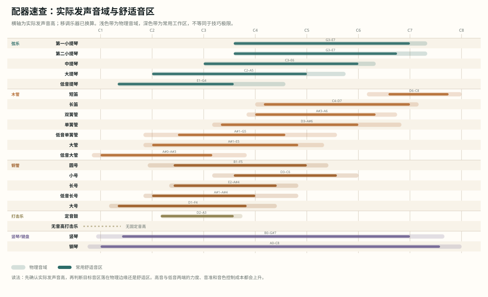
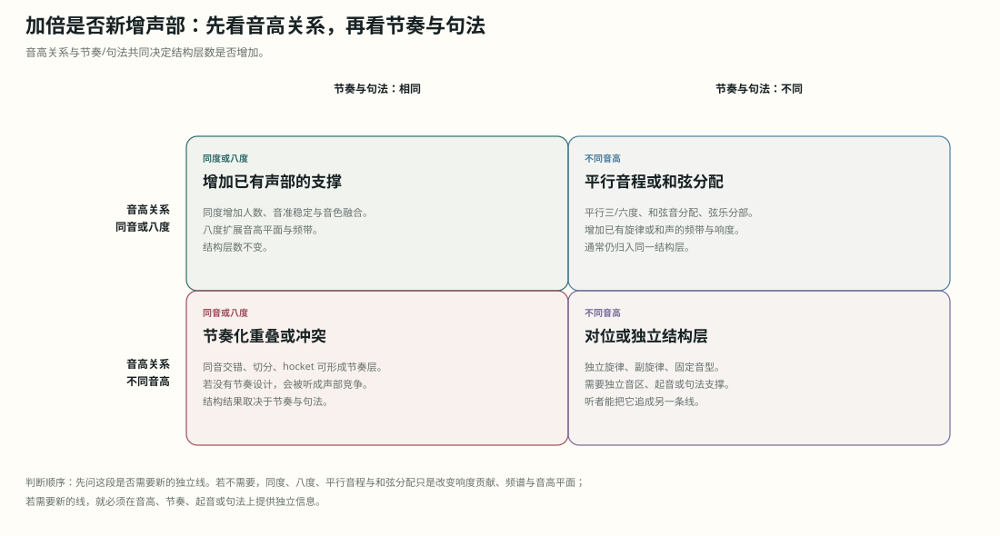
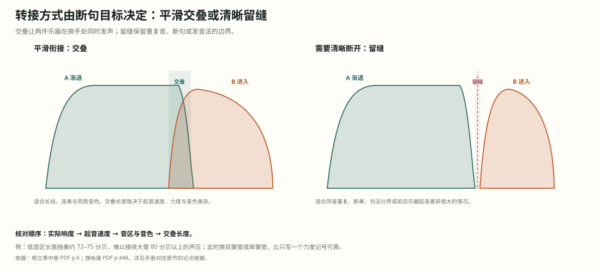

# 配器法理论体系与推演手册

> 本手册覆盖 7 册（4 部）配器法教材。网页推演台位于 `../app/index.html`。手册中的页码以 PDF 物理页为准，书内印刷页码另列；点击“教材页”可直接跳到该页扫描图、OCR 原文与对应论点锚点，本地服务运行时还可打开原 PDF 对应页。

这本手册不按教材章节复述。它只回答四个问题：一段音乐由哪些结构层组成；听者此刻应该先听见什么；哪些乐器与音区能实现这个权重；哪些选择会在声学上互相抵消。

## 0. 先读：三类结论

- **教材直接依据**：有明确页码和原文，例如同度全奏受音域限制、配器分析先拆结构、八度重复不增加新的结构因素。
- **体系性推论**：由声学条件与多条教材规则合成，例如“旋律与伴奏共享音区时，先移动八度，再考虑力度记号”。
- **程序启发式**：网页推演台的评分、三套方案和警告。它用于快速排除明显冲突，不代替试奏、总谱核对与听觉判断。

手册中的机制条目统一写成四段：原理、检查、用法、边界。比喻不承担论证；能写成频率、音区、时间、力度或演奏动作的地方，就直接写这些变量。

### 0.1 八条基本判断

这张表先给出判断顺序。后面的章节只是把这些原理展开到乐器、织体与总谱。

| 原理 | 物理/听觉依据 | 直接操作 |
| --- | --- | --- |
| 音区改变频谱 | 共振峰位置相对固定，基频与谐波随音高移动；力度改变各次谐波的强度 | 先确定实际发声音高，再选乐器；同一旋律换音区后重新判断音色与力度余量 |
| 掩蔽来自重叠 | 频带、时间包络与声源方向重叠时，较弱成分的听辨阈值上升 | 先移音区或八度，再错开节奏与起音，再换音色，最后压缩力度 |
| 同度与八度不新增结构层 | 同度基频相同；八度基频成 2:1，谐波高度重合 | 要新增对位线，就写不同的音高、节奏或句法；加倍不能冒充新声部 |
| 混合加倍补频谱缺口 | 各乐器谐波与共振峰叠加；互补频带补足对应频段的能量，重叠频带增加掩蔽 | 先判断主乐器缺低频、高频还是起音，再选能补该处的乐器 |
| 低音区密度有上限 | 低频波长大，相邻分音容易落入同一临界带，产生粗糙感 | 低音区拉开根音、五度与八度；中高音区再填三音、七音与附加音或变化音 |
| 全奏分配权重 | 听者同时分辨的独立层有限；多个频带与结构层同时填充才形成宽频响度与清晰的全奏 | 旋律、低音、和声、节奏、持续各设位置与力度；不必全员同奏 |
| 转接需要交叠 | 不同乐器的起音速度、音色与力度曲线不同 | 后一乐器先进入，前一乐器稍后退出；交叠处匹配力度与发音 |
| 历史改变可用手段 | 乐器构造、按键与阀键、编制和演奏技术变化；声学条件不变 | 先确认时代乐器与音区限制，再解释写法；不用现代能力反推历史作品 |

还有两点必须同时成立：同样的力度记号在不同乐器与音区并不产生同样的响度；配器的“平衡”指按结构主次形成的相对强弱比例，所有声部等响并不构成平衡。

## 1. 总纲：配器在分配听觉权重

配器处理四组关系：

| 关系 | 要决定的事 | 可测变量 |
| --- | --- | --- |
| 纵向 | 哪些音同时出现 | 音高、音程、和弦排列、声部间距 |
| 横向 | 哪些线在时间中独立 | 节奏、句法、起音、持续、换手 |
| 音色 | 谁与谁融合或分离 | 频谱、共振峰、瞬态、弱音器、演奏法 |
| 权重 | 听者先听见什么 | 音区、力度、事件密度、乐器数量、空间 |

操作顺序固定为：

`结构层 → 角色优先级 → 音区与力度 → 乐器候选 → 同度/八度/混合/分部 → 掩蔽与平衡校验 → 记谱与可演奏性`

这条顺序的意义在于：先改变结构层与音区，代价最低；先增加乐器数量，代价最高，且经常只增加响度。

### 1.1 术语校准

- **听觉权重**：本手册用它表示某结构层在当前织体中被优先辨认的程度，不表示物理功率。它由音区、力度、事件密度、起音、音色和空间位置共同决定。
- **重量**：教材原书有时用“音的重量”描述同度与八度的差别。本手册的操作说明改用“响度贡献、人数支撑与频带占用”，便于和可听结果对应。
- **响度贡献**：某声部在整体听感中增加的相对响度，受音区、频谱、人数、演奏力度和厅堂影响，不能按单一声部的功率直接相加。
- **频带占用**：某声部在哪些频率范围产生显著能量。两层的频带占用重叠越多，掩蔽与音准冲突的风险越高。
- **层次清晰**：指各结构层能够同时被辨认，不指乐器数量少或配器简单。

## 2. 历史阶段：古典、浪漫、现代

历史阶段改变的是乐器构造、常规编制、演奏技术与审美目标；声学条件不变。分析历史作品时，先确认当时可用的乐器，再判断配器选择。

| 阶段 | 新增手段 | 配器后果 | 未改变 |
| --- | --- | --- | --- |
| 古典时期，约 1700–1820 | 弦乐四声部、自然铜管、成对木管 | 低音与和声框架先成立；木管多作同度、八度补强或局部对比；铜管受调性与音高限制 | 频谱、掩蔽、瞬态、响度与音区规律 |
| 浪漫时期，约 1820–1945 | 阀键铜管、辅助木管、竖琴、大型打击乐 | 铜管可奏完整半音并承担旋律；力度范围与音色混合扩大；前景、中景、背景成为整体分配问题 | 同上 |
| 现代时期，约 1900 至今 | 扩展技法、弱音器、噪声、极端音区、空间布置 | 音色、噪声、瞬态与空间可以直接构成结构；传统功能仍可用，但不再唯一 | 同上 |

浪漫时期与现代时期在 1900 年前后重叠。这里的“浪漫时期”按大型晚期浪漫编制和新手段进入常规乐队的时间划分，不把“浪漫”当作单一风格标签。分析时按作品实际使用的乐器与手法判断，不能只按年份机械划分。

网页理论地图按同一分段设置“阶段重点”。选择阶段后，通用声学节点仍保留，只压暗该阶段次要的节点与连线；这样既能看历史差异，也不会把频谱、掩蔽、瞬态等跨时代原理误当成只在某一时期成立。

### 2.1 古典时期：约 1700–1820

弦乐四声部提供稳定框架。木管常以同度、八度或局部对比加入；自然铜管受调性与音高限制，通常承担号角式材料、持续音与结构点。低音与和声框架先成立，音色装饰随后加入。

[[cite:adler.string-core]]

[[cite:adler.history-classical]]

判断要点：

- 先找弦乐四声部与低音进行，再看木管是重复、替换还是独立线条。
- 铜管的音高限制会直接影响旋律音与和声完整度；省略经常来自乐器条件。
- 层次清晰取决于角色分工与同音区竞争较少；乐器数量少本身不能保证。

### 2.2 浪漫时期：约 1820–1945

阀键铜管扩大半音能力，辅助木管扩展高低端，竖琴与大型打击乐进入常规编制。力度范围、乐队规模和音色混合同时扩张，前景、中景、背景的分配成为整体配器问题。

[[cite:adler.history-expanded]]

[[cite:adler.foreground-background]]

判断要点：

- 铜管可以承担旋律、和声与低音，但强奏时占据宽频带，平衡不能按人数估算。
- 加倍从局部补强扩展到整组混合；需要区分同度支撑、八度扩展与独立声部。
- 大型全奏依靠频带和结构层分配，单纯叠加所有乐器会降低清晰度。

### 2.3 现代时期：约 1900 至今

音色、噪声、瞬态、极端音区和空间位置可以直接构成结构。传统角色分工仍可用，但不再是唯一语法。打击乐与扩展技法可以承担时间组织、音色分层与结构分界。

[[cite:yang.spectrum-basis]]

[[cite:adler.contemporary-repertoire]]

判断要点：

- 先判断作品把什么当作结构参数：音高、音色、节奏、噪声、空间或过程。
- 极端音区与不稳定音色可以是有意选择；仍要核对力度、可演奏性和掩蔽。
- 现代配器也需要层级；层级可以由频谱、空间或时间形成。

## 3. 声学底层：四个变量

### 3.1 频谱：音色是谐波与共振峰的分布

一个音由基频和一系列谐波组成。乐器的管体、共鸣箱、膜面和演奏法会强调某些频带，形成共振峰。同一音高换到另一音区，谐波与共振峰的关系改变，音色和穿透力也随之改变。

[[cite:yang.spectrum-basis]]

操作时先问三件事：

1. 实际发声音高是什么？
2. 该音是否位于乐器的舒适音区？
3. 目标力度下，这件乐器的频谱会填补还是抢占已有频带？

### 3.2 瞬态：起音决定合奏是否形成单个事件

弓压、气流、舌奏、槌击和唇振的起始速度不同。多个乐器同奏时，起音越接近，融合越强；起音错开，即使音高相同也会被听成两个事件。

[[cite:adler.inner-hearing]]

需要融合时，统一连断、发音法和进入点。需要分层时，可以让不同组别在起音、句法或音区上分开。

### 3.3 响度：加倍数量只解释一部分

感知响度受音区、频谱、持续时间、演奏力度、厅堂和听者位置影响。理想自由场中，两个同功率声源不相干叠加约增加 3 分贝，相干叠加约增加 6 分贝；听感响度接近翻倍通常需要约 10 分贝。乐器数量增加时，响度不会线性加倍；同频带叠加还会产生掩蔽与音准冲突。

[[cite:yang.balance-definition]]

因此，平衡旋律与伴奏时先调整音区、音色和事件密度；力度记号只处理剩余差额。

### 3.4 掩蔽：重叠越强，弱者越难被听见

掩蔽取决于频带重叠、时间包络、声源方向与注意力。音区相同、节奏相同、起音相近，是风险最高的组合。解决顺序为：

1. 移动音区或八度。
2. 错开节奏、起音或句法。
3. 更换音色或组别。
4. 最后才压缩伴奏力度。

[[cite:yang.balance-definition]]

## 4. 乐器能力：查询表不能代替上下文

乐器表至少需要六列：物理音域、舒适音区、可控力度、敏捷度、持续能力、融合/穿透倾向。每项都随音区与演奏法变化。

下图先给出实际发声音高与常用工作区的总览。力度上限、融合与穿透在表中表示相对评级；边缘音区的控制成本仍需按具体演奏者和力度核对。

**图 1｜实际发声音域与舒适音区。** 移调乐器已换算；浅色带为物理音域，深色带为常用工作区，不等同于技巧极限。

<!-- AUTO:INSTRUMENTS -->

使用规则：

- 旋律、持续音和重要对位线优先放在舒适音区。
- 极端音区只用于有明确目标的局部效果，并复核力度与音准。
- 管乐写换气，弦乐写换弓与换把，铜管高音区计算唇力消耗。
- 移调乐器先换算实际发声音高，再判断音区与间距。

[[cite:adler.instrument-basics]]

## 5. 分析协议：把总谱拆回结构

辟斯顿的分析顺序可以直接转成日常工作流：

1. 先忽略乐器音色，确定旋律、低音、和声背景、对位线、踏板与节奏层；辟斯顿把这一步称为“撤开配器”。
2. 看每组乐器怎样分配到这些结构因素。
3. 比较各因素的平衡、对比与分配结果。
4. 深入每个因素，检查音色选择、声部重复、位置疏密与重音加强。
5. 回到整乐章，检查全奏比例、结构统一与变化。

[[cite:piston.analysis-protocol]]

配器推演台采用同样的顺序，但把第四步拆成可计算项：音区覆盖、角色适配、掩蔽风险、敏捷度与持续能力。

### 5.1 结构层的最低清单

| 层 | 识别问题 | 常见写法 |
| --- | --- | --- |
| 旋律 | 哪条线决定当前句法？ | 单件、同度、八度、混合音色 |
| 低音 | 哪个音确定根音与低音走向？ | 大提琴、低音提琴、大管、大号 |
| 和声 | 哪些音补全和弦性质？ | 木管、弦乐、圆号、长号 |
| 对位 | 哪条线与旋律同时独立？ | 副旋律、模仿、固定音型 |
| 踏板 | 哪个音持续固定中心或框架？ | 持续低音、中音持续、滚奏 |
| 节奏 | 哪个层组织时间与重音？ | 打击乐、固定音型、拨弦 |

结构层会随时间变化。分析时按短小乐段标注，避免把整首作品压成一个标签。

## 6. 角色优先级：先决定听什么

同一时刻可以有一个主要前景、一个到两个中景和一个背景。前景需要最清楚的音区、瞬态或力度；中景提供对位、节奏或和声支撑；背景降低攻击频率与音色突出度。

[[cite:adler.foreground-background]]

三种层级的实现方式：

| 层级 | 音区 | 节奏/起音 | 力度 | 常见乐器 |
| --- | --- | --- | --- | --- |
| 前景 | 舒适且突出 | 清晰、独立 | 有余量 | 木管、弦乐、铜管独奏 |
| 中景 | 与前景分离 | 可独立辨认 | 中等 | 圆号、中提琴、大管、单簧管 |
| 背景 | 填充或低频 | 事件少、持续 | 低而稳定 | 弦乐、持续木管、竖琴、弱奏铜管 |

层级差异必须落到音区、起音时间、力度或事件密度上。只在分析表上写“前景”，不会改变听觉结果。

## 7. 组合语法：同度、八度、混合、分部

判断“加倍”是否新增结构层，先看音高关系，再看节奏与句法。下图把四种常见情况放在同一张表里；后文分别说明写法与边界。

**图 2｜加倍方式与结构层关系。** 同度、八度和平行音程通常只增加已有声部的频带与响度；只有音高、节奏、起音或句法提供独立信息时，才形成新的对位或结构层。

### 7.1 同度加倍

同度加倍让两个乐器奏同一实际音高。基频相同，差异在谐波、瞬态与音准。它巩固一个已有声部，增加同频带的响度贡献、音准稳定与融合，不增加新的旋律声部。

[[cite:adler.tutti-unison-octave]]

[[cite:piston.octave-not-new-factor]]

### 7.2 八度加倍

八度关系的基频成 2:1，谐波高度重合。八度加倍扩展音高平面与频带，不增加新的结构因素，但会改变声部间距和独立性。

[[cite:adler.tutti-unison-octave]]

[[cite:piston.divisi-analysis]]

这里有一个容易读错的细节。辟斯顿比较单个声部时指出：八度重复不增加该声部的响度贡献，同度重复会增加；原书把这一差别称为“音的重量”，指该声部在听感中的响度贡献与人数支撑。阿德勒讨论八度全奏时，响度与频带宽度来自多个八度、更多组别、铜管与定音鼓同时加入。两条结论并不矛盾，因为测量对象分别是“一个声部”和“整个乐队”。

操作上先分清目标：要增加一条旋律的响度贡献，优先增加同度人数或选择频谱互补的乐器；要让全奏跨过更大音域并增加总响度，才使用多八度分配。只给一个声部补一个八度，不能据此期待该声部响度翻倍。

低音八度用于扩展低频与稳定性，高音八度用于增加高频能量与穿透。每个声部都写八度会让所有层同时增加频带占用与响度，层次反而消失。

### 7.3 平行三度、六度

整条旋律用平行三度或六度重复时，附加声部与旋律保持固定音程，属于同一旋律声部的重复。听者不会自动把它当作独立对位线。

[[cite:piston.octave-not-new-factor]]

### 7.4 混合加倍

混合加倍的结果由谐波、共振峰和起音叠加决定。主乐器缺少某段频谱时，可以选择能在该处补充、且不会抢占主频段的乐器。高穿透乐器互相叠加，得到的是更响与更多掩蔽。

[[cite:yang.balance-definition]]

### 7.5 分部与多弦

弦乐分部增加和弦音或独立声部，同时减少每一分部的人数、响度贡献与统一度。弱奏可以细分；强奏需要保留核心人数。

[[cite:piston.divisi-analysis]]

### 7.6 和弦排列

低音区需要更宽的音程，高音区可以更密。先安排根音、三音、七音与低音，再补附加音或变化音。重复哪个音取决于和声功能、旋律位置与音区。

[[cite:piston.chord-arrangement]]

## 8. 平衡与织体：把层级差异落实到可测变量

### 8.1 平衡的四变量

平衡判断按四个变量排序：**音区 → 频谱 → 力度 → 时间**。四者共同决定可听度，不能相互抵消；实际操作通常同时改变两到三种变量。

移动音区通常代价最低，错开时间次之；换音色需要重新分配乐器资源，压缩力度会损失动态范围。

[[cite:yang.balance-definition]]

平衡的目标是让各要素按结构主次形成强弱比例，并不要求所有声部等响。杨立青明确指出，大部分管弦乐织体中不存在绝对的音量平衡；某些作品还会有意利用不均衡。

[[cite:yang.balance-relative]]

一个具体的量级例子：同为 ff，低音区第一小提琴声部约为 83.5 分贝，低音区长笛独奏约为 72 分贝；长笛改为 a2 也只有约 75 分贝。把两条线移高后，响度可接近到约 82 与 79.5 分贝。差距主要来自乐器与音区；力度记号相同也会产生不同响度。先移音区通常比继续加 ff 有效。

[[cite:yang.balance-register-example]]

### 8.2 密度的定义

密度由同时发声的独立层数、音区占用和事件速率共同决定。同度加倍增加同频带的响度贡献与人数支撑，不增加可辨独立层数；增加独立节奏和独立音区才会显著增加听感复杂度。

### 8.3 特殊音色

泛音异常丰富或音色特殊的乐器，在弱奏时也可能从和声层中突出。它们适合旋律、独立音色层与结构强调，不适合无差别铺满内声部。

[[cite:yang.special-timbre]]

## 9. 时间过程：转接、呼应、全奏

### 9.1 乐器转接

转接时让后一乐器先进入，前一乐器稍后退出。交叠使换手处两件乐器同时发声：前一乐器仍在发声，后一乐器已经建立声音；交叠过长会让两个音色同时被听见。

[[cite:shi.instrument-transfer]]

转接还要核对实际响度。低音区长笛约 72–75 分贝，难以接续大管 80 分贝以上的声压；这里换双簧管或单簧管，比给长笛补一个力度记号更可靠。

[[cite:yang.balance-transfer-example]]

**图 3｜交叠与留缝。** 平滑衔接通常让后件提前进入；需要保留断句、重复音或重新起音时留出间隙。交叠长度取决于实际响度、起音速度、音区与音色差异。

### 9.2 呼应、对答与回声

用音色、音区和空间位置划分句法。呼与应放在不同组别；回声减少乐器数量、改变音区或降低力度。换音色过密会让句法失去统一轮廓。

[[cite:shi.call-response]]

### 9.3 全奏

全奏把旋律、低音、和声、节奏与持续层同时填满，并让各组在有效音区承担不同权重。真正的同度全奏受音域限制，数量很少；八度全奏通过扩展音区增加频带覆盖与响度。

[[cite:adler.tutti-unison-octave]]

[[cite:shi.tutti]]

频繁全奏会降低结构对比并造成听觉疲劳。全奏的对比强度依赖它与较稀疏织体之间的差别；如果前面已经一直满员，后面再加乐器只能增加响度，不能形成新的高点。

[[cite:adler.tutti-restraint]]

常见错误是所有乐器奏同一音型。高音区会拥挤，低音区可能空洞，铜管会压过木管与弦乐。部分全奏经常比全体全奏更清楚。

### 9.4 高潮

高潮依靠多个参数同时变化：频带宽度、音区跨度、力度、事件密度与和声张力。所有参数同时达到上限后，后续变化缺少参照。

### 9.5 问题定位：症状、首选动作与代价

排练和改谱时，先按症状定位，不要从“再加一层”开始。下表的顺序按修改代价从低到高排列。

| 症状 | 先检查 | 首选修正 | 再考虑 | 不要先做 |
| --- | --- | --- | --- | --- |
| 旋律被伴奏盖住 | 实际音区、节奏和起音是否重叠 | 移动八度或错开节奏、起音 | 换音色、减薄伴奏 | 先加旋律力度或增加同度人数 |
| 低音糊成一片 | 最低音与上方音程、低音区同时发声数 | 拉开根音、五度与八度，删去低音区的密集三音 | 重新分配大提琴、低音提琴、大管与大号 | 用更多低音乐器补响度 |
| 全奏不宽或不响 | 是否所有人奏同一音型；各组是否承担不同结构层 | 把旋律、低音、和声、节奏、持续分到不同音区与材料 | 增加八度或混合音色 | 所有人齐奏同一节奏 |
| 转接处断裂 | 前后实际响度、起音速度与音区 | 后件提前进入，前件稍晚退出，并匹配力度与发音 | 换同族或音色接近的乐器 | 只在谱面写相同力度 |
| 某件木管从和声层突出 | 该乐器是否音色特殊、泛音丰富或位于高共振区 | 移到内声部或换更融合的乐器 | 降低局部力度或加弱音器 | 把它当普通和声继续叠加 |
| 打击乐遮住乐队 | 具体鼓种、击法、余音与频带 | 换乐器或击法，缩短余音与重音密度 | 调整位置或减少同时事件 | 只把力度写轻 |
| 铜管压过木管与弦乐 | 铜管音区、发音点、持续强奏长度与人数 | 移开八度、错开起音、缩短强奏 | 改用较轻的铜管配置 | 只让木管和弦乐吹得更响 |
| 高潮之后无法继续 | 前面是否长期保持最大密度与力度 | 预留未使用的频带、音区、乐器组或节奏密度 | 改变音色或和声张力 | 继续增加乐器 |

## 10. 操作流程：从材料到总谱

1. **拆层**：标出旋律、低音、和声、对位、踏板、节奏。
2. **排优先级**：每段只设一个主要前景，其余层降为中景或背景。
3. **定音区**：先写实际发声音高，避免所有层占同一八度。
4. **选乐器**：按舒适音区、力度、持续、敏捷与融合度筛选。
5. **定组合**：决定单件、同度、八度、混合、分部或和弦分配。
6. **查掩蔽**：按音区、时间、音色、力度的顺序处理冲突。
7. **查过程**：转接是否交叠，呼应是否成句，高潮是否有准备与释放。
8. **查可演奏性**：换气、换弓、换把、耐力、移调、分谱与记谱。

[[cite:adler.inner-hearing]]

## 11. 网页推演台怎样工作

推演台把每层写成七项输入：角色、音高范围、力度、事件密度、持续时间、优先级和分配方式。分配方式有两种：

- **自动推荐**：引擎从当前编制中筛选乐器，并可自动增加同度或八度声部。
- **手选组合**：用户一次指定多件乐器，并为每件乐器选择低八度、同度或高八度。手选层不再自动补声部，且在三套方案中保持不变；三套方案的差异只来自其余自动层。

引擎按以下步骤输出三套方案：

1. 按优先级排序结构层。
2. 对每件乐器计算音区覆盖、角色适配、力度上限、敏捷度与持续能力。
3. 对已分配层计算音区重叠、组别相似度与掩蔽惩罚，并保留同一层排名靠前的落选候选。
4. 生成“清晰优先”“标准平衡”“扩展全奏”三套权重。
5. 报告音区边缘、敏捷度不足、持续能力不足、铜管权重与旋律层重复过多；手选层另检查乐器是否属于当前编制、实际发声音域是否超出乐器音域，以及角色适配是否偏低。

三套方案分别用于：

- **清晰优先**：检查结构和声部能否被分辨。
- **标准平衡**：作为常规配器起点。
- **扩展全奏**：检查增加八度与混合音色后是否仍有层级。

程序输出是可编辑的配器计划；它不作曲。任何方案都要回到总谱、试奏和厅堂中核对。

手选乐器不在当前编制或超出实际音域时，程序保留用户的选择并给出警告，不自动替换为“更合适”的乐器。这样可以把人员、音域与音色代价明确留在方案里，算法不会暗中替换。

界面中的分数只表示同一结构层内候选乐器的相对适配度，不能跨层相加。展开“评分与备选”可以看到舒适音区、角色适配、力度余量、敏捷度、持续力、掩蔽惩罚，以及同一层的第二、第三候选；这样能看出某项选择是明显占优，还是只在当前规则下略高。

## 12. 机制条目：24 条可检验判断

以下条目由网页同一份数据生成。每条给出原理、检查、用法、边界与教材页码，并标出该条属于“教材直接陈述”还是“教材定义与声学推论”。网页版同时显示对应段落的局部影印。

<!-- AUTO:MECHANISMS -->

## 13. 教材分工与页码规则

<!-- AUTO:BOOKS -->

### 13.1 页码换算

- 阿德勒上册：PDF 页 = 印刷页 + 12。
- 阿德勒下册：PDF 页 = 印刷页 − 535。
- 辟斯顿：扫描页序有跳变，PDF 与印刷页的差值不固定；手册链接一律使用实测 PDF 页。
- 施咏康：PDF 页 = 印刷页 + 4。
- 杨立青上册：PDF 页 = 印刷页 + 24。
- 杨立青中册：PDF 页 = 印刷页 − 466。
- 杨立青下册：PDF 页 = 印刷页 − 1022。
- 其余教材若扫描页序有跳变，也以逐页实测为准，不用单一偏移推算。

### 13.2 怎样使用引文

引文用于核验论点，不替代原书谱例。涉及临时记号、配器细节和谱例编号时，点击教材页查看扫描图。OCR 文本只用于检索与复制。

手册中的教材链接都落到具体论点的页内锚点。资料共 7 册，来自 4 部著作：阿德勒上下册、辟斯顿一册、施咏康一册、杨立青上中下册。统计书目时以“部”为单位，统计扫描件时以“册”为单位，不能混写成 7 本。

## 14. 学习顺序：四轮练习

### 第一轮：单层

- 同一旋律分配给六件不同乐器，记录舒适音区、力度上限与起音差异。
- 同一和弦在低、中、高音区各排一次，检查低音区间距。

### 第二轮：两层

- 旋律加伴奏：先只改音区，再改节奏，最后改音色。
- 旋律加对位：保持两条线独立，禁止用同一音区与同一节奏。

### 第三轮：组合

- 同度、八度、平行三/六度、混合加倍各写四小节。
- 每次只改变一个变量，记录听感变化。

### 第四轮：过程

- 写一次乐器转接、一次呼应、一次部分全奏、一次全体全奏。
- 在高潮前后各留一个对照段，检查频带、力度、音区或事件密度是否形成前后差异。

## 15. 结论

配器的核心判断可以压成一句话：**让每个结构层在正确的音区、以正确的力度和发音方式，获得正确的听觉权重。**

乐器选择服务于这条判断。加倍、混合、全奏与历史风格都只是改变权重和频谱的手段。能够用音区、时间、频谱与力度解释的选择，才算真正掌握。

[返回配器推演台](../app/index.html)
